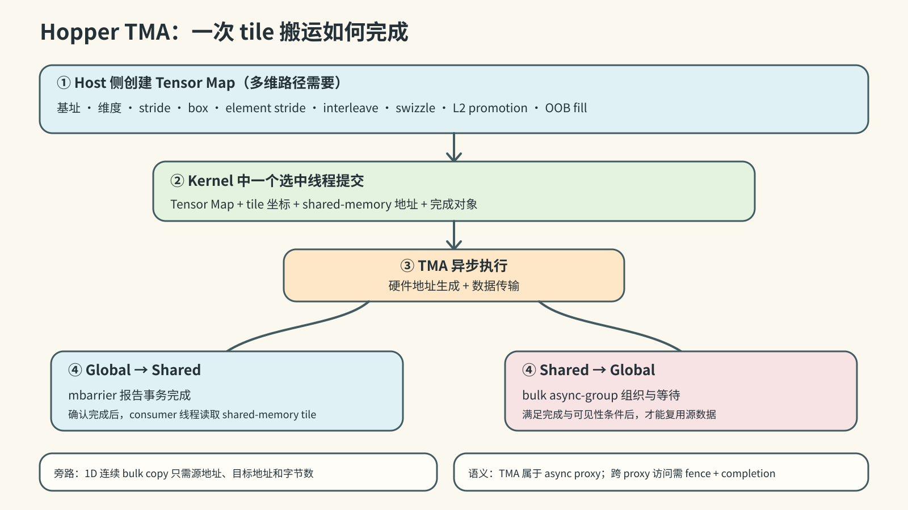
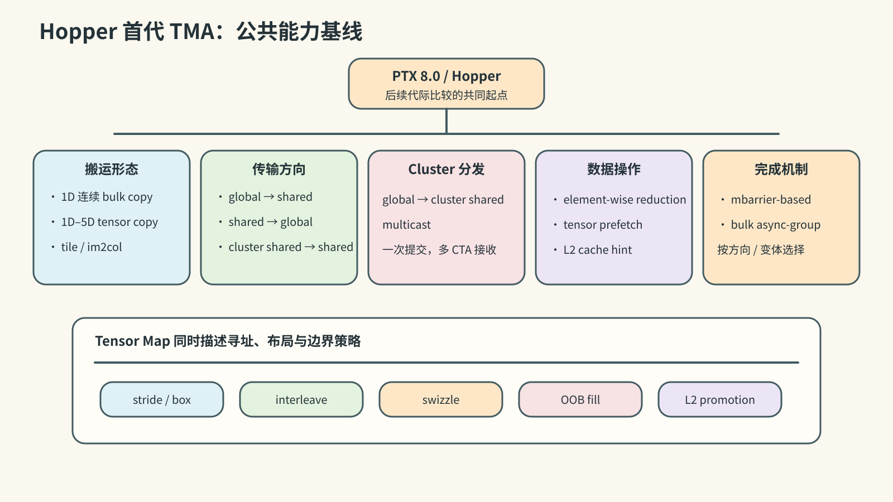
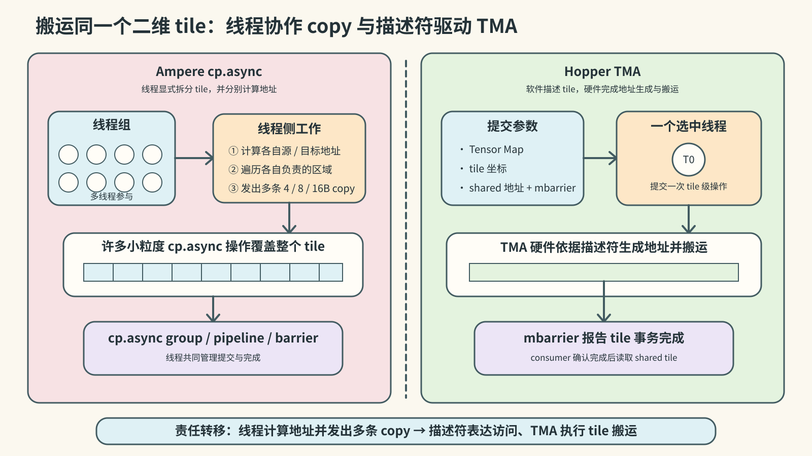
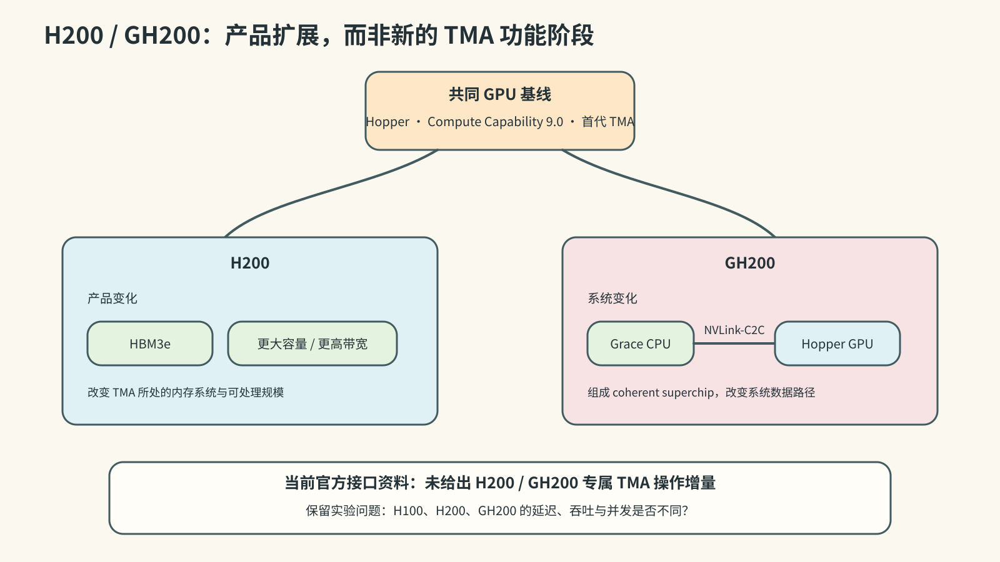
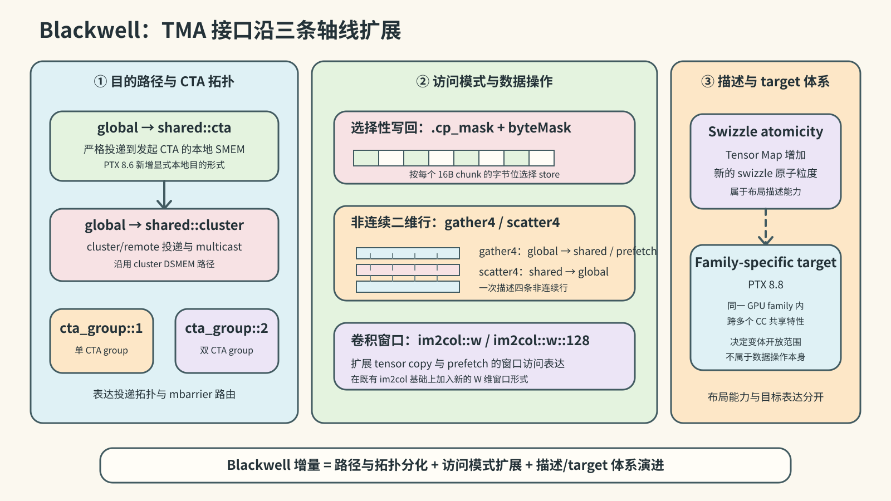
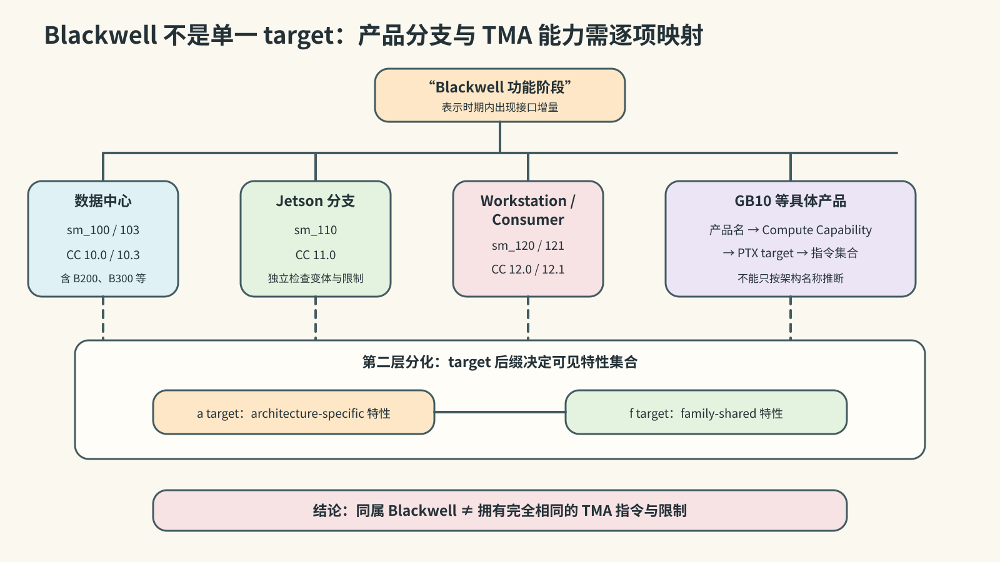
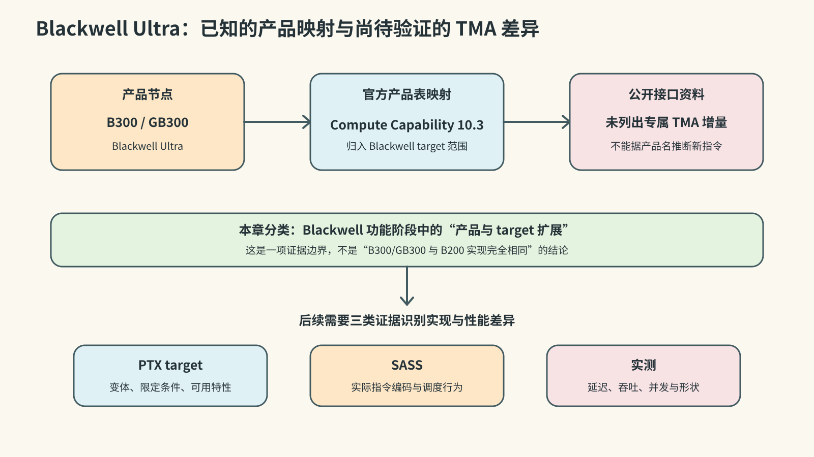
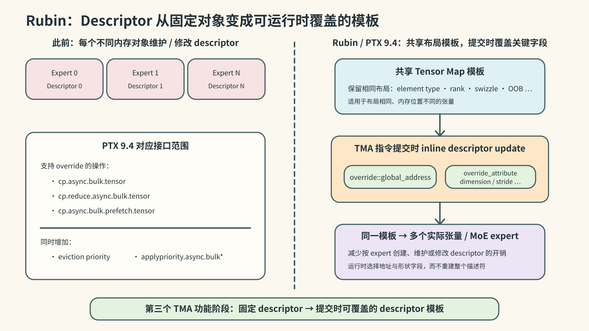

# 第一章：NVIDIA 产品迭代与 TMA 概述

> 调研截止：2026-10-12  
> 本文是 [NVIDIA TMA 调研系列](index.md) 第一章；引用编号见[参考资料索引](references.md)。下一篇：[Hopper 第一代 TMA 的 PTX 设计](02-hopper-ptx.md)。

## 1.1 研究对象与分析口径

### 1.1.1 TMA 的工作定义

本文所称 **TMA（Tensor Memory Accelerator）**，是 NVIDIA 从 Hopper/Compute Capability 9.0 开始提供的一组面向 shared memory 的大粒度异步数据搬运能力及其编程接口。当前 CUDA Programming Guide 将 TMA 作为总称，并把具体操作分成两类 [S001]：

- **bulk-asynchronous copy**：以指针和字节数描述一维连续区域；
- **bulk-tensor asynchronous copy**：以 tensor map 和张量坐标描述一至五维区域。

这两类操作通常由一个被选中的线程发起，由异步路径执行，并以显式完成机制通知使用者。多维操作进一步把全局张量的维度、stride、box、元素步长、interleave、swizzle、越界填充和 L2 promotion 等属性编码在 tensor map 中 [S001][S002][S005]。

官方资料会从不同层次描述 TMA。Hopper 架构文章称其为新的 async memory copy unit；CUDA Programming Guide 用 TMA 统称相关功能；CuTe 文档则从软件使用角度称其为一组指令 [S001][S002][S009]。本文据此采用以下术语层次：

| 术语 | 本文中的含义 |
|---|---|
| TMA | 整体硬件加速机制及其对外能力 |
| bulk asynchronous copy | 不使用 tensor map 的一维连续大粒度异步拷贝 |
| bulk-tensor asynchronous copy | 使用 tensor map 的一至五维张量异步拷贝 |
| tensor map / TMA descriptor | 描述全局张量及其 TMA 访问属性的不透明对象 |
| TMA unit / engine | 官方架构资料所称的异步拷贝硬件单元；内部结构留到第四章分析 |

### 1.1.2 官方名称

NVIDIA 文档先后使用过两种全称：

- Hopper 架构文章在 2022 年使用 **Tensor Memory Accelerator** [S002]；
- CUDA 12.0 Driver API 和 CUDA 12.5 Programming Guide 使用 **Tensor Memory Access** [S005][S008]；
- 当前 CUDA Programming Guide 使用 **Tensor Memory Accelerator** [S001]。

两种全称在相关文档中都指向 TMA 编程模型。本文统一使用当前名称 Tensor Memory Accelerator；引用历史资料时保留原文名称。

### 1.1.3 研究范围

本调研覆盖以下对象：

1. 一维 bulk copy 与一至五维 bulk-tensor copy；
2. global memory、CTA shared memory 和 cluster distributed shared memory 之间的受支持路径；
3. tensor map 的寻址、布局、越界处理和缓存属性；
4. multicast、reduction、prefetch、mask、gather/scatter 和 descriptor override 等扩展；
5. TMA 操作的发起方式、async proxy 语义以及 mbarrier、bulk async-group 等完成机制；
6. 各产品、Compute Capability、PTX target、SASS 实现和硬件行为之间的对应关系。

`mbarrier`、thread block cluster、distributed shared memory 和 async proxy 是 TMA 编程模型的配套机制，同时也具有独立用途。CUDA pipeline、`cuda::barrier`、`cuda::memcpy_async` 和 CUTLASS/CuTe TMA wrapper 属于高层接口或软件封装。后续章节会分析它们与 TMA 的接口，但分别保留其自身的概念边界 [S001][S002][S006][S009]。

作为比较基线，本文还研究 Ampere `cp.async`。它提供小粒度 global-to-shared 异步拷贝，是 Hopper TMA 的直接技术前身 [S002][S003][S006][S007]。通用 host-device copy engine、Tensor Core 以及 Blackwell Tensor Memory（TMEM）分别承担系统级搬运、矩阵计算和片上张量存储功能；本文只在它们与 TMA 数据路径发生直接联系时讨论这些对象。

### 1.1.4 代际判定方法

本文分别记录四条时间轴：GPU 产品、Compute Capability、PTX 接口和 TMA 硬件实现。代际判断使用三种层级：

| 层级 | 判定条件 |
|---|---|
| 产品扩展 | 新产品沿用既有 Compute Capability 或既有 TMA 接口，主要变化发生在容量、带宽或系统形态 |
| 功能阶段 | PTX 或官方架构资料给出新的 TMA 对外能力，且适用 target 可以确定 |
| 硬件实现代际 | SASS、微架构资料或性能实验显示执行单元、数据路径、队列或吞吐机制发生实质变化 |

第一章可以确定产品扩展和功能阶段。硬件实现代际需要第三章的 SASS 证据与第四章的硬件、专利和性能证据共同确认。

## 1.2 TMA 的技术前身与引入动机

### 1.2.1 传统 global-to-shared 搬运

GPU kernel 常把 global memory 中的数据 tile 搬入 shared memory，再由线程块内的计算线程重复使用。传统路径由线程完成以下工作：

1. 计算每个元素的 global address；
2. 从 global memory 读取到寄存器；
3. 从寄存器写入 shared memory；
4. 同步后消费 shared-memory tile。

较大的多维 tile 因而需要大量线程级 load/store、地址计算、边界判断和循环控制。寄存器既保存计算状态，也承担数据中转。

### 1.2.2 Ampere `cp.async`

Ampere/CC 8.0 引入硬件加速的 global-to-shared asynchronous copy。`cp.async` 可以绕过中间寄存器，并通过 pipeline 或 barrier 将搬运与计算重叠 [S006][S007]。单条 `cp.async` 处理 4、8 或 16 字节；完成一个 tile 时，线程共同计算地址并发出多条指令。

Ampere 因此建立了异步、寄存器旁路的 global-to-shared 路径。tile 级的多维地址生成、stride、边界和区域遍历仍由线程指令完成 [S002]。

### 1.2.3 Hopper TMA 的设计增量

Hopper TMA 把搬运区域的描述和地址生成从逐元素线程指令提升到 tile 级操作 [S002][S003]：

- 一个被选中的线程可以发起整个大块或张量 tile 的搬运；
- tensor map 保存全局张量布局和搬运属性；
- 硬件根据 tensor map 与 tile 坐标生成地址，并处理受支持的边界和布局转换；
- 数据直接在 global memory 与 shared memory 相关空间之间传输；
- 发起线程可继续执行其他工作，消费者通过完成机制等待数据；
- cluster multicast 可把一次全局数据获取分发到多个 CTA 的 shared memory。

相较 Ampere，TMA 的主要变化是操作粒度、地址生成位置、数据路径范围和布局表达能力，而异步执行与寄存器旁路是两代机制共有的基础。

## 1.3 产品、架构与软件时间线

### 1.3.1 四个不同的“引入”节点

一项架构能力通常依次经历产品公布、硬件供货、工具链支持和公共编程接口发布。TMA 的首代引入也分布在多个节点：

| 时间 | 节点 | 对 TMA 的意义 | 依据 |
|---|---|---|---|
| 2020 | Ampere A100，CC 8.0 | `cp.async` 与 split arrive/wait barrier 构成直接技术前身 | [S006][S007] |
| 2022-03-22 | Hopper/H100 发布 | NVIDIA 首次公开 TMA unit、descriptor 地址生成和 1D–5D 搬运 | [S002][S014] |
| 2022-09-20 | H100 宣布 full production | Hopper TMA 进入量产产品阶段 | [S014] |
| 2022-10 | CUDA 11.8、PTX 7.8 | 工具链支持 Hopper/`sm_90`；PTX 已建立 cluster 等基础设施 | [S013] |
| 2022-12 | CUDA 12.0、PTX 8.0 | public PTX 发布 bulk/TMA 操作族，Driver API 提供 tensor map 管理 | [S004][S005][S012][S024] |
| 2023-11 | H200 发布 | Hopper 产品扩展到 HBM3e、更高容量和带宽 | [S011][S015] |
| 2024-03 | B200/GB200 发布 | Blackwell 数据中心产品节点，官方产品表映射为 CC 10.0 | [S011][S016] |
| 2024-05，CUDA 12.5 | Programming Guide 新增系统化的 TMA 章节 | 高层 CUDA C++ 文档集中说明 TMA 用法 | [S008] |
| PTX 8.6–8.8 | Blackwell 相关 target 与 TMA 扩展 | 增加 CTA-local destination、copy mask、gather/scatter 和 family-specific target 等能力 | [S018] |
| 2025-03 | B300/GB300 发布 | Blackwell Ultra 产品节点，官方产品表映射为 CC 10.3 | [S011][S017] |
| 2026-01 至 03 | Rubin 发布并宣布 full production | 官方公开 enhanced TMA 与 inline descriptor update | [S020][S021] |
| PTX 9.4 | descriptor override 等新表达 | 公开 global address 与 descriptor attribute override，以及新的缓存优先级控制 | [S022] |

Hopper 的架构介绍早于公共 PTX 指令族约九个月。本文把 2022 年 3 月作为 TMA 的架构公开节点，把 CUDA 12.0/PTX 8.0 作为首个成体系、可系统分析的公共底层编程接口节点 [S002][S004][S012][S014]。

### 1.3.2 产品与 Compute Capability

NVIDIA 当前产品表给出的映射如下 [S011]：

| 产品 | Compute Capability | 本章分类 |
|---|---:|---|
| A100、A30 | 8.0 | `cp.async` 前代基线 |
| H100、H200、GH200 GPU | 9.0 | Hopper 首代 TMA 产品族 |
| B200、GB200 | 10.0 | Blackwell 数据中心功能扩展节点 |
| B300、GB300 | 10.3 | Blackwell Ultra 产品与 target 扩展节点 |
| Jetson T4000、T5000 | 11.0 | 独立产品分支，按 `sm_110` 目标核对能力 |
| RTX PRO Blackwell、GeForce RTX 50 系列 | 12.0 | Blackwell workstation/consumer 分支 |
| GB10 / DGX Spark | 12.1 | `sm_120` family 的后续产品分支 |
| Rubin GPU | 产品表尚未给出 CC 映射 | 官方已确认 enhanced TMA |

当前 CUDA Programming Guide 把 TMA unit 列为 CC 9.0 及后续架构支持的功能，同时把 CC 10.0、10.3、10.7、11.0 和 12.x 分开列出 [S023]。产品名称只能确定研究入口；每项 TMA 能力仍需依据具体 PTX target 判定。

### 1.3.3 baseline、architecture-specific 与 family-specific target

从 CC 9.0 开始，CUDA 区分基础特性与 architecture-specific 特性；从 CC 10.0 开始，又增加 family-specific 特性 [S023]：

- `sm_90` 表示 Hopper 基础目标，`sm_90a` 开放 Hopper architecture-specific 特性；
- `sm_100a`、`sm_103a` 等 `a` target 只兼容对应 Compute Capability；
- `sm_100f`、`sm_103f`、`sm_120f` 等 `f` target 表示同一 family 共享的特性集合；
- 同一产品品牌下的不同 Compute Capability 可以具有不同的 tensor mode、数据类型、swizzle 或其他限制。

以 multicast 为例，CUDA Programming Guide 建议在 `sm_90a` 上使用其优化路径；PTX 的其他 TMA 扩展也分别规定最低 target 或 `a/f` target [S001][S018]。第二章将按指令变体记录这些限制。

## 1.4 Hopper：首代 TMA 的能力基线

### 1.4.1 基本执行模型

多维 TMA 操作的基本流程为：

1. 软件通过 CUDA API 创建 tensor map，编码 global tensor 的基址、维度、stride、box、element stride、interleave、swizzle、L2 promotion 和 OOB fill 等属性；
2. kernel 中的一个被选中线程提交 tensor map、tile 坐标、shared-memory 地址和完成对象；
3. TMA 异步执行地址生成与数据传输；
4. global-to-shared 路径通常以 mbarrier 报告事务完成，shared-to-global 路径以 bulk async-group 组织和等待；
5. 计算线程在确认完成后消费 shared-memory tile，或在写回路径满足相应完成与可见性条件后复用源数据。

一维连续 bulk copy 直接使用源地址、目标地址和字节数，不需要 tensor map [S001]。TMA 操作属于 async proxy；跨 generic proxy 与 async proxy 的访问需要遵循相应 fence 和完成语义 [S001][S012]。

### 1.4.2 首代公共能力

PTX 8.0 建立了 Hopper TMA 的公共能力基线 [S002][S003][S012]：

- 一维连续 bulk copy；
- 由 tensor map 描述的一至五维 tensor copy；
- global-to-shared 与 shared-to-global 双向传输；
- 同一 cluster 内的 shared-to-shared 传输；
- global-to-cluster shared multicast；
- tile 与 im2col 访问模式；
- shared-to-global 的 element-wise reduction；
- tensor prefetch 和 L2 cache hint；
- interleave、swizzle、OOB fill 和 L2 promotion 等 tensor map 属性；
- mbarrier-based 与 bulk async-group-based completion。

首代 TMA 覆盖连续块、1D–5D 张量、多种传输方向、cluster 分发、布局处理、reduction、prefetch 和完成语义。这些能力共同构成后续代际扩展的比较基线 [S001][S003][S012]。

### 1.4.3 与 Ampere `cp.async` 的对照

| 维度 | Ampere `cp.async` | Hopper TMA |
|---|---|---|
| 单条操作的描述粒度 | 每线程 4/8/16B | 单线程可描述大块或整个 tile |
| 地址生成 | 线程计算各项地址并遍历区域 | 硬件依据 tensor map 与坐标生成地址 |
| 形状表达 | 小粒度一维 global-to-shared | 连续块与 1D–5D tensor mode |
| 传输路径 | global-to-shared | global/shared 双向及 cluster shared 路径 |
| 布局与边界 | 由线程代码组织 | tensor map 表达 stride、swizzle、OOB 等属性 |
| 发起方式 | 多线程协作发出多条 copy | 一个被选中线程可提交 tile 级操作 |
| 完成机制 | `cp.async` group、pipeline 或 barrier | mbarrier 或 bulk async-group，取决于传输方向和变体 |

## 1.5 后续产品与 TMA 功能演进

### 1.5.1 H200 与 GH200：Hopper 产品扩展

H200 和 GH200 的 GPU 部分继续采用 Hopper/CC 9.0。H200 的主要产品变化是 HBM3e、显存容量和带宽；GH200 把 Hopper GPU 与 Grace CPU 通过 NVLink-C2C 组成 coherent superchip [S011][S015][S026]。

这些变化会改变 TMA 所处的内存系统和应用规模。当前官方接口资料未给出 H200 或 GH200 专属的 TMA 操作增量，因此本章将其归入 Hopper 产品扩展。H100、H200 和 GH200 上的具体 TMA 延迟、吞吐与并发差异保留为后续实验问题 [S011][S015][S026]。

### 1.5.2 Blackwell：TMA 功能扩展阶段

PTX 8.6–8.8 为 Blackwell 相关目标增加并扩展了多项 TMA 表达 [S018]：

- `cp.async.bulk` 和 `cp.async.bulk.tensor` 的 global-to-shared 路径增加 `.shared::cta` 目的状态空间，显式区分本 CTA 的本地投递与既有 `.shared::cluster` 的 cluster/remote 投递；
- `cp.async.bulk.tensor` 增加 `.cta_group::{1,2}`，表达单 CTA 与双 CTA group 的投递和完成对象路由；
- bulk store 增加 `.cp_mask` 与 `byteMask`，支持选择性写回；
- global-to-shared tensor copy 与 tensor prefetch 增加 `.tile::gather4`，shared-to-global tensor copy 增加 `.tile::scatter4`，分别读取或写回四条非连续二维行；
- tensor copy 与 tensor prefetch 增加 `.im2col::w`、`.im2col::w::128`，扩展卷积窗口访问模式；
- tensor map 的 swizzle 表达增加新的 swizzle atomicity。

这些增量在 ISA 中细分了 TMA 的本地与 cluster 目的路径，并扩展了 CTA-group 拓扑、选择性写回、非连续行访问、卷积窗口访问和布局描述能力。本文据此将 Blackwell 标记为第二个 TMA **功能阶段**。该结论描述公共编程能力的变化，不预判 TMA 硬件单元的内部代际 [S018]。

PTX 8.8 还引入 family-specific target，使部分特性可以在同一 GPU family 的多个 Compute Capability 间共享。这是 target 表达体系的变化，不属于 TMA 数据操作本身；它决定具体 TMA 变体可向哪些目标开放，下一节单独整理 [S018]。

### 1.5.3 Blackwell 各 target 的能力分化

Blackwell 数据中心和 workstation/consumer 产品分布在 CC 10.0、10.3、12.0 与 12.1；同期产品表还列出 CC 11.0 的 Jetson 分支。PTX 对 `sm_100/103`、`sm_110` 与 `sm_120/121` 的指令变体和限制分别定义；`a` target 和 `f` target 又提供不同的特性集合 [S011][S018][S023]。

因此，后续独立文章将把 Blackwell 数据中心、Jetson、workstation/consumer 和 GB10 分支分别映射到具体 target。本文的“Blackwell 功能阶段”表示这一时期出现了确定的 TMA 接口增量，不表示所有相关产品拥有完全相同的 TMA 指令集合 [S018][S023]。

### 1.5.4 Blackwell Ultra：产品与 target 扩展

B300/GB300 是 Blackwell Ultra 产品节点，官方产品表将其映射为 CC 10.3 [S011][S017]。截至本章调研截止日期，公开产品资料没有单独列出 B300/GB300 专属的 TMA 功能。本文先把它归入 Blackwell 功能阶段中的产品与 target 扩展；其实现差异和性能差异需要由 PTX target、SASS 与实测进一步识别。

### 1.5.5 Rubin：运行时 descriptor override

Rubin 的公开 TMA 增量面向布局相同、内存位置不同的张量。NVIDIA 的 Rubin 架构文章称其为 **inline descriptor update** [S021]：

- 多个布局相同的张量可以共享一个 descriptor；
- TMA 指令可以在运行时覆盖 global address；
- 指令还可以覆盖 global dimension、stride 等 descriptor 属性；
- MoE kernel 可以减少按 expert 维护或修改 descriptor 的开销。

PTX 9.4 为 `cp.async.bulk.tensor`、`cp.reduce.async.bulk.tensor` 和 `cp.async.bulk.prefetch.tensor` 增加 `.override::global_address` 与 `.override_attribute`，同时增加 eviction priority 和 `applypriority.async.bulk*` 等相关控制 [S022]。官方 Rubin 文章与 PTX 9.4 分别从产品和 ISA 层描述了相互对应的能力。

Rubin 因此构成第三个 TMA 功能阶段：TMA 的 descriptor 从提交前固定的内存对象，扩展为可在指令提交时覆盖关键字段的模板。当前产品表尚未把 Rubin GPU 映射到具体 Compute Capability；本文保留该映射空缺，不用 PTX target 反推产品编号 [S011][S022][S023]。

## 1.6 产品定位与软件使用方式

### 1.6.1 Hopper：tile 级异步数据供给

Hopper 以 TMA 降低多维 tile 的地址生成和搬运指令开销，从而为 Tensor Core 和其他计算管线持续提供 shared-memory 数据 [S002]。典型 kernel 采用 producer-consumer 结构：

- producer thread 或 producer warp 提交 TMA；
- consumer warp 执行 WGMMA 或其他计算；
- mbarrier 传递 tile 就绪状态；
- cluster multicast 允许多个 CTA 接收同一份 global-memory 数据。

这种组织把 tile 搬运控制集中到少量 producer，释放其他线程用于计算。

### 1.6.2 Blackwell：更丰富的数据选择与 kernel 组织

Blackwell 延续 TMA-fed、warp-specialized kernel，并通过 gather/scatter、byte mask、CTA-local destination 和新的 target 分类覆盖更多数据布局与 kernel 组织方式 [S018]。NVIDIA 软件资料显示，cuDNN 已在 Blackwell normalization 等场景使用 TMA 改善 HBM bandwidth utilization，CUTLASS 的 SM100 kernel 也继续使用 TMA warp-specialized mainloop 与 epilogue [S025]。

这些材料确认 TMA 在 Blackwell 软件栈中用于 GEMM 之外的 normalization 等操作。单个 TMA 单元的吞吐、数量和调度方式仍需独立的硬件证据。

### 1.6.3 Rubin：动态 MoE 数据定位

MoE 推理会在运行时把 token 路由到不同 expert。各 expert 的权重张量常具有相同布局而位于不同地址。Rubin inline descriptor update 允许 kernel 复用布局 descriptor，并在 TMA 指令中提交当前 expert 的地址和相关属性，从而减少 descriptor 数量与 metadata management 开销 [S021]。

从公开功能看，TMA 的演进主线为：

> Hopper 建立 tile 级多维异步搬运与地址生成卸载；Blackwell 扩展数据选择、目标空间和 target 覆盖；Rubin 增加运行时 descriptor 字段覆盖与复用。

## 1.7 代际总表

| 阶段 | 产品/目标 | 对外能力基线或增量 | 本章判断 |
|---|---|---|---|
| 技术前身 | Ampere CC 8.0 | 小粒度 global-to-shared `cp.async`，支持寄存器旁路和异步流水 | TMA 的直接前身 |
| 第一功能阶段 | Hopper H100/H200/GH200，CC 9.0 | bulk、1D–5D tensor copy、global/shared 双向传输、cluster copy、multicast、reduction、prefetch、布局属性和异步完成 | TMA 首次公开的硬件能力与编程基线 |
| Hopper 产品扩展 | H200、GH200 | HBM3e、容量、带宽及 CPU-GPU 系统形态变化 | 沿用首代接口；性能差异待测 |
| 第二功能阶段 | Blackwell-era `sm_100/103/110/120/121` 目标 | CTA-local destination、byte mask、gather4/scatter4、新 swizzle 表达和 family-specific target | 公共 TMA 能力扩展；硬件实现代际待证 |
| Blackwell Ultra 产品扩展 | B300/GB300，CC 10.3 | 产品与 target 节点 | 归入 Blackwell 功能阶段；专属实现差异待证 |
| 第三功能阶段 | Rubin；具体 CC 映射待官方产品表确认 | inline descriptor update，global address 与 descriptor attribute override | 运行时 descriptor 参数化与复用 |

这里的“第一、第二、第三功能阶段”是本文为组织公开能力演进采用的编号。它不等于 NVIDIA 官方命名的 TMA 硬件代数。

## 1.8 本章结论与证据边界

### 1.8.1 已确认结论

1. Hopper/H100 于 2022 年首次公开 TMA；Compute Capability 9.0 是首个 TMA 架构基线 [S001][S002][S014]。
2. Ampere `cp.async` 建立了小粒度、寄存器旁路的异步 global-to-shared 路径；Hopper TMA 在此基础上增加 tile 级描述、硬件地址生成、多维布局和更丰富的数据路径 [S002][S003][S006][S007]。
3. CUDA 12.0/PTX 8.0 是首个公开且成体系的 TMA 底层编程接口节点 [S004][S012][S024]。
4. Hopper 首代公共能力已经包括一维 bulk、1D–5D tensor copy、global/shared 双向传输、cluster copy、multicast、reduction、prefetch、tensor map 属性和异步完成机制 [S001][S003][S012]。
5. H200/GH200 扩展了 Hopper 的产品形态和内存系统；当前资料没有显示专属的 TMA 接口增量 [S011][S015]。
6. PTX 8.6–8.8 为 Blackwell 相关 target 增加了明确的 TMA 能力，因此 Blackwell 构成新的 TMA 功能阶段 [S018]。
7. Rubin 官方资料确认 enhanced TMA 与 inline descriptor update；PTX 9.4 提供对应的 descriptor override 表达 [S021][S022]。

### 1.8.2 尚待后续章节确认

- 各 PTX TMA 变体在 `sm_90`、`sm_90a` 及后续 target 上对应的 SASS 指令；
- H100、H200、B200、B300 和 Rubin 的 TMA 单元数量、队列结构、延迟、吞吐和并发上限；
- Blackwell PTX 增量中哪些来自新硬件，哪些来自已有能力的接口开放或编译映射；
- 不同 Blackwell Compute Capability 的 TMA 硬件实现关系；
- Rubin GPU 与 CC 10.7/`sm_107` 的正式产品映射；
- Rubin descriptor override 的 SASS 编码和硬件应用阶段。

### 1.8.3 对后续文章的约束

[第二章](02-hopper-ptx.md)先聚焦 Hopper/PTX 8.0–8.3 的第一代 TMA 设计，展开以下操作族：

- `cp.async.bulk`、`cp.reduce.async.bulk` 与 bulk prefetch；
- `cp.async.bulk.tensor`、`cp.reduce.async.bulk.tensor` 与 tensor prefetch；
- tensor map 创建、字段、`tensormap.replace` 与 instruction-time override；
- mbarrier、bulk async-group、async proxy 与 proxy fence；
- PTX 8.0 首发能力、PTX 8.3 的 descriptor 更新能力及 Hopper target requirements。

Blackwell 的 PTX 8.6–8.8 增量与 Rubin 的 PTX 9.4 descriptor override 将作为后续独立文章展开，不在第二章中预告为已经覆盖。再后续的文章会把 PTX 变体映射到 SASS，并结合官方硬件资料、专利和性能实验判断 TMA 的内部实现与硬件代际。

## 1.9 关键结论的证据等级

| 关键结论 | 直接证据 | 证据等级 |
|---|---|---|
| Hopper/H100 首次公开 TMA | Hopper 架构文章与 H100 发布资料 [S002][S014] | 已确认 |
| CC 9.0 是首个 TMA 架构基线 | CUDA Programming Guide 与 Hopper Tuning Guide [S001][S003] | 已确认 |
| CUDA 12.0/PTX 8.0 首次公开 bulk/TMA PTX | CUDA 12.0 Release Notes 与 PTX 8.0 [S004][S012][S024] | 已确认 |
| H200/GH200 沿用 Hopper TMA 接口 | 产品—CC 映射与 H200 产品资料 [S011][S015] | 已确认产品归属；实现性能待测 |
| Blackwell 出现 TMA 功能增量 | PTX 8.6–8.8 指令与 target 变更 [S018] | 已确认功能变化；硬件变化待证 |
| Rubin 增加 inline descriptor update | Rubin 架构文章与 PTX 9.4 [S021][S022] | 已确认 |
| Rubin 对应 CC 10.7/`sm_107` | PTX 特征和 family 表提供关联线索，产品表暂无映射 [S011][S022][S023] | 未确认 |

---

[返回系列目录](index.md) · [继续阅读第二章：Hopper 第一代 TMA 的 PTX 设计](02-hopper-ptx.md) · [参考资料索引](references.md)
