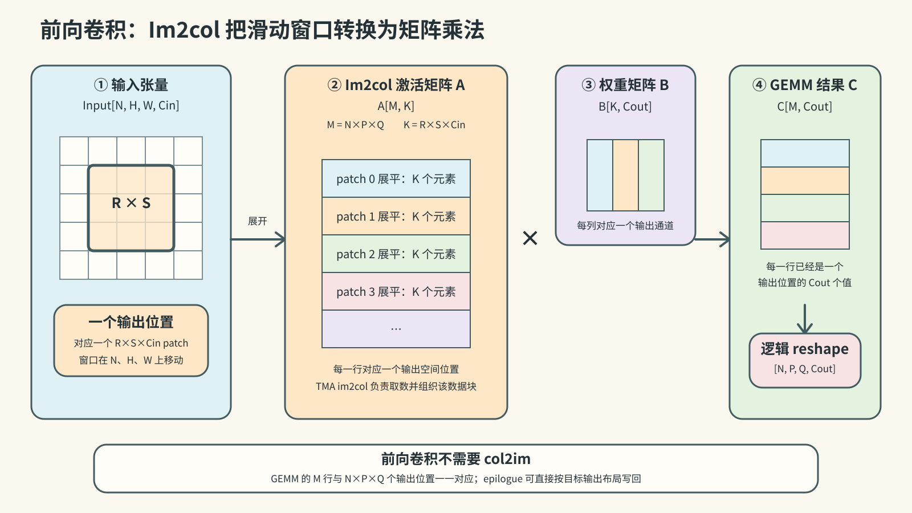
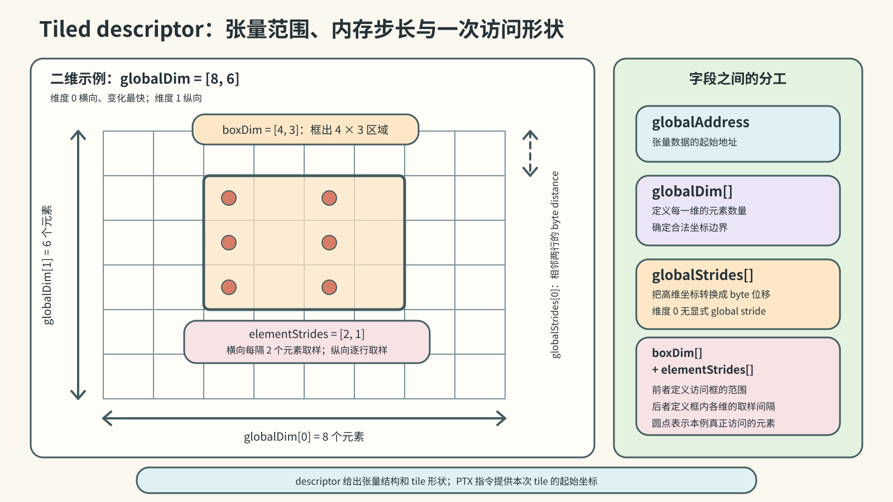
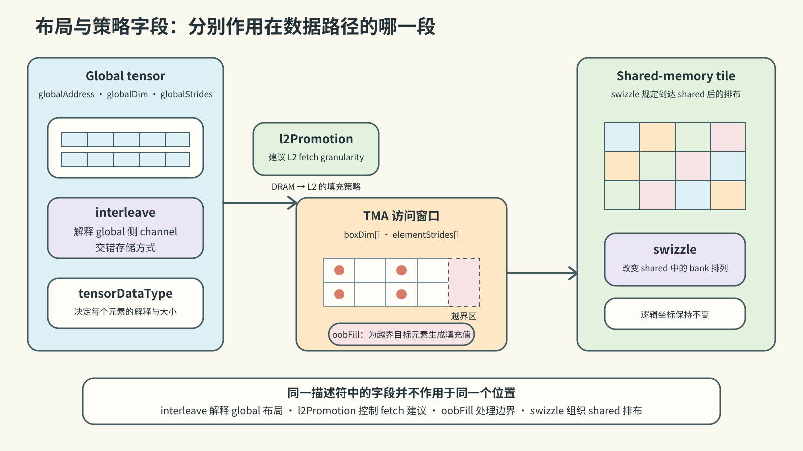
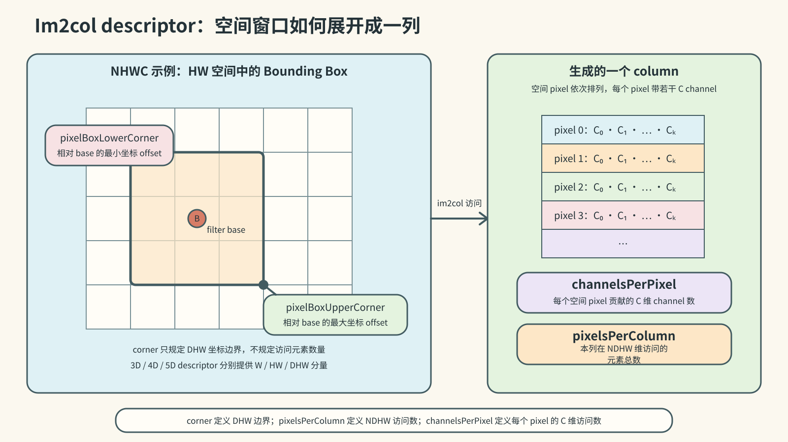
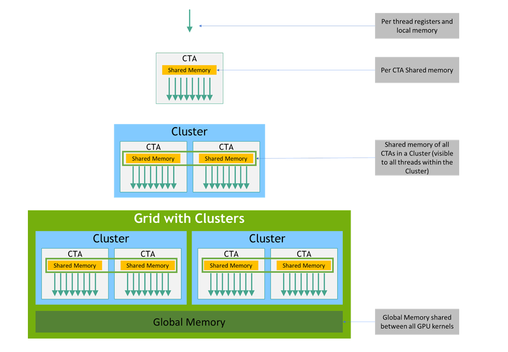
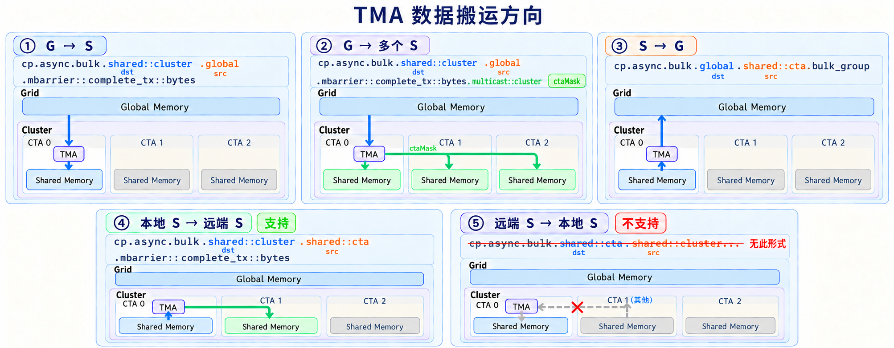
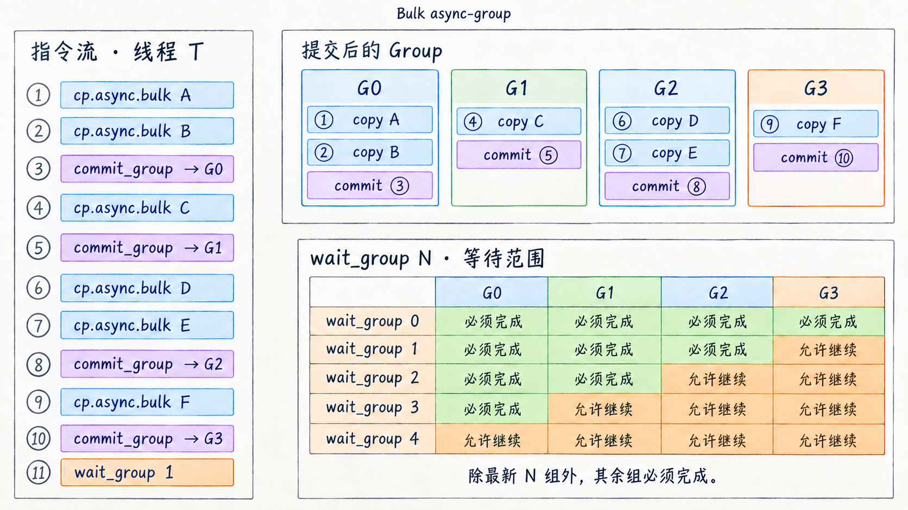
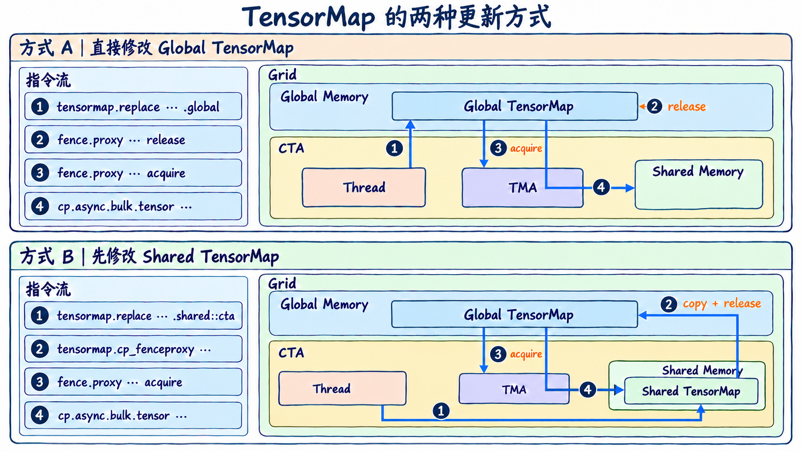

# 第二章：Hopper 第一代 TMA 的 PTX 设计

> 本文是 [NVIDIA TMA 调研系列](index.md) 第二章，聚焦 Hopper/PTX 8.0–8.3。上一篇：[NVIDIA 产品迭代与 TMA 概述](01-overview.md)；下一篇：[Blackwell 与 Rubin 的 TMA PTX 演进](03-blackwell-rubin-ptx.md)；引用编号见[参考资料索引](references.md)。

> 范围：Hopper / Compute Capability 9.0；以 PTX ISA 8.0 首发接口为基线，补充 PTX 8.3 的 Hopper descriptor 修改与 proxy 指令  
> 资料回指：[参考资料索引](references.md)

本章只整理两类对象：**TMA 描述符**和**TMA 相关 PTX 指令**。描述符部分先给出完整对象边界和字段表，再逐字段解释；指令部分先给出指令全集，再按统一格式解释每条指令的修饰符和操作数。

## 2.1 TMA 描述符

### 2.1.1 对象与字段总表

Hopper 对外使用的 tensor map 类型是 `CUtensorMap`。PTX 8.0 将 tensor map 定义为 **128 B 的 opaque object**；CUDA 12.0 Driver API 使用 16 个 64-bit qword 承载该对象，并要求对象地址至少按 64 B 对齐 [S027][S028]：

```cpp
#define CU_TENSOR_MAP_NUM_QWORDS 16

typedef struct CUtensorMap_st {
    cuuint64_t opaque[CU_TENSOR_MAP_NUM_QWORDS];
} CUtensorMap;
```

PTX 不定义其内部字段布局。下面只列 CUDA Driver API 对外提供的逻辑字段。

#### Tiled descriptor

`cuTensorMapEncodeTiled` 接受以下字段 [S028]：

| 字段 | 数量 | API 输入类型 | Hopper 合法范围或单位 |
|---|---:|---:|---|
| `tensorDataType` | 1 | enum | 13 种数据类型，枚举值 0–12 |
| `tensorRank` | 1 | `uint32_t` | 1–5 |
| `globalAddress` | 1 | pointer | 无 interleave 或 16 B interleave 时至少 16 B 对齐；32 B interleave 时至少 32 B 对齐 |
| `globalDim[i]` | rank | `uint64_t[]` | 每维 1–2³² 个元素 |
| `globalStrides[i]` | rank − 1 | `uint64_t[]` | byte；16 B 的倍数且 `< 2⁴⁰`；32 B interleave 时为 32 B 的倍数 |
| `boxDim[i]` | rank | `uint32_t[]` | 每维 1–256 个元素 |
| `elementStrides[i]` | rank | `uint32_t[]` | 每维 1–8 个元素 |
| `interleave` | 1 | enum | none、16 B、32 B |
| `swizzle` | 1 | enum | none、32 B、64 B、128 B |
| `l2Promotion` | 1 | enum | none、64 B、128 B、256 B |
| `oobFill` | 1 | enum | zero、OOB-NaN |

#### Im2col descriptor

Im2col descriptor 与 tiled descriptor 共用 `tensorDataType`、`tensorRank`、`globalAddress`、`globalDim`、`globalStrides`、`elementStrides`、`interleave`、`swizzle`、`l2Promotion` 和 `oobFill`，并以以下字段替代 `boxDim[]` [S027][S028]：

| 字段 | 数量 | API 输入类型 | Hopper 合法范围 |
|---|---:|---:|---|
| `pixelBoxLowerCorner[]` | rank − 2 | `int32_t[]` | 3D：1 个 16-bit signed 值；4D：2 个 8-bit signed 值；5D：3 个 4-bit signed 值 |
| `pixelBoxUpperCorner[]` | rank − 2 | `int32_t[]` | 与 lower corner 相同 |
| `channelsPerPixel` | 1 | `uint32_t` | `≤ 256`；CUDA 12.0 文档未另列非零下限 |
| `pixelsPerColumn` | 1 | `uint32_t` | `≤ 1024`；CUDA 12.0 文档未另列非零下限 |

在前向卷积中，可以把每个输出位置对应的 `R × S × Cin` 输入窗口展平为一行。全部 `N × P × Q` 个输出位置组成激活矩阵 `A[N×P×Q, R×S×Cin]`；卷积权重组成矩阵 `B[R×S×Cin, Cout]`。二者相乘得到 `C[N×P×Q, Cout]`，其每一行已经对应一个输出位置，只需逻辑上恢复为 `Output[N, P, Q, Cout]`，或由 GEMM epilogue 直接按该布局写回，不需要 col2im。下图采用常见的 `A[M,K] × B[K,Cout]` 表达；实际 shared-memory 排列可以转置或 swizzle。



### 2.1.2 字段逐项解释

#### `tensorDataType`

描述 global tensor 元素如何解释，也决定 TMA load、store 和 reduce 的元素语义。Hopper/CUDA 12.0 的枚举为：

| API 值 | 类型 | 元素大小或语义 |
|---:|---|---|
| 0 | `UINT8` | 1 B |
| 1 | `UINT16` | 2 B |
| 2 | `UINT32` | 4 B |
| 3 | `INT32` | 4 B |
| 4 | `UINT64` | 8 B |
| 5 | `INT64` | 8 B |
| 6 | `FLOAT16` | 2 B |
| 7 | `FLOAT32` | 4 B |
| 8 | `FLOAT64` | 8 B |
| 9 | `BFLOAT16` | 2 B |
| 10 | `FLOAT32_FTZ` | 4 B；global reduction 使用 FTZ 语义 |
| 11 | `TFLOAT32` | global 按 FP32，shared 侧按 TF32 表达 |
| 12 | `TFLOAT32_FTZ` | TF32 搬运并带 global reduction FTZ 语义 |

PTX `tensormap.replace.elemtype` 使用另一套立即数映射，不应直接套用 Driver API 的枚举值；该映射在 2.2.11 单独列出 [S031]。

#### `tensorRank`

描述 global tensor 的维数，Hopper 支持 1D–5D。CUDA API 输入实际 rank；`tensormap.replace.tile.rank` 则输入 `rank - 1`，即用 0–4 表示 1D–5D。它与 PTX 指令上的 `.1d`–`.5d` 是两个相互约束的表达：descriptor 保存 tensor 结构，指令修饰符决定本次操作采用的坐标向量长度和指令变体 [S027][S031]。

#### `globalAddress`

global tensor 的起始地址。无 interleave 或 16 B interleave 时至少 16 B 对齐；32 B interleave 时至少 32 B 对齐 [S028]。

#### `globalDim[i]`

第 `i` 维的全局元素数量，单位是**元素**。每维必须非零且不超过 2³²。维度 0 是最内层、变化最快的维度；PTX 指令的 `tensorCoords[i]` 使用同一维序 [S028]。

#### `globalStrides[i]`

从一个高维切片移动到下一个切片所需的 byte distance，单位是**字节**。rank 为 `R` 时只需要 `R-1` 个 stride，因为维度 0 的相邻元素距离由数据类型和 interleave 规则确定。Hopper 要求 stride 为 16 B 的倍数且小于 2⁴⁰；32 B interleave 时还必须是 32 B 的倍数 [S028]。

#### `boxDim[i]`

一次 TMA tiled 操作在第 `i` 维覆盖的 bounding-box 范围，单位是**元素**，每维为 1–256。它不是 global tensor 的 shape，也不是 shared-memory byte stride。无 interleave 时，`boxDim[0] × elementSize` 必须是 16 B 的倍数 [S027][S028]。

#### `elementStrides[i]`

bounding box 在第 `i` 维遍历 global tensor 时的元素步长，单位是**元素**，范围为 1–8。值为 1 表示逐元素遍历；值大于 1 表示跳跃访问。实际访问元素数为 `ceil(boxDim[i] / elementStrides[i])`。无 interleave 时，TMA 不支持维度 0 的 stride，因此 `elementStrides[0]` 被忽略 [S027][S028]。



#### `interleave`

说明 global-memory tensor 的物理 channel interleave 布局。Hopper 支持 none、16 B 和 32 B。interleave 不是 shared-memory swizzle：前者解释 global 侧的交错存储，后者决定数据到达 shared memory 后的排布。启用 interleave 时 rank 至少为 3；32 B interleave 还提高 global address 和 global stride 的对齐要求 [S027][S028]。

#### `swizzle`

指定数据写入或读出 shared memory 时使用的 bank swizzle，Hopper 支持 none、32 B、64 B 和 128 B。无 interleave 时，最内层 bounding-box byte width 不得超过所选 swizzle span；32 B interleave 预期与 32 B swizzle 配合。swizzle 不改变 global tensor 的逻辑坐标，而改变 shared-memory 线性数据的物理排列 [S027][S028]。

#### `l2Promotion`

指定从 DRAM 填充到 L2 时建议采用的 fetch granularity：none、64 B、128 B 或 256 B。它是缓存填充策略字段，不改变 tensor 的逻辑 shape、坐标或 copy 的正确性语义 [S028]。

#### `oobFill`

指定 bounding box 越过 global tensor 边界时生成的目标值。Hopper 支持 zero fill 和特殊 OOB-NaN fill；后者仅适用于浮点数据类型。该字段使边缘 tile 的越界元素可以由 TMA 生成，不要求指令为每个元素携带 predicate [S027][S028]。



#### Im2col 专属字段

`pixelBoxLowerCorner[]` 与 `pixelBoxUpperCorner[]` 分别给出 DHW 各维 filter box 的下角和上角相对 offset。rank 为 3、4、5 时分别有 1、2、3 个分量；随着分量数增加，每项可用的有符号取值宽度依次为 16、8、4 bit。

`channelsPerPixel` 表示每个 pixel 沿 C 维访问的元素数，CUDA 12.0 给出的上限为 256；`pixelsPerColumn` 表示一个 column 沿 NDHW 维访问的元素总数，上限为 1024。corner 字段只规定 DHW 空间中的坐标边界，不直接规定访问元素数。该版文档没有为这两个字段另列非零下限 [S027][S028]。

Im2col descriptor 只支持 3D、4D 和 5D，分别解释为 NWC、NHWC 和 NDHWC [S027]。



## 2.2 TMA 相关 PTX 指令

### 2.2.1 指令全集

PTX 8.0 为 `sm_90` 建立了两条相邻但不同的路径：不使用 tensor map 的一维 bulk path，以及使用 tensor map 的 tensor path。为了完整呈现 Hopper TMA 的 PTX 设计，下表同时列出二者 [S027]。

| 指令 | 使用 tensor map | 功能 | 首发 PTX / target |
|---|---|---|---|
| `prefetch.{const\|param}.tensormap` | 是 | 预取 descriptor 本身 | PTX 8.0 / `sm_90` |
| `cp.async.bulk` | 否 | 一维连续 bulk copy | PTX 8.0 / `sm_90` |
| `cp.reduce.async.bulk` | 否 | 一维连续 bulk copy + reduction | PTX 8.0 / `sm_90` |
| `cp.async.bulk.prefetch` | 否 | 一维连续区域预取到 L2 | PTX 8.0 / `sm_90` |
| `cp.async.bulk.tensor` | 是 | 1D–5D tensor copy | PTX 8.0 / `sm_90` |
| `cp.reduce.async.bulk.tensor` | 是 | tensor store + reduction | PTX 8.0 / `sm_90` |
| `cp.async.bulk.prefetch.tensor` | 是 | tensor region 预取到 L2 | PTX 8.0 / `sm_90` |
| `cp.async.bulk.commit_group` | 间接 | 提交当前线程的 bulk-group 操作 | PTX 8.0 / `sm_90` |
| `cp.async.bulk.wait_group` | 间接 | 等待 bulk async-groups | PTX 8.0 / `sm_90` |
| `tensormap.replace` | 修改 descriptor | 修改 tiled descriptor 字段 | PTX 8.3 / `sm_90a` |
| `tensormap.cp_fenceproxy` | descriptor copy + proxy release | 将 shared 中修改后的 128 B descriptor 复制到 global 并发布给 tensormap proxy | PTX 8.3 / `sm_90` |
| `fence.proxy.tensormap::generic` | descriptor proxy fence | 在 generic proxy 与 tensormap proxy 之间建立定向顺序 | PTX 8.3 / `sm_90` |

### 2.2.2 `prefetch.tensormap`

```ptx
prefetch.const.tensormap [a];
prefetch.param.tensormap [a];
```

| 字段 | 取值或类型 | 含义 |
|---|---|---|
| `prefetch` | opcode | 发出缓存预取提示，不产生程序可见的 tensor 数据结果 |
| `.const` / `.param` | descriptor state space | Hopper PTX 8.0 tensor map 可位于 constant space 或 entry parameter space |
| `.tensormap` | object class | 指明预取对象是供后续 tensor bulk instruction 使用的 tensor map |
| `[a]` | descriptor address | tensor-map object 的地址 |

这条指令预取的是 descriptor，不是 descriptor 所描述的 tensor data。tensor data 的 L2 预取由 `cp.async.bulk.prefetch.tensor` 表达 [S027]。

### 2.2.3 `cp.async.bulk`

```ptx
// global -> shared::cluster；multicast 和 cache hint 均可选
cp.async.bulk.shared::cluster.global.mbarrier::complete_tx::bytes{.multicast::cluster}{.L2::cache_hint}
    [dstMem], [srcMem], size, [mbar] {, ctaMask} {, cache-policy};

// shared::cta -> shared::cluster，目标必须是另一 CTA
cp.async.bulk.shared::cluster.shared::cta.mbarrier::complete_tx::bytes
    [dstMem], [srcMem], size, [mbar];

// shared::cta -> global
cp.async.bulk.global.shared::cta.bulk_group{.L2::cache_hint}
    [dstMem], [srcMem], size {, cache-policy};
```

| 字段 | 取值或类型 | 含义与限制 |
|---|---|---|
| `.dst` | `.shared::cluster` / `.global` | 目标 state space |
| `.src` | `.global` / `.shared::cta` | 源 state space |
| `.mbarrier::complete_tx::bytes` | completion modifier | copy 完成时按实际 byte count 更新 `[mbar]`；用于 global→shared 和 CTA→remote CTA shared |
| `.bulk_group` | completion modifier | 选择发起线程私有的 bulk async-group 完成机制；随后由同一线程执行 `commit_group` 和 `wait_group` |
| `.multicast::cluster` | optional modifier | global 数据写入 `ctaMask` 选中的多个 CTA 的相同 shared offset，并向对应 mbarrier 发送完成通知 |
| `.L2::cache_hint` | optional modifier | 表示末尾存在 64-bit `cache-policy` operand |
| `[dstMem]` | address | 目标地址；shared→shared 时必须映射到 cluster 中另一 CTA |
| `[srcMem]` | address | 源地址 |
| `size` | 32-bit byte count | 必须为 16 B 的倍数 |
| `[mbar]` | shared-memory mbarrier address | mbarrier completion object |
| `ctaMask` | 16 bit | bit `i` 对应 cluster 中 CTA rank `i` |
| `cache-policy` | 64 bit | cache eviction policy hint，不改变内存一致性语义 |

#### `.dst` 与 `.src`

指令名中的 `.dst.src` 按“目标在前、源在后”排列，数据实际从 `.src` 搬到 `.dst`。

`.shared::cta` 表示执行当前指令的 CTA 自己的 shared-memory 地址窗口。`.shared::cluster` 表示当前 CTA cluster 内任意 CTA 的 shared-memory 地址窗口，可以指向本 CTA，也可以指向另一个 CTA。它不是一块独立的 cluster 级物理存储；底层仍是各 CTA 所在 SM 的 shared memory，只是增加了 cluster 范围的寻址方式 [S027][S032]。



*图源：NVIDIA PTX ISA，Memory Hierarchy [S032]。*

`.dst` 和 `.src` 的表中取值不能任意组合。Hopper PTX 8.0 支持以下三种方向：

| `.dst.src` 组合 | 实际方向 | 地址含义 |
|---|---|---|
| `.shared::cluster.global` | global → shared | `dstMem` 指向 cluster 内某个 CTA 的 shared memory，`srcMem` 指向 global memory |
| `.shared::cluster.shared::cta` | shared → shared | `srcMem` 位于当前 CTA 的 shared memory；`dstMem` 必须指向 cluster 内另一个 CTA 的 shared memory |
| `.global.shared::cta` | shared → global | `srcMem` 位于当前 CTA 的 shared memory，`dstMem` 指向 global memory |

`.multicast::cluster` 只适用于 `.shared::cluster.global` 方向。普通形式由 `dstMem` 指定一个 shared-memory 目标；加入 multicast 后，`ctaMask` 选择 cluster 内的多个目标 CTA，global source data 会写入这些 CTA 各自 shared memory 中与 `dstMem` 相同的 CTA-relative offset。对应的完成通知也发送到各目标 CTA 中与 `mbar` 相同的相对位置。

`ctaMask` 是 16-bit 位掩码，第 `i` 位对应 `%cluster_ctarank == i` 的 CTA；置 1 表示该 CTA 是本次 multicast 的目标。掩码宽度提供可表示的 CTA rank 范围，本身不定义当前 cluster 实际包含多少个 CTA [S027]。

下图将三种合法的 `.dst.src` 组合展开为四种数据路径，并补充一个不受支持的反向 shared-memory 路径。每个场景上方保留实际 PTX 形式，其中紧跟 `cp.async.bulk` 的两个 state-space modifier 依次是 `.dst` 和 `.src`。



图中的④与⑤需要成对理解：Hopper 支持当前 CTA 的 `.shared::cta` 作为 source，把数据写入同一 cluster 中另一个 CTA 的 `.shared::cluster`；不支持把远端 `.shared::cluster` 作为 source，再由 TMA 拉回当前 CTA 的 `.shared::cta`。因此 shared→shared 不是方向对称的能力。

`srcMem`、`dstMem` 必须 16 B 对齐，访问区间不得越出相应 state space。该指令不使用 tensor map，不包含多维 shape、stride、swizzle 或 OOB 处理 [S027]。

#### Bulk async-group

`.bulk_group` 表示该异步操作采用 **bulk async-group** 管理完成状态。它不是一个由程序显式创建或命名的共享对象，而是当前线程按指令顺序维护的分组机制：线程先发出若干采用 `.bulk_group` completion 的 bulk async 操作，再执行 `cp.async.bulk.commit_group`，把这些尚未提交的操作封装成一个新 group [S027]。

下图左侧给出一个线程的指令流。①、②先发出两次 copy，③再把它们提交为 G0；④由⑤提交为 G1；⑥、⑦由⑧提交为 G2；⑨由⑩提交为 G3。也就是说，`commit_group` 是一组操作的结束边界，不是该组中的第一条 copy。图中的 G0–G3 只是为了说明提交先后而使用的名称，PTX 指令不会返回可供程序引用的 group ID。



右下部分表示：假设 G0–G3 已按顺序提交，`cp.async.bulk.wait_group N` 允许最新的 `N` 个 group 仍未完成，但要求更早的 group 全部完成。因此，`wait_group 0` 等待四组全部完成；`wait_group 1` 只允许最新的 G3 尚未完成；`wait_group 2` 允许 G2、G3 尚未完成，依此类推。图中的“允许继续”仅表示这些组不在本次等待的强制完成范围内，并不表示它们一定仍在执行 [S027]。

分组和等待均以执行指令的线程为作用域：一个线程的 `commit_group` 只提交该线程此前尚未提交的 bulk async 操作，后续也由同一线程用 `wait_group` 约束这些 group。组内操作被共同纳入完成判断，但组内彼此不因此获得额外的 memory ordering；`.read` 形式的较弱等待语义见 2.2.10。

### 2.2.4 `cp.reduce.async.bulk`

```ptx
// shared::cta -> shared::cluster
cp.reduce.async.bulk.shared::cluster.shared::cta.mbarrier::complete_tx::bytes.redOp.type
    [dstMem], [srcMem], size, [mbar];

// shared::cta -> global：一般形式
cp.reduce.async.bulk.global.shared::cta.bulk_group{.L2::cache_hint}.redOp.type
    [dstMem], [srcMem], size {, cache-policy};

// shared::cta -> global：FP16/BF16 add 的 no-FTZ 形式
cp.reduce.async.bulk.global.shared::cta.bulk_group{.L2::cache_hint}.add.noftz.type
    [dstMem], [srcMem], size {, cache-policy};
```

`cp.reduce.async.bulk` 沿用 `cp.async.bulk` 的地址、大小、完成机制和 L2 cache hint 表达：`[dstMem]`、`[srcMem]`、`size`、`[mbar]`、`.L2::cache_hint` 与 `cache-policy` 的基本含义不变；shared target 仍使用 `.mbarrier::complete_tx::bytes`，global target 仍使用 `.bulk_group`。下面只整理相对 `cp.async.bulk` 新增、删除或发生变化的部分。

| 字段或形式 | 取值 | 变化类型 | 含义或改动 |
|---|---|---|---|
| `.dst/.src` | `.shared::cluster.shared::cta` / `.global.shared::cta` | 改动 | source 固定为当前 CTA 的 `.shared::cta`；只保留 shared→remote shared 和 shared→global，不再支持 global→shared |
| `.redOp` | `.add`、`.min`、`.max`、`.inc`、`.dec`、`.and`、`.or`、`.xor` | 新增 | 指定 source element 与对应 destination element 之间执行的 inline reduction |
| `.type` | 按 destination 和 `.redOp` 受限 | 新增 | 定义每个 reduction element 的类型 |
| `.noftz` | FP16/BF16 add 的规定形式 | 新增 | 保留 subnormal input/result，不执行 flush-to-zero |
| `.multicast::cluster` / `ctaMask` | — | 删除 | `cp.reduce.async.bulk` 不提供 multicast 形式 |

`.type` 的合法集合同时取决于 destination 和 `.redOp`。global destination 支持浮点类型和更多 64-bit 类型；shared::cluster destination 的类型集合更窄。完整组合如下 [S027]：

| `.redOp` | `.global` destination 的 `.type` | `.shared::cluster` destination 的 `.type` |
|---|---|---|
| `.add` | `.u32`、`.s32`、`.u64`、`.f32`、`.f64`、`.f16`、`.bf16` | `.u32`、`.s32`、`.u64` |
| `.min` / `.max` | `.u32`、`.s32`、`.u64`、`.s64`、`.f16`、`.bf16` | `.u32`、`.s32` |
| `.inc` / `.dec` | `.u32` | `.u32` |
| `.and` / `.or` / `.xor` | `.b32`、`.b64` | `.b32` |

### 2.2.5 `cp.async.bulk.prefetch`

```ptx
cp.async.bulk.prefetch.L2.global{.L2::cache_hint}
    [srcMem], size {, cache-policy};
```

| 字段 | 取值或类型 | 含义 |
|---|---|---|
| `.L2` | fixed、必选 | 指令只支持将数据预取到 L2；不存在省略 `.L2` 或改为 `.L1` 的形式 |
| `.global` | fixed、必选 | source 固定为 global memory |
| `.L2::cache_hint` | optional | 表示指令末尾提供 `cache-policy`；不改变预取目标仍为 L2 |
| `[srcMem]` | global address | 待预取区域的起始地址，必须 16 B 对齐 |
| `size` | 32-bit byte count | 待预取的 byte 数，必须为 16 B 的倍数 |
| `cache-policy` | opaque 64-bit value | 由通用 cache-policy 机制提供的 L2 eviction hint；仅在指定 `.L2::cache_hint` 时出现 |

该指令是 hint：系统“可以”发起预取；它不提供 shared-memory destination，也不产生供程序等待的数据完成对象 [S027]。

### 2.2.6 `cp.async.bulk.tensor`

```ptx
// global -> shared::cluster
cp.async.bulk.tensor.dim.shared::cluster.global{.load_mode}.mbarrier::complete_tx::bytes{.multicast::cluster}{.L2::cache_hint}
    [dstMem], [tensorMap, tensorCoords], [mbar]
    {, im2colOffsets} {, ctaMask} {, cache-policy};

// shared::cta -> global
cp.async.bulk.tensor.dim.global.shared::cta{.load_mode}.bulk_group{.L2::cache_hint}
    [tensorMap, tensorCoords], [srcMem] {, cache-policy};
```

`cp.async.bulk.tensor` 沿用 2.2.3 的完成机制、multicast 和 L2 cache hint 表达：load 仍使用 `.mbarrier::complete_tx::bytes`，store 仍使用 `.bulk_group`；`[mbar]`、`.multicast::cluster`、`ctaMask`、`.L2::cache_hint` 与 `cache-policy` 的基本含义不变。shared 侧的 `[dstMem]` / `[srcMem]` 也仍是线性 shared-memory 地址。下面只整理 tensor 形式新增、删除或发生变化的部分。

| 字段或形式 | 取值或类型 | 变化类型 | 含义或改动 |
|---|---|---|---|
| `.dim` | `.1d`–`.5d` | 新增 | 指定本次 tensor operation 的维度，也决定 `tensorCoords` 长度 |
| `.dst/.src` | load：`.shared::cluster.global`；store：`.global.shared::cta` | 改动 | 只保留 global→shared 和 shared→global，不再支持 shared→shared |
| `.load_mode` | load：`.tile` / `.im2col`；store：`.tile` / `.im2col_no_offs` | 新增 | 指定 tensor traversal mode；省略时默认为 `.tile` |
| `tensorMap` | generic descriptor address | 新增 | PTX 8.0 中指向 `.param` 或 `.const` 中的 128-B tensor map，由其提供 global base address、shape、stride、元素类型和布局策略 |
| `tensorCoords` | `.s32` vector，长度=`dim` | 新增 | load 时给出 bounding box 在 global tensor 中的起始坐标；store 时给出写回坐标 |
| `im2colOffsets` | `.u16` vector，长度=`dim-2` | 新增 | 仅 `.im2col` load 使用，动态偏移 W/H/D filter base |
| global 侧 `[srcMem]` / `[dstMem]` | — | 删除 | global 位置改由 `tensorMap` 和 `tensorCoords` 表达 |
| `size` | — | 删除 | 不再显式给出 byte count；传输范围由 descriptor、`.dim`、`.load_mode` 和坐标共同确定 |

因此，这一指令的核心变化不是完成机制，而是 global 侧从“线性地址 + byte count”改为“tensor descriptor + tensor coordinates”。tile 的范围和静态布局来自 descriptor，本次动态位置来自 `tensorCoords`，im2col load 还可以由 `im2colOffsets` 增加动态 filter offset [S027]。

### 2.2.7 `cp.reduce.async.bulk.tensor`

```ptx
cp.reduce.async.bulk.tensor.dim.global.shared::cta.redOp{.load_mode}.bulk_group{.L2::cache_hint}
    [tensorMap, tensorCoords], [srcMem] {, cache-policy};
```

`cp.reduce.async.bulk.tensor` 可以看作在 2.2.6 的 tensor store 上加入 2.2.4 的 reduction 语义。它沿用 tensor store 的 `.dim`、`.global.shared::cta`、`.load_mode`、`.bulk_group`、`.L2::cache_hint`、`tensorMap`、`tensorCoords`、`[srcMem]` 和 `cache-policy`。

相对 2.2.6 的 `cp.async.bulk.tensor`，需要单独说明的变化如下：

| 字段或形式 | 取值或类型 | 变化类型 | 相对 2.2.6 的变化 |
|---|---|---|---|
| 数据方向 | `.global.shared::cta` | 收窄 | 只保留 shared memory → global memory，不支持 global memory → shared memory |
| `.redOp` | `.add/.min/.max/.inc/.dec/.and/.or/.xor` | 新增 | 在 tensor store 的基础上指定写入 global memory 时执行的 reduction 操作 |
| 元素类型限制 | 取决于 `.redOp` | 新增约束 | 元素类型仍由 `tensorMap` 指定，但必须与 `.redOp` 构成合法组合 |

`.redOp` 的种类和操作含义与 2.2.4 相同，但元素类型不写在 opcode 中，而由 `tensorMap` 指定。相对 2.2.4 的非 tensor reduction，合法类型组合变化如下：

| `.redOp` | `tensorMap` 元素类型 | 相对 2.2.4 的变化 |
|---|---|---|
| `.add` | `.u32/.s32/.u64/.f32/.f16/.bf16` | 不再支持 `.f64` |
| `.min/.max` | `.u32/.s32/.u64/.s64/.f16/.bf16` | 不变 |
| `.inc/.dec` | `.u32` | 不变 |
| `.and/.or/.xor` | `.b32/.b64` | 不变 |

因此，这条指令的 tensor 寻址方式来自 2.2.6，reduction 操作来自 2.2.4；元素类型则由 `tensorMap` 描述符提供 [S027]。

### 2.2.8 `cp.async.bulk.prefetch.tensor`

```ptx
cp.async.bulk.prefetch.tensor.dim.L2.global{.load_mode}{.L2::cache_hint}
    [tensorMap, tensorCoords] {, im2colOffsets} {, cache-policy};
```

`cp.async.bulk.prefetch.tensor` 是 2.2.5 `cp.async.bulk.prefetch` 的 tensor 寻址形式：两者都只是向系统发出从 global memory 预取到 L2 的非阻塞 hint，固定使用 `.L2.global`，并沿用可选的 `.L2::cache_hint` 与 `cache-policy`。tensor 区域的表达方式则与 2.2.6 的 global tensor source 相同。

相对 2.2.5，变化如下：

| 字段或操作数 | 取值或类型 | 变化类型 | 相对 2.2.5 的变化 |
|---|---|---|---|
| `.dim` | `.1d`–`.5d` | 新增 | 指定 global tensor 的维度 |
| `.load_mode` | `.tile/.im2col` | 新增 | 指定以普通 tile 或 im2col 方式解释预取区域 |
| `[srcMem], size` | — | 替换 | 不再用线性起始地址和字节数直接描述区域 |
| `[tensorMap, tensorCoords]` | descriptor address + `.s32[dim]` | 新增 | descriptor 给出 tensor 布局和 box shape，坐标给出预取区域的起点 |
| `im2colOffsets` | `.u16[dim-2]` | 条件新增 | 仅 `.im2col` 使用，提供动态 W/H/D offset |

这里预取的是 descriptor 所描述的 **global tensor 数据区域**；2.2.2 的 `prefetch.tensormap` 预取的则是 **descriptor 自身** [S027]。

### 2.2.9 `cp.async.bulk.commit_group`

```ptx
cp.async.bulk.commit_group;
```

这条指令没有显式操作数，也不发起数据搬运；它只为当前线程划定一个新的 bulk async-group。被纳入该 group 的操作必须同时满足：

| 条件 | 含义 |
|---|---|
| 由当前线程发起 | bulk async-group 是 per-thread 的，不能提交其他线程发起的操作 |
| 使用 `.bulk_group` completion | 使用 mbarrier completion 的操作不属于 bulk async-group |
| 尚未被此前的 `commit_group` 提交 | 每个操作只能进入一个 group |

满足条件的此前操作被组成一个新 group；没有待提交操作时，仍会生成一个 trivially complete 的空 group。`commit_group` 只建立 group 边界，不在组内不同操作之间建立 memory ordering [S027]。

### 2.2.10 `cp.async.bulk.wait_group`

```ptx
cp.async.bulk.wait_group N;
cp.async.bulk.wait_group.read N;
```

`wait_group` 等待 2.2.9 提交的 per-thread bulk async-group。`N` 是整数常量：指令返回时，最多允许最新的 `N` 个 group 仍处于 pending 状态，所有更早的 group 都必须达到该指令要求的完成条件；`N=0` 因而等待此前提交的全部 group。

| 指令形式 | 对被等待 group 的完成要求 | 返回后能够安全进行的操作 |
|---|---|---|
| `wait_group N` | source read 完成、destination write 完成，并且这些 write 对执行等待的线程可见 | 可以复用 source，也可以由当前线程消费 destination |
| `wait_group.read N` | 只要求 source read 完成 | 可以提前复用 source；不能据此认为 destination write 已完成或可见 |

这里的 `N` 表示“最多保留多少个最新 group 未完成”，不是某个 group 的编号 [S027]。

### 2.2.11 Hopper `sm_90a` 的 descriptor 修改指令

PTX 8.3 在 Hopper architecture-specific target `sm_90a` 上增加 `tensormap.replace`，使 device 代码能够修改已有 tensor map 的指定字段。它只支持 tiled descriptor，不支持 im2col descriptor，也不是执行普通 TMA copy 的必备指令 [S031]。

```ptx
tensormap.replace.mode.field1{.ss}.b1024.type [addr], new_val;
tensormap.replace.mode.field2{.ss}.b1024.type [addr], ord, new_val;
tensormap.replace.mode.field3{.ss}.b1024.type [addr], new_val;

.mode   = { .tile }
.field1 = { .global_address, .rank }
.field2 = { .box_dim, .global_dim, .global_stride, .element_stride }
.field3 = { .elemtype, .interleave_layout, .swizzle_mode, .fill_mode }
.ss     = { .global, .shared::cta }
.type   = { .b32, .b64 }
```

三种语法形式对应三类 descriptor 字段：

| 字段类别 | 可修改字段 | 操作数形式 | 类型与取值约束 |
|---|---|---|---|
| `.field1` | `.global_address/.rank` | `[addr], new_val` | `global_address` 使用 `.b64`；`rank` 使用 `.b32`，且 `new_val = 实际 rank - 1` |
| `.field2` | `.box_dim/.global_dim/.global_stride/.element_stride` | `[addr], ord, new_val` | `global_stride` 使用 `.b64`，其余使用 `.b32`；`ord` 指定要修改的维度 |
| `.field3` | `.elemtype/.interleave_layout/.swizzle_mode/.fill_mode` | `[addr], new_val` | 使用 `.b32`，且 `new_val` 必须是立即数 |

其余公共字段如下：

| 字段 | 含义 |
|---|---|
| `.tile` | 固定的 descriptor mode；Hopper 版本不支持修改 im2col descriptor |
| `.ss` | descriptor 位于 `.global`、`.shared::cta`；省略时使用 generic addressing |
| `.b1024` | 操作对象是完整的 1024-bit opaque tensor map，即使指令只替换其中一个字段 |
| `addr` | descriptor 地址 |
| `ord` | `.field2` 数组字段的维度序号，必须落在该字段实际元素数内；一般最大为 4，`global_stride` 的 `ord` 最大为 `rank - 2` |

Hopper 中 `.field3` 的 `new_val` 映射为：

| `.field3` | `new_val` 映射 |
|---|---|
| `.elemtype` | 0=`u8`，1=`u16`，2=`u32`，3=`s32`，4=`u64`，5=`s64`，6=`f16`，7=`f32`，8=`f32.ftz`，9=`f64`，10=`bf16`，11=`tf32`，12=`tf32.ftz` |
| `.interleave_layout` | 0=none，1=16 B，2=32 B |
| `.swizzle_mode` | 0=none，1=32 B，2=64 B，3=128 B |
| `.fill_mode` | 0=zero fill，1=OOB-NaN fill |

PTX 明确说明 `.elemtype` 的这些数值与 Driver API 的 `CUtensorMapDataType` 枚举值并不相同。尽管指令只替换一个字段，`tensormap.replace` 在 memory consistency model 中仍被视为对整个 1024-bit tensor map 的 weak memory operation [S031]。

### 2.2.12 Descriptor proxy 指令

TMA 通过 tensormap proxy 读取 descriptor，而 `tensormap.replace` 等普通写入属于 generic proxy。device 代码修改 descriptor 后，必须在两种 proxy 之间建立顺序，才能让后续 TMA 操作读取更新后的内容。PTX 8.3 为此增加了 `fence.proxy.tensormap::generic` 和 `tensormap.cp_fenceproxy`；它们要求 `sm_90`，并不要求 `sm_90a` [S031]。

```ptx
// descriptor 已直接写在 global：发布 generic 写入
fence.proxy.tensormap::generic.release.scope;

// descriptor 先在 shared::cta 中修改：复制到 global，并执行 proxy release
tensormap.cp_fenceproxy.global.shared::cta.proxy.tensormap::generic.release.scope.sync.aligned
    [dst], [src], 128;

// 消费更新后的 descriptor 前执行 address-scoped proxy acquire
fence.proxy.tensormap::generic.acquire.scope [addr], 128;

.scope = { .cta, .cluster, .gpu, .sys }
```

下图分别展开两种完整的 descriptor 更新方式。方式 A 直接修改 global descriptor，随后执行 proxy release；方式 B 先在 CTA shared memory 中修改 descriptor，再由 `tensormap.cp_fenceproxy` 将完整的 128 B descriptor 复制到 global memory，并同时执行 proxy release。每个场景左侧是 PTX 指令流，右侧编号相同的标记表示该指令在内存层级中的作用位置。消费端在发起 TMA 前执行 address-scoped acquire，之后 TMA 才通过 tensormap proxy 读取该 global descriptor。



图中的 `Thread` 表示执行这些指令的线程角色，不表示 PTX 强制要求独立的生产者线程和消费者线程。同一线程可以按 `replace → release → acquire → TMA` 的顺序完成整个过程，此时 program order 已保证 release 先于 acquire。若 descriptor 由一个线程生产、由另一个线程消费，则还必须通过 barrier、原子通信或 kernel/stream 顺序等已有同步关系，保证生产者的 release 发生在消费者的 acquire 之前；proxy fence 负责跨 proxy 的顺序和可见性，本身不会等待未来才发生的 release。执行同步也不能替代消费端的 tensormap-proxy acquire [S031]。

方式 B 还包含一项执行主体约束：`tensormap.replace...shared::cta` 可以由单个线程完成，但 `tensormap.cp_fenceproxy...sync.aligned` 必须由 warp 内所有线程一致执行；只有一个 lane 到达该指令时，行为未定义 [S031]。

两条 descriptor 更新路径的区别如下：

| descriptor 的修改位置 | release 操作 | 实际效果 |
|---|---|---|
| global memory | `fence.proxy.tensormap::generic.release.scope` | 不复制数据，只把此前对 global descriptor 的 generic 写入发布给 tensormap proxy |
| CTA shared memory | `tensormap.cp_fenceproxy...release...` | 将完整 128 B descriptor 从 shared::cta 复制到 global，并在复制后执行 proxy release |

随后，消费线程在使用该 global descriptor 发起 TMA 操作前，对相同的 128 B 地址范围执行 `fence.proxy.tensormap::generic.acquire.scope [addr], 128`。

| 字段 | 含义与限制 |
|---|---|
| `.tensormap::generic` | 建立从 generic proxy 到 tensormap proxy 的单向顺序 |
| `.release/.acquire` | release 发布 descriptor 写入；address-scoped acquire 使后续 tensormap 访问按该顺序观察该 descriptor |
| `.scope` | 可以直接观察该同步效果的线程范围 |
| `.global.shared::cta` | fused 指令固定从 CTA shared memory 复制到 global memory |
| `.sync` | 执行线程等待到 warp 内所有线程都执行该指令后再继续 |
| `.aligned` | warp 内所有线程必须执行相同的指令；若位于分支中，各线程必须对条件作出一致判断 |
| `[dst]/[src]` | 分别是 non-generic global 地址和 non-generic shared::cta 地址 |
| `size` | `tensormap.cp_fenceproxy` 的合法值固定为 128 B；对完整 descriptor 执行 acquire 时同样使用 128 B |

这些 proxy 指令只在 descriptor 被 device 代码修改时使用，不是普通 TMA copy 的固定前序步骤 [S031]。

---

[返回系列目录](index.md) · [上一篇：NVIDIA 产品迭代与 TMA 概述](01-overview.md) · [下一篇：Blackwell 与 Rubin 的 TMA PTX 演进](03-blackwell-rubin-ptx.md) · [参考资料索引](references.md)
