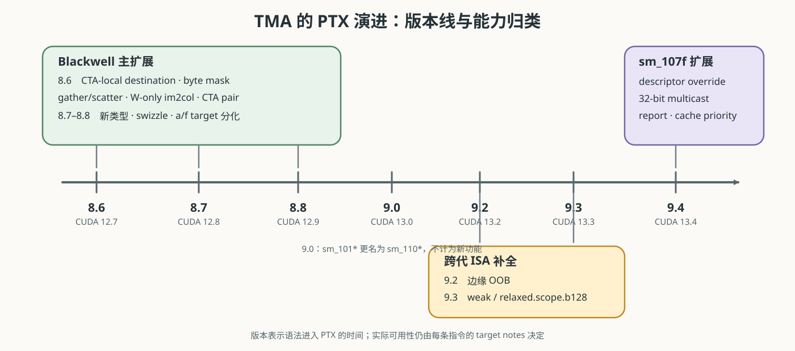
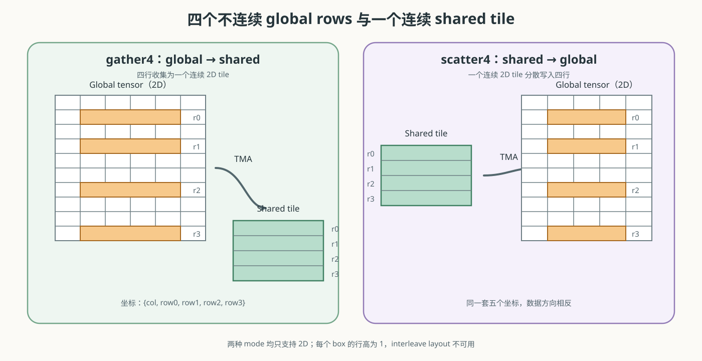
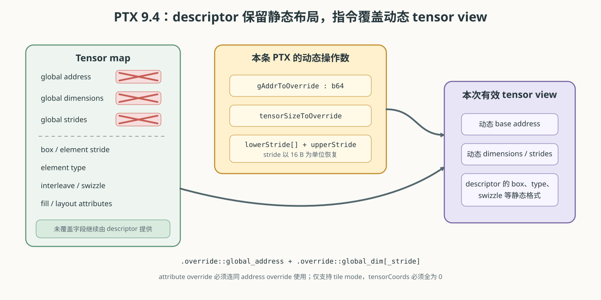
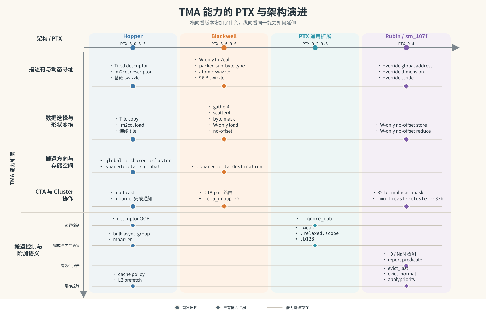

# 第三章：Blackwell 与 Rubin 的 TMA PTX 演进

> 本文是 [NVIDIA TMA 调研系列](index.md) 第三章。上一篇：[Hopper 第一代 TMA 的 PTX 设计](02-hopper-ptx.md)；引用编号见[参考资料索引](references.md)。

> 范围：PTX ISA 8.6–9.4；以第二章的 Hopper/PTX 8.0–8.3 接口为基线，只整理新增和发生变化的部分  
> 资料回指：[参考资料索引](references.md)

第二章先给出 Hopper 的完整 TMA 描述符，再给出 TMA 相关 PTX 指令全集，并逐字段、逐指令解释。本章沿用相同的观察顺序，但只记录相对 Hopper 基线发生的变化：每个版本段先说明描述符对象和字段是否变化，再列出指令变化总表，最后逐条解释变化的指令、修饰符和操作数。未发生变化的字段和指令不重复展开。

## 3.1 版本与 target 坐标

PTX 版本表示一种语法或语义从何时进入 PTX ISA；一条指令能否在某个 GPU target 上使用，还要继续检查该指令的 Target ISA Notes。尤其从 PTX 8.8 开始，`f` target 表示 **family-specific** 能力：例如 `sm_100f` 上可用的特性可以向同一 family 的更高 target 兼容，但不能据此推广到另一 family [S035]。



| PTX ISA | CUDA 节点 | 描述符变化 | 指令变化 |
|---|---|---|---|
| 8.6 | CUDA 12.7 | 增加 W-only im2col 描述方式<br>扩展 swizzle 表达 | `.shared::cta` destination、`.cp_mask`<br>gather4/scatter4<br>W-only im2col<br>`.cta_group`<br>`.swizzle_atomicity` |
| 8.7 | CUDA 12.8 | `tensorDataType` 增加三种 packed sub-byte 类型 | `tensormap.replace.elemtype` 增加取值 13–15<br>增加 `sm_120/120a` |
| 8.8 | CUDA 12.9 | `swizzle` 增加 `96 B` 模式 | `tensormap.replace.swizzle_mode` 增加取值 `4`<br>引入 family-specific `f` target |
| 9.0 | CUDA 13.0 | 无新增字段或字段值 | `sm_101*` 更名为 `sm_110*`<br>本章范围内没有新的核心 TMA 语法 |
| 9.1 | CUDA 13.1 | 无 TMA descriptor 变化 | 新增 `multimem.cp.async.bulk*`<br>属于相邻的 bulk-async 路径，本章不展开 |
| 9.2 | CUDA 13.2 | 无变化 | `cp.async.bulk.ignore_oob` |
| 9.3 | CUDA 13.3 | 无变化 | bulk copy 增加 `.weak/.relaxed`、`.scope`、`.b128`<br>bulk reduce 增加 `.sem.scope` |
| 9.4 | CUDA 13.4 | descriptor 本体没有增加 override 字段 | tensor property override<br>`.im2col_no_offs::w`<br>32-bit multicast mask<br>report mechanism<br>cache priority 操作 |

PTX 9.1 的 `multimem.cp.async.bulk*` 沿用了 bulk async-group、`.cp_mask` 等表达，但其 destination 是 multimem address range，语义是向多个 GPU 对应的 memory location 发起 copy 或 reduction，不使用 tensor map。因此，本章不把“名称中含 `async.bulk`”直接等同于 TMA tensor path [S036]。

## 3.2 PTX 8.6：Blackwell 的主要扩展

### 3.2.1 描述符变化

Blackwell 没有改变 tensor map 的对象边界：`CUtensorMap` 仍是 128 B opaque object，地址至少按 64 B 对齐，物理 bit layout 仍不由 PTX 或 Driver API 公开定义。PTX 8.6 对 Hopper 的 Tiled descriptor 和 Im2col descriptor 扩展 `swizzle`，并增加 W-only Im2col descriptor [S034][S039]。

#### Tiled descriptor

Tiled descriptor 的字段集合不变，只有 `swizzle` 的合法值发生变化：

| 字段 | Hopper | PTX 8.6 / Blackwell | 变化类型 |
|---|---|---|---|
| `swizzle` | `none`、`32 B`、`64 B`、`128 B`<br>atomicity 为 `16 B` | 增加：`128 B span + 32 B atomicity`<br>`128 B span + 32 B atomicity + 8 B flip`<br>`128 B span + 64 B atomicity` | 增加合法值 |

`swizzle` 指定数据写入或读出 shared memory 时的 bank swizzle。Blackwell 在 Hopper 的 `16 B` atomicity 基础上增加三种 128 B swizzle：

| swizzle 取值 | span | atomicity | 额外操作 |
|---|---:|---:|---|
| `128 B span + 32 B atomicity` | `128 B` | `32 B` | 无 |
| `128 B span + 32 B atomicity + 8 B flip` | `128 B` | `32 B` | 交替行内交换每个 `16 B` 的低、高 `8 B` |
| `128 B span + 64 B atomicity` | `128 B` | `64 B` | 无 |

atomicity 表示 swizzle 重排时不可再拆分的连续数据粒度。它不改变 global tensor 的坐标、shape 或 stride；不同 element type 和 copy direction 对这些取值还有组合限制 [S034][S039]。

#### Im2col descriptor

Im2col descriptor 的字段集合不变，同样只有 `swizzle` 的合法值发生变化：

| 字段 | Hopper | PTX 8.6 / Blackwell | 变化类型 |
|---|---|---|---|
| `swizzle` | `none`、`32 B`、`64 B`、`128 B`<br>atomicity 为 `16 B` | 增加：`128 B span + 32 B atomicity`<br>`128 B span + 32 B atomicity + 8 B flip`<br>`128 B span + 64 B atomicity` | 增加合法值 |

`swizzle` 的新增取值及 atomicity 含义与 Tiled descriptor 相同；区别只在于 Im2col descriptor 还要同时满足其 element type、`channelsPerPixel`、interleave 和访问方向约束。`swizzle` 仍只改变 shared-memory 排列，不改变 Im2col 的 pixel box、访问坐标或 global tensor 布局 [S034][S039]。

#### W-only Im2col descriptor

W-only Im2col descriptor 是新增的 descriptor 类型，由 `cuTensorMapEncodeIm2colWide` 创建。它继承 Im2col descriptor 未发生变化的字段；下表只列新增、替换或语义改变的字段 [S039]：

| Im2col descriptor | W-only Im2col descriptor | 变化类型 | 含义或改动 |
|---|---|---|---|
| `pixelBoxLowerCorner[]` | `pixelBoxLowerCornerWidth` | 替换 | DHW lower-corner 数组<br>改为单个 W 方向字段 |
| `pixelBoxUpperCorner[]` | `pixelBoxUpperCornerWidth` | 替换 | DHW upper-corner 数组<br>改为单个 W 方向字段 |
| — | `mode` | 新增 | 选择 W 或 W128 mode |
| `pixelsPerColumn` | `pixelsPerColumn` | 改动 | W mode：沿 W 维访问的元素数<br>W128 mode：该字段被忽略 |
| `swizzle` | `swizzle` | 改动 | 合法组合收窄为 W-only mode 支持的 swizzle<br>PTX 8.8 再增加 `96 B` 模式 |

`tensorDataType`、`tensorRank`、`globalAddress`、`globalDim[]`、`globalStrides[]`、`channelsPerPixel`、`elementStrides[]`、`interleave`、`l2Promotion` 和 `oobFill` 均从 Im2col descriptor 继承，本节不重复列出。

##### `pixelBoxLowerCornerWidth`

给出 W 维 pixel box 左边界相对 source pixel 的 offset，取值范围为 `[-32768, 32767]`。它取代通用 Im2col descriptor 的 `pixelBoxLowerCorner[]` 数组：W-only descriptor 不再编码 H、D 方向的 lower-corner 分量，H、D 方向的 box size 固定为 1 [S039]。

##### `pixelBoxUpperCornerWidth`

给出 W 维 pixel box 右边界相对 source pixel 的 offset，取值范围同样为 `[-32768, 32767]`。它取代通用 Im2col descriptor 的 `pixelBoxUpperCorner[]` 数组。lower 与 upper corner 共同形成的 W 方向 box 必须具有非零范围 [S039]。

##### `mode`

指定 W-only descriptor 的访问模式：

| API 值 | 对应 PTX mode | 访问元素数 |
|---|---|---|
| `CU_TENSOR_MAP_IM2COL_WIDE_MODE_W` | `.im2col::w` | 由 `pixelsPerColumn` 指定 |
| `CU_TENSOR_MAP_IM2COL_WIDE_MODE_W128` | `.im2col::w::128` | 固定为 128，忽略 `pixelsPerColumn` |

`mode` 是 descriptor 字段，决定 descriptor 采用可变长度还是固定 128-element 的 W-only 访问；指令上的 `.im2col::w` 或 `.im2col::w::128` 必须与 descriptor 编码匹配。

##### `pixelsPerColumn`

在 W mode 中表示沿 W 维访问的元素数，上限为 1024；在 W128 mode 中该字段仍作为 API 参数存在，但不会决定访问数量。它与通用 Im2col descriptor 中“沿 NDHW 展开的 pixel 总数”不同：W-only descriptor 将访问限制在 W 维，D、H 保持不变 [S039]。

##### `swizzle`

W-only Im2col descriptor 不接受任意 Im2col swizzle 组合。PTX 8.6 对应的 W/W128 编码使用 `64 B`、`128 B` 或 `128 B span + 32 B atomicity`；`none` 和 `128 B span + 32 B atomicity + 8 B flip` 不合法。PTX 8.8 又为部分 W-only 组合增加 `96 B` swizzle。具体可用集合还取决于 mode、element type、interleave 和 copy direction [S034][S035][S039]。

### 3.2.2 指令变化总表

| 指令 | PTX 8.6 的变化 | 变化类型 |
|---|---|---|
| `cp.async.bulk` | 增加 `.shared::cta` destination<br>shared→global 增加 `.cp_mask` | 修改 |
| `cp.async.bulk.tensor` | 增加 `.shared::cta` destination<br>`.tile::gather4/.scatter4`<br>`.im2col::w/.w::128`<br>`.cta_group` | 修改 |
| `cp.async.bulk.prefetch.tensor` | 增加 `.tile::gather4`<br>`.im2col::w/.w::128` | 修改 |
| `tensormap.replace` | 增加 `.swizzle_atomicity` 字段选择符 | 修改 |

`cp.reduce.async.bulk`、bulk async-group 的 `commit_group/wait_group` 以及 descriptor proxy 指令在 PTX 8.6 中没有改变，本节不重复解释。

### 3.2.3 `cp.async.bulk`

PTX 8.6 对第二章 2.2.3 的非 tensor bulk copy 做了两项扩展：global→shared 可以明确写入当前 CTA 的 shared memory；shared→global 可以为每个 16 B chunk 选择实际写出的 byte。

```ptx
// PTX 8.6：global -> 当前 CTA shared
cp.async.bulk.shared::cta.global.mbarrier::complete_tx::bytes
    [dstMem], [srcMem], size, [mbar];

// PTX 8.6：shared -> global，按 byte mask 写出
cp.async.bulk.global.shared::cta.bulk_group.cp_mask
    [dstMem], [srcMem], size, byteMask;
```

相对 Hopper 形式，字段变化如下：

| 字段或形式 | PTX 8.0 | PTX 8.6 | 变化类型 | 含义或改动 |
|---|---|---|---|---|
| `.dst` | `.shared::cluster`、`.global` | 增加 `.shared::cta` | 新增取值 | global 数据可以直接声明写入 executing CTA 的 shared-memory window |
| `.src` | `.global`、`.shared::cta` | 不变 | 保持不变 | 仍不允许把远端 `.shared::cluster` 作为 source |
| `.cp_mask` | 无 | shared→global 可选 | 新增 | 表示指令末尾存在 `byteMask` |
| `byteMask` | 无 | 16-bit | 新增 | bit `i` 控制每个 16 B source chunk 中第 `i` byte 是否复制 |

#### `.dst` 与 `.src`

PTX 8.6 只扩展了 destination 集合，source 集合保持不变：

| modifier | PTX 8.0 | PTX 8.6 |
|---|---|---|
| `.dst` | `.shared::cluster`、`.global` | `.shared::cta`、`.shared::cluster`、`.global` |
| `.src` | `.global`、`.shared::cta` | `.global`、`.shared::cta` |

各取值的语义如下：

| 取值 | 作为 `.dst` / `.src` 时的语义 |
|---|---|
| `.shared::cta` destination | 数据写入 executing CTA 自己的 shared memory<br>这是 PTX 8.6 新增的 destination |
| `.shared::cluster` destination | 数据写入当前 cluster 内由 `dstMem` 指定的 CTA shared memory<br>shared→shared 形式要求目标位于另一 CTA |
| `.global` destination | 数据从当前 CTA 的 shared memory 写入 global memory |
| `.global` source | 数据从 global memory 读入 shared memory |
| `.shared::cta` source | 数据从 executing CTA 自己的 shared memory 读出 |

指令名中的两个 state-space modifier 仍按 `.dst.src` 排列。到 PTX 8.6，合法组合为：

| `.dst.src` 组合 | 数据方向 | `cp.async.bulk` | `cp.async.bulk.tensor` |
|---|---|---:|---:|
| `.shared::cta.global` | global → 当前 CTA shared | 支持 | 支持 |
| `.shared::cluster.global` | global → cluster 内 CTA shared | 支持 | 支持 |
| `.shared::cluster.shared::cta` | 当前 CTA shared → 另一 CTA shared | 支持 | 不支持 |
| `.global.shared::cta` | 当前 CTA shared → global | 支持 | 支持 |

前三种 shared destination 组合采用 `.mbarrier::complete_tx::bytes`；`.global.shared::cta` 采用 `.bulk_group`。mbarrier 与 multicast 的合法组合为：

| 约束 | `.shared::cta.global` | `.shared::cluster.global` | `.shared::cluster.shared::cta` | `.global.shared::cta` |
|---|---|---|---|---|
| `[mbar]` | 必选 | 必选 | 必选 | 不使用 |
| `.multicast::cluster` / `ctaMask` | 不合法 | 可选 | 不合法 | 不合法 |
| 完成机制 | mbarrier | mbarrier | mbarrier | bulk async-group |

`.shared::cta.global` 要求 `dstMem` 位于 executing CTA。`.multicast::cluster` 仍只属于 `.shared::cluster.global`：`ctaMask` 选择多个 destination CTA，数据和完成通知分别到达这些 CTA 中与 `dstMem`、`mbar` 相同的 CTA-relative offset [S034]。

#### `.cp_mask` 与 `byteMask`

`byteMask` 是 16-bit 值。bit `i` 控制每个 16 B source chunk 中第 `i` 个 byte 是否复制；同一个 mask 对整个传输中的每个 16 B chunk 重复应用。

例如 `byteMask = 0x00FF`、`size = 64` 时：

```text
chunk 0: 复制 byte  0..7，跳过  8..15
chunk 1: 复制 byte 16..23，跳过 24..31
chunk 2: 复制 byte 32..39，跳过 40..47
chunk 3: 复制 byte 48..55，跳过 56..63
```

`.cp_mask` 不改变 `size` 必须为 16 B 倍数、src/dst 必须 16 B 对齐以及 `.bulk_group` 完成机制。该 qualifier 要求 `sm_100` 或更高 [S034]。

### 3.2.4 `cp.async.bulk.tensor`

```ptx
// global -> 当前 CTA shared
cp.async.bulk.tensor.dim.shared::cta.global{.load_mode}
    .mbarrier::complete_tx::bytes{.cta_group}{.L2::cache_hint}
    [dstMem], [tensorMap, tensorCoords], [mbar]
    {, im2colInfo} {, cache-policy};

// global -> cluster shared；可选 multicast
cp.async.bulk.tensor.dim.shared::cluster.global{.load_mode}
    .mbarrier::complete_tx::bytes{.multicast::cluster}{.cta_group}{.L2::cache_hint}
    [dstMem], [tensorMap, tensorCoords], [mbar]
    {, im2colInfo} {, ctaMask} {, cache-policy};

// shared -> global；scatter4 是新增 store mode
cp.async.bulk.tensor.2d.global.shared::cta.tile::scatter4.bulk_group
    [tensorMap, {col_idx, row_idx0, row_idx1, row_idx2, row_idx3}], [srcMem];
```

该指令沿用第二章 2.2.6 的 `tensorMap`、`.dim`、完成机制和 cache-policy 表达；原有 `.tile`、`.im2col` 与 `.im2col_no_offs` 形式的操作数含义不变。变化项如下：

| 字段 | PTX 8.0 | PTX 8.6 | 变化类型 | 含义或改动 |
|---|---|---|---|---|
| `.dst` | load：`.shared::cluster`<br>store：`.global` | load：`.shared::cta`、`.shared::cluster`<br>store：`.global` | 新增取值 | load 增加 CTA-local shared destination |
| `.load_mode` | load：`.tile`、`.im2col`<br>store：`.tile`、`.im2col_no_offs` | load（tile）：`.tile`、`.tile::gather4`<br>load（im2col）：`.im2col`、`.im2col::w`、`.im2col::w::128`<br>store：`.tile`、`.im2col_no_offs`、`.tile::scatter4` | 新增取值 | load 增加 gather4 和 W-only im2col<br>store 增加 scatter4 |
| `.cta_group` | 无 | 省略（等同 `.cta_group::1`）<br>`.cta_group::2` | 新增字段 | 指定 CTA-pair 下的 mbarrier 完成通知路由 |
| `tensorCoords` | `.s32[dim]` | 原有形式不变<br>gather4/scatter4：`{col_idx, row_idx0, row_idx1, row_idx2, row_idx3}` | 新增形式 | gather4/scatter4 为一个 column 指定四个独立 row 坐标 |
| `im2colInfo` | `.im2col`：W/H/D offsets | 原有形式不变<br>W-only：`{wHalo, wOffset}` | 新增形式 | W-only mode 增加 W 维 halo 与动态 offset |

#### `.dst`

`.dst` 的变化与 3.2.3 相同：PTX 8.6 为 global→shared 形式增加 `.shared::cta` destination，其语义和地址约束不再重复展开。

#### `.load_mode`

PTX 8.6 为 tensor load 增加 `.tile::gather4`、`.im2col::w` 和 `.im2col::w::128`，并为 tensor store 增加 `.tile::scatter4`。下面分别说明两组新增 mode。

##### `.tile::gather4` 与 `.tile::scatter4`

两种 mode 都只适用于 2D tensor，用来选择 global tensor 中四个可以互不连续的 row。`.tile::gather4` 将四个 global rows 组合成一个连续的 shared tile；`.tile::scatter4` 执行相反方向的 store，将连续 shared tile 分散写入四个 global rows [S034]。

```ptx
cp.async.bulk.tensor.2d.shared::cta.global.tile::gather4
    .mbarrier::complete_tx::bytes
    [dstMem], [tensorMap, {col_idx, row_idx0, row_idx1, row_idx2, row_idx3}], [mbar];

cp.async.bulk.tensor.2d.global.shared::cta.tile::scatter4.bulk_group
    [tensorMap, {col_idx, row_idx0, row_idx1, row_idx2, row_idx3}], [srcMem];
```



这两个 mode 将 `tensorCoords` 从普通的 `.s32[dim]` 改为固定五个 `.s32` 坐标：

```text
{col_idx, row_idx0, row_idx1, row_idx2, row_idx3}
```

它们表示四个起点 `(col_idx, row_idxN)`，即四行共享同一个 column 坐标，row 坐标分别给出。四个起点在 tensor space 中形成四个 bounding box；每个 box 的 dimension 0 size 表示 row length，dimension 1 size 必须为 1。四行之间可以不连续，但每行内部仍按 tiled mode 连续访问。除上述坐标形式外，其余 tiled-mode 规则继续生效；interleave layout 不受支持 [S034]。

`.tile::gather4` 的 `.shared::cta` destination 要求 `sm_100` 或更高，同一模式的 `.shared::cluster` destination 要求 `sm_100a`。`.tile::scatter4` 要求 `sm_100a` 或 `sm_101a` [S034][S035]。

##### `.im2col::w` 与 `.im2col::w::128`

这两种 mode 保留普通 `.im2col` 的基本语义，但把展开限制在 W 维：D、H 方向的 bounding-box size 固定为 1，其位置仍由普通的 `.s32[dim]` `tensorCoords` 指定；W 方向的 box 则由 W-only descriptor 的 lower/upper corner 与 W 坐标共同确定 [S034]。

两种 mode 都在指令末尾增加 `im2colInfo = {wHalo, wOffset}`：

| 项目 | `.im2col::w` | `.im2col::w::128` |
|---|---|---|
| 主体访问数量 | 由 descriptor 的 `pixelsPerColumn` 指定 | 固定为 128，忽略 `pixelsPerColumn` |
| `wHalo` | `[0, 512)`；在主体 row 旁加载附加 halo | `[0, 32)`；每处理 32 个主体元素插入一组 halo |
| `wOffset` | `[0, 32)`；同时平移 W 坐标及 W box 的 lower/upper corner | `[0, 32)`；作用相同 |

`wHalo` 决定附加装入 shared memory 的 W 方向 halo 数量；`wOffset` 用于把同一 W-only descriptor 指向不同的 W 起点，从而为不同 shared buffer 发起 copy。指令 mode 必须与 descriptor 创建时选择的 W/W128 mode 匹配 [S034][S039]。

两种 mode 都不支持 interleave，并要求使用合法 swizzle：`none` 与 `128 B span + 32 B atomicity + 8 B flip` 不合法。`.im2col::w` 的 `.shared::cta` destination 要求 `sm_100` 或更高，`.shared::cluster` destination 要求 `sm_100a`；`.im2col::w::128` 仅支持 `sm_100a` 和 `sm_101a` [S034][S035]。

#### `.cta_group`

`.cta_group` 只用于 global→shared tensor load 的 mbarrier completion；shared→global 的 `.bulk_group` store 不使用它。省略 `.cta_group` 等同于 `.cta_group::1` [S034]。

| 形式 | `mbar` 与 destination 的关系 | multicast 时的完成通知 |
|---|---|---|
| `.cta_group::1` | `mbar` 必须位于 `dstMem` 所属 CTA | 通知每个 destination CTA 中与 `mbar` 相同的 shared-memory offset |
| `.cta_group::2` | `mbar` 可以位于 destination CTA，也可以位于其 peer CTA | 对每个 CTA-pair，按 `mbar` 所在 CTA 的 rank parity 将通知路由到奇数侧或偶数侧 |

`.cta_group::2` 改变的是 CTA-pair 内的完成通知路由，不改变数据 destination，也不表示两个线程共同发出指令。数据仍写向 `dstMem` 指定的位置，multicast 的 destination 集合仍由 `ctaMask` 决定。该 qualifier 要求 `sm_100a` 或 `sm_101a` [S034]。

### 3.2.5 `cp.async.bulk.prefetch.tensor`

该指令的 descriptor、坐标和 cache-policy 含义仍与第二章 2.2.8 相同。PTX 8.6 只扩展 `.load_mode` 以及相应坐标/附加操作数：

```ptx
cp.async.bulk.prefetch.tensor.2d.L2.global.tile::gather4
    [tensorMap, {col_idx, row_idx0, row_idx1, row_idx2, row_idx3}];

cp.async.bulk.prefetch.tensor.4d.L2.global.im2col::w::128
    [tensorMap, {t0, t1, t2, t3}], {wHalo, wOffset};
```

| 字段 | PTX 8.0 | PTX 8.6 | 含义或改动 |
|---|---|---|---|
| `.load_mode` | `.tile/.im2col` | 增加 `.tile::gather4`<br>`.im2col::w/.w::128` | 可以预取四个不连续 row<br>或 W-only im2col 区域 |
| `tensorCoords` | `.s32[dim]` | gather4 固定 5 个坐标 | 描述一个 column 起点和四个 row |
| `im2colInfo` | 通用 W/H/D offset | W-only 使用 `{wHalo, wOffset}` | 与 3.2.4 相同 |

`.load_mode`、`tensorCoords` 和 `im2colInfo` 的新增取值、操作数形式及语义与 3.2.4 的 tensor load 相同，本节不再重复展开。区别在于 prefetch 的目标固定为 L2，不存在 shared-memory destination，因此不使用 `.shared::cta`、`.cta_group` 或 `.tile::scatter4`，也不产生供程序等待的 shared-memory 数据完成对象。gather4 与 W-only mode 仍要求相应的 architecture/family-specific target [S034]。

### 3.2.6 `tensormap.replace`

PTX 8.6 在第二章 2.2.11 的 `.field3` 选择符中增加 `.swizzle_atomicity`：

```ptx
tensormap.replace.tile.swizzle_atomicity{.ss}.b1024.b32
    [addr], new_val;
```

其余 `.tile`、`.ss`、`.b1024`、`addr` 和立即数规则不变。新增值为：

| `new_val` | swizzle atomicity | 额外含义 |
|---:|---:|---|
| `0` | `16 B` | Hopper 原有粒度 |
| `1` | `32 B` | 以 `32 B` 为不可拆分 swizzle 单元 |
| `2` | `32 B` | 额外启用 `8 B flip` |
| `3` | `64 B` | 以 `64 B` 为不可拆分 swizzle 单元 |

这条指令改变 descriptor 中的 swizzle 属性；它不意味着 descriptor 对象新增了一个由 PTX 独立公开布局的字段。修改后的 proxy 发布和 acquire 规则仍完全沿用第二章 2.2.12 [S034]。

## 3.3 PTX 8.7–9.0：字段取值扩展与 target 分化

PTX 8.7–9.0 没有改变 tensor map 的 128 B opaque-object 边界，也没有新增 shape、stride 或 box 字段。描述符变化只发生在 `tensorDataType` 与 `swizzle` 的合法取值；相应的 device-side 修改能力通过 `tensormap.replace` 扩展。PTX 8.8 和 9.0 还分别引入 family-specific target 表达与 target 重命名 [S035][S036]。

### 3.3.1 描述符变化

PTX 8.7–9.0 没有新增 descriptor 类型或字段。Tiled、Im2col 和 W-only Im2col descriptor 都只扩展既有字段的合法取值；PTX 9.0 没有继续改变 descriptor。

#### Tiled descriptor

| 字段 | PTX 8.6 | PTX 8.7–8.8 | 变化类型 |
|---|---|---|---|
| `tensorDataType` | Hopper/Blackwell 原有 element type | 增加 `.b4x16`、`.b4x16_p64`<br>`.b6x16_p32` / `.b6p2x16` | 新增取值 |
| `swizzle` | PTX 8.6 已有取值 | 增加 `96 B` swizzle | 新增取值 |

##### `tensorDataType`

PTX 8.7 增加三种以 16 个 sub-byte element 为一组的 packed format：

| PTX 类型 | Driver API 对应类型 | 物理表达 |
|---|---|---|
| `.b4x16` | `CU_TENSOR_MAP_DATA_TYPE_16U4_ALIGN8B` | 16 个 U4 紧密放入 8 B |
| `.b4x16_p64` | `CU_TENSOR_MAP_DATA_TYPE_16U4_ALIGN16B` | 8 B packed data 后带 8 B 间隔 |
| `.b6x16_p32`<br>`.b6p2x16` | `CU_TENSOR_MAP_DATA_TYPE_16U6_ALIGN16B` | 12 B packed data 后带 4 B 间隔 |

`.b6x16_p32` 与 `.b6p2x16` 是同一类 16U6 descriptor encoding 在 PTX 文档中的两个名称。上述类型不是普通 `.u8` 的局部截位，而是 descriptor 对 global tensor element packing 的完整定义 [S035][S039]。

packed sub-byte 类型同时收紧 tensor copy 的布局组合，主要限制如下：

| 约束项 | 限制 |
|---|---|
| OOB fill | 不支持 OOB-NaN fill |
| `.b4x16_p64` | Box-Size[0] 必须为 `64 B`，Tensor-Size[0] 必须为 `64 B` 的倍数 |
| `.b6x16_p32`<br>`.b6p2x16` | Box-Size[0] 必须为 `96 B`，Tensor-Size[0] 必须为 `96 B` 的倍数 |
| address / stride | 对带 padding 的类型，global address 及各维 stride 通常要求 `32 B` 对齐 |
| `tensorCoords[0]` | 对带 padding 的类型，通常要求为 128 的倍数 |
| swizzle | 带 padding 的类型只支持 no-swizzle 或受限的 `128 B` swizzle 组合 |

这些限制还有 target-specific 例外，例如 `sm_103a` 的 `.b6p2x16` local-store 形式使用另一组 box、alignment 和 coordinate 约束。因此不能仅根据 `tensorDataType` 判断某条 tensor copy 是否合法，还必须结合 direction、swizzle 和 target 检查 [S035]。

##### `swizzle`

PTX 8.8 为 descriptor 增加 `96 B` swizzle。它仍以 `16 B` 为 atomicity，但具有独立的 96 B swizzle span：

| 属性 | `96 B` swizzle |
|---|---|
| swizzle atomicity | 固定为 `16 B` |
| interleave | 不支持 |
| Box-Size[0] | 不得超过 `96 B` |
| element type | 不支持 `.b4x16_p64`<br>`.b6x16_p32`<br>`.b6p2x16` |
| load mode | 不支持 `.im2col::w::128` |
| 零 base-offset 边界 | `dstMem` 位于 `256 B` boundary |
| 非零 base offset | `(dstMem / 128) % 2` |

`96 B` 描述的是 shared-memory swizzle span，不是 tensor 的传输长度；一次 operation 的实际范围仍由 descriptor 的 box、坐标和 mode 决定。该模式最初是 `sm_103a` 的 architecture-specific 能力 [S035]。

#### Im2col descriptor

| 字段 | PTX 8.6 | PTX 8.7–8.8 | 变化类型 |
|---|---|---|---|
| `tensorDataType` | Hopper/Blackwell 原有 element type | 增加 `.b4x16`、`.b4x16_p64`<br>`.b6x16_p32` / `.b6p2x16` | 新增取值 |
| `swizzle` | PTX 8.6 已有取值 | 增加 `96 B` swizzle | 新增取值 |

##### `tensorDataType`

新增类型及其 packing 与 Tiled descriptor 相同，不再重复列表。Im2col descriptor 仍需同时满足 `channelsPerPixel`、box、stride、OOB fill、swizzle 和 copy direction 的组合约束；增加 packed element type 不改变 `pixelBoxLowerCorner[]`、`pixelBoxUpperCorner[]` 或 `pixelsPerColumn` 的含义。

##### `swizzle`

`96 B` swizzle 的 span、atomicity、base-offset 和 element-type 限制与 Tiled descriptor 相同。它只改变 shared-memory 排列，不改变 Im2col 的 global tensor 坐标或 pixel-box 语义。

#### W-only Im2col descriptor

| 字段 | PTX 8.6 | PTX 8.7–8.8 | 变化类型 |
|---|---|---|---|
| `tensorDataType` | PTX 8.6 W-only 支持的 element type | 增加 packed sub-byte types | 新增取值 |
| `swizzle` | PTX 8.6 W/W128 支持的 swizzle | 增加 `96 B` swizzle | 新增取值 |

##### `tensorDataType`

packed sub-byte 类型的编码与 Tiled descriptor 相同，但合法性仍取决于 W-only mode、box、alignment、copy direction 和 target。本次变化不改变 `pixelBoxLowerCornerWidth`、`pixelBoxUpperCornerWidth`、`mode` 或 `pixelsPerColumn` 的含义。

##### `swizzle`

`96 B` swizzle 可以进入 W-only descriptor 的合法取值集合，但不能与 `.im2col::w::128` mode 组合；W-only descriptor 其余 swizzle 约束继续沿用 3.2.1。

### 3.3.2 指令变化总表

| 指令 | PTX 8.7–9.0 的变化 | 变化类型 |
|---|---|---|
| `tensormap.replace` | PTX 8.7：`.elemtype` 的 `new_val` 增加 13–15<br>PTX 8.8：`.swizzle_mode` 的 `new_val` 增加 `4` | 修改 |

PTX 9.0 没有新增 TMA 指令或操作数。PTX 8.8 的 family-specific target 和 PTX 9.0 的 target 重命名不改变指令语法，统一在 3.3.4 说明。

### 3.3.3 `tensormap.replace`

PTX 8.7–8.8 没有改变 `tensormap.replace` 的汇编结构，只扩展两个既有 field selector 对应的 `new_val` 集合：

```ptx
tensormap.replace.tile.elemtype{.ss}.b1024.b32
    [addr], new_val;

tensormap.replace.tile.swizzle_mode{.ss}.b1024.b32
    [addr], new_val;
```

| 字段 | PTX 8.6 | PTX 8.7–8.8 | 变化类型 | 含义或改动 |
|---|---|---|---|---|
| `.elemtype` | `new_val = 0–12` | `new_val = 0–15` | 新增取值 | `13–15` 对应三种 packed sub-byte element type |
| `.swizzle_mode` | `new_val = 0–3` | `new_val = 0–4` | 新增取值 | `4` 对应 `96 B` swizzle |

#### `.elemtype`

PTX 8.6 的 `.elemtype` 接受 `new_val = 0–12`；PTX 8.7 增加以下三个值：

| `new_val` | descriptor element type |
|---:|---|
| `13` | `.b4x16` |
| `14` | `.b4x16_p64` |
| `15` | `.b6x16_p32` / `.b6p2x16` |

这些 `new_val` 是 PTX 为 `tensormap.replace` 定义的编码，不等同于 Driver API 中 `CUtensorMapDataType` 枚举的数值。各 element type 的物理表达和组合限制见 3.3.1。

#### `.swizzle_mode`

PTX 8.6 的 `.swizzle_mode` 接受 `new_val = 0–3`；PTX 8.8 增加 `new_val = 4`，表示 `96 B` swizzle。该值要求 `16 B` swizzle atomicity，最初只支持 `sm_103a`；其他 descriptor 约束见 3.3.1 [S035]。

`.ss`、`.b1024`、`addr`、整对象 weak write，以及修改后的 proxy release/acquire 规则均与第二章 2.2.11–2.2.12 相同，本节不再重复展开。

### 3.3.4 target 分化

这一阶段的 target 变化决定的是能力可以在哪些架构上使用，而不是 descriptor 或 opcode 又增加了新字段。PTX 对 Blackwell 相关 target 至少区分三种兼容边界：

| target 形式 | 兼容含义 | 使用原则 |
|---|---|---|
| `sm_NN` | baseline target | 只使用该 compute capability 的基础能力 |
| `sm_NNa` | architecture-specific target | 能力绑定该精确 architecture，不能据此推广到其他 target |
| `sm_NNf` | family-specific target | 可在同一 family 中支持该 feature set 的后续 target 上使用 |

各 PTX 版本的变化如下：

| PTX | target 变化 | 对本章 TMA 能力的影响 |
|---|---|---|
| 8.7 | 增加 `sm_120/120a` | `sm_120a` 的 cluster-destination tensor copy 不支持 sub-byte type<br>也不支持 `.swizzle_atomicity` |
| 8.8 | 增加 `sm_100f`、`sm_101f`、`sm_103f`、`sm_120f` 等 `f` target | 部分原先只列在 `a` target 下的 TMA 扩展获得同 family 的兼容表达 |
| 8.8 | 增加 `sm_103a` | `96 B` swizzle 及其 `tensormap.replace` 编码最初要求该 target |
| 9.0 | `sm_101*` 更名为 `sm_110*` | `sm_101` → `sm_110`<br>`sm_101a` → `sm_110a`<br>`sm_101f` → `sm_110f` |

因此，Blackwell TMA 能力不能统一概括为“`sm_100+`”。例如 `.shared::cta` destination 属于 baseline 能力，而 cluster gather4、scatter4、`.cta_group`、swizzle atomicity 和 `96 B` swizzle 的 target 边界并不相同。PTX 9.0 的 `sm_101*`→`sm_110*` 只是命名变化，不能统计为新的 TMA 功能 [S035][S036]。

## 3.4 PTX 9.2–9.3：bulk copy 的边界与内存语义

### 3.4.1 描述符变化

PTX 9.2–9.3 没有改变 Tiled descriptor、Im2col descriptor 或 W-only Im2col descriptor 的字段与取值。本节变化都发生在不使用 tensor map 的 `cp.async.bulk` 和 `cp.reduce.async.bulk` 上，因此没有需要逐项解释的描述符字段。

### 3.4.2 指令变化总表

| 指令 | PTX 9.2–9.3 的变化 | 变化类型 |
|---|---|---|
| `cp.async.bulk` | PTX 9.2：global→`.shared::cta` 增加 `.ignore_oob`、`ignoreBytesLeft` 和 `ignoreBytesRight`<br>PTX 9.3：增加 `.sem`、`.scope` 和 `.type` | 修改 |
| `cp.reduce.async.bulk` | PTX 9.3：增加可选的 `.sem.scope` | 修改 |

### 3.4.3 `cp.async.bulk`

```ptx
// PTX 9.2：允许 global source 两端包含少量越界 byte
cp.async.bulk.shared::cta.global.mbarrier::complete_tx::bytes.ignore_oob
    [dstMem], [srcMem], size,
    ignoreBytesLeft, ignoreBytesRight, [mbar];

// PTX 9.3：显式指定 relaxed memory semantics
cp.async.bulk.relaxed.cluster.shared::cta.global
    .mbarrier::complete_tx::bytes.b128
    [dstMem], [srcMem], size, [mbar];
```

相对前一版本，字段变化如下：

| 字段 | 之前 | PTX 9.2–9.3 | 变化类型 | 含义或改动 |
|---|---|---|---|---|
| `.ignore_oob` | 无 | 可选 | 新增 | 允许 global source range 的开头、末尾各有最多 15 B 越出 allocation |
| `ignoreBytesLeft` | 无 | `0`–`15` | 新增 | 指定 copy range 开头不读取的 byte 数 |
| `ignoreBytesRight` | 无 | `0`–`15` | 新增 | 指定 copy range 末尾不读取的 byte 数 |
| `.sem` | 隐式 weak | `.weak` / `.relaxed` | 新增 | 显式选择 weak access<br>或 relaxed strong access |
| `.scope` | 无 | `.cta` / `.cluster` / `.gpu` / `.sys` | 新增 | 指定 relaxed strong access 的 thread scope<br>合法取值由 copy direction 决定 |
| `.type` | 无 | `.b128` | 新增 | 指定 relaxed strong access 的 element-wise atomic size |

#### `.ignore_oob`

`.ignore_oob` 只适用于 global→`.shared::cta`。`ignoreBytesLeft` 和 `ignoreBytesRight` 分别从 source range 的开头和末尾划出不读取的 byte；两个操作数都只能取 `0`–`15`。与这些 source byte 对应的 destination 内容是 **indeterminate**，并不会自动填零。

使用 `.ignore_oob` 后，`srcMem`、`dstMem` 仍须 16 B 对齐，`size` 仍须为 16 B 的倍数。若同时显式写出 report mechanism，只允许 `.mbarrier::report::disabled`。因此，它解决的是线性 allocation 边缘不足一个 16 B chunk 的访问问题，不等同于 tensor copy 的 OOB fill [S036][S038]。

#### `.sem`

| 取值 | 数据访问语义 |
|---|---|
| `.weak` | source read 与 destination write 都是 weak memory operations |
| `.relaxed` | source read 与 destination write 都使用自然对齐的 strong memory operations<br>ordering 为 relaxed |

省略 `.sem` 时默认 `.weak`，与 PTX 9.3 以前的写法保持一致。选择 `.relaxed` 时必须同时写出 `.scope` 和 `.type`；这不是单独改变完成机制，异步操作仍通过 mbarrier 或 bulk async-group 判断完成 [S036]。

#### `.scope`

`.scope` 指定 `.relaxed` 访问的 thread scope，合法集合取决于 copy direction：

| copy direction | `.scope` 的合法取值 |
|---|---|
| global→`.shared::cta` | `.cta` / `.cluster` / `.gpu` / `.sys` |
| global→`.shared::cluster` | `.cta` / `.cluster` / `.gpu` / `.sys` |
| `.shared::cta`→global | `.cta` / `.cluster` / `.gpu` / `.sys` |
| `.shared::cta`→`.shared::cluster` | `.cta` / `.cluster` |

这里的 scope 描述 strong memory operation 的作用域，不改变 `.dst`、`.src` 所指定的数据搬运方向，也不表示 TMA 可以访问新的 memory state space。

#### `.type`

`cp.async.bulk` 的 relaxed 形式要求 `.type = .b128`。也就是说，strong access 以自然对齐的 128-bit 单元执行；这里的 `.type` 描述内存操作的 element-wise atomic size，不是被搬运数据的数值类型 [S036]。

### 3.4.4 `cp.reduce.async.bulk`

```ptx
// PTX 9.3：显式指定每个 destination reduction 的语义与 scope
cp.reduce.async.bulk.relaxed.cluster
    .shared::cluster.shared::cta
    .mbarrier::complete_tx::bytes.add.u64
    [dstMem], [srcMem], size, [mbar];
```

相对 PTX 9.2，字段变化如下：

| 字段 | PTX 9.2 | PTX 9.3 | 变化类型 | 含义或改动 |
|---|---|---|---|---|
| `.sem.scope` | 不可显式指定 | 可选的 `.relaxed.scope` | 新增 | 显式指定每个 destination element-wise reduction 的 memory semantics 与 thread scope |

#### `.sem` 与 `.scope`

`cp.reduce.async.bulk` 只允许 `.sem = .relaxed`。省略 `.sem.scope` 时默认 `.relaxed.sys`；显式写出时，`.scope` 的合法取值由 destination 决定：

| destination | `.scope` 的合法取值 |
|---|---|
| `.shared::cluster` | `.cta` / `.cluster` |
| global | `.cta` / `.cluster` / `.gpu` / `.sys` |

`.sem.scope` 只约束 destination 上逐元素 reduction 的内存语义：每个 reduction 在指定 scope 内是 atomic 的。对 `srcMem` 的读取仍是 weak memory operation。原有的 `.redOp`、`.type`、copy direction 和完成机制均未改变；其中 `.type` 仍表示 reduction element type，不能与 3.4.3 中 `cp.async.bulk` 新增且固定为 `.b128` 的 `.type` 混为一谈 [S036]。

## 3.5 PTX 9.4：`sm_107f` family-specific 扩展

NVIDIA 的 Rubin 架构博客说明 Rubin TMA 增加 descriptor override、数据完整性检查和更大的 multicast group；PTX 9.4 在 `sm_107f` family-specific target 上给出了与这些描述对应的精确接口 [S021][S037][S038]。当前公开 PTX target 表没有在同一处把某个 Rubin 产品名称直接写成 Compute Capability 10.7，因此本章只表述为“Rubin 官方能力描述与 `sm_107f` PTX 接口相对应”。

### 3.5.1 描述符变化

PTX 9.4 没有改变 Tiled descriptor、Im2col descriptor 或 W-only Im2col descriptor 的字段与取值。property override 只是让单次指令用显式操作数替代 descriptor 中的 global address、dimension 和 stride；`.im2col_no_offs::w`、report、32-bit multicast 和 cache priority 同样都是指令能力。因此，本节没有需要逐项解释的描述符字段。

### 3.5.2 指令变化总表

| 指令 | PTX 9.4 的变化 | 变化类型 |
|---|---|---|
| `cp.async.bulk` | 增加 `.multicast::cluster::32b`<br>增加 `.report_mechanism` | 修改 |
| `cp.async.bulk.tensor` | 增加 property override<br>`.im2col_no_offs::w`<br>`.multicast::cluster::32b`<br>`.report_mechanism` | 修改 |
| `cp.reduce.async.bulk.tensor` | 增加 property override<br>`.im2col_no_offs::w` | 修改 |
| `cp.async.bulk.prefetch` | 增加 `.L2::evict_last` | 修改 |
| `cp.async.bulk.prefetch.tensor` | 增加 property override<br>`.L2::evict_last` | 修改 |
| `applypriority.async.bulk` | 新增线性地址范围的 L2 priority 操作 | 新增指令 |
| `applypriority.async.bulk.tensor` | 新增 tensor 地址范围的 L2 priority 操作<br>支持 property override | 新增指令 |

### 3.5.3 `cp.async.bulk`

```ptx
// 32-bit multicast mask
cp.async.bulk.shared::cluster.global
    .mbarrier::complete_tx::bytes.multicast::cluster::32b
    [dstMem], [srcMem], size, [mbar], ctaMask32;

// source validity report
cp.async.bulk.shared::cta.global
    .mbarrier::complete_tx::bytes
    .mbarrier::report::validity::per_16bytes::80000000
    [dstMem], [srcMem], size, [mbar];
```

相对 PTX 9.3，字段变化如下：

| 字段 | PTX 9.3 | PTX 9.4 | 变化类型 | 含义或改动 |
|---|---|---|---|---|
| `.multicast` | `.multicast::cluster`<br>16-bit `ctaMask` | `.multicast::cluster` / `.multicast::cluster::16b`<br>增加 `.multicast::cluster::32b` | 新增取值 | 增加 32-bit multicast mask 形式 |
| `ctaMask` | 16 bit | 16 bit / 32 bit | 新增形式 | bit `i` 选择 cluster CTA rank `i` |
| `.report_mechanism` | 无 | disabled / validity report | 新增 | copy source data 时检查指定 bit pattern<br>结果写入完成 mbarrier 的 report payload |

#### `.multicast`

| 取值 | `ctaMask` 宽度 | 可编码 CTA rank |
|---|---:|---:|
| `.multicast::cluster` / `.multicast::cluster::16b` | 16 bit | 0–15 |
| `.multicast::cluster::32b` | 32 bit | 0–31 |

bit `i` 对应 cluster CTA rank `i`。mask 宽度只决定指令能够编码的 rank 范围，不保证任意设备或任意 launch 都支持 32-CTA cluster；实际 cluster shape 仍受设备属性和 launch 约束 [S038]。

#### `.report_mechanism`

report mechanism 只用于 global→shared 的 mbarrier completion 形式。它在 copy source data 时检查指定 pattern，并把检查结果写入同一个完成 mbarrier 的 report payload；report 内容不是 transaction completion 状态本身。

| 取值 | 检查粒度 | 匹配模式 |
|---|---|---|
| `.mbarrier::report::disabled` | 不检查 | — |
| `.mbarrier::report::validity::per_16bytes::80000000` | 每 16 B 抽样 FP32 | `-0` |
| `.mbarrier::report::validity::per_16bytes::8000` | 每 16 B 抽样 FP16 | `-0` |
| `.mbarrier::report::validity::per_16bytes::80` | 每 16 B 抽样 FP8 | `-0` |
| `.mbarrier::report::validity::per_16bytes::8` | 每 16 B 抽样 FP4 | `-0` |
| `.mbarrier::report::validity::per_element::ff` | 每个 FP8/FP4 element | NaN / `0xF` pattern |

匹配发生时，copy 对 mbarrier 执行 report-on，使 report predicate 非零。启用 validity report 时，mbarrier 必须使用 `.layout::v1`；省略 `.report_mechanism` 时默认 disabled [S038]。

`-0` 并不是非法浮点数。PTX 只规定 TMA 检查这些 bit pattern，没有说明选择 `-0` 的设计动机。一个合理的工程解释是把 `-0` 用作 sentinel/poison：FP32 的 `+0` 为 `0x00000000`，`-0` 为 `0x80000000`，二者在多数普通算术中数值等价，但可以通过 bit pattern 区分。生产者可以预先在约定的检查位置写入 `-0`，正常数据应覆盖该标记；TMA 搬运时若仍采样到 `-0`，便报告可能存在未写入或无效数据。

`per_16bytes` 每个对齐 16 B 块只检查 sampled element，更像是检测预先布置的块级标记，而不是判断任意业务数值是否异常。这一用途属于根据接口形式作出的推测，不能写成 NVIDIA 已公开确认的设计目的；若业务数据本来允许出现 `-0`，该检查也可能报告合法数据。它只能检测指定 pattern，不能替代 ECC、CRC 或通用完整性校验 [S040]。

延伸阅读：[NVIDIA PTX ISA：Report Mechanisms](https://docs.nvidia.com/cuda/parallel-thread-execution/#report-mechanisms-for-asynchronous-copy-operations)、[CUDA Core Compute Libraries：`cp.async.bulk.tensor`](https://nvidia.github.io/cccl/unstable/libcudacxx/ptx/instructions/cp_async_bulk_tensor.html)、[LLVM NVPTX Backend：TMA report mechanism 映射](https://llvm.org/docs/NVPTXUsage.html)、[LLVM 对 PTX 9.4 TMA intrinsics 的实现改动](https://chromium.googlesource.com/external/github.com/llvm/llvm-project/+/cc798fb63ca1a08f43cdcd314b66a96fa973e584)。

### 3.5.4 `cp.async.bulk.tensor`

```ptx
// 单次 tensor copy 覆盖 global address、dimension 和 stride
cp.async.bulk.tensor.3d.shared::cta.global.tile
    .mbarrier::complete_tx::bytes
    .override::global_address.override::global_dim_stride
    [dstMem],
    [tensorMap, gAddrToOverride, attributeOverrideInfo, {0, 0, 0}],
    [mbar];

// W-only no-offset store
cp.async.bulk.tensor.4d.global.shared::cta.im2col_no_offs::w.bulk_group
    [tensorMap, tensorCoords], [srcMem];
```

相对 PTX 9.3，字段变化如下：

| 字段 | PTX 9.3 | PTX 9.4 | 变化类型 | 含义或改动 |
|---|---|---|---|---|
| `.override::global_address` | 无 | 可选 | 新增 | 用 `gAddrToOverride` 替代 descriptor 的 global base address |
| `.override_attribute` | 无 | `.override::global_dim`<br>`.override::global_dim_stride` | 新增 | 用 `attributeOverrideInfo` 替代 descriptor 的 global dimension<br>或同时替代 dimension 与 stride |
| `.load_mode` | 原有取值 | 增加 `.im2col_no_offs::w` | 新增取值 | W-only tensor store，不提供动态 W offset |
| `.multicast` | 16-bit mask | 增加 `.multicast::cluster::32b` | 新增取值 | 将可编码的 destination CTA rank 扩到 0–31 |
| `.report_mechanism` | 无 | disabled / validity report | 新增 | 检查 global source data，并通过完成 mbarrier 返回 report |

#### `.override::global_address`

指定该 qualifier 后，指令忽略 descriptor 中的 global base address，改用显式的 64-bit `gAddrToOverride`。该地址必须 16 B 对齐，否则触发 runtime error；执行时 `[gAddrToOverride, gAddrToOverride + 128 KiB)` 必须已分配且可访问，否则行为未定义。只覆盖 address 时，descriptor 中的 dimension、stride、box、element type 和 swizzle 等字段仍然生效 [S037]。

#### `.override_attribute`

`.override_attribute` 必须与 `.override::global_address` 同时出现，不能单独保留 descriptor address 而只覆盖 dimension 或 stride。

| tensor 维数 | `.override_attribute` 取值 | `attributeOverrideInfo` |
|---|---|---|
| 1D | `.override::global_dim` | 一个 `.b8` 或 `.b16` 的 `tensorSizeToOverride` |
| 2D–5D | `.override::global_dim_stride` | `.dim` 个 size<br>`.dim - 1` 个 lower stride<br>一个 packed upper-stride `.b16` |



对 2D–5D，每个 stride 由低 32 bit 与打包在 `.b16` 中的 4-bit 高位恢复：

```text
globalStride[i] =
    ((lowerStride[i] + (upperStride[i] << 32)) << 4)
```

因此 stride 以 16 B 为单位编码。`tensorSizeToOverride` 使用 `.b16` register 时，有效值仍位于低 8 bit。attribute override 还要求 `.load_mode = .tile`、`tensorCoords` 全为 0；若同时使用 multicast，只允许 `.multicast::cluster::32b`。descriptor 的 element type、box、interleave、swizzle 等 layout 信息继续生效 [S037]。

#### `.load_mode`

`.im2col_no_offs::w` 是新增的 W-only store mode：访问数量来自 W-only descriptor 的 `pixelsPerColumn`，`wHalo` 和 `wOffset` 固定为 0，因此指令末尾没有 `im2colInfo`。

由于方向是 shared→global，bounding box 必须始终位于 tensor boundary 内：Lower-Corner-W 必须非负，Upper-Corner-W 必须非正；非法的 OOB store 会触发 runtime error。它与 load 侧可以通过 OOB fill 生成 padding 的 `.im2col::w` 不对称 [S038]。

#### `.multicast`

与 3.5.3 相同，tensor copy 增加 `.multicast::cluster::32b` 和 32-bit `ctaMask`。property attribute override 与 multicast 同时使用时，只允许该 32-bit 形式。

#### `.report_mechanism`

与 3.5.3 相同，global→shared tensor copy 可以检查 global source data，并把 validity report 写入 `.layout::v1` mbarrier；检查模式和 payload 语义不变。

### 3.5.5 `cp.reduce.async.bulk.tensor`

```ptx
cp.reduce.async.bulk.tensor.4d.global.shared::cta.add
    .im2col_no_offs::w.bulk_group
    [tensorMap, tensorCoords], [srcMem];
```

相对 PTX 9.3，字段变化如下：

| 字段 | PTX 9.3 | PTX 9.4 | 变化类型 | 含义或改动 |
|---|---|---|---|---|
| `.override::global_address` | 无 | 可选 | 新增 | 用显式地址替代 descriptor 的 global base address |
| `.override_attribute` | 无 | `.override::global_dim`<br>`.override::global_dim_stride` | 新增 | 覆盖 global dimension<br>或同时覆盖 dimension 与 stride |
| `.load_mode` | 原有取值 | 增加 `.im2col_no_offs::w` | 新增取值 | 对 W-only global tensor 执行 no-offset reduction |

#### `.override::global_address`

该字段及 `gAddrToOverride` 的含义和约束与 3.5.4 相同。区别只在最终 operation 是 tensor reduction，而不是普通 tensor copy；address override 不改变 `.redOp` 或 reduction element type。

#### `.override_attribute`

该字段、`attributeOverrideInfo` 的编码和组合约束与 3.5.4 相同。attribute override 仍须同时使用 `.override::global_address`。

#### `.load_mode`

`.im2col_no_offs::w` 的 W-only traversal、`pixelsPerColumn`、固定为 0 的 `wHalo/wOffset` 和 global boundary 约束均与 3.5.4 相同；区别是 source 数据与 global tensor destination 做逐元素 reduction [S038]。

### 3.5.6 `cp.async.bulk.prefetch`

```ptx
cp.async.bulk.prefetch.L2.global.L2::evict_last [srcMem], size;
```

相对 PTX 9.3，字段变化如下：

| 字段 | PTX 9.3 | PTX 9.4 | 变化类型 | 含义或改动 |
|---|---|---|---|---|
| `.level::eviction_priority` | 无 | `.L2::evict_last` | 新增 | 将预取 cache line 标记为较晚驱逐 |

#### `.level::eviction_priority`

`.L2::evict_last` 在发起 L2 prefetch 的同时提高对应 cache line 的保留优先级。它是 cache replacement hint，不提供显式完成对象，也不改变程序的 memory consistency [S038]。

### 3.5.7 `cp.async.bulk.prefetch.tensor`

```ptx
cp.async.bulk.prefetch.tensor.3d.L2.global.tile.L2::evict_last
    .override::global_address.override::global_dim_stride
    [tensorMap, gAddrToOverride, attributeOverrideInfo, {0, 0, 0}];
```

相对 PTX 9.3，字段变化如下：

| 字段 | PTX 9.3 | PTX 9.4 | 变化类型 | 含义或改动 |
|---|---|---|---|---|
| `.level::eviction_priority` | 无 | `.L2::evict_last` | 新增 | 预取 tensor 对应的 cache line，并标记为较晚驱逐 |
| `.override::global_address` | 无 | 可选 | 新增 | 用显式地址替代 descriptor 的 global base address |
| `.override_attribute` | 无 | `.override::global_dim`<br>`.override::global_dim_stride` | 新增 | 覆盖 global dimension<br>或同时覆盖 dimension 与 stride |

#### `.level::eviction_priority`

与 3.5.6 相同，`.L2::evict_last` 只改变 cache replacement priority；tensor 形式仍是 prefetch hint，没有显式完成对象。

#### `.override::global_address`

该字段及 `gAddrToOverride` 的含义和约束与 3.5.4 相同；这里只把 override 后的 tensor address range 预取到 L2，不搬入 shared memory。

#### `.override_attribute`

该字段、`attributeOverrideInfo` 的编码和组合约束与 3.5.4 相同，仍须同时使用 `.override::global_address` [S037][S038]。

### 3.5.8 `applypriority.async.bulk`

```ptx
applypriority.async.bulk.global.bulk_group.L2::evict_normal
    [a], size;
```

这是 PTX 9.4 新增指令，字段如下：

| 字段或操作数 | 取值 | 含义 |
|---|---|---|
| `.src` | `.global` / 省略 | 指定 global 或 generic address |
| `.completion_mechanism` | `.bulk_group` | 将操作加入当前线程的 bulk async-group |
| `.level::eviction_priority` | `.L2::evict_normal` | 把指定 L2 address range 恢复为普通驱逐优先级 |
| `a` | 128 B 对齐 | priority 操作的起始地址 |
| `size` | 16 B 的倍数 | priority 操作覆盖的 byte 数 |

`applypriority.async.bulk` 不搬运数据，只异步修改指定 L2 cache line 的 eviction priority。该操作被视为 weak memory operation；`.bulk_group` 的提交和等待规则与第二章相同 [S038]。

### 3.5.9 `applypriority.async.bulk.tensor`

```ptx
applypriority.async.bulk.tensor.3d.global.bulk_group.tile.L2::evict_normal
    [tensorMap, tensorCoords];
```

这是 PTX 9.4 新增的 tensor 形式，字段如下：

| 字段 | 取值 | 含义 |
|---|---|---|
| `.dim` | `.1d`–`.5d` | tensor 维数 |
| `.src` | `.global` / 省略 | tensor 所在 state space |
| `.completion_mechanism` | `.bulk_group` | 将操作加入当前线程的 bulk async-group |
| `.load_mode` | `.tile` / `.tile::gather4` / `.im2col`<br>`.im2col::w` / `.im2col::w::128` | 选择要恢复 priority 的 tensor address range |
| `.level::eviction_priority` | `.L2::evict_normal` | 恢复普通驱逐优先级 |
| `.override::global_address` | 可选 | 覆盖 descriptor 的 global base address |
| `.override_attribute` | 可选 | 覆盖 global dimension<br>或同时覆盖 dimension 与 stride |

#### `.override::global_address`

该字段及 `gAddrToOverride` 的含义和约束与 3.5.4 相同。address override 改变本次 priority 操作所覆盖的 tensor base address。

#### `.override_attribute`

该字段、`attributeOverrideInfo` 的编码和组合约束与 3.5.4 相同，仍须同时使用 `.override::global_address`。该指令只对最终计算出的 tensor address range 应用 `.L2::evict_normal`，不搬运或修改 tensor data；完成由 bulk async-group 观察 [S037][S038]。

以上 PTX 9.4 扩展均要求 `sm_107f` 或同一 family 中的后续 target。这里的 target 条件描述 PTX 接口可用性，不等价于所有设备都支持相同的 cluster shape 或 cache 行为。

## 3.6 代际变化总结

下图将 TMA 的代际变化放在同一组坐标中：横轴按 NVIDIA 架构与 PTX ISA 版本推进，纵轴依次观察描述符与动态寻址、数据选择与形状变换、搬运方向与存储空间、CTA 与 Cluster 协作，以及搬运控制与附加语义。圆点表示能力首次出现，菱形表示对既有能力的扩展，横线表示该能力在后续版本中继续存在。



从纵向看，Hopper 建立了 descriptor 驱动的异步搬运、基础 tile/Im2col、multicast、mbarrier 和 cache-policy 等能力；Blackwell 主要扩展一次 operation 的数据选择、shared destination 和 CTA 协作方式；PTX 9.2–9.3 补充边界与内存语义；PTX 9.4 则进一步加入指令级 property override、32-bit multicast mask、有效性报告和 cache priority 操作。下表对图中的变化作精确展开。

| 能力维度 | Hopper / PTX 8.0–8.3 | Blackwell 主扩展 / PTX 8.6–8.8 | PTX 9.2–9.3 | `sm_107f` / PTX 9.4 |
|---|---|---|---|---|
| descriptor | tiled + 通用 im2col<br>基础 swizzle | W-only im2col<br>sub-byte 类型<br>atomic swizzle、`96 B` swizzle | 无变化 | descriptor 本体无新增字段 |
| shared destination | cluster-addressed | 增加 CTA-local destination | — | 保留 |
| 线性 bulk copy | 整段 copy | 增加重复 16 B byte mask | 增加边缘 OOB<br>与 strong-operation 语义 | 增加 validity report |
| tiled access | 连续 tile | 四行 gather/scatter | — | 32-bit multicast mask |
| im2col instruction | 通用 offsets | W-only load variants | — | W-only no-offset store/reduce |
| CTA 协作表达 | destination/multicast | CTA-pair mbarrier routing | — | multicast mask 扩到 32 bit |
| descriptor 动态使用 | device-side replace + proxy publish | replace 支持新的 element/swizzle 值 | — | 指令级 address/dimension/stride override |
| cache 控制 | cache-policy hint<br>L2 prefetch | 保留 | 保留 | prefetch：`evict_last`<br>applypriority：`evict_normal` |

从 PTX 接口看，Blackwell 的重点是扩大一次 TMA operation 能表达的数据选择与 CTA 协作方式：本地 destination、byte mask、四行 gather/scatter、W-only im2col 和 CTA-pair 通知。PTX 9.4 的重点是降低 descriptor 重用和运行期适配成本，并在 copy path 上附加数据有效性报告与 cache 生命周期控制。

以上结论只说明 PTX 对软件暴露的架构契约。`.shared::cta` 是否对应独立快速路径、gather4/scatter4 如何生成硬件请求、override 是否绕过 descriptor decode、report 与 cache-priority 操作由哪些硬件模块执行，仍需由后续 SASS 和硬件章节验证。

---

[返回系列目录](index.md) · [上一篇：Hopper 第一代 TMA 的 PTX 设计](02-hopper-ptx.md) · [下一篇：TMA 硬件设计](04-hardware-design.md) · [参考资料索引](references.md)
