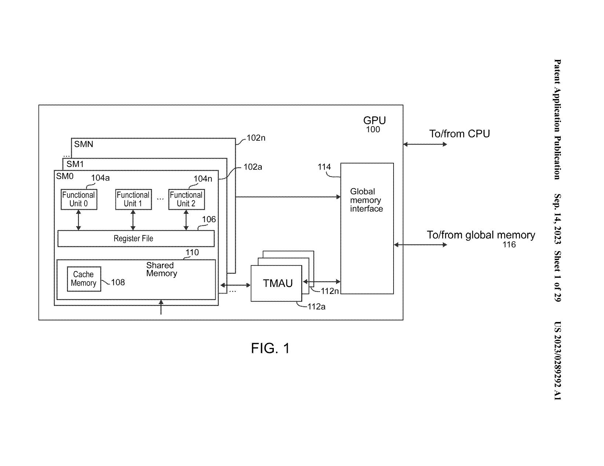
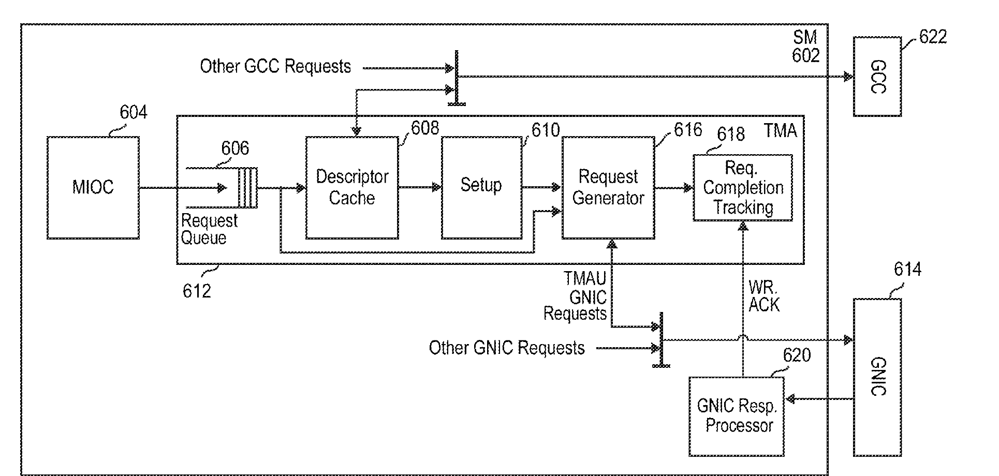
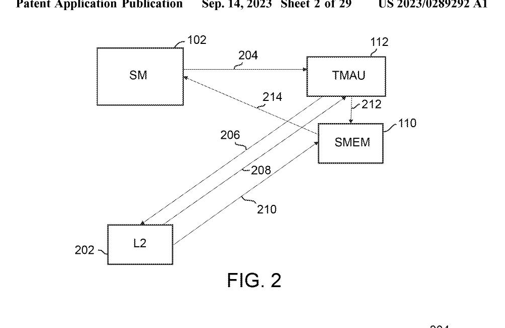
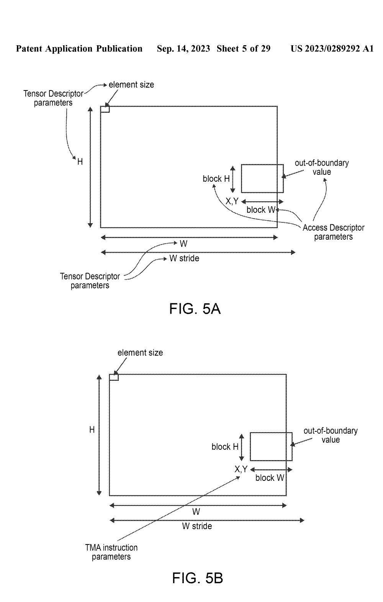
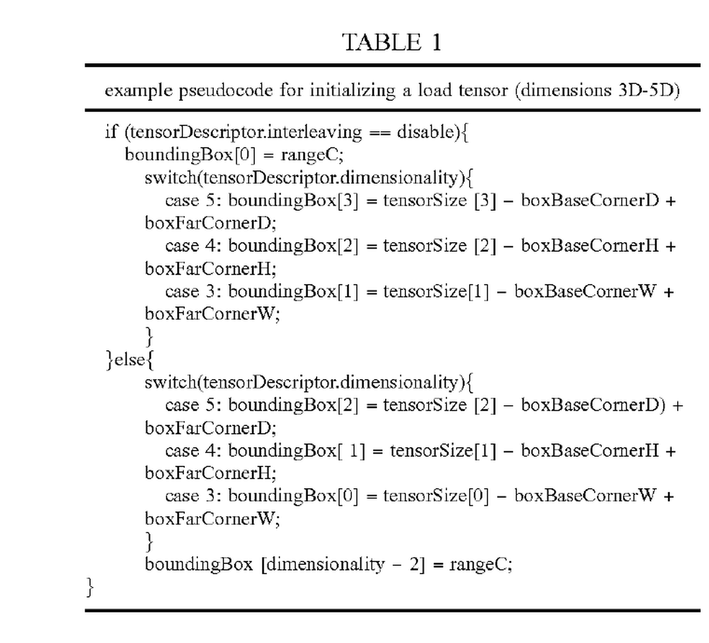
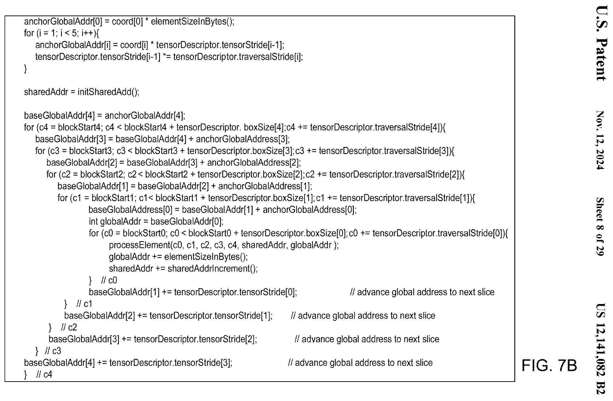
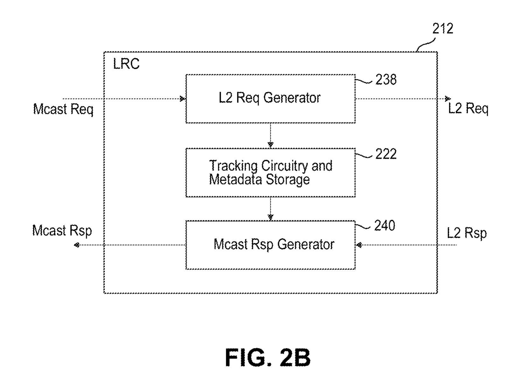
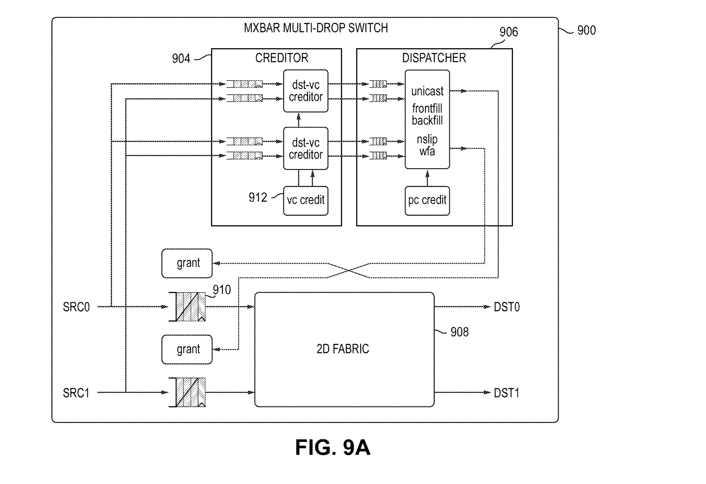
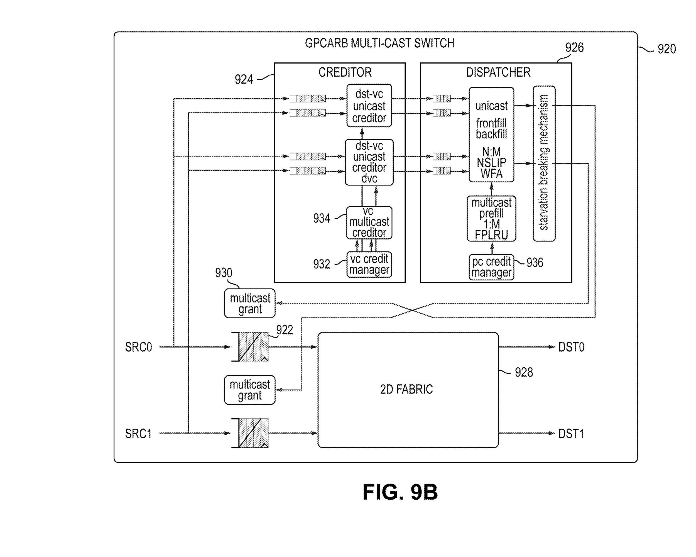
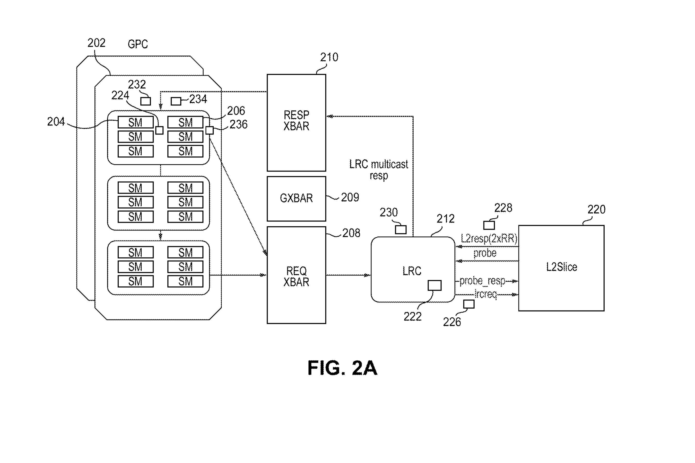

# 第四章：TMA 硬件设计

> 本文是 [NVIDIA TMA 调研系列](index.md) 第四章。上一篇：[Blackwell 与 Rubin 的 TMA PTX 演进](03-blackwell-rubin-ptx.md)。

本章以 Hopper 为主要背景，结合 NVIDIA 官方资料、专利和公开逆向结果，梳理 TMA 的内部模块、内存请求与响应，以及 mbarrier、Multicast、Group 等机制。专利中的结构作为实现模型，文中推测在相应段落标明。

## 4.1 TMA 数量

从软件可见的硬件资源看，Hopper 为每个 SM 提供了一个独立的 TMA 服务端点，而不是由整个 GPU 共用一个全局 TMA 引擎。每个 SM 都可以独立发起 TMA 请求，并获得相对固定的数据搬运能力。

NVIDIA 的官方资料采用了相同的组织方式。H100 白皮书在单个 SM 的功能框内画出 TMA，并将它连接到该 SM 的 shared memory 与全局内存数据通路；[NVIDIA Research](https://research.nvidia.com/publication/2025-06_task-based-tensor-computations-modern-gpus) 则将 TMA描述为 Hopper 每个 compute unit 所包含的异步数据移动单元。这里的 compute unit 对应 SM，因此可以确定 TMA 在体系结构上是按 SM 提供服务的。

至于一个服务端点是否对应一个完整的物理 TMAU，[NVIDIA TMAU 专利](https://patents.google.com/patent/US12499052B2/en) 给出了更宽的实现范围：TMAU 可以位于 SM 内，也可以位于 SM 外但与 SM 紧密耦合；多个 SM 可以分别连接各自的 TMAU，也可以通过仲裁共享部分 TMA 硬件。因此，“每个 SM 有一个 TMA 服务端点”并不必然等价于“每个 SM 内复制了一套完整 TMAU”。



*图 4-1　专利 FIG. 1 给出的 SM、shared memory、TMAU 与 global-memory interface 的系统关系。该图表示专利允许的组织方式，不代表 GH100 的实际物理布局。*

[H200 DSM/TMA 带宽逆向实验](https://seanzw.github.io/posts/gpu_dsm_bw/) 进一步测量了多个 SM 同时执行 TMA remote put 时的扩展性：

| 活动 SM 数 | 聚合吞吐 | 每 SM 吞吐 |
| --- | --- | --- |
| 2 | 约 40.59 B/cycle | 约 20.29 B/SM-cycle |
| 4 | 约 82.02 B/cycle | 约 20.50 B/SM-cycle |
| 8 | 约 164.30 B/cycle | 约 20.54 B/SM-cycle |
| 16 | 约 338.89 B/cycle | 约 21.18 B/SM-cycle |

聚合吞吐随活动 SM 数近似线性增长，而每个 SM 始终获得约 20–21 B/cycle。实验扩展到 16 个 SM 时仍未出现明显的 GPC 级共享 TMA 瓶颈；减少活动 SM 数也没有让剩余 SM 获得其他 SM 的空闲份额。这表明 TMA 至少具有按 SM 独立配置或固定分区的前端、队列和服务带宽，而不是一个可由整个 GPC 动态共享的普通 DMA 引擎。

综合官方说明、专利结构和逆向结果，本章采用以下硬件模型：**每个 Hopper SM 对应一个独立的 TMA 服务端点，并具有固定的 per-SM TMA 服务能力；该端点很可能包含与 SM 一对一近耦合的 TMA 前端，descriptor cache、request generator、网络接口等后端模块是否完整复制，则可能随具体物理实现而变化。**

## 4.2 TMA 内部模块

根据 [NVIDIA TMAU 专利](https://patents.google.com/patent/US12499052B2/en) 给出的请求处理路径，TMA 可以拆分为八个逻辑模块。为补全实际数据搬运路径，本章另外引入 Local SMEM Data Interface 作为 TMAU 与本地 shared memory 之间的功能接口；该接口没有在专利图 6 中标成独立模块。

| 模块 | 主要功能 |
| --- | --- |
| SM–TMA 接口（MIOC） | 连接 SM 与 TMA 请求流水线，接收 SM 发出的 memory access request |
| Internal Request Queue | 缓存 tensor 与 non-tensor 请求，并选择下一项进入处理流水线 |
| Descriptor Cache | 按 descriptor 地址缓存最近使用的 tensor descriptor，并通过 GCC 从全局内存补充缺失项 |
| Setup Block | 合并 descriptor 字段与本次请求参数，计算派生信息并检查参数合法性 |
| Request Generator | 遍历多维 tensor 坐标，计算 global/shared 地址、处理 OOB，并生成内存子请求 |
| GNIC Interface | 把生成的内存子请求发送到 L2/全局内存系统 |
| GNIC Response Processor | 接收内存系统返回的数据与响应，推进 destination write 和请求完成处理 |
| Local SMEM Data Interface | 从本地 SMEM 读取源数据，或将 GNIC 返回的数据写入本地 SMEM |
| Response Completion Circuit | 跟踪每个高层请求对应的未完成子请求，并在全部完成后生成完成事件 |

这些模块组成一条从 SM 请求输入、请求展开、内存系统交互到完成跟踪的处理流水线。专利图 6 给出了各模块之间的连接关系：



*图 4-2　TMAU 请求处理流水线。图片裁自 NVIDIA 专利 [US20230289292A1，FIG. 6](https://patentimages.storage.googleapis.com/d1/f5/46/4edecd80657a0d/US20230289292A1.pdf)。该图表达的是逻辑模块与请求路径，不代表 GH100 芯片上的物理布局。*

图 4-2 主要展开请求与响应控制流水，没有画出连接本地 shared memory 的 payload 数据通路；该通路由本章的 Local SMEM Data Interface 功能模型补充。



*图 4-3　专利 FIG. 2 给出的高层请求、L2 子请求、数据返回、SMEM 写入与同步关系。*

FIG. 2 中，SM 通过操作 204 向 TMAU 提交一次高层请求；TMAU 通过操作 206 向 L2 发出多个子请求。专利对目的 SMEM 写入给出两种实施方式：L2 可通过操作 210 将 sub-block 直接写入 SMEM；数据也可通过操作 208 返回 TMAU，再由 TMAU 通过操作 212 写入 SMEM。两种路径均在目的数据写入后通过操作 214 与 SM 同步。[US20230289292A1，FIG. 2 及对应说明](https://patents.google.com/patent/US20230289292A1/en)

其中，MIOC 和 Request Queue 构成请求前端；Descriptor Cache、Setup Block 与 Request Generator 负责把 descriptor 驱动的高层操作展开为线性内存事务；GNIC 及其 Response Processor 负责与远端内存系统交换请求和数据；Local SMEM Data Interface 负责本地 SMEM 的源读取和目的写入；Response Completion Circuit 则把多个子请求重新汇总为一次 TMA 操作的完成状态。

SyncUnit/mbarrier、GCC/L2 和本地 shared-memory array 位于 TMAU 请求处理模块之外：SyncUnit/mbarrier 接收完成更新并维护同步状态，GCC/L2 负责 descriptor 和 tensor 数据的缓存及全局内存访问，shared-memory array 则通过 Local SMEM Data Interface 与 TMAU 交换数据。

### 4.2.1 SM–TMA 接口（MIOC）

MIOC 的全称是 Memory Input/Output Controller，即存储器输入/输出控制器，在专利图 6 中编号为 604。它位于 SM 602 与 TMAU 612 的请求处理流水线之间：接收 SM 发出的 memory access request，并将请求送入 Internal Request Queue 606。

```text
SM 602 → MIOC 604 → Internal Request Queue 606 → TMAU 请求处理流水线
```

专利将 MIOC 定义为 SM 与 TMAU 请求流水线之间的输入接口。MIOC 接收请求后即将其送入 Internal Request Queue；请求的保存、选择和后续分派由 Request Queue 负责。

### 4.2.2 Internal Request Queue

Internal Request Queue 在专利图 6 中编号为 606，输入来自 MIOC 604，后级连接 Descriptor Cache 608、Setup Block 610 和 Request Generator 616。

Request Queue 接收 tensor request 和 non-tensor request 两类请求：

| 请求类别 | 请求携带的信息 |
| --- | --- |
| Tensor request | 携带 Tensor Map 描述符的全局地址，以及本次请求特有的 tensor 坐标或地址等参数 |
| Non-tensor request | 访问线性内存，不使用 Tensor Map 描述符；可直接携带 global-memory 地址、shared-memory 地址和传输大小 |

两类请求都可以包含 load、store、reduction 和 prefetch 操作。

专利给出了两种队列组织方式：一种是使用一个 Request Queue，同时接收 tensor 和 non-tensor 请求；另一种是为两类请求分别设置队列。图 6 画出的是第一种形式，即统一的 Request Queue 606。

队列可以按 FIFO 顺序处理请求，也可以根据请求属性选择下一项请求。专利列举的选择条件包括：

- request type；
- read/write request 的大小；
- 请求的数据类型；
- 要访问的 memory；
- 其他请求特征。

因此，Request Queue 允许按照请求特征选择待处理项，不要求始终按照进入队列的先后顺序发射。

队列完成选择后，将 tensor request 送入 descriptor/setup 路径；non-tensor request 不需要 Tensor Map，可以直接送入 Request Generator，也可以在部分实现中先经过 Setup Block。

### 4.2.3 Descriptor Cache

#### 4.2.3.1 Tensor Map

CUDA 对外提供的 Tensor Map 是一个 128 B 的 opaque object，TMA 硬件使用的 descriptor 位于对象起始的 64 B。专利给出的说明性布局为：

```text
128 B Tensor Map 软件对象
├── 0–63 B：desc[8]，64 B 硬件 TMA descriptor
├── 64–119 B：pad[7]，辅助信息或未来扩展的预留空间
└── 120–127 B：cpsize，预计算的 expected transaction count
```

两部分由不同通路使用：

```text
                    ┌── 前 64 B → TMA-cache → TMAU
128 B Tensor Map ───┤
                    └── 后 64 B → 普通内存访问 → barrier/pipeline 管理代码
```

TMA tensor 指令使用 Tensor Map 对象的基地址，该地址同时也是内部 64 B descriptor 的地址。TMA-cache 只缓存这部分硬件 descriptor。后 64 B 仍保存在 `.global`、`.constant` 或 `.grid_constant` 内存中，由 CUDA API 展开的普通指令读取。例如，自动事务计数可以展开为：

```text
cp.async.bulk.tensor... [map], ...       // TMAU 使用前 64 B descriptor
mbarrier.expect_tx ... map->cpsize       // 软件封装读取后 64 B 中的元数据
```

对于 pipeline，`map->cpsize` 也可以用于累加 pipeline 的 transaction count。这样，软件在提交 TMA 操作时不需要重新根据 Tensor Map 各字段计算搬运字节数。

`desc[8] + pad[7] + cpsize` 是专利用于解释 128 B 对象用途的示例布局，不是 CUDA 对应用程序承诺不变的公开字段布局；公开接口仍将整个 Tensor Map 定义为 opaque object。[NVIDIA Tensor Cache 专利](https://patents.google.com/patent/US20240168765A1/en)

#### 4.2.3.2 缓存对象与缓存层次

Descriptor Cache 缓存的是前述 64 B 硬件 tensor descriptor，而不是整个 128 B Tensor Map 软件对象，也不是 descriptor 所描述的 tensor 数据。

TMA 通过一条 constant-cache hierarchy 读取 descriptor：

```text
Global Memory → L2 → GCC 管理的中间 constant-cache → TMA-cache → Setup Block
```

GCC 的全称是 General Cache Controller。它是中间缓存的控制模块；专利中的 `GCC line` 指由 GCC 管理的缓存行。TMA-cache 又称 Descriptor Cache，是更靠近 TMAU 的专用 descriptor 缓存。二者在层次中的分工如下：

| 层级 | 作用 |
| --- | --- |
| L2 | 保存从 global memory 读取或由 generic/global 路径写入的 descriptor 数据 |
| GCC 管理的缓存 | constant/tensormap 访问路径中的中间缓存，并向 TMA-cache 提供 descriptor |
| TMA-cache | 按 descriptor 地址保存 TMAU 最近使用的硬件 descriptor |

专利将 TMA-cache 称为本地缓存，并规定 CTA 绑定到 SM 时可以通过 `task bind` 使其失效。GCC 位于它的上游，为 descriptor load 和 refill 提供接口。[NVIDIA TMAU 专利](https://patents.google.com/patent/US20230289304A1/en)、[NVIDIA Tensor Cache 专利](https://patents.google.com/patent/US20240168765A1/en)

#### 4.2.3.3 GCC 与 TMA-cache 的组织和配置

| 配置项 | GCC 管理的缓存 | TMA-cache |
| --- | --- | --- |
| 缓存对象 | constant/tensormap 访问路径中的数据 | 硬件 tensor descriptor |
| Cache line | 专利实施例为 256 B | 专利实施例为 64 B |
| Tag | 未公开具体格式 | descriptor 的 global-memory 地址 |
| 容量与 entry 数 | 未公开 | 可以实现为 single-line 或 multi-line cache，具体容量未公开 |
| 组相联度与索引 | 未公开 | 未公开 |
| 归属范围 | TMA-cache 的上游缓存层级 | 专利称为 local TMA-cache，并由本地 TMA cache-control 操作失效 |

Tensor descriptor 按 64 B 对齐时，一个 256 B GCC line 覆盖四个连续的 64 B 地址区间；TMA-cache 则以 64 B 为 descriptor 缓存和失效粒度。这里描述的是地址覆盖关系，不表示 GCC 与 TMA-cache 必须采用包含式缓存。

TMAU 收到 tensor request 时，请求携带 descriptor 的 global-memory 地址。TMA-cache 以该地址识别对应 descriptor，因此多个使用相同 descriptor 地址的 TMA 请求可以复用同一缓存项。[NVIDIA TMAU 专利](https://patents.google.com/patent/US20230289304A1/en)、[Tensor Map Cache Storage 专利](https://patents.google.com/patent/US20240176663A1/en)

#### 4.2.3.4 查找、预取、miss、填充与替换

一次 descriptor 访问依次经历：

```text
lookup → hit / miss → fetch → fill → use → replace
```

TMA-cache 命中时，descriptor 直接交给 Setup Block。Setup Block 再把其中的静态字段与本次请求携带的坐标、shared-memory 地址等动态参数组合。

TMA-cache 未命中时，TMAU 向 GCC 发出 descriptor load request；GCC 从上游缓存或 global memory 取得对应数据，并将 descriptor 填入 TMA-cache。专利还给出下一请求的提前检查：TMAU 处理当前请求时，可以检查 Request Queue 中下一项 tensor request 的 descriptor 是否命中；发生 miss 时立即启动读取，从而把 descriptor 获取与当前请求处理重叠。该结构至少支持“一个请求正在处理、下一份 descriptor 正在获取”的流水关系。

软件也可以使用 `prefetch.tensormap`，根据 Tensor Map 地址提前触发 descriptor 预取：

```text
prefetch.tensormap [tmap]
                 │
                 ▼
       L2 / GCC → TMA-cache
```

`prefetch.tensormap` 预取的是 descriptor；`cp.async.bulk.prefetch.tensor...global.L2` 使用 descriptor 计算 tensor 地址，预取的是 tensor payload。两者使用不同的缓存目标。

专利允许 TMA-cache 采用 single-line 或 multi-line 结构。新 descriptor 填入而没有空闲项时需要替换已有项；具体替换算法、同时在途的 descriptor miss 数量和同地址 miss 合并规则没有公开。[Tensor Map Cache Storage 专利](https://patents.google.com/patent/US20240176663A1/en)

#### 4.2.3.5 一致性与同步

Descriptor 的写入与 TMA 读取经过不同的 memory proxy：

```text
线程修改 descriptor：generic/global proxy → L2
TMA 读取 descriptor：tensormap/constant proxy → GCC 管理的缓存 → TMA-cache
```

线程把新 descriptor 写入 L2 后，GCC 管理的 256 B cache line 和 TMA-cache 中的 64 B cache line 仍可能保存旧副本。专利明确指出，GCC 与 TMA-cache 不会自动保持一致；更新 descriptor 后，需要先保证新值到达 L2，再使使用方访问路径中的旧副本失效。

设备端动态更新 descriptor 时，完整顺序为：

```text
生产者写 descriptor
        ↓
release：将更新推进到 L2
        ↓
生产者与消费者同步
        ↓
acquire：失效 GCC line 和本地 TMA-cache line
        ↓
TMA 重新从上游取得 descriptor
```

专利将底层动作描述为：生产者使用 `MEMBAR.GL` 把更新推进到 L2，使用方通过 `UTMACCTL.IV` 使 GCC 和本地 TMA-cache 中对应内容失效。在 PTX 层，这组关系由 `fence.proxy.tensormap::generic.release` 和 `fence.proxy.tensormap::generic.acquire` 表达。

对于通过 `.constant` 或 `.grid_constant` 传入、在 kernel 执行期间保持不变的 Tensor Map，kernel launch 可以失效对应 GCC range，CTA 的 `task bind` 可以失效本地 TMA-cache。运行期间由 device 代码修改的 descriptor，则需要显式执行 release、线程间同步和 acquire。[NVIDIA Tensor Cache 专利](https://patents.google.com/patent/US20240168765A1/en)

#### 4.2.3.6 性能与并发行为

Descriptor Cache 的性能作用来自 descriptor 复用和请求间流水。连续 tile 操作通常使用同一 Tensor Map，只改变 tile 坐标；第一次访问把 descriptor 填入 TMA-cache，后续请求即可复用缓存项。对于即将切换到另一份 descriptor 的请求，TMAU可以在处理当前请求时提前获取下一份 descriptor，隐藏一部分 miss 延迟。

这套机制形成两种互补的延迟隐藏方式：

| 方式 | 提前量来源 | 适用情况 |
| --- | --- | --- |
| Request Queue look-ahead | TMAU 检查队列中的下一项 tensor request | 请求已经进入 TMAU |
| `prefetch.tensormap` | 软件在真正提交 tensor copy 前显式预取 | 软件能够更早确定下一份 Tensor Map |

实际命中率由同时活跃的 descriptor 数量、TMA-cache 容量和替换行为共同决定。现有专利能够确定 descriptor 复用、队列前瞻和软件预取三种性能来源；容量、端口数量、命中延迟和最大并发 miss 数仍需要通过硬件资料或微基准进一步确定。

#### 4.2.3.7 TMA 内部通路

将前述缓存机制放回 TMAU 流水线，可以得到三条请求路径。

Tensor request 命中：

```text
MIOC → Request Queue → TMA-cache → Setup Block → Request Generator
```

Tensor request 未命中：

```text
                         ┌← GCC ← L2 / Global Memory
                         │
MIOC → Request Queue → TMA-cache → Setup Block → Request Generator
```

Non-tensor request：

```text
MIOC → Request Queue ─────────────────────→ Request Generator
                           bypass
                    TMA-cache / Setup Block
```

部分实现也可以让 non-tensor request 先经过 Setup Block，但它不需要查找 Tensor Map。由此，Descriptor Cache 是 tensor request 的专用前端：负责把 descriptor 地址转换为可供 Setup Block 使用的本地 descriptor；它不参与 non-tensor bulk copy，也不缓存 TMA 实际搬运的 tensor payload。

### 4.2.4 Setup Block

Setup Block 在专利图 6 中编号为 610，负责将指令信息与其指向的 descriptor 内容合并，完成一次 TMA 请求的初始化，并向 Request Generator 提供可用于迭代展开的请求 context。

#### 输入与输出

Setup 的请求参数来自两个来源：Request Queue 提供当前指令的操作信息和动态操作数；Descriptor Cache 提供该请求引用的 descriptor 内容。二者的字段与语义见第二章。

```text
Request Queue ── 指令信息 ──┐
                           ├──→ Setup ── 请求 context ──→ Request Generator
Descriptor Cache ── desc ──┘
```



*图 4-4　专利 FIG. 5A/5B 给出的参数来源。Descriptor 提供 tensor 与访问块属性，指令提供本次访问的动态坐标；该图表示参数归属，不改变“先译码指令确定 descriptor 类型，再按类型译码 descriptor bits”的处理顺序。*

输出 context 是对完整请求的内部表示：它保留后续执行所需的信息，并加入预处理得到的派生参数，使 Request Generator 能够开始遍历。统一 context 是本章采用的功能模型；公开资料未披露其字段布局、存储形式和传递接口。

#### 职责

Setup 的处理可按功能划分为三个阶段；该划分不代表三个物理流水级。

| 阶段 | 职责 |
|---|---|
| 解析 | 先独立译码指令，确定操作语义及 descriptor 类型；再按照该类型译码从 Descriptor Cache 取得的 descriptor bits |
| 校验 | 检查请求参数及其组合是否满足 TMAU 要求；失败时产生错误并丢弃请求 |
| 规范化 | 合并输入并计算请求级派生参数，形成适合 Request Generator 迭代执行的 context |

专利明确描述了参数收集、计算和错误检查，并以 Table 1 展示 Setup 根据维数、interleave、tensor size 和 box corner 计算 `boundingBox[]` 的实例。具体校验项目及其他预计算的硬件归属未完整公开。[US12141082B2，Setup 说明及 Table 1](https://patents.google.com/patent/US12141082B2/en)



*图 4-5　专利 Table 1 给出的 Setup 高层伪代码。该例根据 interleaving 和 dimensionality，将通道范围及各空间维范围组织为 `boundingBox[]`；它是初始化逻辑示例，不代表 Setup 的完整实现。*

两个模块的边界是：**Setup 完成整条请求的一次性准备；Request Generator 推进多维坐标，执行当前位置的 OOB 判断和地址计算，并生成内存子请求。** 按照这一分工，模式解释和请求级预计算可以移出反复执行的遍历过程；这属于对模块划分的逻辑解释。[US12141082B2，Request Generator 说明](https://patents.google.com/patent/US12141082B2/en)

#### 前后级流水

Setup 完成参数准备依赖当前请求及对应 descriptor 就绪。Descriptor 未命中时，TMAU 经 GCC 获取；专利允许提前检查下一请求的 descriptor，使获取过程与当前请求处理重叠。

Setup 与 Request Generator 也可并行运行：后者展开请求 $n$ 时，前者准备请求 $n+1$。这一设计重叠了相邻请求的初始化与展开过程，但具体缓冲深度、握手协议和流水时序尚未公开。Non-tensor request 不依赖 descriptor，可直接进入 Request Generator；专利也允许其经过 Setup。[US12141082B2，FIG. 6 及流水说明](https://patents.google.com/patent/US12141082B2/en)

### 4.2.5 Request Generator

#### 1. 输入输出

| 项目 | 内容 |
|---|---|
| Tensor 请求输入 | Setup 生成的请求 context，包括已译码、校验和预处理的 descriptor 参数与指令参数 |
| Non-tensor 请求输入 | 全局内存地址、共享内存地址和传输大小，可由 Request Queue 直接提供 |
| 远端请求输出 | 发往 GNIC 的读、写或 reduction 子请求 |
| 本地请求输出 | 以 local SMEM 为源时发出的 SMEM 读请求 |
| 完成信息 | 本地 SMEM 源读完成由 scoreboard 跟踪；远端返回数据或 write ACK 经 GNIC Response Processor 更新完成状态 |

[US12141082B2，FIG. 6 及 Request Generator 说明](https://patents.google.com/patent/US12141082B2/en)

#### 2. 功能描述

Request Generator 是 TMAU 展开内存访问的核心模块。对于 tensor 请求，其处理流程为：

1. 按照请求 context 遍历一至五维 tensor 空间；
2. 计算当前 tensor 坐标并执行越界判断；
3. 计算对应的全局内存地址和共享内存地址；
4. 按照内存系统支持的请求大小组织子请求；
5. 根据数据方向，向 GNIC 发出远端读请求，或者先向 Local SMEM Data Interface 发出本地读请求，再使用返回数据形成 GNIC 写请求。

对于 tensor store，源 shared memory 被作为线性地址空间顺序读取，global destination 则按照 descriptor 描述的多维 tensor 解释。请求携带 descriptor 指针、shared-memory base address 和目的 tensor coordinates；Request Generator 据此把线性源数据映射到多维目的地址。[US20230289292A1，Store and Reduction Requests](https://patents.google.com/patent/US20230289292A1/en)

FIG. 7B 以五层嵌套循环描述多维遍历的高层结构。实际请求生成还包括 L2 请求组织、swizzle 和越界数据处理。



*图 4-6　专利 FIG. 7B 给出的 Request Generator 五维遍历高层伪代码。*

专利称单个子请求通常不超过一个 L2 cache line。NVIDIA 公开的缓存模型中，L2 cache line 为 128 B，由四个 32 B sector 组成；一个 L2 请求访问同一 cache line 中的一至四个 sector。Request Generator 据此将连续数据组织为 cache-line 范围内的请求，并对请求序列进行优化。

对于 non-tensor 请求，Request Generator 按照相同的请求大小约束，将线性数据块拆分为多个 sub-block，依次计算其全局内存地址，并复用相同的发送与完成跟踪通路。

对于 tensor payload prefetch，Request Generator 复用 tensor load 的 descriptor、坐标解释和地址生成路径，将目标数据从 DRAM 预取到 L2。该操作不生成 destination SMEM write，也不执行普通 load 所需的目的端 completion tracking。[US20230289292A1，Prefetch Support](https://patents.google.com/patent/US20230289292A1/en)

[US12141082B2，Request Generator 及 FIG. 7B 说明](https://patents.google.com/patent/US12141082B2/en)  
[Nsight Compute 缓存请求定义](https://docs.nvidia.com/nsight-compute/ProfilingGuide/)

#### 3. outstanding 设计

一条 TMA transaction 可以展开为多个 L2 子请求。Request Generator 负责持续生成和发送子请求，Response Completion Circuit 负责跟踪其完成状态：

$$
\text{发送 L2 子请求：}\quad outstanding \leftarrow outstanding+1
$$

$$
\text{收到对应完成事件：}\quad outstanding \leftarrow outstanding-1
$$

$$
\text{全部子请求已发出}\ \land\ outstanding=0
\quad\Rightarrow\quad \text{所跟踪阶段完成}
$$

该设计将请求生成与返回等待解耦，使 Request Generator 能够在前序子请求仍处于在途状态时继续展开当前 transaction。请求展开期间，计数器可能暂时归零；只有全部子请求均已发出且对应完成事件全部返回，才能判定所跟踪阶段完成。对于 load，若计数器跟踪的是 L2 读响应，归零只表示远端读取完成；整笔搬运还需要目的 SMEM 写入完成。

专利还允许一个 counter 聚合跟踪多条连续发出的 TMA transaction，并在组内最后一条 transaction 完成后统一报告。由此形成两级完成关系：

```text
L2 子请求完成
      ↓ outstanding 归零
单条 TMA transaction 完成
      ↓ 可选聚合
连续 transaction 组完成
```

PTX 通过 `mbarrier` 向软件提供完成状态。TMA load 使用 `mbarrier::complete_tx::bytes` 按完成字节数递减 transaction count；当 pending-arrival count 和 transaction count 均归零时，当前 barrier phase 完成。专利中的内部 counter 以 L2 子请求为计数单位，`mbarrier` 以字节数表示软件可见的完成条件，二者共同构成从内存子请求到线程同步的分层完成机制。

[US12141082B2，completion tracking 说明](https://patents.google.com/patent/US12141082B2/en)  
[PTX ISA，mbarrier 异步 transaction 跟踪](https://docs.nvidia.com/cuda/parallel-thread-execution/index.html#mbarrier-instructions-tracking-asynchronous-operations-by-the-mbarrier-object)

### 4.2.6 GNIC Interface

#### 1. 输入输出

GNIC 位于 TMAU 与 GPU 内存网络之间。输入包括 Request Generator 生成的远端请求信息，以及写操作中由 Local SMEM Data Interface 返回的 payload；输出是发往 L2 或目标 SM 的数据传输请求。返回流量由独立的 GNIC Response Processor 接收，并交给后续写入与完成跟踪逻辑。

```text
Request Generator ── request ──┐
                               ├→ GNIC → GPU Memory Network → L2 / Target SM
Local SMEM Data Interface ─data┘                              ↓
                                        GNIC Response Processor ← Response
```

[US12141082B2，FIG. 6 及 GNIC 说明](https://patents.google.com/patent/US12141082B2/en)

#### 2. 功能描述

GNIC 负责将 TMAU 生成的内部子请求接入 GPU 片上网络。Request Generator 完成坐标遍历、地址计算和请求切分；Local SMEM Data Interface 为写请求提供源数据；GNIC 承担请求封装、发送和网络接入，使 TMAU 能够通过统一通路访问 L2 以及 cluster 内其他 SM 的 shared memory。

相关专利给出的片上路径为：

```text
SM → TPCARB → GPCMMU/uTLB → GPCARB
                              ├─→ MXBAR → L2 / Global Memory
                              └─→ GXBAR → Cluster Peer SM
```

全局内存流量和 SM 间流量在 GPCARB 处分流：前者进入 MXBAR 和 L2 路径，后者进入 GXBAR 和 DSMEM 路径。TMA multicast 由 SM 与 GNIC 中的组播硬件共同支持，使一份源数据能够经片上网络发送到 cluster 内多个目标 CTA。

Multicast 同时包含接收侧和发起侧两类完成状态。每个接收 CTA 在数据到达后更新自己的 shared-memory barrier；为支持 preemption，发起 TMAU 还需要汇总各接收端的数据包确认，以判断整个 multicast transaction 是否完成。专利允许通过跨 TMAU acknowledgement 传递这些接收事件。[US20230289292A1，Multicast Support](https://patents.google.com/patent/US20230289292A1/en)

因此，GNIC 的模块边界是：**接收已经形成的内存请求，完成片上网络的接入、路由与发送；tensor 遍历、地址生成和请求完成判定分别属于 Request Generator 与 Response Completion Circuit。**

[US12248788B2，DSMEM 片上请求路径](https://patents.google.com/patent/US12248788B2/en)  
[US20230289189A1，TMA multicast 与 GNIC](https://patents.google.com/patent/US20230289189A1/en)

### 4.2.7 GNIC Response Processor

#### 1. 输入输出

GNIC Response Processor 接收内存系统返回的响应，并根据响应类型将其送往本地 SMEM 写入通路或完成跟踪通路。其逻辑输入输出如下。

| 响应类型 | 输入 | 输出 |
|---|---|---|
| 读数据响应 | 请求标识、读数据、错误状态及目的 SMEM 元数据 | 本地 SMEM 写请求，以及对应的完成状态 |
| 写完成响应 | 请求标识、write ACK 或写完成状态 | Response Completion Circuit 的完成更新 |
| 错误响应 | 请求标识和错误信息 | 对应请求的错误及完成状态 |

其中，读数据响应对应 `GMEM → SMEM`：GNIC 返回的数据需要继续写入本地 SMEM。写完成响应对应 `SMEM → GMEM` 或 `SMEM → peer SMEM`：数据已在此前从本地 SMEM 读出并随写请求发出，响应处理阶段只需确认目的端写入完成。

专利将 GNIC 网络流量划分为 REQUEST 和 RESPONSE 两类虚拟通道。读命令和写命令均通过 REQUEST VC 发出；读数据、write ACK 和 read error 均通过 RESPONSE VC 返回。因此，这里的通道划分是请求与响应分离，而不是读操作与写操作分别占用独立的 GNIC 通道。[US12248788B2，SM2SM packets on the network](https://patents.google.com/patent/US12248788B2/en)

#### 2. 功能描述

GNIC Response Processor 首先根据响应携带的请求标识匹配 outstanding 子请求，并区分读数据、写完成和错误响应。TMA 主专利明确说明，内存请求通过 GNIC Interface 发出，返回响应由 GNIC Response Processor 接收，并由其通知 Response Completion Circuit 更新请求状态。[US12141082B2，TMAU Processing Path](https://patents.google.com/patent/US12141082B2/en)

对于数据先返回 TMAU、再由 TMAU 写入目的 SMEM 的实施方式，`GMEM → local SMEM` 的处理流程为：

```text
Request Generator
→ GNIC read request
→ GNIC read-data response
→ 匹配 outstanding 读请求
→ GNIC Response Processor
→ Local SMEM write request
→ Local SMEM write completion
→ Response Completion Circuit / SyncUnit barrier
```

GNIC 读响应只是远端读取阶段的完成；整个 TMA 搬运需要在数据写入目的 SMEM 后才完成。使用 mbarrier 的操作以目的端写入字节数更新 transaction count，使等待方只在 SMEM 数据可用后通过 barrier。[US20240168765A1，TMA-bulk completion](https://patents.google.com/patent/US20240168765A1/en)

专利 FIG. 2 还允许内存系统将返回的 sub-block 直接写入 destination SMEM。在该实施方式中，payload 不需要先经过 GNIC Response Processor 再形成一次本地写请求，但目的端数据写入与 barrier 更新仍是 TMA load 的完成条件。两种方式是公开资料给出的可选实现，本章的模块划分用于描述其共同功能，不限定实际芯片采用哪一条物理路径。[US20230289292A1，FIG. 2 及对应说明](https://patents.google.com/patent/US20230289292A1/en)

对于 `local SMEM → GMEM/peer SMEM`，完整处理流程为：

```text
Request Generator
→ Local SMEM read request
→ Local SMEM read response（payload + source-read completion）
→ TMA write-data path
→ GNIC write request
→ destination write completion / write ACK
→ 更新 Response Completion Circuit
```

本地 SMEM 读完成和目的端写完成是两个独立的完成事件。前者表示源数据已经被 TMA 安全取走，允许软件复用源 SMEM；后者表示数据已经到达 GMEM 或 peer SMEM。专利分别使用 scoreboard、cache invalidation、write ACK 或 SyncUnit barrier 跟踪这些事件。[US20240168765A1，read/write completion](https://patents.google.com/patent/US20240168765A1/en)

由此，TMAU 内部可归纳出两条相反方向的数据通路：

```text
local SMEM read    → GNIC write
GNIC read response → local SMEM write
```

两条通路可以流水重叠，但仍共享 Request Generator、GNIC 请求/响应虚拟通道、内部缓冲、完成跟踪资源以及 SMEM bank/端口。公开资料支持这两条逻辑数据流及其独立完成语义，未给出 SMEM 读写端口和 GNIC 收发资源完全物理独立的实现。

### 4.2.8 Local SMEM Data Interface

Local SMEM Data Interface 是 TMAU 与本地 shared memory 之间的数据接口。MIOC 传递 SM 发出的 TMA 指令和请求参数；Local SMEM Data Interface 传递 TMA 实际搬运的数据。

#### 1. 输入输出

| 数据方向 | 输入 | 输出 |
|---|---|---|
| Local SMEM 作为源 | Request Generator 生成的本地 SMEM 地址、访问大小及控制信息 | SMEM 读数据送入 TMA write-data path；源读完成状态送入 scoreboard |
| Local SMEM 作为目的 | 内存系统直接送达的数据，或 GNIC Response Processor 提供的读响应数据，以及目的 SMEM 地址和写入控制信息 | SMEM 写入；目的端完成状态更新至对应 barrier 或同步通路 |

两条方向的数据流分别为：

```text
Request Generator
→ Local SMEM read request
→ Local SMEM read response（payload + source-read completion）
→ TMA write-data path
→ GNIC write request
→ destination write completion / write ACK
→ Response Completion Circuit
```

```text
Request Generator
→ GNIC read request
→ L2 / memory-system read-data response
→ destination SMEM direct write
   或 GNIC Response Processor → Local SMEM write request
→ Local SMEM write completion
→ Response Completion Circuit / SyncUnit barrier
```

#### 2. 功能描述

Local SMEM Data Interface 根据 Request Generator 提供的地址和范围向本地 SMEM 发起读取，并将返回数据送入 GNIC 写数据通路；反方向上，它表示将内存系统返回的数据写入指定本地 SMEM 地址的功能边界。该数据可以由内存系统直接送达，也可以先返回 TMAU 并经 GNIC Response Processor 转交。接口同时处理有效字节、写掩码及与访问布局相关的控制信息，并分别报告源 SMEM 读完成和目的 SMEM 更新完成。

其模块边界是：**Request Generator 决定访问地址并生成子请求；Local SMEM Data Interface 完成本地数据读取和写入；GNIC Interface 负责远端请求的网络发送；GNIC Response Processor 处理远端返回；Response Completion Circuit 和 SyncUnit 汇总完成状态。**

公开资料确认 TMAU 对本地 shared memory 具有读写访问能力。这里将其抽象为 Local SMEM Data Interface，用于描述完整数据流；具体物理端口、缓冲深度和仲裁结构未公开。[US20240176663A1，TMAU 对 shared memory 的读写访问](https://patents.google.com/patent/US20240176663A1/en)

### 4.2.9 Response Completion Circuit

Response Completion Circuit 在专利图 6 中编号为 618，负责跟踪 Request Generator 生成并经 GNIC 发出且需要完成事件的内存请求。GNIC Response Processor 接收内存系统返回的响应，并与该电路通信以更新请求的完成状态。该跟踪机制使 SM 可以在内存请求尚未完成时继续异步执行。Tensor payload prefetch 只将数据推进 L2，不进入普通 load 的目的端 completion tracking。

#### 1. 输入输出

| 项目 | 内容 |
|---|---|
| 跟踪对象 | Request Generator 生成并经 GNIC 发出的内存请求 |
| 完成信息输入 | GNIC Response Processor 接收的内存系统响应 |
| 输出 | TMA transaction completion |

专利未公开上述模块之间传递的具体字段和接口协议。

#### 2. 功能描述

一条 TMA transaction 可以展开为多个内存子请求。Response Completion Circuit 跟踪这些子请求及其返回响应，并在全部完成后报告 transaction completion。具体的 outstanding 计数与多条连续 transaction 的聚合规则见 4.2.5“outstanding 设计”。

该完成跟踪同时适用于 tensor request 和 non-tensor block request；专利明确说明，non-tensor sub-block requests 及其响应采用与 tensor block 相同的跟踪方式。

专利还给出一种实施方式：完成计数器可以保存在 shared memory 的预定位置，SM 内的 synchronization circuit 可以监视该计数器，并据此实现 synchronization barrier。[US12141082B2，Response Completion Circuit 及 completion tracking 说明](https://patents.google.com/patent/US12141082B2/en)

对于使用 destination barrier 的 load，请求向 TMAU 提供 barrier 的 shared-memory 地址，TMAU 将该地址携带到各个 L2 子请求；数据到达 destination SM 后，由目的端更新 barrier，TMAU 本身不执行该 barrier update。该目的端 barrier 表示数据已经写入并可由接收 CTA 使用，与 TMAU 内部用于跟踪在途子请求的 outstanding 状态属于不同层次。[US20230289292A1，Request Completion](https://patents.google.com/patent/US20230289292A1/en)

## 4.3 实现细节梳理

### 4.3.1 读写请求和响应

1. **GMEM读请求**

   TMAU将一次大块 load拆分为多个普通 L2读请求。每个子请求包含：

   - GMEM子块地址；
   - local SMEM目的地址；
   - 目的 SMEM使用的 swizzle pattern；
   - mbarrier或完成计数器地址。

   如果是 Multicast，还需要附带目标 CTA集合、目标 SMEM offset和完成通知等信息，详见 4.3.3。

2. **GMEM读响应 → local SMEM写请求**

   L2返回读取的数据后，响应中的目的地址和 swizzle信息用于生成 local SMEM写请求。专利给出了一种写入组织：

   - 一个 L2 cache line为 128 B；
   - 每个 cache line包含四个 32 B sector；
   - 每个 sector可以继续分成两个 16 B部分；
   - sector或 16 B子块根据 `swizzle_32B`、`swizzle_64B`或 `swizzle_128B`映射到不同的 SMEM bank group。

   因此，一份较大的 L2响应可以拆成更小的写入操作，分散写入 local SMEM。

3. **Local SMEM写响应**

   数据写入 local SMEM后，目标 SM按照实际完成的字节数更新 mbarrier或完成计数器，并通知本地 TMAU更新请求状态。当全部子请求均已写入 SMEM后，TMAU可以将整笔 load标记为完成。

4. **Local SMEM读请求**

   对于以 SMEM为源的 store或 SMEM → SMEM操作，TMAU向发起 CTA的 local SMEM发出读请求。大块读请求可以按照 Local SMEM Data Interface支持的宽度拆分，也可以由 local SMEM接口接收大块请求后自行拆分并分块返回。

   SMEM source的读取状态可以由 scoreboard跟踪，软件可以通过 `cp.async.bulk.wait_group.read N`独立等待源 SMEM读取完成。

5. **Local SMEM读响应 → GMEM写请求**

   Local SMEM返回的数据进入 TMAU写数据通路，与 Request Generator生成的 GMEM地址及控制信息组合，形成 GMEM子写请求。

   TMAU可能只负责计算逻辑地址。生成的 GMEM子写请求在之后实际到达 MMU时才进行地址检查，目的地址无效所产生的 fault也可能到此时才被发现。

6. **GMEM写响应**

   GMEM子写请求完成后，写完成响应返回 TMAU的 Response Completion Circuit，更新对应请求的完成状态。

7. **GMEM读响应／local SMEM读响应 → 其他 SMEM写请求**

   其他 SM上的 SMEM写请求有两种来源：

   - GMEM Multicast：LRC取得普通 L2读响应后，恢复此前保存的 Multicast元数据，生成 Multicast response packet；
   - SMEM → SMEM：TMAU取得 local SMEM读响应后，将数据与目的 DSMEM信息组合，生成 SM2SM write packet。

   两类 packet都需要携带目标端解析和写入所需的信息，包括：

   - 写入数据及 byte enable；
   - 目标 SM和源 SM；
   - CGA ID与 cluster内 CTA ID；
   - 目标 SMEM offset；
   - phase信息；
   - barrier地址；
   - 必要的 swizzle、zero-fill等处理参数。

   Multicast packet由 LRC和 Response NoC生成、复制与分发；SM2SM packet由 Source TMAU直接生成并通过 GXBAR发送，不经过 LRC和 L2。

8. **其他 SMEM写响应**

   目标 SM收到 packet后，首先解析目标 CTA和写入信息，通过 `{CGA ID, CTA ID}`查询本地 CAM，取得目标 CTA的 shared-memory base和 size；然后检查 SMEM offset，将数据写入：

   ```text
   shared-memory base + SMEM offset
   ```

   写入完成后，目标 SM更新对应 mbarrier，并根据 packet中的 Source SM信息向真正的 Source TMAU返回 ACK；多个 ACK可以合并后发送。若目标 CTA已经退出、CAM匹配失败、SMEM offset越界或 barrier地址非法，则返回 NACK。

### 4.3.2 mbarrier

mbarrier不是 TMAU内部模块，而是 TMA使用的外部完成通知机制。mbarrier对象位于目标 CTA的 shared memory中，其状态由目标 SM的 SyncUnit维护。

在发出 TMA操作前，软件通过 `mbarrier.expect_tx`或等效操作将本次预计传输的字节数加入 mbarrier的 `tx-count`。TMA请求除数据读写信息外，还携带目标 mbarrier的地址。数据到达目标 SM并写入 shared memory后，目的端按照实际完成的字节数对该 mbarrier执行 `complete-tx`，相应减少 `tx-count`。

```text
软件设置 expected bytes
        ↓
TMAU发出携带mbarrier地址的搬运请求
        ↓
目标SM写入shared memory
        ↓
目标SyncUnit执行complete-tx(bytes)
        ↓
mbarrier的tx-count减少
```

TMAU负责组织数据搬运并传递完成通知所需的信息；SyncUnit负责读取和更新 mbarrier状态、判断当前 phase是否完成，并处理等待线程的恢复。TMAU本身不保存 mbarrier状态，也不负责执行 phase切换。

对于 Multicast，每个目标 CTA均在自己的 shared memory中保存对应的 mbarrier对象。Multicast response携带相同的 barrier offset，各目标 SM结合本地 CTA的 shared-memory base定位实际 mbarrier，并在完成本地数据写入后分别更新自己的 mbarrier。因此，不同目标 CTA可以独立观察其本地数据是否已经可用。

### 4.3.3 Multicast

TMA Multicast将一次 global-memory读取的结果写入同一 CTA cluster内多个 CTA的 shared memory。它的硬件实现包括两部分：在 L2侧增加 LRC，负责把多目标请求转换为一次普通 L2读取；改造已有 NoC，使一份 L2 response能够沿公共路径传输，并在目标路径分叉时复制到多个 SM。

#### L2 Request Coalescer

如果多个 CTA分别读取相同数据，每个 CTA都会产生独立的 L2请求和响应，相同数据将多次占用 L2端口及片上网络带宽。Multicast需要将这些重复访问合并成一次 L2读取，同时保留所有目标 CTA的信息，因此 NVIDIA在 L2侧引入了 L2 Request Coalescer，简称 LRC。

LRC位于片上 Request/Response NoC与 L2 slice之间。它不保存 tensor数据，也不代替 L2 cache；其主要功能是保存 Multicast请求的目标和写入信息，向 L2发出普通读取，并在 L2 response返回后恢复多目标信息。



*图 4-7　LRC 的内部结构。L2 Request Generator将 Multicast request转换为普通 L2 request，并把 Multicast元数据保存到 Tracking Circuitry and Metadata Storage；Multicast Response Generator在 L2 response返回后取回元数据，重新生成 Multicast response。图片裁自 NVIDIA 专利 [US12020035B2，FIG. 2B](https://patentimages.storage.googleapis.com/5b/32/a6/cde2adeb8ca46e/US12020035.pdf)。*

专利给出每个 L2 slice 对应一个 LRC 的配置模型。因此，LRC 数量可以随 L2 slice 数量扩展；若按 H100 的 80 个 L2 slice 配置套用该模型，可推测有 80 个 LRC 服务实例或接口。这是结合产品配置与专利模型得到的推算。LRC 属于分布式 L2 子系统，其归属按 L2 slice 划分；TMAU 展开的不同 global-memory 子请求可以根据地址映射进入不同的 LRC 和 L2 slice。[US12020035B2，FIG. 7](https://patents.google.com/patent/US12020035B2/en)

#### 支持 Multicast 的 NoC

LRC只生成携带多目标信息的 response packet，数据的复制和分发仍由片上网络完成。Hopper没有为 Multicast重新建立一套端到端 NoC，而是在已有 L2 response网络上增加 Multidrop、目标过滤、Multicast credit和仲裁能力。

H100计算侧的相关层级为：

```text
GPU
└─ GPC
   └─ CPC
      └─ TPC
         └─ SM
```

一个完整 GPC包含3个 CPC；每个 CPC包含3个 TPC；每个 TPC包含2个 SM。与数据路由相关的主要节点包括：

| 层级 | 节点 | 原有作用 |
|---|---|---|
| TPC | `TPCARB` | 仲裁同一 TPC内两个 SM的外发请求 |
| CPC接入侧 | `GPCARB-IG` | 汇集该 CPC内多个 TPC/SM的请求，并选择后续路径 |
| GPC内部 | `GXBAR` | 连接同一 GPC内不同 CPC，用于 SM-to-SM通信 |
| CPC目标侧 | `GPCARB-EG` | 将返回数据或 SM-to-SM数据分发至具体 SM |
| GPC与L2之间 | Request/Response Crossbar | 在 GPC与分布式 L2 slice之间传输请求和响应 |

TMA Multicast的返回数据主要经过 L2 Response Crossbar和目标 GPC中的 GPCARB，不使用一条独立的 Multicast网络。为了支持一份 packet到达多个目标，现有节点增加了以下功能：

- packet携带目标 CPC和目标 SM的 bitmask；
- 路由节点检查本节点负责的目标 bit；
- 本分支没有目标时丢弃 packet；
- 只有一个目标分支时直接转发；
- 存在多个目标分支时复制 packet，并为各分支附带对应的目标子集；
- Multicast creditor在发射前为所有目标分支申请接收 credit；
- 任意目标没有可用 credit时，整份 packet保留在输入队列中；
- Multicast packet可以使用独立的 credit和仲裁逻辑，并在部分节点获得高于普通 unicast的调度优先级。



*图 4-8　MXBAR Multidrop Switch。Creditor为 packet涉及的各目标分支取得 credit，Dispatcher完成仲裁，取得全部所需 credit后由 2D Fabric向目标 CPC方向发送。图片裁自 NVIDIA 专利 [US12020035B2，FIG. 9A](https://patentimages.storage.googleapis.com/5b/32/a6/cde2adeb8ca46e/US12020035.pdf)。*



*图 4-9　GPCARB Multicast Switch。该节点在目标 CPC内部为多个目标 SM取得 Multicast credit、完成仲裁，并通过 2D Fabric把同一 packet分发到相应 SM。图片裁自 NVIDIA 专利 [US12020035B2，FIG. 9B](https://patentimages.storage.googleapis.com/5b/32/a6/cde2adeb8ca46e/US12020035.pdf)。*

因此，Multicast response在多个目标共享的链路上保持单份，只在物理路径真正分叉的位置复制。这样既减少 L2读取次数，也减少公共 NoC链路上的重复流量。

#### Multicast 请求的生命周期

一条 TMA tensor操作可以展开成多个内存子请求。以下过程描述其中一个 Multicast子请求从 TMAU发出到全部目标完成的生命周期。



*图 4-10　Multicast请求与响应的完整链路。发起 SM经 Request XBAR向 LRC提交请求，LRC向 L2 slice执行一次普通读取，再经 Response XBAR将一份 Multicast response分发到多个目标 SM；非发起端目标 SM通过 ACK路径向发起 SM报告完成。图片裁自 NVIDIA 专利 [US12020035B2，FIG. 2A](https://patentimages.storage.googleapis.com/5b/32/a6/cde2adeb8ca46e/US12020035.pdf)。*

##### 1. TMAU 生成请求

TMAU的 Request Generator根据 Tensor Map和动态 tensor坐标计算 global地址，并生成普通内存请求所需的字段，例如：

- global-memory地址；
- 请求大小；
- 读请求类型；
- request ID或用于匹配 response的标识；
- cache-policy等内存访问属性。

Multicast请求还需要携带：

| Multicast 字段 | 作用 |
|---|---|
| 目标 CTA mask | 指定 cluster内接收数据的 CTA |
| CGA ID | 标识目标 CTA所属的 cluster |
| Data SMEM offset | 指定数据在各目标 CTA SMEM中的写入偏移 |
| Barrier offset | 指定各目标 CTA中 mbarrier的位置 |
| Source SM ID | 指定 ACK返回的发起端 |
| ACK phase ID | 区分不同阶段的在途异步事务 |
| 数据处理参数 | 指定 swizzle、zero-fill等写入处理 |

发起端根据 cluster内 CTA的实际调度映射，将 CTA ID转换为对应的目标 SM ID。发起 CTA不要求包含在目标 mask中，因此一个 CTA可以只负责发出请求，而由其他 CTA接收数据。

##### 2. LRC 生成普通 L2 请求

Multicast请求通过 request network到达其 global地址所映射的 LRC。LRC将请求拆成两部分处理：

- 将目标 mask、CGA ID、SMEM/barrier offset、source SM ID等 Multicast元数据写入 tracking structure；
- 使用 global地址、请求大小和 request ID等普通内存字段生成 L2 read request。

L2 slice按照普通读取处理该请求，不需要感知目标 CTA集合，也不需要为每个目标分别读取一次数据。

##### 3. LRC 生成 Multicast Response

L2 slice完成读取后，将一份普通 L2 response返回 LRC。LRC使用 response中的请求标识查找对应 tracking entry，取出此前保存的目标和写入信息，并将其与 L2返回的数据组合成 Multicast response packet。

该 packet包含：

```text
L2 返回的数据
+ 目标 CPC/SM mask
+ CGA/CTA 信息
+ Data SMEM offset
+ Barrier offset
+ Source SM ID
+ ACK phase ID
+ swizzle / zero-fill 等处理参数
```

随后，LRC将 Multicast response送入共享的 L2 Response NoC。

##### 4. NoC 分发 Response

Response packet在 NoC中的各级节点采用相同的基本处理方式：

1. 检查 packet的目标 mask；
2. 计算本节点各输出分支所包含的目标；
3. 没有目标的分支不接收该 packet；
4. 只有一个有效分支时直接转发；
5. 多个分支均有目标时，在当前分叉点复制 packet；
6. 为所有有效目标分支取得 credit后，才允许 packet进入 switch fabric。

目标位于不同 CPC时，packet会在较高层的 Response Crossbar处分叉；多个目标位于同一 CPC时，可以继续共用公共路径，再由 GPCARB将其复制到具体 SM。

##### 5. 目标 SM 写入数据并返回 ACK

目标 SM收到 response后，使用 packet中的 `{CGA ID, CTA ID}` 查询本地 CTA映射表，得到目标 CTA的 SMEM base address。

数据写入地址为：

```text
SMEM Base Address + Data SMEM Offset
```

目标 mbarrier地址为：

```text
SMEM Base Address + Barrier Offset
```

目标端在写入 SMEM之前或写入过程中执行 swizzle、zero-fill等处理，并按照实际接收的数据字节数更新 mbarrier的 transaction count。当累计完成字节数达到 expected transaction bytes，并且普通 arrive条件满足时，目标 CTA可以通过 mbarrier观察到数据已经可用。

完成当前 packet的接收和处理后，目标 SM根据 Source SM ID向发起端返回 ACK。ACK携带对应事务类型、phase和完成数量。为了减少反向 NoC流量，目标 SM可以按 source SM累计多个完成事件，并将多个 ACK聚合成一个带 count的返回消息。

发生目标 CTA已经退出、SMEM offset越界或 barrier地址非法等情况时，目标端返回 NACK。

##### 6. 发起端维护完成状态

Source SM侧的 TMAU或相关 completion-tracking逻辑维护 Multicast事务的 outstanding count。发出请求时，计数加入该请求预期产生的目标数据包或完成字节数；收到目标端返回的 ACK后，按照 ACK携带的 count扣减。

发起端不需要为每个目标 SM分别保存一套完成计数，而是维护所有目标尚未确认的总量。目标端则按 source SM维护尚欠的 ACK数量，以支持 ACK聚合。

Multicast load属于 async事务。完成跟踪状态可以按事务类型和两个 phase分别维护，使新的 Multicast请求能够在上一 phase等待 ACK时继续发出。当当前 phase的 outstanding count归零时，说明该 phase内所有 Multicast packet均已被目标端接收和处理，发起端可以确认不存在相关在途事务。

目标 CTA是否可以使用数据，由各自的 mbarrier判断；source侧 outstanding count是否归零，则用于整笔跨 SM事务的完成跟踪、preemption、context switch、CGA退出和异常处理。

主要资料：

- [US12020035B2：Programmatically Controlled Data Multicasting Across Multiple Compute Engines](https://patents.google.com/patent/US12020035B2/en)
- [US12141082B2：TMAU Multicast Support](https://patents.google.com/patent/US12141082B2/en)
- [US12248788B2：Distributed Shared Memory 与 Hopper GPC 内部网络](https://patents.google.com/patent/US12248788B2/en)

### 4.3.4 Group

Bulk async-group 的硬件实现包含两个部分：

| 部分 | 作用 |
|---|---|
| Group 完成判定 | 判断一个已提交 group 中的 TMA 操作是否全部完成 |
| Group 数量维护 | 记录仍未完成的 group 数量，并实现 `wait_group N` |

#### Group 完成判定

TMAU 专利说明，TMAU 支持请求完成事件，并支持使用专用指令检测此前发出的 TMAU 请求是否全部完成。[US12141082B2，Synchronization and Transaction Completion](https://patents.google.com/patent/US12141082B2/en)

Hopper 的 PTX→SASS 逆向结果为：

```text
cp.async.bulk.commit_group
    → UTMACMDFLUSH
```

结合这一映射，可以推测，专利提到的专用指令就是 PTX 的 `cp.async.bulk.commit_group`，在 Hopper SASS 中表现为 `UTMACMDFLUSH`。该指令为此前发出的 TMA 请求建立一个 group 完成边界，使这些请求进入同一次完成检查。

TMAU 内部如何保存 group 边界、如何汇总各条请求的完成状态，TMA 专利没有继续披露。不过，NVIDIA 关于异步数据搬运流水线的专利给出了一种可以用于实现该功能的 FIFO 方案。

该方案将异步请求按发射顺序写入 FIFO；执行 `commit` 时，在当前请求之后插入一个 batch marker，以此标记一个 group 的结束位置。流水线按顺序处理请求，当执行进度越过某个 batch marker，并确认该 marker 之前的请求均已完成时，对应 group 即可被标记为完成。流水线还维护未完成 batch 的数量：接收到新的已提交 batch 时计数增加，batch 完成时计数减少，等待指令根据该计数判断剩余未完成 group 是否达到目标值。[US12118382B2](https://patents.google.com/patent/US12118382B2/en)

将这一设计对应到 TMA bulk async-group，可以形成如下可能的实现：

```text
TMA 请求 → TMA 请求 → UTMACMDFLUSH → TMA 请求 → UTMACMDFLUSH
                        │                         │
                   group marker 0           group marker 1
                        │                         │
                        └──── TMAU 请求 FIFO ────┘
                                      ↓
                         按顺序跟踪请求完成状态
                                      ↓
                          越过 marker 并满足完成条件
                                      ↓
                          group 完成，未完成计数减一
                                      ↓
                              更新 SM 侧的 SB0
```

在该实现中，`UTMACMDFLUSH` 不需要立即等待前面所有请求完成，而是向 TMAU 的请求流中写入一个 group 边界。TMAU 后续根据请求完成进度识别该边界何时成立，再向 SM 返回对应的 group completion 信号。

#### 未完成 Group 数量

TMA 相关专利说明，以 GMEM 为目的端的 TMA-bulk 操作使用 scoreboard、instruction flushing 和 memory barrier 完成同步；以 SMEM 为源的 TMA-bulk 操作也可以通过 scoreboard 等待源数据读取完成。[US20240169471A1，TMA-bulk synchronization](https://patents.google.com/patent/US20240169471A1/en)

NVIDIA 的几份 scoreboard 专利进一步给出了 scoreboard 的通用结构：

- 每个可调度 warp 在逻辑上分配一组 scoreboard 项；
- 每个 scoreboard 项都是一个计数器；
- 专利给出的示例项为 6 bit，可表示 `0–63`；
- 指令发射时可以增加计数；
- 对应操作完成时，由 scheduler 或外部完成逻辑减少计数；
- 等待指令比较计数器与指定阈值，条件不满足时停止当前 warp 或 shard 的发射。

[US9612836B2，software-based scoreboarding](https://patents.google.com/patent/US9612836B2/en)  
[US11934867B2，count-based scoreboard](https://patents.google.com/patent/US11934867B2/en)

Bulk-group wait 的等待条件由 PTX 明确定义：

| 指令 | 所等待 group 的完成条件 |
|---|---|
| `cp.async.bulk.wait_group.read N` | Tensor Map 和源数据已经读取完成，源缓冲区可以复用 |
| `cp.async.bulk.wait_group N` | 整个操作完成，包括目的写入及写入结果对执行线程可见 |

两种形式都按提交顺序保留最近的至多 `N` 个 group，其余更早提交的 group 必须满足各自的等待条件。[PTX ISA：cp.async.bulk.wait_group](https://docs.nvidia.com/cuda/parallel-thread-execution/index.html#data-movement-and-conversion-instructions-cp-async-bulk-wait-group)

[Crucible Notes 的 Hopper 逆向](https://gh.evko.io/crucible-notes/ptxas/sass-isa/async-copy.html) 将 bulk-group 等待关联到 `DEPBAR.LE SB0, N`，并报告 `.read` 形式还生成 `CCTL.IVALL`：

```text
cp.async.bulk.wait_group.read N
    → DEPBAR.LE SB0, N
    → CCTL.IVALL（该资料报告的附加指令）

cp.async.bulk.wait_group N
    → DEPBAR.LE SB0, N
```

该对应关系记录的是特定工具链和 probe 的结果，不能仅凭附加的 cache-control 指令判断硬件在何时报告源读取或目的写入完成。结合 scoreboard 专利，可以用 `SB0` 计数模型解释 group 的提交和等待：

```text
发出 UTMACMDFLUSH
    → SB0++
    → 新增一个未完成 group

TMAU 发出所跟踪阶段的 group completion
    → SB0--
    → 一个 group 完成
```

这里的 `SB0++` 和 `SB0--` 是功能模型。`.read` 需要源读取完成条件，普通 wait 需要完整操作完成条件；当前反汇编不足以确定硬件如何区分和连接这两类事件。具体加计数发生在 `UTMACMDFLUSH` 被发射、被 TMAU 接收，还是内部完成边界建立时，现有资料也没有进一步区分。

`DEPBAR.LE SB0, N` 负责检查剩余 group 数量：

```text
SB0 <= N
    → wait 条件满足，继续发射后续指令

SB0 > N
    → wait 条件不满足，当前执行流保持等待
```

例如已经提交四个 group 时，`wait_group 1` 要求前三个 group 满足完整操作的完成条件，最近一个可以继续在途。若使用计数器实现该条件，计数器必须按 group 提交顺序退休；后提交 group 提前完成时，也不能让更早的未完成 group 被跳过。

#### 同一 Warp 内的 Thread 与 Shard

PTX 将 bulk async-group 定义为 per-thread：每个线程提交自己发起的 bulk async 操作，并通过该线程执行的 `commit_group` 和 `wait_group` 管理这些操作。不同线程各自拥有独立的逻辑 group 序列。

NVIDIA 的 scoreboard 专利描述的基础结构则是 Warp 级的：Warp 调度器为每个可调度 Warp 维护一组 scoreboard 项，每项包含未完成操作的计数等状态。当一个 Warp 分裂为多个独立调度的 shard 时，多个 shard 可能使用同一个 Warp 的 scoreboard 项，由此产生了 PTX 的 per-thread 语义与 Warp 级 scoreboard 资源之间的对应问题。

相关专利给出了两种处理方案。

第一种方案是为不同线程或 shard 保存独立的等待状态。专利描述的 thread-status table 可以为每个线程记录当前状态、等待的 scoreboard ID、目标 count，以及可选的 PC。线程执行等待指令时，如果 scoreboard 尚未满足条件，就把该线程的等待条件写入表中；完成事件到达后，根据 scoreboard ID 更新相应条目，计数达到目标后再将该线程恢复为 ready。该方案允许多个线程共享底层 scoreboard，同时分别保存各自的等待进度。[US11934867B2](https://patents.google.com/patent/US11934867B2/en)

第二种方案是 scoreboard anti-aliasing。该方案仍然由同一 Warp 的线程共享 scoreboard 计数，但额外维护一个 Warp 共享的累计值 `U`，并为每个线程保存其进入当前操作序列时的快照 `R`。线程等待时使用由 `U` 和 `R` 计算出的相对阈值，将其他线程已经加入 scoreboard 的操作从自己的等待范围中排除，从而避免一个 shard 错误等待另一个 shard 的长延迟操作。[US20250123905A1](https://patents.google.com/patent/US20250123905A1/en)

目前对 TMA 指令的反汇编只确认：

```text
cp.async.bulk.commit_group → UTMACMDFLUSH
cp.async.bulk.wait_group N → DEPBAR.LE SB0, N
```

这些指令只能说明 TMA bulk async-group 使用 `SB0` 记录或反映未完成 group 的数量，并由 `DEPBAR` 判断该数量是否已经不大于 `N`。上述两种方案最终都可以生成相同的 `DEPBAR.LE SB0, N`，因此仅凭当前 SASS 不能判断实际采用了哪一种。

综合 CUDA Programming Guide 对单线程发射和 peeling loop 的说明，以及现有 SASS 中由 `ELECT` 选出单个 lane 发射 TMA 指令的结果，TMA 大概率采用第三种方式：软件保证同一 Warp 内同时只有一个线程实际操作 bulk async-group，硬件直接使用 Warp 级的 TMA group 状态和 `SB0`，不再区分不同线程或 shard 的 group。

CUDA Programming Guide 建议由一个线程发起 TMA 操作，并使用 `elect_sync()` 从 Warp 中选出负责发射的线程；现有 TMA SASS 反汇编中也可以看到 `ELECT`，随后由被选中的 lane 执行 `UBLKCP`、`UTMACMDFLUSH` 等指令。如果编译器不能确认只有一个线程执行 TMA，官方文档说明编译器可能生成遍历活动线程的 peeling loop，将不同线程的 TMA 操作串行化。[CUDA Programming Guide：Asynchronous Data Copies](https://docs.nvidia.com/cuda/cuda-programming-guide/04-special-topics/async-copies.html)、[Crucible Notes：Async Copy](https://gh.evko.io/crucible-notes/ptxas/sass-isa/async-copy.html)

因此，当前证据虽然不能直接排除前两种专利方案，但整体更支持第三种实现：软件通过单线程发射或逐线程串行化避免线程间冲突，硬件直接复用 Warp 级的 TMA group 状态和 `SB0`。

### 4.3.5 Reduce

Reduction 操作有两个数据方向：shared → global reduction 和 shared → shared::cluster reduction。

#### shared → global reduction

计算位于 global-memory 的原子/归约路径，具体落在 L2 atomic/reduction stage，不是在 SM 的普通 ALU 中，也不是由 TMA Request Generator 自己逐元素计算。

证据链：

1. Hopper SASS 将两种指令归入 Tensor Memory Access Instructions：

   - `UBLKRED`：Bulk Data Copy from Shared Memory with Reduction
   - `UTMAREDG`：Tensor Store from Shared to Global Memory with Reduction

   说明 TMA 负责发起和组织这类请求。[CUDA Binary Utilities：Hopper Instruction Set](https://docs.nvidia.com/cuda/archive/12.9.0/cuda-binary-utilities/index.html#hopper-instruction-set)

2. NVIDIA 的另一份专利在 Tensor Map 数据类型编码中直接写到：

   > `f32.ftz.rn is used for global reduction ATOMG`

   `ATOMG` 是 global-memory atomic operation。也就是说，TMA tensor reduction 的 global 目标最终使用 global atomic/reduction 类型的内存事务。[US20240168765A1](https://patents.google.com/patent/US20240168765A1/en)

3. NVIDIA CUPTI 将 atomic 和 reduction 请求对应的吞吐指标定义为：

   > Memory read throughput seen at L2 cache for atomic and reduction requests.

   NVIDIA 的性能分析文档也明确将 global atomic serialization 放在 L2 atomic stage。[CUPTI 指标定义](https://docs.nvidia.com/cuda/archive/11.0/cupti/Cupti/r_main.html)、[Nsight Compute Triage Guide](https://docs.nvidia.com/nsight-compute/ComputeTriage/#memory-contention-and-synchronization-overhead)

#### shared → shared::cluster reduction

该形式的目标是 cluster 内某个 CTA 的 shared memory。相关专利明确指出：

- source 位于 submitting CTA 的 shared memory；
- destination data 和 destination barrier 位于 cluster peer CTA；
- 完成机制等待 destination reduction/write 完成；
- 对应 SASS 为 `UBLKRED`。

因此计算发生在目标 CTA 的 DSMEM/shared-memory 写入路径，而不是 global/L2 atomic stage。[US20240168765A1，TMA-bulk/UBLKRED 描述](https://patents.google.com/patent/US20240168765A1/en)

但现有资料没有继续区分它究竟由：

- destination SM 的 shared-memory atomic ALU；
- DSMEM 接收接口；
- 或两者之间的专用 reduction datapath

中的哪一个具体电路执行。

#### 结论

Reduction 的计算发生在目的 memory 内部，或者发生在请求去往目的 memory 的写入路径上：shared → global reduction 由 L2 atomic/reduction path 执行，shared → shared::cluster reduction 由目标 CTA 的 DSMEM/shared-memory 写入路径执行。TMA 负责读取源数据、生成目标地址并发出 reduction request，reduction 算术操作不在 TMA 内部执行。


### 4.3.6 Prefetch

TMA 支持 tensor payload prefetch 和 descriptor prefetch。前者将后续可能访问的数据提前加载到 L2，后者提前获取后续 TMA 请求使用的 Tensor Map descriptor；两者的预取目标和硬件路径不同。

#### Tensor payload prefetch

Tensor payload prefetch 复用 tensor load 的 descriptor 解析和地址生成逻辑。Request Generator 根据计算出的 global 地址生成一笔或多笔内存请求，并受 memory subsystem 最大请求尺寸约束。线性 prefetch 不依赖 descriptor，可以按照 non-tensor request 路径直接生成请求。

#### Descriptor prefetch

Descriptor prefetch 包括软件显式预取和 TMAU 硬件预取。软件通过 `prefetch.tensormap` 显式预取 Tensor Map descriptor；如 4.2.3 所述，TMAU 在处理当前请求时也会检查下一请求的 descriptor，并在 Descriptor Cache 未命中时通过 GCC 发起 descriptor load。两种方式的目标相同，都是提前将 descriptor 加载到 Descriptor Cache。

### 4.3.7 Descriptor 修改

- 2.2.11 和 2.2.12 分别整理了 PTX 提供的 descriptor 修改接口及其与 TMA 访问之间的同步接口；
- 4.2.3.5 进一步说明了 TMA-cache 的一致性与同步机制。
- 三者共同构成 descriptor 更新的软件与硬件协同流程，确保修改后的 descriptor 能够被后续 TMA 请求正确读取并生效。

| PTX | SASS | 硬件行为 |
| --- | --- | --- |
| `tensormap.replace...global` | `LDG`、`STG`、`LOP3`、`SHF` 等组合 | 向 global memory（L2/HBM）指定地址写入数据 |
| `fence.proxy.tensormap::generic.release.scope` | `MEMBAR.GL`（专利实施例） | 等待当前线程在该指令之前发出的 generic global 写入推进到 L2 |
| `tensormap.replace...shared::cta` | `LDS`、`STS`、`LOP3`、`SHF` 等组合 | 向当前 CTA 的 shared memory 指定地址写入数据 |
| `tensormap.cp_fenceproxy.global.shared::cta.tensormap::generic.release.gpu.sync.aligned` | `LDS` + `ATOMG.E.EXCH.STRONG.GPU`，以及地址计算等辅助指令 | Warp 以每 lane 4 B 将 shared memory 中的 128 B 强序写入 global memory，并建立 GPU 范围的可见性 |
| `fence.proxy.tensormap::generic.acquire.scope [addr], 128` | `UTMACCTL.IV` | 无效指定 128 B 地址范围在 GCC 与当前消费端 TMA-cache 中的缓存项 |
| `cp.async.bulk.tensor...` | `UTMALDG`、`UTMASTG`、`UTMAREDG` 等 | 查询 TMA-cache；miss 时经 GCC/L2 重新取得指定地址的数据，并据此展开 TMA 请求 |

---

[返回系列目录](index.md) · [上一篇：Blackwell 与 Rubin 的 TMA PTX 演进](03-blackwell-rubin-ptx.md) · [独立文章：TMA 地址生成](address-generation.md) · [参考资料索引](references.md)

