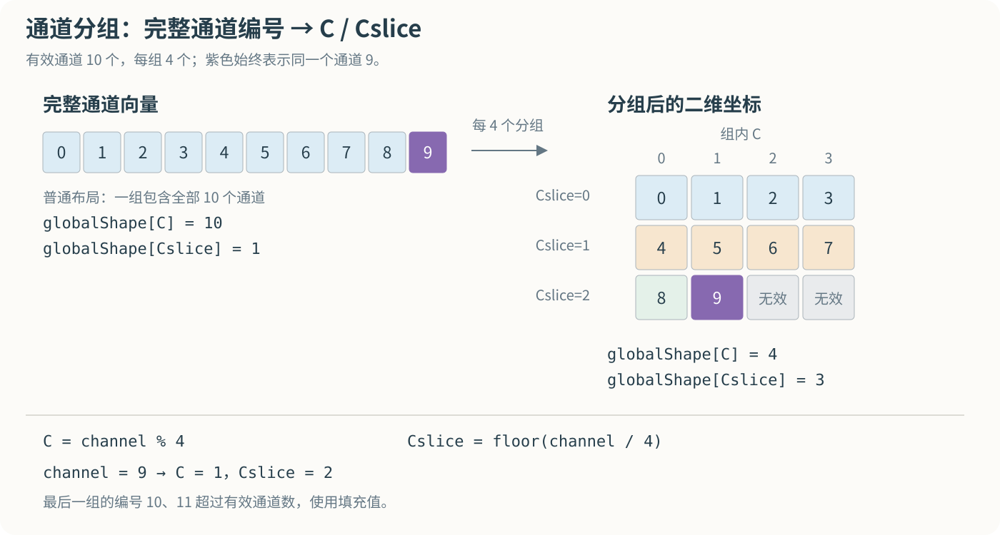
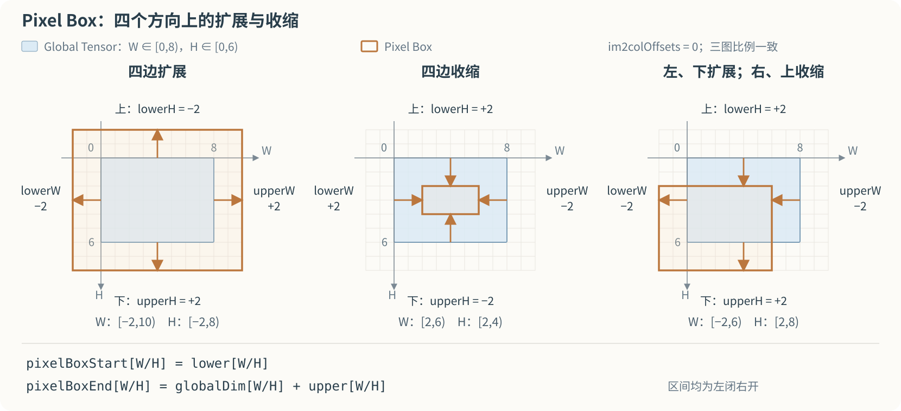
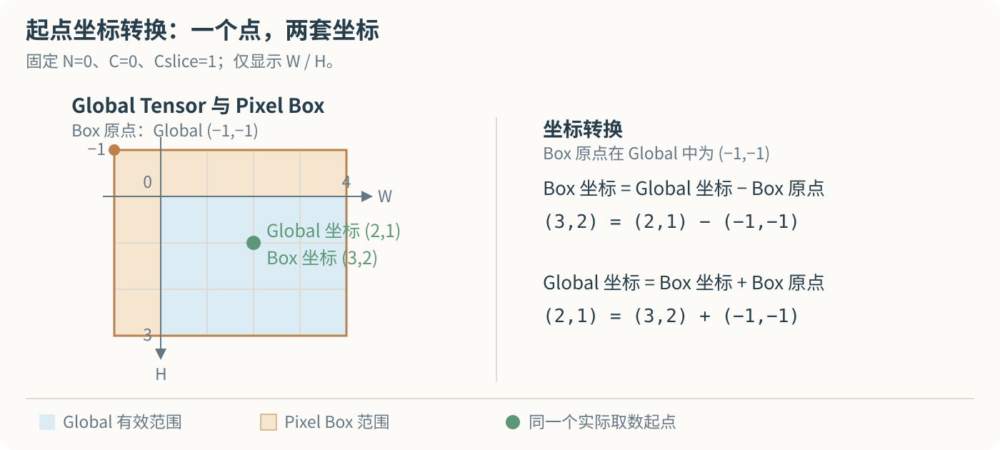

# TMA 地址生成

## 1. Tile 地址生成

Tile 地址生成可以抽象为三个步骤：

1. 读取原始 Tile 参数；
2. 根据 Interleave 布局转换维度和坐标；
3. 判断 OOB，并在最后根据坐标和字节跨度计算 Global Memory 地址。

这里只讨论参数之间的逻辑关系。

### 1.1 输入参数

| 参数 | 作用 |
| --- | --- |
| `tensorRank` | 原始 Tensor 的维度数 |
| `globalAddress` | Tensor 的 Global Memory 基地址 |
| `globalDim[i]` | 原始第 `i` 维的大小 |
| `globalStrides[i]` | 原始高维的字节跨度 |
| `tensorCoords[i]` | 本次 Tile 在第 `i` 维的起点 |
| `boxDim[i]` | 本次 Tile 在第 `i` 维覆盖的范围 |
| `elementStrides[i]` | 本次 Tile 在第 `i` 维的遍历步长 |
| `tensorDataType` | 元素类型，确定单个元素的字节数 |
| `interleave` | 确定通道的分组方式 |

下文 `rank = tensorRank`，各展开式仅保留实际存在的维度。非 Interleave 时，先将 `elementStrides[0]` 按有效值 `1` 处理。

### 1.2 Tile Box 的维度与总元素数

```ini
boxShape[i] = ceil(boxDim[i] / elementStrides[i])
总元素数 = boxShape[0] × boxShape[1] × ... × boxShape[rank-1]
```

### 1.3 Box 中各点的 Global Tensor 坐标

Box 中任意一点：

```ini
boxIndex = [b0, b1, ..., b(rank-1)]
0 <= bi < boxShape[i]  // i = 0 ... rank-1
```

#### 1.3.1 非 Interleave

```ini
globalCoord = [
    tensorCoords[0] + b0 × elementStrides[0],
    tensorCoords[1] + b1 × elementStrides[1],
    ...,
    tensorCoords[rank-1] + b(rank-1) × elementStrides[rank-1]
] // rank维度
```

#### 1.3.2 Interleave

`sliceElements` 表示每组元素数。

```ini
globalCoord_0 = tensorCoords[0] × sliceElements + b0 × elementStrides[0]
inner = globalCoord_0 % sliceElements
slice = floor(globalCoord_0 / sliceElements)

globalCoord = [
    inner,
    tensorCoords[1] + b1 × elementStrides[1],
    ...,
    tensorCoords[rank-2] + b(rank-2) × elementStrides[rank-2],
    slice,
    tensorCoords[rank-1] + b(rank-1) × elementStrides[rank-1]
] // rank+1 维度
```

### 1.4 OOB 判断

按原始 Tensor 各维检查坐标是否位于 `[0, globalDim[i])`：非 Interleave 直接使用 `globalCoord[i]`；Interleave 的第 0 维使用 `globalCoord_0`，其余维度使用 `tensorCoords[i] + bi × elementStrides[i]`。

越界点按 OOB 配置填充；有效点继续计算地址。

### 1.5 Global Memory 地址计算

由 `tensorDataType` 确定 `elementBytes`，结合 `globalAddress` 和 `globalStrides` 计算地址。以下公式适用于每个元素占固定整数字节的数据类型。

Interleave 的分组字节数为 `interleaveBytes`，与前面的逻辑分组大小对应：

```ini
sliceElements = interleaveBytes / elementBytes
```

#### 1.5.1 非 Interleave

```ini
globalAddressOfPoint =
    globalAddress
    + globalCoord[0] × elementBytes
    + globalCoord[1] × globalStrides[0]
    + globalCoord[2] × globalStrides[1]
    + ...
    + globalCoord[rank-1] × globalStrides[rank-2]
```

#### 1.5.2 Interleave

```ini
globalAddressOfPoint =
    globalAddress
    + globalCoord[0] × elementBytes
    + globalCoord[1] × interleaveBytes
    + globalCoord[2] × globalStrides[0]
    + ...
    + globalCoord[rank] × globalStrides[rank-2]
```

规则参考：[PTX ISA：Tiled mode](https://docs.nvidia.com/cuda/parallel-thread-execution/#tensor-tiled-mode)、[CUDA Driver API：Tensor Map](https://docs.nvidia.com/cuda/cuda-driver-api/cuda_driver_api/group__CUDA__TENSOR__MEMORY.html)。

## 2. Im2col 地址生成

Im2col 地址生成要回答的是：输出矩阵中的每个 `[channelIndex, pixelIndex]`，最终读取 Global Memory 中的哪个地址。先确定 Global Tensor 的维度和取数起点，再借助 Pixel Box 的局部坐标将输出点映射回原始数据，最后判断 OOB 并计算地址。

### 2.1 输入参数与两个 Tensor

输入直接描述了两个逻辑 Tensor：Global Tensor 是原始数据，原点为各维零坐标，`tensorCoords` 指定取数参考点；Im2col 是输出二维矩阵，原点为 `[channelIndex=0, pixelIndex=0]`。

| 参数 | 作用 |
| --- | --- |
| `tensorRank` | 原始 Global Tensor 的维度数，支持 3D、4D、5D |
| `globalAddress` | Global Tensor 原点的 Global Memory 地址 |
| `globalDim` | 原始 Global Tensor 各维大小 |
| `globalStrides` | 原始 Tensor 各高维的字节跨度 |
| `tensorCoords` | C/N 维起点，以及 W/H/D 维的 filter base |
| `im2colOffsets` | 从 filter base 到实际取数点的 W/H/D 偏移 |
| `pixelBoxLowerCorner` | Pixel Box 相对 Global Tensor 空间各维起始边界的偏移 |
| `pixelBoxUpperCorner` | Pixel Box 相对 Global Tensor 空间各维终止边界的偏移 |
| `channelsPerPixel` | Im2col 的通道维大小 |
| `pixelsPerColumn` | Im2col 的 pixel 维大小 |
| `elementStrides` | W/H/D 各维的遍历步长 |
| `tensorDataType` | 元素类型，确定单个元素的字节数 |
| `interleave` | 确定通道的分组方式 |

原始数组从内到外的维度顺序为 `[C,W,N]`、`[C,W,H,N]` 或 `[C,W,H,D,N]`。下文用 C/W/H/D/N 作具名下标，表示这些数组中对应的维度。

```ini
im2colIndex = [channelIndex, pixelIndex]
0 <= channelIndex < channelsPerPixel
0 <= pixelIndex < pixelsPerColumn
```

### 2.2 统一 Global Tensor 的表示

先将 Global Tensor 整理为统一的逻辑维度和参考坐标。后续的坐标转换都使用这套表示：

```ini
globalShape[dim]     // 统一后各维的大小
referenceCoord[dim]  // 取数参考点在该维的坐标
```

统一后的逻辑维度写成 `[C,W,(H,D),Cslice,N]`，只保留原始 Tensor 实际存在的 H/D。C 表示每组内部的通道，Cslice 表示通道组。普通布局将完整 C 作为一组，补入长度为 1 的 Cslice 维度，用于统一后续表达。

先保留原始有效通道数。开启 Interleave 时，将布局给定的每组元素数量记作 `sliceElements`：

```ini
validChannels = globalDim[C]
```

C 和 Cslice 的大小、参考坐标按下表转换。指令在 Interleave 布局中提供的 C 坐标以 slice 为单位：

| 统一字段 | 普通布局 | Interleave 布局 |
| --- | --- | --- |
| `globalShape[C]` | `globalDim[C]` | `sliceElements` |
| `globalShape[Cslice]` | `1` | `ceil(globalDim[C] / sliceElements)` |
| `referenceCoord[C]` | `tensorCoords[C]` | `0` |
| `referenceCoord[Cslice]` | `0` | `tensorCoords[C]` |

N/W/H/D 的大小和参考坐标直接继承输入：

```ini
globalShape[dim] = globalDim[dim]
referenceCoord[dim] = tensorCoords[dim]  // dim = N/W/H/D
```

最后一个通道组可能只包含部分有效元素，后续用 `validChannels` 判断真实通道边界。



*图　10 个有效通道按每组 4 个元素展开；完整通道 9 对应 `C=1、Cslice=2`，最后两个格子超出有效通道范围。*

### 2.3 确定实际取数起点

在统一后的 Global Tensor 中，W/H/D 的参考点加上 `im2colOffsets`，得到实际取数起点 `startGlobalCoord`；N 和通道位置保持参考坐标：

```ini
startGlobalCoord[dim] = referenceCoord[dim] + im2colOffsets[dim]  // dim = W/H/D
startGlobalCoord[N] = referenceCoord[N]
startGlobalCoord[C] = referenceCoord[C]
startGlobalCoord[Cslice] = referenceCoord[Cslice]
```

这个点就是 Im2col 原点 `[0,0]` 对应的实际取数位置。

### 2.4 建立 Pixel Box

Pixel Box 确定 W/H/D 的展开范围。将这个空间范围扩展到统一后的完整维度，N、C、Cslice 保留 Global Tensor 的范围，就得到用于坐标转换的独立 Pixel Box Tensor。它有自己的局部坐标系，局部原点为零。

`pixelBoxStart`、`pixelBoxEnd` 表示 Pixel Box 在统一后的 Global Tensor 坐标系中的起止位置，范围左闭右开；`pixelBoxWidth` 表示 Pixel Box 自身各维的大小。

#### 2.4.1 N 维度

```ini
pixelBoxStart[N] = 0
pixelBoxEnd[N] = globalShape[N]
pixelBoxWidth[N] = globalShape[N]
```

#### 2.4.2 W/H/D 维度

Global Tensor 的空间边界加上 lower、upper 和本次 offset，得到 Pixel Box 的空间范围。`im2colOffsets` 同时平移实际取数起点和 Pixel Box：

```ini
pixelBoxStart[dim] = pixelBoxLowerCorner[dim] + im2colOffsets[dim]
pixelBoxEnd[dim] = globalShape[dim] + pixelBoxUpperCorner[dim] + im2colOffsets[dim]
pixelBoxWidth[dim] = pixelBoxEnd[dim] - pixelBoxStart[dim]
```

这里 `dim` 取当前 Tensor 存在的 W/H/D 维度。W 向右、H 向下时，lower 控制左、上边界，upper 控制右、下边界：lower 为负向外扩展，为正向内收缩；upper 为正向外扩展，为负向内收缩。D 使用相同规则。



*图　蓝色矩形为 Global Tensor，橙框为 Pixel Box；三个场景使用相同坐标比例，箭头从 Tensor 边界指向对应的 Box 边界。图中取 `im2colOffsets=0`，展示四边扩展、四边收缩，以及左/下扩展而右/上收缩。*

#### 2.4.3 C 与 Cslice 维度

```ini
pixelBoxStart[C] = 0
pixelBoxEnd[C] = globalShape[C]
pixelBoxWidth[C] = globalShape[C]

pixelBoxStart[Cslice] = 0
pixelBoxEnd[Cslice] = globalShape[Cslice]
pixelBoxWidth[Cslice] = globalShape[Cslice]
```

### 2.5 将起点转换到 Pixel Box

实际取数起点减去 Pixel Box 原点的位置，得到同一个点在 Pixel Box 局部坐标系中的 `startPixelBoxCoord`。这个转换对统一后的所有维度相同：

```ini
startPixelBoxCoord[dim] = startGlobalCoord[dim] - pixelBoxStart[dim]
```

现在，Im2col 原点、Global Tensor 实际取数起点、Pixel Box 实际取数起点，已经对应到同一个数据位置。



*图　Box 原点在 Global Tensor 中位于 `(-1,-1)`；同一实际取数起点的 Global 坐标为 `(2,1)`，Box 内部坐标为 `(3,2)`。*

### 2.6 将 Im2col 各点映射到 Pixel Box

从 `startPixelBoxCoord` 出发，`pixelIndex` 决定 N/W/H/D 位置，`channelIndex` 决定 C/Cslice 位置。

#### 2.6.1 Pixel 位置

首个 pixel 的局部坐标就是 `startPixelBoxCoord`。按 PTX 的遍历规则，将后续空间位置写成递推映射；下面的 `nextPixel` 只作用于 N/W/H/D：

```ini
pixelBoxCoord(0)[dim] = startPixelBoxCoord[dim]  // dim = N/W/H/D
pixelBoxCoord(pixelIndex + 1) = nextPixel(pixelBoxCoord(pixelIndex))
```

`nextPixel` 按 W → H → D → N 进位，只使用实际存在的维度。W 增加 `elementStrides[W]`；达到或超过 `pixelBoxWidth[W]` 时，W 回到 0，H 增加 `elementStrides[H]`。H 越界时回到 0 并向 D 进位，D 越界时回到 0 并使 N 增加 1。3D 的 W 直接向 N 进位，4D 的 H 直接向 N 进位。N 保留递增后的坐标，供后续 OOB 判断。

因此，`pixelBoxCoord(pixelIndex)` 给出任意 `pixelIndex` 对应的空间位置。`pixelsPerColumn` 控制取多少个 pixel，Pixel Box 的大小和 `elementStrides` 控制位置如何推进。

#### 2.6.2 通道位置

在每个 pixel 上，从同一个通道起点连续读取 `channelsPerPixel` 个通道。先在 C/Cslice 子空间中计算完整通道编号，再按每组宽度展开：

```ini
channel = startPixelBoxCoord[Cslice] × pixelBoxWidth[C] + startPixelBoxCoord[C] + channelIndex
pixelBoxCoord[C] = channel % pixelBoxWidth[C]
pixelBoxCoord[Cslice] = floor(channel / pixelBoxWidth[C])
```

C 增长到一组的宽度时回到 0，并向 Cslice 进位。将这两个分量与 N/W/H/D 合并，就得到了 `[channelIndex,pixelIndex]` 在 Pixel Box 中的完整局部坐标。

### 2.7 映射回 Global Tensor 与 OOB 判断

Pixel Box 中的各点加上它的原点位置，映射回统一后的 Global Tensor。所有维度使用同一个公式：

```ini
globalCoord[dim] = pixelBoxStart[dim] + pixelBoxCoord[dim]
```

现在，每个 Im2col 元素都对应一个完整的逻辑坐标 `globalCoord`，各分量与 `globalShape` 一一对应。

按统一后的各维大小检查坐标，并恢复完整通道编号，检查真实通道边界：

```ini
globalChannel = globalCoord[Cslice] × globalShape[C] + globalCoord[C]
OOB = 任一维度不满足 0 <= globalCoord[dim] < globalShape[dim]
      或不满足 0 <= globalChannel < validChannels
```

OOB 点按配置填充 0 或 OOB-NaN；有效点继续计算 Global Memory 地址。

### 2.8 Global Memory 地址计算

此前得到的是各 Im2col 元素在 Global Tensor 中的逻辑坐标。由 `tensorDataType` 确定 `elementBytes`，结合 `globalAddress` 和 `globalStrides` 计算地址。以下地址公式适用于每个元素占固定整数字节的数据类型。

开启 Interleave 时，`interleaveBytes` 取 16 B 或 32 B，与前面的逻辑分组大小对应：

```ini
sliceElements = interleaveBytes / elementBytes  // 开启 Interleave 时
```

为统一后的每个逻辑维度配置字节跨度 `byteStride`。其中 `rank = tensorRank`，只保留当前 Tensor 实际存在的 H/D：

| 维度 | 普通布局的 `byteStride` | Interleave 布局的 `byteStride` |
| --- | --- | --- |
| C | `elementBytes` | `elementBytes` |
| W | `globalStrides[0]` | `interleaveBytes` |
| H | `globalStrides[1]` | `globalStrides[0]` |
| D | `globalStrides[2]` | `globalStrides[1]` |
| Cslice | `0` | `globalStrides[rank-3]` |
| N | `globalStrides[rank-2]` | `globalStrides[rank-2]` |

普通布局补入的 Cslice 维度长度为 1，对应的字节跨度设为 0。Interleave 布局中，每个 slice 在 GMEM 中占完整的 16 B 或 32 B，最后一个 slice 通道不足时补零，有效通道数仍为 `validChannels`。

有效点的 Global Memory 地址统一为：

```ini
globalAddressOfPoint = globalAddress + sum(globalCoord[dim] × byteStride[dim])
```

求和覆盖统一后的全部维度，由此得到有效 Im2col 元素的 Global Memory 地址；越界点使用对应的填充值。

### 2.9 资料来源

- [PTX ISA：Im2col mode、Traversal Stride 与 Interleave layout](https://docs.nvidia.com/cuda/parallel-thread-execution/#tensor-im2col-mode)
- [CUDA Driver API：Tensor Map Object Management](https://docs.nvidia.com/cuda/cuda-driver-api/cuda_driver_api/group__CUDA__TENSOR__MEMORY.html)
- [NVIDIA 专利 US12499052B2：Im2col 的起点、偏移和 Bounding Box](https://patents.google.com/patent/US12499052B2/en)

---

[返回系列目录](index.md) · [TMA 硬件设计](04-hardware-design.md) · [参考资料索引](references.md)
