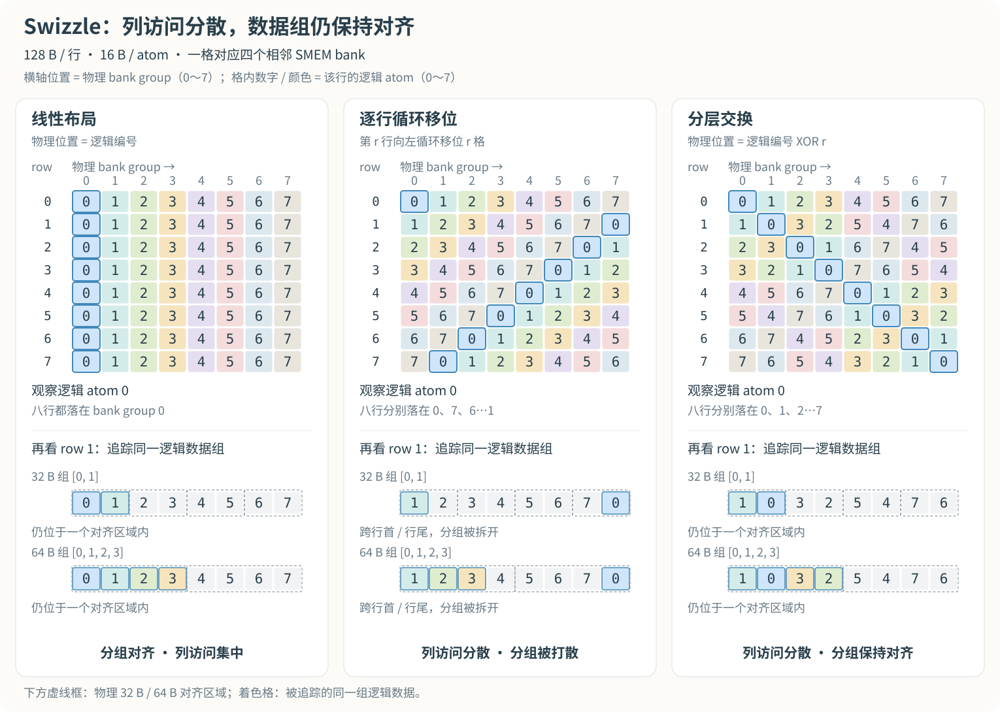
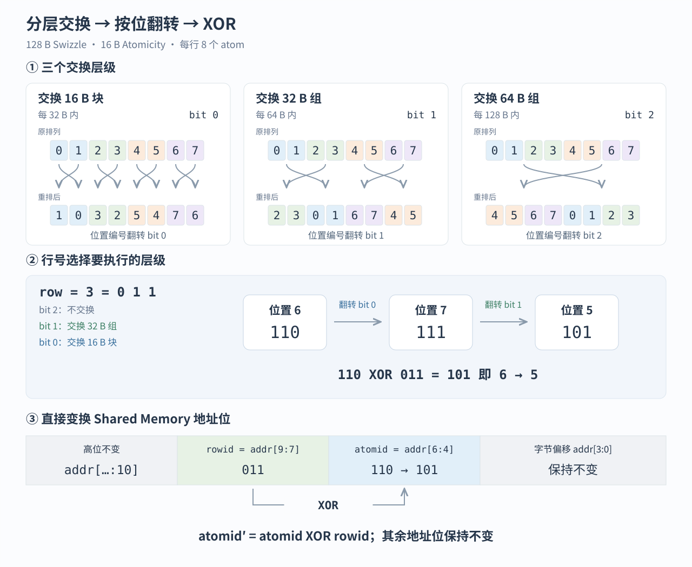
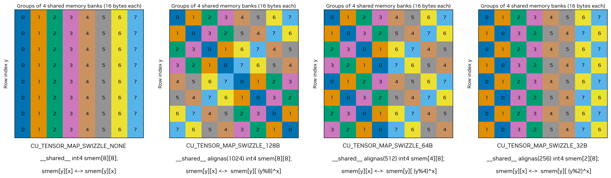

# NVIDIA Swizzle 分析

## 为什么需要 Swizzle

Shared Memory 由 32 个 bank 组成，每个 bank 每周期可以提供 4 B 数据。连续的 16 B 数据会分布在四个相邻 bank 中，可以将其视为一个 bank group。

TMA 将 Tensor 从 Global Memory 搬入 Shared Memory 后，Tensor Core 会按照特定的 operand layout，以 warp 或 warpgroup 为单位并行读取 SMEM。Global Memory 中的线性布局适合连续搬运，却不一定适合 Tensor Core 的跨行、分组读取。如果同一次内存事务中的多个访问落到同一 bank 的不同地址，就会发生 bank conflict，需要拆分处理。下面以跨行访问同一逻辑列的布局模型说明这种冲突。

以一行包含八个 16 B 数据块为例。线性布局中，每一行的数据排列完全相同：

```text
row 0：0 1 2 3 4 5 6 7
row 1：0 1 2 3 4 5 6 7
row 2：0 1 2 3 4 5 6 7
...
```

当 Tensor Core 同时读取多行中的位置 `0` 时，这些访问都会指向相同的 bank group。

Swizzle 在 TMA 写入 SMEM 的过程中改变数据的物理排列，使不同数据行采用不同的列映射：

```text
row 0：0 1 2 3 4 5 6 7
row 1：1 0 3 2 5 4 7 6
row 2：2 3 0 1 6 7 4 5
row 3：3 2 1 0 7 6 5 4
...
```

经过重排后，多行中的同一逻辑位置被分散到不同的 bank group。Tensor Core 仍然读取同一组逻辑数据，但这些数据在 SMEM 中具有更适合并行访问的物理布局。

## Swizzle 的设计

Swizzle 的设计目标不只是让不同行的数据落入不同的 bank group，还要使重排后的布局适合 Tensor Core 按固定粒度读取 operand fragment。

以 `128 B` 数据行为例。一行包含八个 `16 B` Atomicity，每个 Atomicity 对应四个相邻的 SMEM banks：

```text
0 1 2 3 4 5 6 7
```

Tensor Core 跨行读取同一逻辑位置时，希望连续八行中的数据分别落入八个不同的 bank group。因此，每一行都需要采用不同的排列，并且固定列在所有行中的物理位置应完整覆盖 `0～7`。

一种直接方案是逐行循环移位：

```text
row 0：0 1 2 3 4 5 6 7
row 1：1 2 3 4 5 6 7 0
row 2：2 3 4 5 6 7 0 1
...
```

这种排列可以分散固定列的 bank 访问，但会破坏原有的二次幂对齐分组。追踪同一组逻辑数据：第 1 行向左循环移位一格后，原来的 `32 B` 数据组：

```text
[0 1]
```

其两个元素分别落到以下物理位置：

```text
[7 0]
```

它们分散在行尾和行首，跨越了两个对齐的 `32 B` 区域。原本对齐的 `64 B` 数据组：

```text
[0 1 2 3]
```

则分别落到：

```text
[7 0 1 2]
```

同样跨越了 `64 B` 边界。

从分散 bank 访问、同时保持 `16 B、32 B、64 B、128 B` 等二次幂对齐分组的需求出发，可以构造分层的数据组交换。以下是对重排规律的逻辑推导：

```text
第一层：在每个32 B组内交换两个16 B数据块
第二层：在每个64 B组内交换两个32 B数据组
第三层：在每个128 B组内交换两个64 B数据组
```

由此得到以下基本排列：

```text
不交换：
0 1 2 3 4 5 6 7

交换相邻的16 B数据块：
1 0 3 2 5 4 7 6

交换相邻的32 B数据组：
2 3 0 1 6 7 4 5

交换两个64 B数据组：
4 5 6 7 0 1 2 3
```

其他行可以组合多个层级的交换：

```text
同时执行第一层和第二层：
3 2 1 0 7 6 5 4

同时执行第一层和第三层：
5 4 7 6 1 0 3 2
```

最终形成完整的八行排列：

```text
row 0：0 1 2 3 4 5 6 7
row 1：1 0 3 2 5 4 7 6
row 2：2 3 0 1 6 7 4 5
row 3：3 2 1 0 7 6 5 4
row 4：4 5 6 7 0 1 2 3
row 5：5 4 7 6 1 0 3 2
row 6：6 7 4 5 2 3 0 1
row 7：7 6 5 4 3 2 1 0
```

这种布局同时满足两个要求：

- 固定逻辑列在八行中分别映射到八个 bank group；
- `32 B、64 B、128 B` 对齐的数据组在重排后仍保持相应的分组结构。



## 重排规律的实现

八个 Atomicity 的位置可以表示为三位二进制数：

```text
0 = 000
1 = 001
2 = 010
3 = 011
4 = 100
5 = 101
6 = 110
7 = 111
```

前面设计的三个交换层级，分别对应修改位置编号中的一个 bit：

- 交换相邻的 `16 B` 数据块：翻转 bit 0；
- 交换相邻的 `32 B` 数据组：翻转 bit 1；
- 交换两个 `64 B` 数据组：翻转 bit 2。

行号也可以表示为三位二进制数。行号中的每个 bit，恰好可以表示是否执行对应层级的交换：

```text
row 1 = 001：执行第一层交换
row 2 = 010：执行第二层交换
row 3 = 011：同时执行第一层和第二层交换
row 4 = 100：执行第三层交换
```

因此，目标位置可以通过“原位置的各个 bit，与行号对应 bit 分别进行条件翻转”得到。这个按位条件翻转正好就是 XOR：

```text
目标位置
=
原位置 XOR 行号
```

例如：

```text
原位置 6 = 110
row 3    = 011
目标位置 = 101 = 5
```

所以：

```text
6 → 5
```

完整映射为：

```text
target_atom =
source_atom XOR row
```

对于本文讨论的普通二次幂 XOR 模式，设一行宽度为 $L=128\ \mathrm{B}$，Swizzle 位宽为 $S=2^s$，Atomicity 位宽为 $A=2^a$。一个 Swizzle 包含 $2^{s-a}$ 个 Atomicity。对于 Shared Memory 绝对字节地址 $addr$，`atomid` 和 `rowid` 直接取自以下 bit 段；`32 B + 8 B flip` 还需要文末说明的块内交换：

$$
atomid=addr[s-1:a]
$$

$$
rowid=addr[7+s-a-1:7]
$$

Swizzle 只改变 Atomicity 编号：

$$
atomid'=atomid\oplus rowid
$$

目标地址保持其他 bit 不变，只用 $atomid'$ 替换原来的 $atomid$ bit 段。

以 `64 B Swizzle / 16 B Atomicity` 为例，一个 Swizzle 包含 4 个 Atomicity，`atomid=addr[5:4]`，`rowid=addr[8:7]`。当 $addr=0x190$ 时，$atomid=1$、$rowid=3$，因此 $atomid'=1\oplus3=2$，目标地址为 $0x1A0$。



## NVIDIA 的 Swizzle 定义

Hopper TMA 定义了四种基本模式：

| 模式 | Swizzle 位宽 | Atomicity | 每个 Swizzle 的 Atomicity 数量 |
|---|---:|---:|---:|
| `NONE` | — | — | — |
| `32B` | `32 B` | `16 B` | 2 |
| `64B` | `64 B` | `16 B` | 4 |
| `128B` | `128 B` | `16 B` | 8 |

NVIDIA 官方给出的三种基本模式映射如下，地址索引与 base offset 的定义见 [CUDA Programming Guide：Shared-Memory Bank Swizzling](https://docs.nvidia.com/cuda/cuda-programming-guide/04-special-topics/async-copies.html#shared-memory-bank-swizzling)：



对于 `32 B Swizzle`，一条 `128 B` 行包含四个独立的 `32 B` Swizzle，每个 Swizzle 包含两个 `16 B` Atomicity：

```text
row 0：0 1 | 2 3 | 4 5 | 6 7
row 1：1 0 | 3 2 | 5 4 | 7 6
```

对于 `64 B Swizzle`，一行包含两个独立的 `64 B` Swizzle，每个 Swizzle 包含四个 Atomicity：

```text
row 0：0 1 2 3 | 4 5 6 7
row 1：1 0 3 2 | 5 4 7 6
row 2：2 3 0 1 | 6 7 4 5
row 3：3 2 1 0 | 7 6 5 4
```

对于 `128 B Swizzle`，整行构成一个 Swizzle，其中包含八个 Atomicity：

```text
row 0：0 1 2 3 4 5 6 7
row 1：1 0 3 2 5 4 7 6
row 2：2 3 0 1 6 7 4 5
row 3：3 2 1 0 7 6 5 4
row 4：4 5 6 7 0 1 2 3
row 5：5 4 7 6 1 0 3 2
row 6：6 7 4 5 2 3 0 1
row 7：7 6 5 4 3 2 1 0
```

Swizzle pattern 的起始行由 Shared Memory 起始地址决定。三种模式的重复周期分别为：

| 模式 | Pattern 重复周期 |
|---|---:|
| `32B` | `256 B` |
| `64B` | `512 B` |
| `128B` | `1024 B` |

当起始地址没有位于完整 pattern 的起始边界时，TMA 根据该地址位于第几个 `128 B` 行计算 base offset，并从对应的 pattern 行开始重排。

后续 PTX 又为 `128 B Swizzle` 增加了不同 Atomicity：

| Swizzle 位宽 | Atomicity |
|---:|---:|
| `128 B` | `16 B` |
| `128 B` | `32 B` |
| `128 B` | `32 B + 8 B flip` |
| `128 B` | `64 B` |

`32 B` 和 `64 B` Atomicity 分别表示以完整的 `32 B` 或 `64 B` 数据块为重排单位。`32 B + 8 B flip` 则在 `128 B / 32 B` 重排基础上，在隔行的 Shared Memory 行中交换每个 `16 B` 数据块内相邻的两个 `8 B` 部分。各子模式的排列见 [PTX ISA 9.0：Tensor Swizzling](https://docs.nvidia.com/cuda/archive/13.0.0/parallel-thread-execution/index.html#tensor-swizzling)。

---

[返回系列目录](index.md) · [TMA 地址生成](address-generation.md) · [参考资料索引](references.md)
