# Layer 0：从四路残差到局部注意力与 MoE

## 1. Layer 0 总览

本文分析 **DeepSeek-V4.1-Flash 的 Layer 0 文本前向路径**，张量形状按完整逻辑维度表示。

$B$ 表示 batch，$S$ 表示本次处理的 token 数，$\mathrm{BxS}=B\times S$ 表示合并后的 token 维。Attention 仍按各自会话计算。

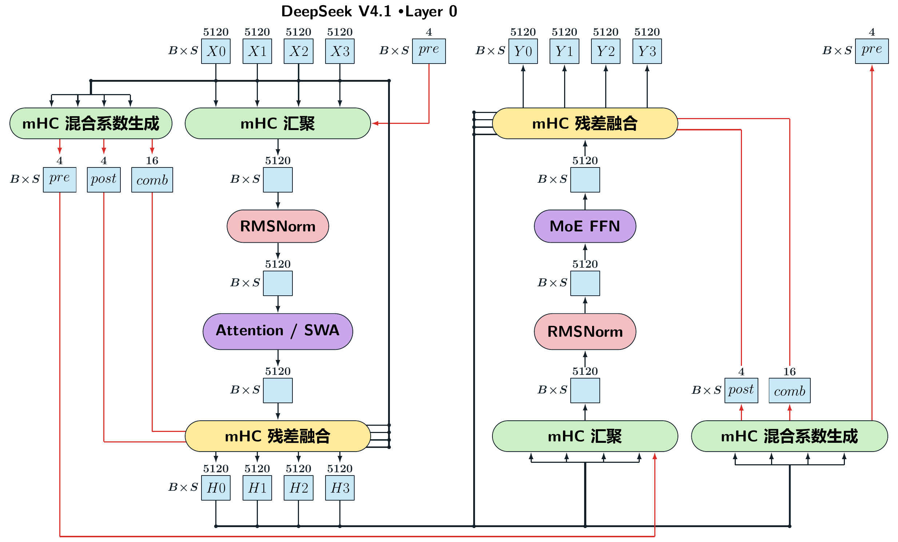

Layer 0 先计算 Attention，再计算 MoE；两个子层各有独立的一套 mHC。初始四路来自同一份 embedding，整体形状为 `[BxS,4,5120]`，首次 pre 为 `[1,0,0,0]`。

每个子层的流程为：

- **入口汇聚**：四路残差汇成一路，同时由四路输入生成混合系数。
- **子层计算**：单路输入 `[BxS,5120]` 经过 RMSNorm，再执行 Attention 或 MoE。
- **出口融合**：子层输出与保留的原四路残差融合，恢复为 `[BxS,4,5120]`，交给下一子层。

混合系数生成分支读取当前子层的四路输入。生成的 **post、comb 用于当前出口，pre 用于下一子层入口**：Attention 侧的 pre 交给本层 MoE，MoE 侧的 pre 交给下一层 Attention。

## 2. mHC

### 2.1 四路输入生成 raw mixes

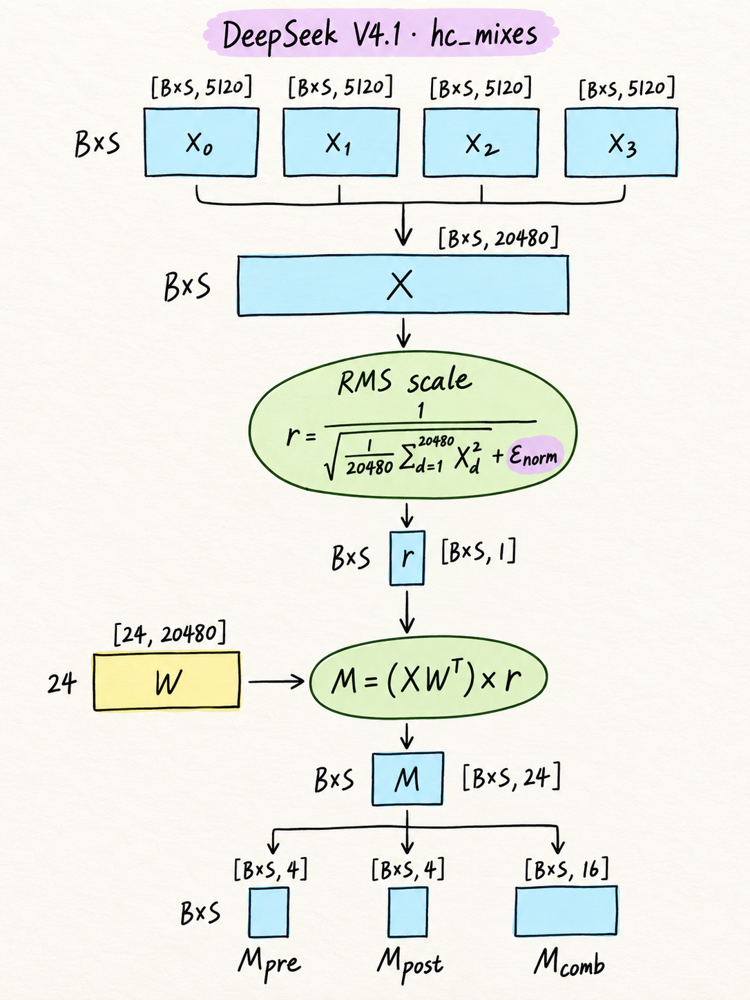

四路输入经过展平、RMS 缩放与联合投影，生成混合系数的原始值。以下 $t$ 为展平后的 token 索引，$d$ 为特征元素索引，$\odot$ 表示逐元素相乘；线性权重按 `[输出,输入]` 排列。

计算分为三步：

- **展平**：$X_0$～$X_3$ 沿 hidden 维拼接，每个 token 的 $4\times5120$ 个元素组成 $X$ $[\mathrm{BxS},20480]$。

    $$
    X=[X_0\;X_1\;X_2\;X_3]
    $$

- **RMS 缩放**：对每行的 $20480$ 个元素计算一个缩放因子，得到 $r$ $[\mathrm{BxS},1]$；这里没有可学习的缩放权重。

    $$
    r_t=\left(\frac{1}{20480}\sum_{d=0}^{20479}X_{t,d}^{2}
    +\epsilon_{\mathrm{norm}}\right)^{-1/2},
    \qquad \epsilon_{\mathrm{norm}}=10^{-20}
    $$

- **联合投影**：$X$ 与权重 $W$ $[24,20480]$ 相乘，再按行乘 $r$，得到 $M$ $[\mathrm{BxS},24]$。

    $$
    M=(XW^{\mathsf T})\odot r
    $$

$M$ 按 **$4+4+16$** 拆成 $M_{\mathrm{pre}}$、$M_{\mathrm{post}}$、$M_{\mathrm{comb}}$，供下一步生成 $\mathrm{pre}$、$\mathrm{post}$、$\mathrm{comb}$；它们此时还是原始值。

$$
M=[M_{\mathrm{pre}}\;M_{\mathrm{post}}\;M_{\mathrm{comb}}]
$$

$X$ 提供投影内容，$r$ 按行广播，对投影结果逐行缩放。

### 2.2 生成 pre、post、comb

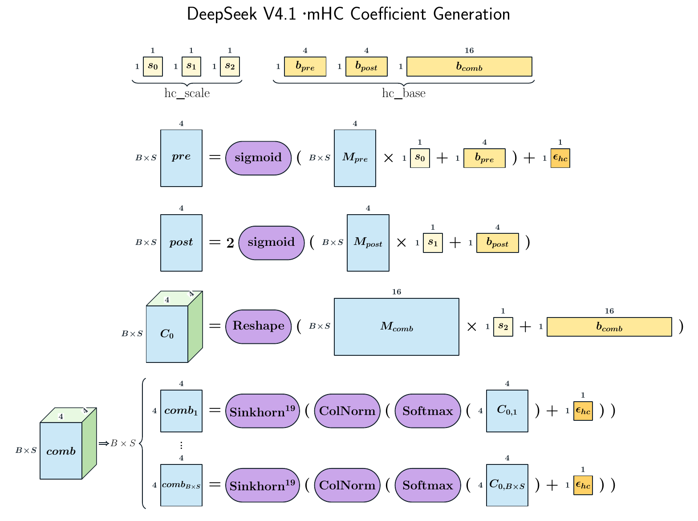

$M$ 以及由它生成的 pre、post、comb 都是随输入变化的动态值。下面的 $s$、$b$ 是训练得到的模型参数，对所有 token 共用；固定常数由算法给定。

| 对象 | 来源与含义 |
|---|---|
| $s_0,s_1,s_2$ | $\mathrm{hc\_scale}:[3]$ 中的三个缩放标量，分别用于三个分支 |
| $b_{\mathrm{pre}},b_{\mathrm{post}},b_{\mathrm{comb}}$ | $\mathrm{hc\_base}:[24]$ 中的三组偏置，长度分别为 $4,4,16$ |
| $\epsilon_{\mathrm{hc}}=c=10^{-6}$ | 用于数值稳定的固定常数，不参与训练 |

$\sigma$ 为 Sigmoid：

$$
\sigma(x)=\frac{1}{1+e^{-x}}
$$

#### 生成 pre

输出 $\mathrm{pre}:[\mathrm{BxS},4]$：

$$
\mathrm{pre}=\sigma(M_{\mathrm{pre}}\cdot s_0+b_{\mathrm{pre}})+\epsilon_{\mathrm{hc}}
$$

#### 生成 post

输出 $\mathrm{post}:[\mathrm{BxS},4]$：

$$
\mathrm{post}=2\sigma(M_{\mathrm{post}}\cdot s_1+b_{\mathrm{post}})
$$

#### Sinkhorn

Sinkhorn 是行、列交替归一化的迭代方法，使正值矩阵的行和、列和接近 $1$。在残差混合中，行对应旧残差流，列对应新残差流，分别约束每路分配出去和接收进来的混合系数总量。

对每个 token 的 $4\times4$ 工作矩阵 $A$，行、列归一化分别为：

$$
\begin{aligned}
\operatorname{RowNorm}(A)_{ij}
&=\frac{A_{ij}}{\sum_{k=0}^{3}A_{ik}+c}\\
\operatorname{ColNorm}(A)_{ij}
&=\frac{A_{ij}}{\sum_{k=0}^{3}A_{kj}+c}
\end{aligned}
$$

其中，一次 Sinkhorn 迭代表示：

$$
\operatorname{Sinkhorn}(A)
=\operatorname{ColNorm}\left(\operatorname{RowNorm}(A)\right)
$$

#### 生成 comb

先得到 $C_0:[\mathrm{BxS},16]$：

$$
C_0=M_{\mathrm{comb}}\cdot s_2+b_{\mathrm{comb}}
$$

将 $C_0$ 重排为 $[\mathrm{BxS},4,4]$。本配置 $\mathrm{hc\_sinkhorn\_iters}=20$：先做行 Softmax、逐项加 $c$ 和首次列归一化，再执行 $19$ 次 Sinkhorn 迭代，共完成 $20$ 次列归一化：

$$
\mathrm{comb}=
\operatorname{Sinkhorn}^{19}
\left(
\operatorname{ColNorm}
\left(
\operatorname{Softmax}_{\mathrm{row}}(C_0)+c
\right)
\right)
$$

最终输出 $\mathrm{comb}:[\mathrm{BxS},4,4]$。

### 2.3 四路汇聚 hc_pre

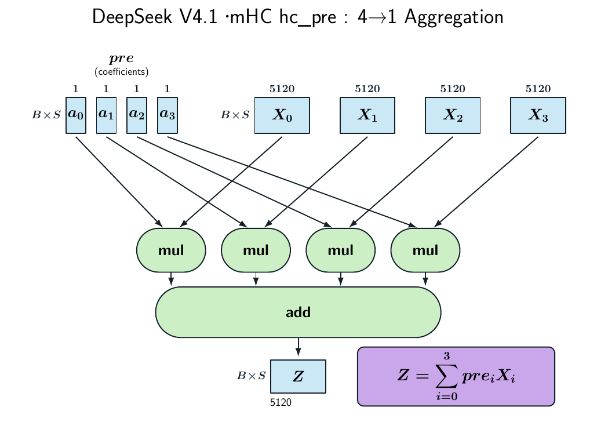

本次使用的 $\mathrm{pre}$ 由上一子层生成；Layer 0 首次汇聚使用固定值 $[1,0,0,0]$。四路残差分别乘以对应系数，再相加，得到单路输入 $Z$。

| 对象 | 维度与含义 |
|---|---|
| $X_0,X_1,X_2,X_3$ | 各为 $[\mathrm{BxS},5120]$，表示四路残差 |
| $a_0,a_1,a_2,a_3$ | $\mathrm{pre}:[\mathrm{BxS},4]$ 的四列，各按 $[\mathrm{BxS},1]$ 使用 |
| $Z$ | $[\mathrm{BxS},5120]$，表示汇聚后的单路输入 |

$$
Z=a_0\odot X_0+a_1\odot X_1+a_2\odot X_2+a_3\odot X_3
$$

每个 token 的 $a_i$ 作用于对应残差流的全部 $5120$ 个元素；求和只沿四路进行，保留 token 与 hidden 维度。

### 2.4 残差融合 hc_post

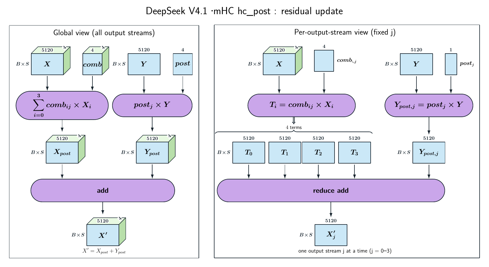

左侧展示四路输出的整体融合，右侧展开单个输出流 $j$ 的计算，两侧表达的是同一个过程。

输入为保留的四路残差 $X:[\mathrm{BxS},4,5120]$ 和子层输出 $Y:[\mathrm{BxS},5120]$，使用当前子层生成的 $\mathrm{comb}:[\mathrm{BxS},4,4]$ 与 $\mathrm{post}:[\mathrm{BxS},4]$。以下 $i$、$j$ 分别表示旧、新残差流；$t$、$d$ 分别表示 token 与特征元素。

- **旧残差混合**：每个输出流 $j$ 都接收旧四路的加权结果。$\mathrm{comb}_{t,i,j}$ 表示 token $t$ 的旧第 $i$ 路到新第 $j$ 路的系数。

$$
X_{\mathrm{post},t,j,d}
=\sum_{i=0}^{3}\mathrm{comb}_{t,i,j}X_{t,i,d}
$$

- **子层输出写入**：同一个 $Y$ 按各路的 $\mathrm{post}$ 系数加权，每个系数作用于该 token 的全部 $5120$ 个元素。

$$
Y_{\mathrm{post},t,j,d}
=\mathrm{post}_{t,j}Y_{t,d}
$$

两条分支逐元素相加，恢复为四路：

$$
X'=X_{\mathrm{post}}+Y_{\mathrm{post}},
\qquad X':[\mathrm{BxS},4,5120]
$$

### 2.5 参数量、计算量与 Required Global Memory 理论下界

以下先按**一套 mHC**统计，再按 Attention、MoE 两套汇总参数量和计算量。参数量、计算量中的 K、M 分别表示 $10^3$、$10^6$；存储量使用 Byte、KiB、MiB。

#### 参数量

一套 mHC 的可学习参数包括联合投影矩阵 $W$、偏置 $\mathrm{hc\_base}$ 和缩放系数 $\mathrm{hc\_scale}$。四路汇聚和残差融合没有额外可学习参数，固定常数不计入参数量。

| 参数 | 维度 | 参数量 |
|---|---|---:|
| $W$ | $24\times20480$ | 491,520 |
| $\mathrm{hc\_base}$ | $24$ | 24 |
| $\mathrm{hc\_scale}$ | $3$ | 3 |
| **合计** | — | **491,547** |

$$
P_{\mathrm{mHC}}
=24\times20480+24+3
=491547
$$

Layer 0 的两套 mHC 合计 **983094（983.094K）** 个参数。

#### 计算量

仅统计 mHC 的前向算术运算，不含 Attention、MoE 本体，也不统计数据搬运和类型转换。

乘加列合计加法、减法和乘法，每次计 1 次；RMS 均值按乘以 $1/20480$ 计 1 次乘法。除法、exp、rsqrt、比较分别计数。下表为**一套 mHC 处理一个 token** 的计算量。

| 阶段 | 计算公式 | 乘加运算量 | 其他运算量 |
|---|---|---:|---|
| RMS 缩放因子 $r$ | $r_t=\left(\frac{1}{20480}\sum_d X_{t,d}^2+\epsilon_{\mathrm{norm}}\right)^{-1/2}$ | $20480+20479+2=40961$ | rsqrt：1 次 |
| 联合投影 | $\widetilde M=XW^{\mathsf T}$ | $24\times(20480+20479)=983016$ | — |
| 投影结果缩放及偏置 | $M=\widetilde M\odot r$ $s_0M_{\mathrm{pre}}+b_{\mathrm{pre}}$ $s_1M_{\mathrm{post}}+b_{\mathrm{post}}$ $s_2M_{\mathrm{comb}}+b_{\mathrm{comb}}$ | $24\times3=72$ | — |
| pre、post 的 Sigmoid | $\sigma(x)=\frac{1}{1+\exp(-x)}$ | $8\times2=16$ | exp：8 次 除法：8 次 |
| pre 加 $\epsilon_{\mathrm{hc}}$、post 乘 $2$ | $\mathrm{pre}=\sigma(\cdot)+\epsilon_{\mathrm{hc}}$ $\mathrm{post}=2\sigma(\cdot)$ | $4+4=8$ | — |
| comb：行 Softmax 后加 $c$ | $A=\operatorname{Softmax}_{\mathrm{row}}(C_0)+c$ | $4\times(4+3+4)=44$ | 比较：12 次 exp：16 次 除法：16 次 |
| comb：行列归一化，含首次列归一化 | $\mathrm{comb}=\operatorname{Sinkhorn}^{19}\!\left(\operatorname{ColNorm}(A)\right)$ | $39\times(12+4)=624$ | 除法：$39\times16=624$ 次 |
| 四路汇聚 $\mathrm{hc\_pre}$ | $Z=\sum_{i=0}^{3}a_i\odot X_i$ | $5120\times(4+3)=35840$ | — |
| 残差融合 $\mathrm{hc\_post}$ | $X'_j=\sum_{i=0}^{3}\mathrm{comb}_{ij}\odot X_i+\mathrm{post}_j\odot Y$ | $4\times5120\times(4+3+1+1)=184320$ | — |
| **合计** | — | **1,244,901** | 除法：648 次 exp：24 次 rsqrt：1 次 比较：12 次 |

将一套 mHC 的运算量乘以 $2$，得到**每层 mHC 处理一个 token**的官方通用路径计算量：

$$
2\times1244901=2489802
$$

Layer 0 的首次 pre 虽然固定为 $[1,0,0,0]$，但固定 revision 的官方 reference 前向仍会创建 `pre_mix:[B,S,4]` 并调用通用 `hc_pre`，没有把它常量折叠成“直接取第 0 路”。因此整层汇总以 **2,489,802** 次加 / 减 / 乘为准。若某个优化实现做了这项折叠，才可省去首次汇聚的 $35840$ 次，降至 **2,453,962** 次。

| op | Reference 通用路径 | Layer 0 常量折叠理论值 |
|---|---:|---:|
| 加 / 减 / 乘 | 2,489,802 | 2,453,962 |
| 除法 | 1.296K | 1.296K |
| exp | 48 | 48 |
| rsqrt | 2 | 2 |
| 比较 | 24 | 24 |

处理 $\mathrm{BxS}$ 个 token 时，各项计算量按 $\mathrm{BxS}$ 倍计。

#### Required Global Memory 理论下界（理想融合口径）

以下按**一套 mHC** 的完整逻辑张量核算 Required Global Memory 理论下界。数据类型见下表：FP32 每元素 $4$ Byte，BF16 每元素 $2$ Byte；$1\,\mathrm{KiB}=1024\,\mathrm{Byte}$，$1\,\mathrm{MiB}=1024^2\,\mathrm{Byte}$。

将整个 mHC 作为一个逻辑分析单元，采用以下存储假设：

- **Weight**：模型参数长期保存在 Global Memory。
- **I/O**：完整输入、输出保存在 Global Memory，并分别计数。$\mathrm{pre}_{\mathrm{in}}$ 从上一子层传入，$\mathrm{pre}_{\mathrm{out}}$ 传给下一子层；不考虑与相邻模块进一步融合或复用输入、输出存储。
- **Internal Activation**：所有内部中间量（包括 $Z$、$Y$）假设可在 Shared Memory / Register 中保存和消化，不完整物化到 Global Memory。

##### Tensor 细节表

| Tensor | 分类 | Shape | dtype | Logical Size（Byte） | Liveness |
|---|---|---|---|---:|---|
| $W$ | Weight | $[24,20480]$ | FP32 | $1966080$ | 模型加载 → 模型卸载 |
| $\mathrm{hc\_scale}$ | Weight | $[3]$ | FP32 | $12$ | 模型加载 → 模型卸载 |
| $\mathrm{hc\_base}$ | Weight | $[24]$ | FP32 | $96$ | 模型加载 → 模型卸载 |
| $X$ | I/O：Input | $[\mathrm{BxS},4,5120]$ | BF16 | $40960\mathrm{BxS}$ | mHC 输入 → 当前 mHC 完成 |
| $\mathrm{pre}_{\mathrm{in}}$ | I/O：Input | $[\mathrm{BxS},4]$ | FP32 | $16\mathrm{BxS}$ | 上一子层传入 → 当前 $\mathrm{hc\_pre}$ 完成 |
| $X_{\mathrm{fp32}}$ | Internal Activation | $[\mathrm{BxS},20480]$ | FP32 | $81920\mathrm{BxS}$ | 类型转换 / 归一化 / 投影阶段 |
| $r$ | Internal Activation | $[\mathrm{BxS},1]$ | FP32 | $4\mathrm{BxS}$ | 归一化 → 投影 |
| $M$ | Internal Activation | $[\mathrm{BxS},24]$ | FP32 | $96\mathrm{BxS}$ | 系数投影 → pre/post/comb 生成 |
| $\mathrm{pre}_{\mathrm{out}}$ | I/O：Output | $[\mathrm{BxS},4]$ | FP32 | $16\mathrm{BxS}$ | 当前系数生成 → 下一子层 $\mathrm{hc\_pre}$ 完成 |
| $\mathrm{post}$ | Internal Activation | $[\mathrm{BxS},4]$ | FP32 | $16\mathrm{BxS}$ | 系数生成 → 当前 $\mathrm{hc\_post}$ |
| $\mathrm{comb}$ | Internal Activation | $[\mathrm{BxS},4,4]$ | FP32 | $64\mathrm{BxS}$ | 系数生成 → 当前 $\mathrm{hc\_post}$ |
| $Z$ | Internal Activation | $[\mathrm{BxS},5120]$ | BF16 | $10240\mathrm{BxS}$ | $\mathrm{hc\_pre}$ 输出 → 子层计算 |
| $Y$ | Internal Activation | $[\mathrm{BxS},5120]$ | BF16 | $10240\mathrm{BxS}$ | 子层输出 → $\mathrm{hc\_post}$ |
| $X'$ | I/O：Output | $[\mathrm{BxS},4,5120]$ | BF16 | $40960\mathrm{BxS}$ | mHC 输出 → 下一逻辑模块 |

##### Global Memory 汇总表

按上述假设，仅汇总参数、输入和输出：

| 类别 | 包含 Tensor | Global Memory Size |
|---|---|---:|
| Parameter | $W,\ \mathrm{hc\_scale},\ \mathrm{hc\_base}$ | $\approx1.88\,\mathrm{MiB}$ |
| Input | $X,\ \mathrm{pre}_{\mathrm{in}}$ | $40\,\mathrm{KiB}\cdot \mathrm{BxS}+16\mathrm{BxS}\,\mathrm{Byte}$ |
| Output | $X',\ \mathrm{pre}_{\mathrm{out}}$ | $40\,\mathrm{KiB}\cdot \mathrm{BxS}+16\mathrm{BxS}\,\mathrm{Byte}$ |
| **Required Global Memory** | Parameter + Input + Output | **$\approx1.88\,\mathrm{MiB}+80\,\mathrm{KiB}\cdot \mathrm{BxS}+32\mathrm{BxS}\,\mathrm{Byte}$** |

##### 空间公式

$$
\boxed{
M_{\mathrm{mHC}}(B,S)
\approx
1.88\,\mathrm{MiB}+80\,\mathrm{KiB}\cdot \mathrm{BxS}+32\mathrm{BxS}\,\mathrm{Byte}
}
$$

其中：

$$
M_{\mathrm{param}}\approx1.88\,\mathrm{MiB}
$$

$$
M_{\mathrm{input}}=40\,\mathrm{KiB}\cdot \mathrm{BxS}+16\mathrm{BxS}\,\mathrm{Byte}
$$

$$
M_{\mathrm{output}}=40\,\mathrm{KiB}\cdot \mathrm{BxS}+16\mathrm{BxS}\,\mathrm{Byte}
$$

形状与类型依据：[模型配置](https://huggingface.co/deepseek-ai/DeepSeek-V4.1-Flash/blob/5254448103b6254fc646dacbca1cbbf20e9216c1/inference/config.json)、[模型前向实现](https://huggingface.co/deepseek-ai/DeepSeek-V4.1-Flash/blob/5254448103b6254fc646dacbca1cbbf20e9216c1/inference/model.py)、[系数生成核](https://huggingface.co/deepseek-ai/DeepSeek-V4.1-Flash/blob/5254448103b6254fc646dacbca1cbbf20e9216c1/inference/kernel.py)。全文统一复核日期：2026-10-14。

## 3. 两个入口 RMSNorm

Layer 0 有两套互不共享参数的入口 RMSNorm：一套位于第一次 `hc_pre` 与 Attention 之间，另一套位于第二次 `hc_pre` 与 MoE 之间。两次输入都是四路汇聚后的单路张量，shape 均为 `[B,S,5120]`；记 $N=BS$，以下先分析其中一套。

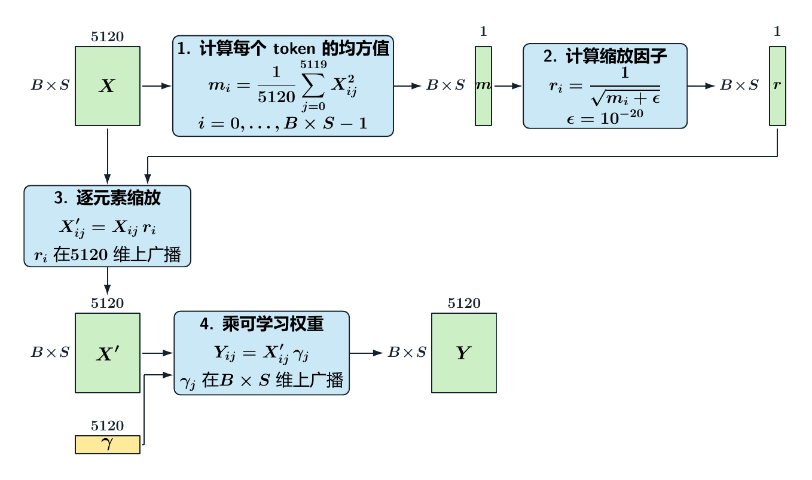

### 3.1 四步前向计算与精度

图中用 $X$ 表示入口张量、$Y$ 表示输出；对应前文符号时，就是 $X=Z$、$Y=U$。参考实现先记住输入 dtype，再把计算提升到 FP32：

$$
\widehat X=\operatorname{float}(X),\qquad X:[N,5120]
$$

第一步，对每个 token 独立计算 5120 维上的**均方值**，不减均值：

$$
m_i=\frac{1}{5120}\sum_{j=0}^{5119}\widehat X_{ij}^{\,2},\qquad m:[N,1]
$$

第二步，加固定常数 $\epsilon=10^{-20}$，再计算动态缩放因子：

$$
r_i=\frac{1}{\sqrt{m_i+\epsilon}},\qquad r:[N,1]
$$

第三步把 $r_i$ 沿特征维广播，完成逐元素归一化；第四步乘可学习权重 $\gamma:[5120]$：

$$
X'_{ij}=\widehat X_{ij}r_i,\qquad
Y_{ij}=X'_{ij}\gamma_j
$$

最后把 $Y$ 转回输入 dtype。当前参考推理路径的输入、输出和 $\gamma$ 为 BF16，均方、`rsqrt`、归一化及权重缩放在 FP32 表达中完成。$\gamma$ 是唯一的可学习参数，没有 bias；$\epsilon$ 是固定常数，不计入参数量。[核查：固定 revision 的 `RMSNorm`](https://huggingface.co/deepseek-ai/DeepSeek-V4.1-Flash/blob/5254448103b6254fc646dacbca1cbbf20e9216c1/inference/model.py#L303-L317)

### 3.2 参数量与前向计算量

一套 5120 维 RMSNorm 只有一个缩放向量：

| 参数 | shape | 数量 | BF16 驻留字节 |
|---|---|---:|---:|
| $\gamma$ | `[5120]` | 5,120 | 10,240 B（10 KiB） |

Attention 前和 MoE 前各有一套独立的 $\gamma$，所以 Layer 0 的两个入口 RMSNorm 合计 **10,240 个逻辑参数、20 KiB 权重**。

下面给出一套 RMSNorm 处理一个 token 的算法级标量运算数。加法和乘法各计 1 次；均值中的除以 5120 按一次常数乘法计；`rsqrt` 单列，dtype 转换不计：

| 阶段 | 加法 / 乘法 | `rsqrt` |
|---|---:|---:|
| 平方、求和、乘 $1/5120$、加 $\epsilon$ | $5120+5119+1+1=10241$ | 1 |
| $X'_{ij}=\widehat X_{ij}r_i$ | 5,120 | 0 |
| $Y_{ij}=X'_{ij}\gamma_j$ | 5,120 | 0 |
| **一 token 合计** | **20,481** | **1** |

因此一套处理 $N=BS$ 个 token 时：

$$
C_{\mathrm{RMSNorm}}=20481N\ \text{次标量加法/乘法}+N\ \text{次 rsqrt}
$$

Layer 0 两套合计：

$$
C_{\mathrm{Layer0\ Norm}}=40962N\ \text{次标量加法/乘法}+2N\ \text{次 rsqrt}
$$

这是按数学步骤统计的运算量，不等同于 GPU 指令数或执行时间；实际 kernel 会融合归约、广播和逐元素乘法。

### 3.3 张量生命周期与 Required Global Memory 理论下界（理想融合口径）

一套 RMSNorm 的逻辑张量如下。内部 FP32 张量用于说明计算与上界，不代表实现必须把它们完整写入 Global Memory：

| Tensor | 分类 | shape | dtype | 若完整物化的字节数 |
|---|---|---|---|---:|
| $\gamma$ | Weight | `[5120]` | BF16 | 10,240 |
| $X$ | Input | `[N,5120]` | BF16 | $10240N$ |
| $\widehat X$ | Internal | `[N,5120]` | FP32 | $20480N$ |
| $m$ | Internal | `[N,1]` | FP32 | $4N$ |
| $r$ | Internal | `[N,1]` | FP32 | $4N$ |
| $X'$ | Internal | `[N,5120]` | FP32 | $20480N$ |
| $Y$ | Output | `[N,5120]` | BF16 | $10240N$ |

若只统计参数、输入和输出，并假设融合/tiling 让 $\widehat X,m,r,X'$ 停留在寄存器或共享内存，一套 RMSNorm 的 Required Global Memory 理论下界为：

$$
\boxed{
M_{\mathrm{RMSNorm}}(B,S)=10\,\mathrm{KiB}+20\,\mathrm{KiB}\cdot BS
}
$$

Layer 0 的两套 $\gamma$ 会同时随模型驻留，合计 20 KiB；但两次 RMSNorm 按执行顺序发生，输入/输出工作区可以复用。因此仅就这两个 Norm 自身并按理想复用计算，最低**同时驻留**量是：

$$
\boxed{
M_{\mathrm{Layer0\ Norm,min}}(B,S)=20\,\mathrm{KiB}+20\,\mathrm{KiB}\cdot BS
}
$$

这不是进程峰值显存，也不是显存读写流量；框架上下文、allocator 保留区、kernel workspace 和未融合的 FP32 中间量都可能提高实测值。

### 3.4 与 LayerNorm、mHC RMS 因子的区别

- RMSNorm 只按平方均值缩放，不减均值，也没有 LayerNorm 的可学习偏置 $\beta$。
- 本节入口 RMSNorm 沿单路 $5120$ 维统计，并乘独立的 $\gamma:[5120]$。
- 第 2 节 mHC 的 RMS 因子沿四路展平后的 $4\times5120=20480$ 维统计，只服务于动态系数投影，没有独立的 $\gamma$。

两套入口 Norm 的位置和调用顺序可直接在 `Block.forward` 中看到：`hc_pre → attn_norm → Attention`，随后是 `hc_pre → ffn_norm → MoE`。[核查：固定 revision 的 `Block`](https://huggingface.co/deepseek-ai/DeepSeek-V4.1-Flash/blob/5254448103b6254fc646dacbca1cbbf20e9216c1/inference/model.py#L1148-L1235)

## 4. 局部 Attention / SWA

这一节沿用 mHC 部分的展开方式：先逐步跟踪张量，再给公式与显存账。记 $N=BS$，窗口宽度 $W=128$；输入 $U:[N,5120]$ 已经过 Attention 入口 RMSNorm。

### 4.1 生成 Q、共享 KV 与局部窗口

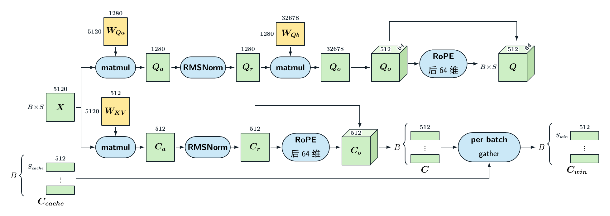

Q 与 KV 两条支路读取同一个 $U$：

$$
Q_a=UW_{Qa}^{T},\qquad Q_r=\operatorname{RMSNorm}(Q_a),\qquad
Q_0=\operatorname{reshape}(Q_rW_{Qb}^{T},[B,S,64,512])
$$

$$
C_a=UW_{KV}^{T},\qquad C_r=\operatorname{RMSNorm}(C_a)
$$

| 步骤 | 权重 / 操作 | 输出 shape |
|---|---|---|
| Q 降维 | $W_{Qa}:[1280,5120]$ | `[N,1280]` |
| Q 归一化 | 独立 RMSNorm，$\gamma_q:[1280]$ | `[N,1280]` |
| Q 展开 | $W_{Qb}:[32768,1280]$，分成 64 头 | `[B,S,64,512]` |
| 共享 KV 投影 | $W_{KV}:[512,5120]$ | `[N,512]` |
| 共享 KV 归一化 | 独立 RMSNorm，$\gamma_{kv}:[512]$ | `[B,S,512]` |

每个头只有最后 $64$ 维参加 RoPE，前 $448$ 维直通。对一对实数分量 $(x_{2r},x_{2r+1})$，旋转写为：

$$
\operatorname{RoPE}_{\theta}
\begin{bmatrix}x_{2r}\\x_{2r+1}\end{bmatrix}
=
\begin{bmatrix}\cos\theta&-\sin\theta\\\sin\theta&\cos\theta\end{bmatrix}
\begin{bmatrix}x_{2r}\\x_{2r+1}\end{bmatrix}
$$

于是：

$$
Q=\operatorname{Concat}\left(Q_0[...,0{:}448],\operatorname{RoPE}(Q_0[...,448{:}512])\right)
$$

$$
C=K=V=\operatorname{Concat}\left(C_r[...,0{:}448],\operatorname{RoPE}(C_r[...,448{:}512])\right)
$$

第 0 层使用基数 $10000$ 的 RoPE；$64$ 个 Query 头共享同一份 $C:[B,S,512]$。推理时，每个会话只保留最近 $128$ 个 KV。令 $S_{\mathrm{cache}}$ 为本轮开始前已有的缓存长度，则概念上的窗口长度和窗口内容可写成：

$$
S_{\mathrm{win}}=
\begin{cases}
S,&S\ge 128\\
\min(S_{\mathrm{cache}}+S,128),&S<128
\end{cases}
$$

$$
C_{\mathrm{win}}=
\begin{cases}
C,&S\ge 128\\
\operatorname{Tail}_{S_{\mathrm{win}}}\!\left(\operatorname{Concat}(C_{\mathrm{cache}},C)\right),&S<128
\end{cases}
$$

这里的 $C_{\mathrm{win}}$ 是便于理解的逻辑视图，不是实现必须物化的新张量。上游实现用 `topk_idxs` 直接索引交给 attention kernel 的 KV：prefill 索引当前序列 $C$，同时把末尾 KV 写入环形 `window_kv_cache`；decode 再按从旧到新的顺序索引该缓存的 128 个槽。prefill 为每个 Query 生成至多 $\min(S,128)$ 个因果索引，无效槽填 `-1`。即使此时概念上的 $S_{\mathrm{win}}=S>128$，下一步的窗口 mask 仍保证单个 Query 最多只参与 128 个 KV。[核查：固定 revision 的 `Attention._window_kv`](https://huggingface.co/deepseek-ai/DeepSeek-V4.1-Flash/blob/5254448103b6254fc646dacbca1cbbf20e9216c1/inference/model.py#L940-L960)、[`get_window_topk_idxs`](https://huggingface.co/deepseek-ai/DeepSeek-V4.1-Flash/blob/5254448103b6254fc646dacbca1cbbf20e9216c1/inference/kernel.py)

### 4.2 SWA mask、attention sink 与在线 softmax

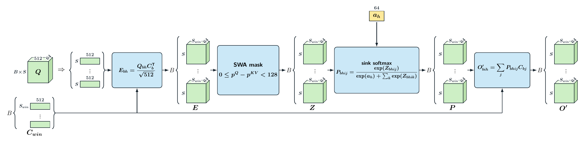

固定会话 $b$、Query 头 $h$ 和 Query 位置 $i$。令当前内核实际遍历的候选数为 $K_{\mathrm{idx}}$；prefill 时 $K_{\mathrm{idx}}=\min(S,128)$，decode 时为 $128$。对候选 KV 位置 $j$，原始得分为：

$$
E_{b,h,i,j}=\frac{Q_{b,i,h}C_{b,j}^{T}}{\sqrt{512}}
$$

$p^Q_{b,i}$ 与 $p^{KV}_{b,j}$ 分别表示 Query 和 KV 的绝对位置。128-token 因果滑窗的 mask 为：

$$
M_{b,i,j}=
\begin{cases}
0,&0\le p^Q_{b,i}-p^{KV}_{b,j}<128\\
-\infty,&\text{其他}
\end{cases},\qquad Z^{\mathrm{attn}}=E+M
$$

因此每个 Query 只访问自身及此前最多 $127$ 个位置；在完整序列示意中，就是主对角线及其下方 127 条对角线。

每个头还有一个可学习 sink logit $a_h$。它只进入 softmax 分母，不携带 value 内容。直接形式为：

$$
P_{b,h,i,j}=
\frac{\exp(Z^{\mathrm{attn}}_{b,h,i,j})}
{\exp(a_h)+\sum_k\exp(Z^{\mathrm{attn}}_{b,h,i,k})}
$$

在数学上，可以把 sink 当成一个“无 value 的额外 logit”，并统一取最大值：

$$
m_{b,h,i}=\max\!\left(a_h,\max_k Z^{\mathrm{attn}}_{b,h,i,k}\right)
$$

于是可写成：

$$
P_{b,h,i,j}=
\frac{\exp(Z^{\mathrm{attn}}_{b,h,i,j}-m_{b,h,i})}
{\exp(a_h-m_{b,h,i})+\sum_k\exp(Z^{\mathrm{attn}}_{b,h,i,k}-m_{b,h,i})}
$$

$$
O'_{b,i,h}=\sum_j P_{b,h,i,j}C_{b,j}
$$

上式是便于推导的稳定等价形式，不是官方 kernel 对 max 的逐行复述。固定 revision 的 `sparse_attn_kernel` 实际只对真实 KV score 维护 running max：

$$
m^{\mathrm{KV}}_{b,h,i}=\max_k Z^{\mathrm{attn}}_{b,h,i,k}
$$

处理完所有 KV block 后，它再把 $\exp(a_h-m^{\mathrm{KV}}_{b,h,i})$ 加入分母，并用该分母归一化累计输出。换言之，sink 不参与 kernel 的 running-max 更新，但数学结果与上面的直接定义一致。

因为 sink 吸收了部分概率质量，真实 token 的权重和满足 $\sum_jP_{b,h,i,j}<1$，而不是强制等于 1。内核以 FP32 累积真实 score 的最大值、指数和及输出，再写回 BF16；$E$、$Z^{\mathrm{attn}}$、$P$ 都只是逻辑上的分块，不会完整落到全局显存。[核查：固定 revision 的 `sparse_attn_kernel`](https://huggingface.co/deepseek-ai/DeepSeek-V4.1-Flash/blob/5254448103b6254fc646dacbca1cbbf20e9216c1/inference/kernel.py#L568-L630)

| 对象 | 逻辑 shape | 实现说明 |
|---|---|---|
| Q | `[B,S,64,512]` | BF16 |
| 窗口 KV | `[B,K_idx,512]` | 由索引从环形缓存 gather |
| `topk_idxs` | `[B,S,K_idx]` | INT32，`-1` 表示无效槽 |
| $E,Z^{\mathrm{attn}},P$ | `[B,S,64,K_idx]` | FP32 分块 / 在线计算，不完整物化 |
| $O'$ | `[B,S,64,512]` | BF16 |

### 4.3 逆 RoPE 与两级分组输出投影

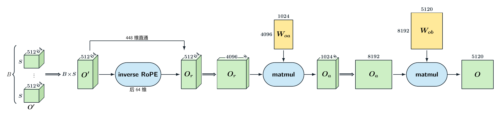

先按当前 Query 位置撤销每个头最后 $64$ 维的旋转。逆变换等价于使用共轭频率，即 $\operatorname{RoPE}_{-\theta}$：

$$
\operatorname{RoPE}^{-1}_{\theta}=
\begin{bmatrix}\cos\theta&\sin\theta\\-\sin\theta&\cos\theta\end{bmatrix}
$$

$$
O_r=\operatorname{Concat}\left(O'[...,0{:}448],\operatorname{RoPE}^{-1}(O'[...,448{:}512])\right)
$$

随后把 $64$ 个头分成 $8$ 组，每组 $8$ 个头：

$$
O_g=\operatorname{reshape}(O_r,[N,8,4096])
$$

第一级由 8 组独立权重完成：

$$
O_a[n,g,:]=O_g[n,g,:]W_{oa,g}^{T},\qquad
W_{oa}:[8,1024,4096]
$$

第二级先把 8 组展平为 $8192$ 维，再合并回模型宽度：

$$
O=\operatorname{reshape}(O_a,[N,8192])W_{ob}^{T},\qquad
W_{ob}:[5120,8192]
$$

完整形状链为：

$$
[N,64,512]\to[N,8,4096]\to[N,8,1024]\to[N,8192]\to[N,5120]
$$

两级之间没有额外非线性。最终单路输出 $O:[N,5120]$ 交给当前 Attention 侧的 mHC 融合。[核查：固定 revision 的 `Attention.forward`](https://huggingface.co/deepseek-ai/DeepSeek-V4.1-Flash/blob/5254448103b6254fc646dacbca1cbbf20e9216c1/inference/model.py#L1005-L1030)

### 4.4 前向计算量

下面统计数学前向中的标量加法、减法和乘法；量化/反量化、数据搬运、索引与 dtype 转换不计。RoPE 的每个二维旋转按 4 次乘法和 2 次加 / 减统计。对 token $(b,i)$，令

$$
L_{b,i}=\text{该 Query 实际参与数学 Attention 的有效 KV 数},
\qquad
\overline L=\frac{1}{N}\sum_{b,i}L_{b,i}\le128
$$

因果窗口始终包含 Query 自身，所以 $L_{b,i}\ge1$。各部分的一 token 计数为：

| 阶段 | 加 / 减 / 乘 |
|---|---:|
| $W_{Qa}$ 投影 | 13,105,920 |
| 1280 维 RMSNorm | 5,121 |
| $W_{Qb}$ 投影 | 83,853,312 |
| $W_{KV}$ 投影 | 5,242,368 |
| 512 维 RMSNorm | 2,049 |
| Q RoPE、KV RoPE、输出 inverse RoPE | 24,768 |
| 64 头 score 点积与缩放 | $65,536L_{b,i}$ |
| Sink Softmax 的 score/sink 平移与分母求和 | $128L_{b,i}+64$ |
| $PC$ 加权汇总 | $65,536L_{b,i}-32,768$ |
| 8 组 $W_{oa}$ 投影 | 67,100,672 |
| $W_{ob}$ 投影 | 83,880,960 |
| **合计** | **$253,182,466+131,200L_{b,i}$** |

其中 $PC$ 的每个输出分量使用 $L_{b,i}$ 次乘法和 $L_{b,i}-1$ 次加法；这解释了常数项中的 $-32,768$。因此处理 $N=BS$ 个 token 时：

$$
\boxed{
C_{\mathrm{SWA,mul/add/sub}}
=N\left(253182466+131200\overline L\right)
}
$$

这个公式按数学上的 Sink Softmax 与 $PC$ 两步统计，不等同于分块 online-softmax kernel 的实际指令数。两次内部 RMSNorm 另有 $2N$ 次 `rsqrt`；softmax 的 exp、除法、比较以及 kernel 为 running max 重标定累计量的操作，也没有混入主公式。

### 4.5 参数量与 Required Global Memory 理论下界（理想融合口径）

先区分两个口径：**逻辑参数量**统计模型中有多少个标量；**驻留字节数**按参考实现实际的 GPU dtype 和 FP8 scale 计算。SWA 的逻辑参数量仍是第 6 节汇总所用的 **126,617,408**：

| 参数 | shape | 逻辑参数量 |
|---|---|---:|
| $W_{Qa}$ | `[1280,5120]` | 6,553,600 |
| $\gamma_q$ | `[1280]` | 1,280 |
| $W_{Qb}$ | `[32768,1280]` | 41,943,040 |
| $W_{KV}$ | `[512,5120]` | 2,621,440 |
| $\gamma_{kv}$ | `[512]` | 512 |
| sink $a$ | `[64]` | 64 |
| $W_{oa}$ | `[8,1024,4096]` | 33,554,432 |
| $W_{ob}$ | `[5120,8192]` | 41,943,040 |
| **合计** |  | **126,617,408** |

参考实现默认 FP8 权重使用 E4M3 数据与按 $32\times32$ block 存放的 E8M0 scale；两个 RMSNorm 权重为 BF16，sink 为 FP32，$W_{oa}$ 为 BF16。对应驻留字节为：

| 驻留对象 | GPU 存储 | 字节数 |
|---|---|---:|
| $W_{Qa}$ | FP8 + E8M0 scale | 6,560,000 |
| $\gamma_q$ | BF16 | 2,560 |
| $W_{Qb}$ | FP8 + E8M0 scale | 41,984,000 |
| $W_{KV}$ | FP8 + E8M0 scale | 2,624,000 |
| $\gamma_{kv}$ | BF16 | 1,024 |
| sink $a$ | FP32 | 256 |
| $W_{oa}$ | BF16 | 67,108,864 |
| $W_{ob}$ | FP8 + E8M0 scale | 41,984,000 |
| **参数与 scale 合计** |  | **160,264,704 B（约 152.84 MiB）** |

令 $B_{\max}$ 为预分配最大 batch，$S_{\max}$ 为 RoPE 表覆盖的最大位置。持续状态还包括 BF16 `window_kv_cache:[B_max,128,512]`，占 $131072B_{\max}$ 字节；以及 `freqs_cis:[S_max,32]` 的 Complex64 表，占 $256S_{\max}$ 字节。最后的 32 来自 $64$ 个实数 RoPE 维两两组成复数。

若只计算该 SWA 模块完成一次前向所必需的 Global Memory，并假设理想融合/tiling 让 Q、分数、概率和中间投影停留在寄存器或共享内存，则需要长期保留的动态张量只有 BF16 输入与输出，各占 $10240N$ 字节。因此 Required Global Memory 理论下界为：

$$
M_{\min}=152.84\,\mathrm{MiB}+20\,\mathrm{KiB}\cdot N
+128\,\mathrm{KiB}\cdot B_{\max}
+0.25\,\mathrm{KiB}\cdot S_{\max}
$$

这不是进程实际峰值显存：它不包含框架上下文、allocator 保留区、kernel workspace，也不要求完整物化下面这些中间量：

| 中间量 | dtype | 若完整物化的字节数 |
|---|---|---:|
| $Q_a$ 或 $Q_r:[N,1280]$ | BF16 | $2560N$ |
| $Q$ 或 $O':[B,S,64,512]$ | BF16 | $65536N$ |
| $C:[B,S,512]$ | BF16 | $1024N$ |
| `topk_idxs:[B,S,K_idx]` | INT32 | $4NK_{\mathrm{idx}}$ |
| $E$、$Z^{\mathrm{attn}}$ 或 $P:[B,S,64,K_{\mathrm{idx}}]$ | FP32 | 每个 $256NK_{\mathrm{idx}}$ |
| $O_a:[B,S,8,1024]$ | BF16 | $16384N$ |

当前参考路径先对 $C$ 做原地 FP8 量化—反量化模拟，再把结果以 BF16 写入窗口缓存；因此这里按 BF16 cache 计数。`freqs_cis` 在单层只计一次；虽然相同 RoPE 配置的层理论上可以共享该只读表，固定 revision 的构造器仍为每层分别注册 buffer，整模型实测不能未经验证就按共享扣减。[核查：固定 revision 的 `Attention`](https://huggingface.co/deepseek-ai/DeepSeek-V4.1-Flash/blob/5254448103b6254fc646dacbca1cbbf20e9216c1/inference/model.py#L853-L938)、[`act_quant(inplace=True)` 与 `sparse_attn`](https://huggingface.co/deepseek-ai/DeepSeek-V4.1-Flash/blob/5254448103b6254fc646dacbca1cbbf20e9216c1/inference/kernel.py)

## 5. MoE 前馈计算

这一节继续沿用前文的展开方式：先跟踪 Router、专家参数索引和专家计算，再核算参数、计算量与 Required Global Memory 理论下界。记

$$
N=BS,\qquad H=5120,\qquad M=2304,\qquad E=384,\qquad K=6
$$

输入 $X:[N,H]$ 已经过 MoE 入口 RMSNorm。每个 token 从 $384$ 个 routed experts 中选择 $6$ 个，同时无条件执行 $1$ 个 shared expert；所有专家都是无投影偏置的截断 SwiGLU。

### 5.1 Router：Top-6 选择与路由权重

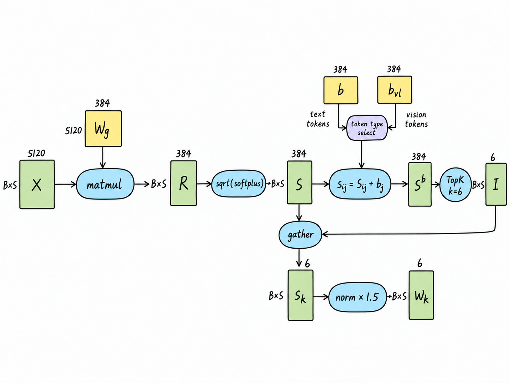

Router 先用 $W_g:[384,5120]$ 计算 logits。参考实现把输入和 $W_g$ 转成 FP32 后再执行这次投影；本配置温度 $\tau=1$：

$$
L=\frac{XW_g^{\mathsf T}}{\tau},\qquad
S=\sqrt{\operatorname{Softplus}(L)},\qquad
L,S:[N,384]
$$

对 token $i$，文本路径使用 $b:[384]$，图像 span 内的 token 使用 $b_{\mathrm{vl}}:[384]$：

$$
b_i=
\begin{cases}
b_{\mathrm{vl}},&\mathrm{image\_mask}_i=\mathrm{True}\\
b,&\text{其他情况}
\end{cases}
$$

先用加修正量后的分数选专家：

$$
I_i=\operatorname{TopKIndices}_{6}(S_i+b_i),
\qquad I:[N,6]
$$

但修正量**只改变入选次序，不进入最终数值权重**。根据 $I_i$ 回到原始正分数 $S_i$ gather，再归一化并乘 `route_scale=1.5`：

$$
s_{i,e}=S_{i,I_{i,e}},\qquad
w_{i,e}=1.5\frac{s_{i,e}}{\sum_{k=0}^{5}s_{i,k}+10^{-20}},
\qquad w:[N,6]
$$

因此每个 token 的六个路由权重之和约为 $1.5$；分母中的 $10^{-20}$ 是路由归一化常数。[核查：固定 revision 的 `Gate`](https://huggingface.co/deepseek-ai/DeepSeek-V4.1-Flash/blob/5254448103b6254fc646dacbca1cbbf20e9216c1/inference/model.py#L1033-L1068)、[模型配置](https://huggingface.co/deepseek-ai/DeepSeek-V4.1-Flash/blob/5254448103b6254fc646dacbca1cbbf20e9216c1/inference/config.json)

### 5.2 专家参数池与逻辑 gather

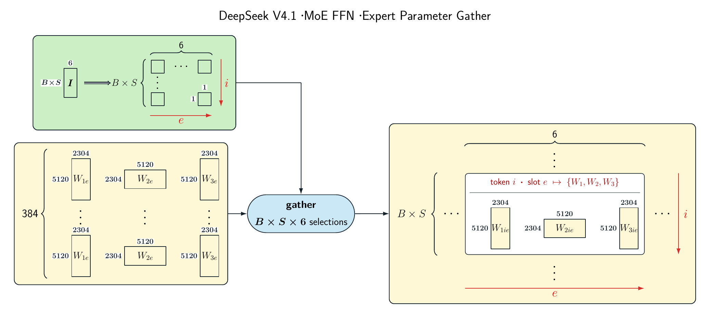

全局 routed expert $g$ 各有三组独立参数，统一按 PyTorch 的 `[输出,输入]` 存储顺序写为：

$$
W_{1,g},W_{3,g}:[2304,5120],\qquad W_{2,g}:[5120,2304]
$$

对 token $i$ 的第 $e$ 个 selected slot：

$$
W_{1,i,e}=W_{1,I_{i,e}},\qquad
W_{2,i,e}=W_{2,I_{i,e}},\qquad
W_{3,i,e}=W_{3,I_{i,e}}
$$

图 11、图 12 黄色矩阵旁的尺寸采用行向量乘法视角 `[输入,输出]`，所以写作 $5120\times2304$ 或 $2304\times5120$；正文则始终采用参数存储视角 `[输出,输入]`，计算时显式写转置。两种标法描述的是同一组矩阵。

这里的 gather 是**逻辑索引关系**，不表示为每个 token 复制六份完整参数。参考实现反过来按 expert id 统计 token 数，用 `where(indices == expert_id)` 收集属于该专家的 token，再批量调用一次 expert。多卡时 $384$ 个 routed experts 按 rank 切分，各 rank 计算自己的局部专家后对 FP32 输出累加器做 `all_reduce`；shared expert 在各 rank 本地执行。[核查：固定 revision 的 `MoE`](https://huggingface.co/deepseek-ai/DeepSeek-V4.1-Flash/blob/5254448103b6254fc646dacbca1cbbf20e9216c1/inference/model.py#L1095-L1145)

### 5.3 六个 routed experts 与一个 shared expert

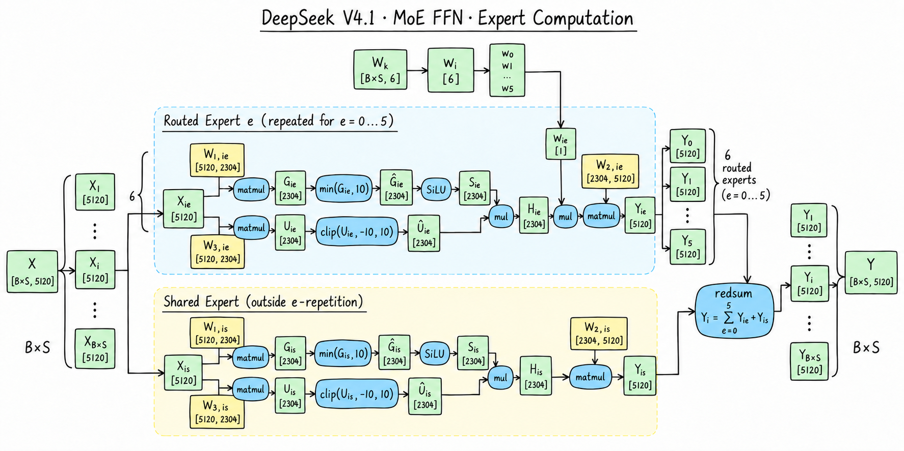

对 token $i$ 的第 $e$ 个已选 routed expert，先计算两条输入投影：

$$
G_{i,e}=X_iW_{1,i,e}^{\mathsf T},\qquad
U_{i,e}=X_iW_{3,i,e}^{\mathsf T},\qquad
G_{i,e},U_{i,e}:[2304]
$$

Gate 支路只裁剪上界，Up 支路裁剪上下界：

$$
\widehat G_{i,e}=\min(G_{i,e},10),\qquad
\widehat U_{i,e}=\operatorname{clip}(U_{i,e},-10,10)
$$

随后执行 SwiGLU。参考实现先在 FP32 中乘路由权重，再转回输入 dtype 进入 $W_2$：

$$
H_{i,e}=\operatorname{SiLU}(\widehat G_{i,e})\odot\widehat U_{i,e}
$$

$$
Y_{i,e}=\left(w_{i,e}H_{i,e}\right)W_{2,i,e}^{\mathsf T},
\qquad Y_{i,e}:[5120]
$$

shared expert 使用同一结构和独立的 $W_{1,s},W_{2,s},W_{3,s}$，但不参加 Top-K，也不乘路由权重：

$$
Y_{i,s}=
\left[
\operatorname{SiLU}\!\left(\min(X_iW_{1,s}^{\mathsf T},10)\right)
\odot
\operatorname{clip}\!\left(X_iW_{3,s}^{\mathsf T},-10,10\right)
\right]W_{2,s}^{\mathsf T}
$$

六个 routed 输出在 FP32 累加器中相加，再加 shared 输出，最后转回输入 dtype：

$$
\boxed{
Y_i=\sum_{e=0}^{5}Y_{i,e}+Y_{i,s}
},\qquad Y:[N,5120]
$$

原始交付图曾把两处 Gate 上限误写为 $0$；图 12 已依据官方 `clamp(gate,max=10)` 修正为 $10$，其余结构保持不变。[核查：固定 revision 的 `Expert`](https://huggingface.co/deepseek-ai/DeepSeek-V4.1-Flash/blob/5254448103b6254fc646dacbca1cbbf20e9216c1/inference/model.py#L1071-L1092)

### 5.4 参数量

| 部分 | 参数 shape | 逻辑参数量 |
|---|---|---:|
| Router $W_g$ | `[384,5120]` | 1,966,080 |
| 文本 / 视觉修正量 $b,b_{\mathrm{vl}}$ | 各 `[384]` | 768 |
| 384 个 routed experts 的 $W_1,W_2,W_3$ | 每个 expert 共 $3\times5120\times2304$ | 13,589,544,960 |
| 1 个 shared expert 的 $W_1,W_2,W_3$ | $3\times5120\times2304$ | 35,389,440 |
| **合计** | — | **13,626,901,248** |

一个 expert 的逻辑参数量为：

$$
N_{\mathrm{expert}}=3\times5120\times2304=35389440
$$

整个 MoE 为：

$$
\boxed{
N_{\mathrm{MoE}}
=384\times35389440+35389440+384\times5120+2\times384
=13626901248
}
$$

每个 token 虽然只执行 $6+1$ 个专家，但 Router 仍要计算全部 $384$ 个分数；“激活参数量”也不能直接当成单 token 的实际显存读量，因为同一 expert 的权重会在分配给它的一批 token 间复用。

### 5.5 前向计算量

下面统计**数学前向**：加法、减法和乘法各计 1 次；`exp`、`log`、`sqrt`、除法、比较和 Top-K 单列；不计量化、反量化、数据搬运、参数索引、expert dispatch 和通信。SiLU 按 $x/(1+e^{-x})$ 展开；实际 kernel 可以融合这些逐元素步骤。

| 阶段 | 一 token 的加 / 减 / 乘 | 其他运算 |
|---|---:|---|
| Router 投影 $XW_g^{\mathsf T}$ | 3,931,776 | — |
| Sqrt-Softplus | 384 | exp：384；log：384；sqrt：384 |
| 修正量与 Top-6 归一化 | 396 | 除法：6；TopK$_6(384)$：1 次；混合文本/视觉时条件选择：384 |
| 1 个 routed expert | 70,780,672 | exp：2,304；除法：2,304；Clamp 比较：6,912 |
| 6 个 routed experts | 424,684,032 | exp：13,824；除法：13,824；Clamp 比较：41,472 |
| 1 个 shared expert | 70,778,368 | exp：2,304；除法：2,304；Clamp 比较：6,912 |
| 7 路输出汇聚 | 30,720 | — |
| **一 token 合计** | **499,425,676** | exp：16,512；log：384；sqrt：384；除法：16,134；显式 Clamp 比较：48,384；TopK：1 次 |

其中，单个 routed expert 的三次矩阵投影占绝大部分：

$$
2\times2304(5120+5119)+5120(2304+2303)=70769152
$$

加上 SiLU、门控乘法和路由缩放后是 $70780672$ 次加 / 减 / 乘；shared expert 少 $2304$ 次路由缩放，得到 $70778368$。因此处理 $N=BS$ 个 token 时：

$$
\boxed{C_{\mathrm{MoE,mul/add/sub}}=499425676N}
$$

其余按 $N$ 线性放大；Top-K 内部比较次数取决于实现，未伪装成固定常数。纯文本调用不传 `image_mask` 时，文本/视觉条件选择也可省略。

### 5.6 权重存储与 Required Global Memory 理论下界（理想融合口径）

这里同时区分**逻辑参数量**和**实际驻留字节**。按官方参考配置：Router 的 $W_g$ 为 BF16，两个修正量为 FP32；routed experts 使用两个 FP4 值打包为 1 Byte，并沿 K 维每 32 个元素保存 1 个 E8M0 scale；shared expert 使用 FP8 权重和 $32\times32$ 的 E8M0 scale。

| 驻留对象 | 存储方式 | 字节数 |
|---|---|---:|
| Router $W_g$ | BF16 | 3,932,160 |
| $b,b_{\mathrm{vl}}$ | FP32 | 3,072 |
| Routed $W_1$ pool | FP4 packed + E8M0 scale | 2,406,481,920 |
| Routed $W_2$ pool | FP4 packed + E8M0 scale | 2,406,481,920 |
| Routed $W_3$ pool | FP4 packed + E8M0 scale | 2,406,481,920 |
| Shared $W_{1,s},W_{2,s},W_{3,s}$ | FP8 + E8M0 scale | 35,424,000 |
| **参数与 scale 合计** | — | **7,258,804,992 B（7.259 GB / 6.760 GiB）** |

以 routed expert 的一组 $5120\times2304$ 矩阵为例：

$$
M_{\mathrm{routed\ matrix}}
=\frac{5120\times2304}{2}
+\frac{5120\times2304}{32}
=6266880\ \mathrm{Byte}
$$

所以 $384$ 个 routed experts 的三组矩阵合计：

$$
M_{\mathrm{routed}}
=384\times3\times6266880
=7219445760\ \mathrm{Byte}
$$

用于理解生命周期的主要逻辑张量如下；“若完整物化”不表示参考实现一定这样保存：

| Tensor | 分类 | shape / dtype | 若完整物化的字节数 |
|---|---|---|---:|
| $X$ | Input | `[N,5120]` / BF16 | $10240N$ |
| $L,S,S^b$ | Internal | 各 `[N,384]` / FP32 | 每个 $1536N$ |
| $I$ | Internal | `[N,6]` / INT64 | $48N$ |
| $w$ | Internal | `[N,6]` / FP32 | $24N$ |
| Routed 中间量 | Logical Internal | 各 `[N,6,2304]` / FP32 | 每个 $55296N$ |
| Routed 输出 | Logical Internal | `[N,6,5120]` / BF16 | $61440N$ |
| Routed 累加器 | Internal | `[N,5120]` / FP32 | $20480N$ |
| Shared 输出 | Internal | `[N,5120]` / BF16 | $10240N$ |
| $Y$ | Output | `[N,5120]` / BF16 | $10240N$ |

若只统计 `world_size=1` 下完整参数池、输入和输出，并假设 Router、expert dispatch、矩阵分块与 reduce 的中间量不完整落到 Global Memory，Required Global Memory 理论下界为：

$$
\boxed{
M_{\mathrm{MoE,min}}(B,S)
=7258804992+20480BS\ \mathrm{Byte}
}
$$

即约 $7.259\,\mathrm{GB}+20.48\,\mathrm{KB}\cdot BS$；若把调用方持有的 BOOL `image_mask:[N]` 也归入本模块，再增加 $N$ Byte。该式不是进程峰值显存，也不是每步显存流量；未融合激活、allocator、grouped-GEMM workspace 与通信缓冲都会提高实测值。

若以 $P$ 个 rank 做 expert parallel，且 $384$ 可被 $P$ 整除，则 routed 参数池按 rank 等分，而 Router 与 shared expert 在参考实现中保留于每个 rank。仅参数与 scale 的单 rank 口径为：

$$
M_{\mathrm{param/rank}}(P)
=\frac{7219445760}{P}+39359232\ \mathrm{Byte}
$$

FP4 的 `[out,in/2]` 打包与 `[out,in/32]` E8M0 scale 形状可在官方 `Linear` 与 `fp4_gemm` 中直接核查。[核查：固定 revision 的 `Linear`](https://huggingface.co/deepseek-ai/DeepSeek-V4.1-Flash/blob/5254448103b6254fc646dacbca1cbbf20e9216c1/inference/model.py#L449-L479)、[`fp4_gemm`](https://huggingface.co/deepseek-ai/DeepSeek-V4.1-Flash/blob/5254448103b6254fc646dacbca1cbbf20e9216c1/inference/kernel.py#L803-L832)

## 6. Layer 0 整层汇总：参数、计算、显存与状态

本章不重复前面的模块推导，只把固定 revision 下的 Layer 0 文本路径结算到同一口径。记 $N=BS$。

### 6.1 整层输入、输出与执行顺序

Layer 0 的外部输入为：

$$
X_{\mathrm{in}}:[N,4,5120],\qquad
\mathrm{pre}_{\mathrm{in}}:[N,4]
$$

其中四路 $X_{\mathrm{in}}$ 由 embedding 复制得到，`make_identity_pre_mix` 实际创建 FP32 的 $\mathrm{pre}_{\mathrm{in}}=[1,0,0,0]$。层内顺序为：

$$
\mathrm{mHC}_{A,\mathrm{pre}}
\rightarrow\mathrm{RMSNorm}_{A}
\rightarrow\mathrm{SWA}
\rightarrow\mathrm{mHC}_{A,\mathrm{post}}
$$

$$
\rightarrow\mathrm{mHC}_{F,\mathrm{pre}}
\rightarrow\mathrm{RMSNorm}_{F}
\rightarrow\mathrm{MoE}
\rightarrow\mathrm{mHC}_{F,\mathrm{post}}
$$

最终输出：

$$
X_{\mathrm{out}}:[N,4,5120],\qquad
\mathrm{pre}_{\mathrm{next}}:[N,4]
$$

`pre_next` 是本层 MoE 侧 mHC 生成的动态运行时状态，供 Layer 1 的 Attention 入口汇聚使用，不是模型参数。配置中 Layer 0 的 `compress_ratio=0`，且它不在 `kv_source_layers`、`index_source_layers` 或 `engram_layer_ids` 内，所以本层没有 compressed/global KV、Indexer 或 Engram 路径。

### 6.2 整层逻辑参数量与 GPU 驻留字节

下表包含当前文本路径不使用、但仍属于 Layer 0 参数的 `bias_vl`；不含 embedding、输出头和运行时状态。逻辑参数量统计标量个数，GPU 驻留字节则纳入 FP4 / FP8 打包、BF16 / FP32 以及量化 scale：

| 部分 | 逻辑参数量 | GPU 驻留字节 |
|---|---:|---:|
| Attention、MoE 两套 mHC | 983,094 | 3,932,376 B |
| 两个入口 RMSNorm | 10,240 | 20,480 B |
| Local Attention / SWA | 126,617,408 | 160,264,704 B |
| MoE FFN | 13,626,901,248 | 7,258,804,992 B |
| **Layer 0 合计** | **13,754,511,990** | **7,423,022,552 B** |

$$
\boxed{P_{\mathrm{Layer0}}=13754511990\approx13.755\ \mathrm{B}}
$$

$$
\boxed{
M_{\mathrm{param}}=7423022552\ \mathrm{Byte}
\approx7.423\ \mathrm{GB}
\approx6.913\ \mathrm{GiB}
}
$$

每个 token 只执行 6 个 routed experts 和 1 个 shared expert；这不会减少完整专家池的常驻参数字节。

### 6.3 整层前向计算量

沿用各模块“数学前向的标量加、减、乘”口径：

| 部分 | 每 token 的加 / 减 / 乘 |
|---|---:|
| 两套 mHC：官方通用路径 | 2,489,802 |
| 两个入口 RMSNorm | 40,962 |
| Local Attention / SWA | $253,182,466+131,200\overline L$ |
| MoE FFN | 499,425,676 |
| **Layer 0 合计** | **$755,138,906+131,200\overline L$** |

这里

$$
\overline L=\frac{1}{N}\sum_{b,i}L_{b,i},\qquad1\le\overline L\le128
$$

因此官方通用路径为：

$$
\boxed{
C_{\mathrm{Layer0,mul/add/sub}}
=N\left(755138906+131200\overline L\right)
}
$$

若优化实现把 Layer 0 首次 identity-pre 常量折叠，才可减去 $35840N$：

$$
\boxed{
C_{\mathrm{Layer0,opt}}
=N\left(755103066+131200\overline L\right)
}
$$

后一个值是理论优化值，不是固定 revision 官方 reference 当前执行的路径。exp、log、sqrt、`rsqrt`、除法、比较和 Top-K 仍按各模块章节单列，不在整层主公式中重复相加。

### 6.4 整层 Required Global Memory 理论下界（理想融合口径）

本节只统计参数与 scale、完整层边界 I/O、本层持久缓存及 RoPE 表；假设层内中间激活可融合、分块或复用，不完整物化到 Global Memory。

外部输入占：

$$
M_{\mathrm{input}}
=N\times4\times5120\times2+N\times4\times4
=40976N\ \mathrm{Byte}
$$

输出 $X_{\mathrm{out}}$ 与 $\mathrm{pre}_{\mathrm{next}}$ 同样占 $40976N$ Byte。Persistent Runtime Storage 包括：

$$
\mathrm{window\_kv\_cache}:[B_{\max},128,512] \mathrm{(BF16)}
=131072B_{\max}\ \mathrm{Byte}
$$

$$
\mathrm{freqs\_cis}:[S_{\max},32]\ \mathrm{(Complex64)}
=256S_{\max}\ \mathrm{Byte}
$$

所以：

$$
\boxed{
\begin{aligned}
M_{\mathrm{Layer0,min}}={}&7423022552\\
&+81952N\\
&+131072B_{\max}\\
&+256S_{\max}
\end{aligned}
\quad\mathrm{Byte}
}
$$

即：

$$
\boxed{
M_{\mathrm{Layer0,min}}
\approx6.913\ \mathrm{GiB}
+80\ \mathrm{KiB}\cdot N+32N\ \mathrm{Byte}
+128\ \mathrm{KiB}\cdot B_{\max}
+0.25\ \mathrm{KiB}\cdot S_{\max}
}
$$

官方 reference 会物化 $\mathrm{pre}_{\mathrm{in}}:[N,4]$；若某个优化实现把 identity-pre 连同首次 `hc_pre` 一并常量折叠，边界存储可再减少 $16N$ Byte。`freqs_cis` 在本层只计一次；相同 RoPE 配置的层理论上可以共享该只读表，但固定 revision 的 `Attention` 构造器仍为每层分别注册 buffer，整模型实测不能未经验证就按共享扣减。本式不是进程峰值显存，也不是每步显存读写量；未融合激活、allocator 保留区、kernel / grouped-GEMM workspace、dispatch 与通信缓冲都会增加实测值。

### 6.5 本层状态与跨层输出

| 对象 | Shape | dtype | 去向 / 生命周期 |
|---|---|---|---|
| 四路残差 $X_{\mathrm{out}}$ | `[N,4,5120]` | BF16 | 下一层 Attention 侧 mHC |
| $\mathrm{pre}_{\mathrm{next}}$ | `[N,4]` | FP32 | 下一层 Attention 入口汇聚 |
| `window_kv_cache` | `[B_max,128,512]` | BF16 | 本层后续 decode；环形保留最近 128 个 token |
| `freqs_cis` | `[S_max,32]` | Complex64 | 本层 RoPE / inverse RoPE 的只读 buffer |

Layer 0 不产生 compressed/global KV、Indexer 状态或 Engram 状态。四路残差与 `pre_next` 是层间运行时状态；local KV cache 与 RoPE 表是随模块驻留的 non-persistent buffer。

### 6.6 本层结论

1. **参数与常驻显存主要由 MoE 决定。** Layer 0 的 13.755B 逻辑参数和约 6.913 GiB 参数驻留量，绝大部分来自 384 个 FP4 routed experts。
2. **单 token 算术量主要来自 Expert FFN 与 Attention 投影。** mHC 和入口 RMSNorm 占比较小，但负责四路残差组织和数值稳定。
3. **本层 Attention 历史状态较小。** Layer 0 只保留 128-token local KV，不包含 compressed/global KV；更早历史由后续带压缩分支的层处理。

## 7. 资料来源与版本说明

本文分析对象为 **DeepSeek-V4.1-Flash**，数学关系与维度依据以下上游资料：

- [模型配置](https://huggingface.co/deepseek-ai/DeepSeek-V4.1-Flash/blob/5254448103b6254fc646dacbca1cbbf20e9216c1/inference/config.json)
- [模型前向实现](https://huggingface.co/deepseek-ai/DeepSeek-V4.1-Flash/blob/5254448103b6254fc646dacbca1cbbf20e9216c1/inference/model.py)：RMSNorm、Attention、Gate、Expert、MoE、Block 与 Transformer。
- [算子数学细节](https://huggingface.co/deepseek-ai/DeepSeek-V4.1-Flash/blob/5254448103b6254fc646dacbca1cbbf20e9216c1/inference/kernel.py)：hc_split_sinkhorn、窗口索引与 sparse_attn。

全文已于 2026-10-14 统一对照固定 revision [`5254448103b6254fc646dacbca1cbbf20e9216c1`](https://huggingface.co/deepseek-ai/DeepSeek-V4.1-Flash/tree/5254448103b6254fc646dacbca1cbbf20e9216c1) 复核；同日 Hugging Face 模型 API 返回的 `main` SHA 也为该 revision。后续上游更新不会自动改变本文的分析基准。图示用于辅助理解，精确维度、dtype、存储方式与是否物化以相邻正文为准。
