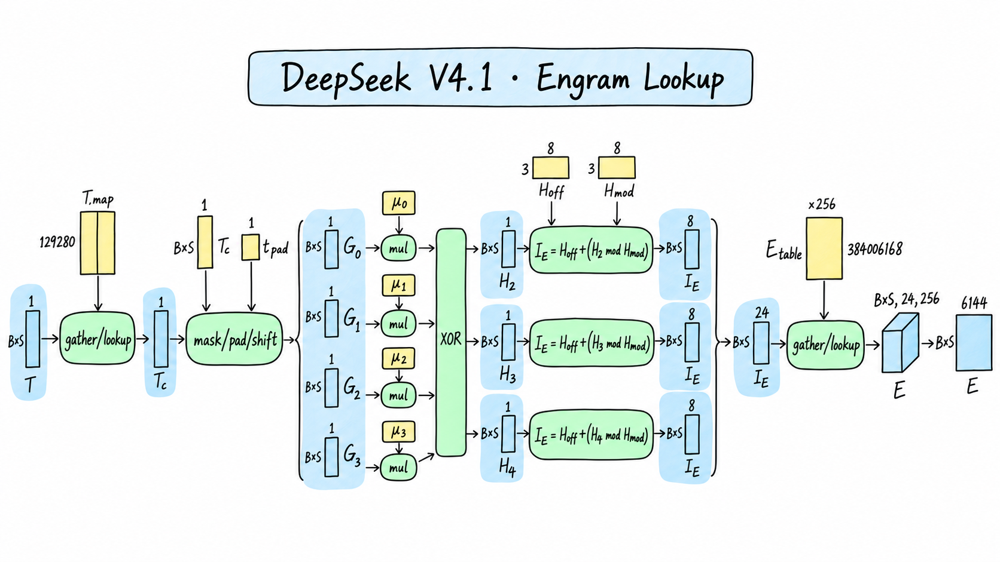
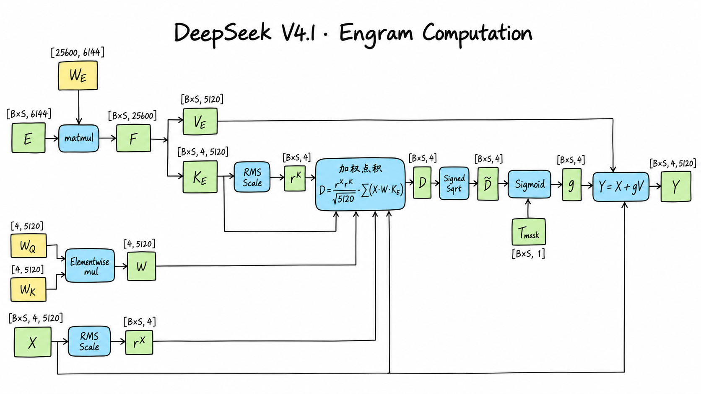

# Layer 1：从 Engram 写入到局部注意力与 MoE

## 1. 相对 Layer 0，只看两处差异

本文分析 **DeepSeek-V4.1-Flash 的 Layer 1**。Layer 0 已经完整讲过 mHC、RMSNorm、局部 Attention / SWA 和 MoE；Layer 1 不再重复这些推导，而是回答两个新问题：

1. Engram 怎样在普通 Transformer Block 之前，根据当前 token 及其局部历史检索条件记忆，并写回四路残差？
2. Layer 1 的第一次 `hc_pre` 为什么不再使用固定的 $[1,0,0,0]$，而是使用 Layer 0 MoE 侧传来的动态 `pre_next`？

记

$$
N=BS,\qquad D=5120,\qquad C=4,\qquad W=128.
$$

Layer 1 从 Layer 0 接收：

$$
X^{(1)}_{\mathrm{in}}:[B,S,4,5120]\quad\text{(BF16)},
\qquad
p^{(0)}_{\mathrm{next}}:[B,S,4]\quad\text{(FP32)}.
$$

其中 $X^{(1)}_{\mathrm{in}}$ 是四路残差，$p^{(0)}_{\mathrm{next}}$ 是 Layer 0 的 MoE 侧 mHC 生成的下一次汇聚系数。完整数据流为：

$$
\boxed{
(X^{(1)}_{\mathrm{in}},p^{(0)}_{\mathrm{next}})
\rightarrow \mathrm{Engram}
\rightarrow \mathrm{Layer\ 1\ Block}
\rightarrow (X^{(1)}_{\mathrm{out}},p^{(1)}_{\mathrm{next}})
}
$$

逐步对照如下。“结构相同”只表示算子、shape 和执行顺序与 Layer 0 相同；Layer 1 拥有自己的参数，输入数值也已经被 Engram 改变，并不与 Layer 0 共享权重或计算结果。

| 步骤 | 相对 Layer 0 | Layer 1 的行为 |
|---|---|---|
| 1. Engram Hash、查表、门控与四路写回 | **新增** | 在普通 Block 前修改四路残差；不修改传入的 `pre_next` |
| 2. Attention 侧 mHC 系数生成 | 结构相同 | 从 Engram 更新后的四路残差预测本层 `attn_pre/post/comb` |
| 3. Attention 入口 `hc_pre` | **输入不同** | 使用 Layer 0 MoE 侧生成的动态 `pre_next`，不再使用 identity-pre |
| 4. Attention 入口 RMSNorm | 结构相同 | 独立参数，输入来自步骤 3 |
| 5. Local Attention / SWA | 结构相同 | 仍是 128-token 局部窗口，没有 compressed/global KV 或 Indexer |
| 6. Attention 侧 `hc_post` | 结构相同 | 融合 Attention 输出和 Engram 更新后的四路残差 |
| 7. MoE 侧 mHC 系数生成 | 结构相同 | 生成本层 `ffn_pre/post/comb` |
| 8. MoE 入口 `hc_pre` | 结构相同 | 使用本层 Attention 侧生成的 `attn_pre` |
| 9. MoE 入口 RMSNorm | 结构相同 | 独立参数 |
| 10. MoE FFN | 结构相同 | 384 个 routed experts 选 6 个，并执行 1 个 shared expert |
| 11. MoE 侧 `hc_post` | 结构相同 | 输出四路残差，并把 `ffn_pre` 作为下一层的 `pre_next` |

固定配置中 `compress_ratios[1]=0`，而 `kv_source_layers` 与 `index_source_layers` 都从 Layer 2 开始。因此 Layer 1 与 Layer 0 一样只执行 SWA；本页新增的注意力外路径只有 Engram。[配置核查](https://huggingface.co/deepseek-ai/DeepSeek-V4.1-Flash/blob/5254448103b6254fc646dacbca1cbbf20e9216c1/inference/config.json)

## 2. Engram 在哪里，解决什么问题

Engram 把条件记忆作为 MoE 条件计算之外的另一条稀疏轴：MoE 根据隐藏状态选择少量专家进行动态计算；Engram 则根据确定性的局部 $N$-gram 地址，从巨大表中只读取少量行。官方论文把这一过程概括为 Tokenizer Compression、Multi-Head Hashing、Context-aware Gating 和 Multi-branch Integration。[Engram 论文](https://arxiv.org/abs/2601.07372)

DeepSeek-V4.1-Flash 在零起始编号的 Layer 1 和 Layer 14 各放置一个 Engram。两者合计约 196B 逻辑参数；每个模块使用 $N$-gram 阶数 $\{2,3,4\}$、8 个 Hash head，每个阶数共 $8\times256=2048$ 维查表结果。Layer 1 的表有 384,006,168 行，每行 256 维。[技术报告 §2.4.2](https://arxiv.org/abs/2609.19969)

参考前向并不是进入 Layer 1 后才开始构造 Hash。`Transformer.forward` 会在进入层循环前，根据原始 `input_ids` 一次生成两个 Engram 层的 Hash：

$$
I_{\mathrm{all}}:[B,S,2,24]\quad\text{(INT64)}.
$$

这里维度 2 对应 Layer 1 与 Layer 14，$24=3\times8$ 对应三个 $N$-gram 阶数和八个 Hash head。执行到 Layer 1 时，只取

$$
I^{(1)}=I_{\mathrm{all}}[:,:,0,:]:[B,S,24].
$$

因此需要把两个位置分清：

- **Transformer 级 Hash 前置组件**：处理 Token 压缩、历史状态、两个 Engram 层的 Hash 与索引。
- **Layer 1 Engram 模块**：读取本层的 24 个索引，执行查表、投影、门控和残差写回。

这也解释了为什么后面的显存分析不能把完整 Hash buffer 在 Layer 1 和 Layer 14 各算一遍。[前向接入位置](https://huggingface.co/deepseek-ai/DeepSeek-V4.1-Flash/blob/5254448103b6254fc646dacbca1cbbf20e9216c1/inference/model.py#L1245-L1271)

## 3. 从 Token 到 24 个查表地址

### 3.1 Token 压缩与跨前向历史

原始 Token ID 为

$$
T:[B,S],\qquad 0\le T_{b,t}<129280.
$$

Hash 前先通过固定映射 $P$ 把 129,280 个原始 Token ID 映射到 99,092 个压缩 ID：

$$
T'_{b,t}=P[T_{b,t}].
$$

这张映射在模型构建时由 tokenizer 生成，会对可完整解码的 token 文本执行 Unicode 规范化、去音调、转小写、空白折叠和首尾空白处理；规范化结果相同的 token 共用压缩 ID。它是固定运行时 buffer，不是可学习参数。

Hash 组件还维护

$$
T_{\mathrm{cache}}:[B_{\max},S_{\max}]\quad\text{(INT64)},
$$

所以 Decode 阶段可以读取 Prefill 或更早 Decode 已写入的最近三个压缩 Token ID，而不必重新处理全部历史。对于图像 span，压缩缓存写入特殊的 `DEAD=-1`；任何跨过 `DEAD` 的 $N$-gram 都会被阻断并使用固定 `pad_id` 补齐。

令 $u_{b,t,r}$ 表示位置 $t$ 向前回看 $r$ 步后的有效压缩 ID，$r=0$ 是当前 token：

$$
u_{b,t,r}=
\begin{cases}
T'_{b,t-r}, & t-r\ge0\ \land\ [t-r,t]\text{ 内没有无效 token},\\
t_{\mathrm{pad}}, & \text{其他}.
\end{cases}
$$

### 3.2 乘法-XOR Hash 与互不重叠的分区

对 Engram 层 $\ell$，四个回看位置各有一个由层号确定的奇数乘数 $\mu_{\ell,r}$。2、3、4-gram 的滚动 Hash 为：

$$
h^{(\ell)}_{b,t,n}
=\bigoplus_{r=0}^{n-1}
\left(u_{b,t,r}\mu_{\ell,r}\right),
\qquad n\in\{2,3,4\}.
$$

每个阶数再进入八个不同的质数桶。记 $M_{\ell,n,q}$ 为模数、$O_{\ell,n,q}$ 为这段桶区间的起始 offset：

$$
i^{(\ell)}_{b,t,n,q}
=O_{\ell,n,q}+
\left(h^{(\ell)}_{b,t,n}\bmod M_{\ell,n,q}\right),
\qquad q=0,\ldots,7.
$$

三个阶数乘八个 head，得到每 token 24 个地址。每个 $(n,q)$ 使用不同质数大小和互不重叠的 offset，因此可以把它们理解为 24 张逻辑表；在参数存储上，它们拼成一张连续大表。

图中 $G_0$ 表示当前 token，$G_1,G_2,G_3$ 依次向历史回看；`mask/pad/shift` 还读取未单独画出的有效性 mask。正文公式是精确定义，图中的蓝色 `$B\times S$` 块用于简写逐 token 的逻辑 shape。

Layer 1 的可学习表为：

$$
E_{\mathrm{table}}:[384006168,256].
$$

按 24 个地址读取：

$$
E_{b,t,n,q,:}
=E_{\mathrm{table}}[i^{(1)}_{b,t,n,q},:],
\qquad E:[B,S,3,8,256].
$$

最后展平：

$$
E_{\mathrm{flat}}:[B,S,6144],
\qquad6144=3\times8\times256.
$$

“每 token 读取 24 行”是逻辑查表口径。固定 reference 中 FP8 数据与对应 E8M0 scale 分别通过 `F.embedding` gather，因此它不能直接等同于底层访存指令数。[Hash 实现](https://huggingface.co/deepseek-ai/DeepSeek-V4.1-Flash/blob/5254448103b6254fc646dacbca1cbbf20e9216c1/inference/engram.py#L129-L184)

## 4. 从查表结果到四路残差写回

### 4.1 一次投影生成四个 Key 和一个共享 Value

Engram 接收查表结果和 Layer 0 输出的四路残差：

| 对象 | Shape | 性质 |
|---|---|---|
| $E_{\mathrm{flat}}$ | `[B,S,6144]` | 24 行查表结果展平，BF16 |
| $X$ | `[B,S,4,5120]` | 四路残差，BF16 |
| $W_E$ | `[25600,6144]` | FP8 可学习投影，无 bias |
| $W_Q,W_K$ | 各 `[4,5120]` | BF16 可学习逐维缩放 |
| $T_{\mathrm{mask}}$ | `[B,S]` | 可选 BOOL；图像位置为 false |

统一采用权重 `[输出,输入]` 约定：

$$
F=E_{\mathrm{flat}}W_E^{\mathsf T},
\qquad F:[B,S,25600].
$$

再按 $20480+5120$ 切分：

$$
[K_E,V_E]=\operatorname{split}(F,[20480,5120]),
$$

$$
K_E:[B,S,4,5120],
\qquad V_E:[B,S,5120].
$$

四路各有一个 Key，但 Value 只有一份。Engram 最终向四路写入相同的 $V_E$，差异来自四路各自的 gate。

### 4.2 归一化匹配分数与 Signed Sqrt

先合并两套逐维缩放：

$$
W=W_Q\odot W_K:[4,5120].
$$

对于残差流 $c\in\{0,1,2,3\}$，分别沿 5120 维计算 RMS 倒数：

$$
r^X_{b,t,c}
=\left(\frac1{5120}\sum_{d=0}^{5119}X_{b,t,c,d}^2+\epsilon\right)^{-1/2},
$$

$$
r^K_{b,t,c}
=\left(\frac1{5120}\sum_{d=0}^{5119}K_{E,b,t,c,d}^2+\epsilon\right)^{-1/2},
\qquad \epsilon=10^{-20}.
$$

加权归一化点积为：

$$
D_{b,t,c}
=\frac{r^X_{b,t,c}r^K_{b,t,c}}{\sqrt{5120}}
\sum_{d=0}^{5119}
X_{b,t,c,d}W_{c,d}K_{E,b,t,c,d}.
$$

固定实现不会直接把 $D$ 送入 Sigmoid，而是先执行带符号平方根。这里使用 `copysign` 而不是简单的 $\operatorname{sign}(D)\sqrt{\cdot}$，从而与源码在 $D=0$ 时复制正号的边界行为一致：

$$
\widetilde D_{b,t,c}
=\operatorname{copysign}\left(
\sqrt{\max(|D_{b,t,c}|,10^{-6})},
D_{b,t,c}
\right).
$$

于是

$$
g_{b,t,c}=\sigma(\widetilde D_{b,t,c}).
$$

多模态输入中的图像位置随后把 gate 置零；纯文本前向不需要 mask：

$$
g_{b,t,c}\leftarrow
\begin{cases}
g_{b,t,c},&T_{\mathrm{mask},b,t}=1,\\
0,&T_{\mathrm{mask},b,t}=0.
\end{cases}
$$

图 2 把这两步合并画在 Sigmoid 附近；源码顺序是 **先 Sigmoid，再用 mask 置零**。

### 4.3 四路写回，但不改变 `pre_next`

最终输出为：

$$
\boxed{
X'_{b,t,c,d}
=X_{b,t,c,d}+g_{b,t,c}V_{E,b,t,d}
},
\qquad X':[B,S,4,5120].
$$

这一步有三个容易混淆的点：

1. $V_E$ 在四路之间共享，不是从表中读取四份不同 Value。
2. 四路 gate 独立，因此同一个 $V_E$ 对四路的写入幅度不同。
3. Engram 只返回更新后的四路残差 $X'$；Layer 0 传来的 $p^{(0)}_{\mathrm{next}}$ 不经过 Engram，也不会被它重新计算。[Engram 前向](https://huggingface.co/deepseek-ai/DeepSeek-V4.1-Flash/blob/5254448103b6254fc646dacbca1cbbf20e9216c1/inference/model.py#L296-L365)

## 5. Layer 1 第一次 `hc_pre` 的真正变化

模型只在最初把 embedding 扩成四路时创建一次 identity-pre：

$$
p^{\mathrm{identity}}=[1,0,0,0].
$$

Layer 0 的 Attention 入口使用它；Layer 0 执行结束后返回 MoE 侧生成的 `ffn_pre`，即 $p^{(0)}_{\mathrm{next}}$。Layer 1 不会重新创建 identity-pre，而是直接用这个动态状态汇聚 Engram 更新后的四路残差：

$$
\boxed{
Z^{(1)}_{b,t,d}
=\sum_{c=0}^{3}
p^{(0)}_{\mathrm{next},b,t,c}
X'_{b,t,c,d}
},
\qquad Z^{(1)}:[B,S,5120].
$$

与此同时，Layer 1 Attention 侧的 `hc_mixes` 已经从 $X'$ 预测出新的 `attn_pre/post/comb`。但这里的第一次 `hc_pre` 仍使用**上一层**传来的 $p^{(0)}_{\mathrm{next}}$；本层新生成的 `attn_pre` 留给紧随其后的 MoE 入口。顺序是：

$$
\underbrace{p^{(0)}_{\mathrm{next}}}_{\text{Layer 0 MoE 产生}}
\xrightarrow{\mathrm{Layer\ 1\ Attention\ hc\_pre}}
\underbrace{p^{(1)}_{A}}_{\text{Layer 1 Attention 产生}}
\xrightarrow{\mathrm{Layer\ 1\ MoE\ hc\_pre}}
\underbrace{p^{(1)}_{\mathrm{next}}}_{\text{Layer 1 MoE 产生}}.
$$

这正是 Single-Pass mHC 的跨子层、跨层系数传递。与 Layer 0 相比，Layer 1 的 `hc_pre` 算法没有变化，变化的是第一次调用的系数来源。[Block.forward](https://huggingface.co/deepseek-ai/DeepSeek-V4.1-Flash/blob/5254448103b6254fc646dacbca1cbbf20e9216c1/inference/model.py#L909-L997)

## 6. 后续模块为什么不再展开

Engram 写回之后，Layer 1 进入与 Layer 0 同构的 Block。下面只记录复用关系；公式、shape 和内部步骤见 [Layer 0：从四路残差到局部注意力与 MoE](02-layer0.md)。

| 模块 | Layer 1 相对 Layer 0 | 需要记住的差别 |
|---|---|---|
| Attention 侧 mHC | 算法与 shape 相同，参数独立 | 系数从 Engram 更新后的 $X'$ 预测；首次汇聚用动态 `pre_next` |
| 两个入口 RMSNorm | 相同结构，参数独立 | 输入数值不同 |
| Local Attention / SWA | 相同结构，参数独立 | 同为 128-token 窗口；没有 global KV、Compressor 或 Indexer |
| Attention 侧 `hc_post` | 相同 | residual 是 Engram 更新后的四路张量 |
| MoE 侧 mHC | 相同结构，参数独立 | 其 `ffn_pre` 传给 Layer 2 |
| MoE FFN | 相同结构，参数独立 | 仍是 Top-6 routed + 1 shared expert |
| Local KV cache 与 RoPE 表 | 相同 shape，各层独立 | 不与 Layer 0 共用缓存或权重 |

所以 Layer 1 可以概括为：

$$
\boxed{
\mathrm{Layer\ 1}
=\mathrm{Layer\ 0\ 基准\ Block}
+\mathrm{前置\ Engram}
+\mathrm{动态跨层\ pre}
}
$$

这里的加号表示结构差异，不表示参数共享。

## 7. 参数量与 GPU 驻留字节

### 7.1 Layer 1 Engram 的逻辑参数量

只统计可学习模型标量，FP8 scale 计入驻留字节、不重复算作逻辑模型参数：

| 参数 | Shape | 逻辑参数量 |
|---|---|---:|
| $E_{\mathrm{table}}$ | `[384006168,256]` | 98,305,579,008 |
| $W_E$ | `[25600,6144]` | 157,286,400 |
| $W_Q$ | `[4,5120]` | 20,480 |
| $W_K$ | `[4,5120]` | 20,480 |
| **Engram 合计** | — | **98,462,906,368** |

$$
\boxed{
P_{\mathrm{Engram1}}
=384006168\times256
+25600\times6144
+2\times4\times5120
=98462906368
}
$$

技术报告中的“196B Engram”是 Layer 1 与 Layer 14 两个模块的模型级近似；这里给的是 Layer 1 单个模块按固定配置得到的精确逻辑参数量。

### 7.2 Engram 的参考 GPU 权重存储

固定 reference 中：

- Engram 表用 FP8 E4M3 数据，每 32 个元素配一个 E8M0 scale。
- $W_E$ 用 FP8 E4M3 数据和 $32\times32$ block scale。
- $W_Q,W_K$ 用 BF16。

因此：

| 部分 | FP8 / BF16 数据与 scale | GPU 驻留字节 |
|---|---|---:|
| Engram 表 | $384006168\times(256+8)$ | 101,377,628,352 B |
| $W_E$ | $25600\times6144+800\times192$ | 157,440,000 B |
| $W_Q,W_K$ | $2\times4\times5120\times2$ | 81,920 B |
| **Engram 合计** | — | **101,535,150,272 B** |

$$
\boxed{
M_{\mathrm{Engram1,param}}
=101535150272\ \mathrm{Byte}
\approx101.535\ \mathrm{GB}
\approx94.562\ \mathrm{GiB}
}
$$

### 7.3 Layer 1 整层参数汇总

Layer 1 的基准 Block 参数结构与 Layer 0 相同，再加本层 Engram：

| 部分 | 逻辑参数量 | GPU 驻留字节 |
|---|---:|---:|
| 基准 Block：两套 mHC、Norm、SWA、MoE | 13,754,511,990 | 7,423,022,552 B |
| Layer 1 Engram | 98,462,906,368 | 101,535,150,272 B |
| **Layer 1 合计** | **112,217,418,358** | **108,958,172,824 B** |

$$
\boxed{P_{\mathrm{Layer1}}=112217418358\approx112.217\ \mathrm{B}}
$$

$$
\boxed{
M_{\mathrm{Layer1,param}}
=108958172824\ \mathrm{Byte}
\approx108.958\ \mathrm{GB}
\approx101.475\ \mathrm{GiB}
}
$$

Engram 占 Layer 1 逻辑参数的约 **87.74%**，占参考权重驻留字节的约 **93.19%**。这不表示生产部署必须把 101.5 GB Engram 全放在单张 GPU：官方报告明确采用确定性地址进行预取，参考实现也支持按行跨 `world_size` 分片，并在查表后合并结果。本节的单卡完整驻留值是便于核算的 `world_size=1` 基准，不是部署建议。

## 8. 前向计算量

### 8.1 统计口径

沿用 Layer 0：统计数学前向的标量加、减、乘，每次计 1；`XOR`、整数取模、逻辑 Lookup、`rsqrt`、`sqrt`、`exp`、除法和比较单列。忽略量化/反量化、类型转换、通信、reshape、数据搬运和具体 kernel 融合。

Hash 在官方 reference 中同时生成 Layer 1、14 的地址。为了与“本层增量”一致，主表只归因 Layer 1 的一个 Hash slice；完整 Hash 前置调用的整数操作量在表后单独说明。

### 8.2 Engram 每 token 的算法级运算

| 阶段 | Layer 1 每 token 的加 / 减 / 乘 | 其他运算 |
|---|---:|---|
| 压缩 Token ID | 0 | 逻辑 Lookup：1 |
| 四个回看位置乘 Hash 乘数 | 4 | XOR：3 |
| 24 个桶取模并加 offset | 24 | 整数取模：24 |
| 24 行 Engram 查表 | 0 | 逻辑行 Lookup：24 |
| $6144\rightarrow25600$ 投影 | 314,547,200 | — |
| $X,K_E$ 的八个 RMS 因子 | 81,928 | `rsqrt`：8 |
| 四路加权点积与归一化缩放 | 61,448 | — |
| Signed Sqrt 与 Sigmoid | 8 | `sqrt`：4；`exp`：4；除法：4；比较：4 |
| 四路 $gV_E$ 写回 | 40,960 | — |
| **合计** | **314,731,572** | 见上 |

其中最大项来自：

$$
25600\times(6144\ \mathrm{mult}+6143\ \mathrm{add})
=314547200.
$$

此外，参考实现每次 Engram 调用都会计算一次：

$$
W=W_Q\odot W_K,
$$

产生 20,480 次逐元素乘法。若部署实现预先合并这两个只以乘积形式使用的静态权重，可省去这项。

所以处理 $N=BS$ 个 token 时：

$$
\boxed{
C_{\mathrm{Engram1,mul/add/sub}}
=314731572N+20480
}
$$

另有：

$$
3N\ \mathrm{XOR},\quad24N\ \mathrm{整数取模},\quad25N\ \mathrm{逻辑Lookup},
$$

$$
8N\ \mathrm{rsqrt},\quad4N\ \mathrm{sqrt},\quad4N\ \mathrm{exp},
\quad4N\ \mathrm{除法},\quad4N\ \mathrm{clamp比较}.
$$

这里把 Sigmoid 按 $1/(1+e^{-x})$ 展开计数；实际数值稳定 kernel 的指令数可能不同。Mask、边界检查、历史 gather 和布尔选择随输入情况变化，没有混入主公式。

完整 `NgramHashState.forward` 一次会同时计算 Layer 1 和 Layer 14，所以参考调用的 Hash 主体为每 token **8 次整数乘法、6 次 XOR、48 次取模和 48 次 offset 加法**，但 Token 压缩映射仍只做一次。本文把其中一半 Hash 主体归因给 Layer 1；分析 Layer 14 时不能再次计入共享 Token 映射和缓存。

### 8.3 Layer 1 整层计算量

Layer 0 的官方通用路径为：

$$
C_{\mathrm{Layer0}}
=N\left(755138906+131200\overline L\right),
$$

其中 $\overline L$ 是每个查询实际参与 SWA 评分的平均局部历史长度，$1\le\overline L\le128$。Layer 1 后半段使用同一通用路径；它的首次 `hc_pre` 是动态系数，不能做 Layer 0 identity-pre 的理论常量折叠。

加上 Engram：

$$
\boxed{
C_{\mathrm{Layer1,mul/add/sub}}
=N\left(1069870478+131200\overline L\right)+20480
}
$$

在暂不考虑 $\overline L$ 的固定部分时，Engram 使本层每 token 的加/减/乘主项比 Layer 0 reference 增加约 **41.68%**。这个比例不是实际延迟比例：Engram 表可预取和分片，FP8 GEMM、访存、通信、并发重叠与 kernel 融合都会改变硬件时间。[官方报告的 Engram 预取说明](https://arxiv.org/abs/2609.19969)

## 9. Required Global Memory 理论下界与状态

这一节给出固定 reference 的**共享状态视角**：参数和 scale、层边界 I/O、本层 local Attention 状态、模型级 Hash 固定 buffer、Token 历史 cache，以及同时服务 Layer 1 和 Layer 14 的完整 `engram_hashes`。内部 $E_{\mathrm{flat}},F,K_E,V_E,D,g$ 假设可通过融合、分块或工作区复用，不要求全部同时写入 Global Memory。

### 9.1 边界 I/O 与持久状态

Layer 1 输入和输出均包含四路 BF16 残差与一份 FP32 pre：

$$
M_{\mathrm{boundary}}
=2\times N(4\times5120\times2+4\times4)
=81952N\ \mathrm{Byte}.
$$

本层 Attention 状态与 Layer 0 相同：

$$
\mathrm{window\_kv\_cache}:[B_{\max},128,512]\ \mathrm{BF16}
=131072B_{\max}\ \mathrm{Byte},
$$

$$
\mathrm{freqs\_cis}:[S_{\max},32]\ \mathrm{Complex64}
=256S_{\max}\ \mathrm{Byte}.
$$

模型级 Hash 前置组件持有：

| 对象 | Shape / dtype | 字节数 |
|---|---|---:|
| Token 压缩映射 | `[129280]` INT64 | 1,034,240 |
| 两层 Hash 乘数 | `[2,4]` INT64 | 64 |
| 两层质数模数 | `[2,3,8]` INT64 | 384 |
| 两层 offset | `[2,24]` INT64 | 384 |
| 压缩 Token 历史 cache | `[B_max,S_max]` INT64 | $8B_{\max}S_{\max}$ |
| 本次完整 Hash 输出 | `[B,S,2,24]` INT64 | $384N$ |

前四项合计 1,035,072 Byte。`engram_hashes` 在进入 Layer 0 前生成，并至少保留到 Layer 14 消费完成；Layer 1 使用的 `[B,S,24]` 只是视图，不再分配 192N Byte。

### 9.2 汇总公式

纯文本路径没有 `engram_mask`，于是：

$$
\boxed{
\begin{aligned}
M_{\mathrm{Layer1,min}}={}&108958172824
+81952N
+384N\\
&+131072B_{\max}
+256S_{\max}\\
&+1035072
+8B_{\max}S_{\max}
\end{aligned}
\quad\mathrm{Byte}
}
$$

整理为：

$$
\boxed{
M_{\mathrm{Layer1,min}}
=108959207896
+82336N
+131072B_{\max}
+256S_{\max}
+8B_{\max}S_{\max}
\quad\mathrm{Byte}
}
$$

多模态路径若把新生成的 BOOL `engram_mask:[B,S]` 独立计入，再加 $N$ Byte。上式把整份 Hash 固定 buffer、Token cache 和 `[B,S,2,24]` Hash 输出计了一次；它们是 Layer 1 与 Layer 14 共享的模型级资源，做整模型汇总时不能再次相加。

这仍不是进程峰值显存，也不是显存读写量：未融合激活、FP8 解量化临时值、GEMM workspace、allocator 保留区、分片通信 buffer 以及实际推理引擎的 Engram CPU / host-memory offload 都会改变测量结果。

## 10. Layer 1 的跨层输出与结论

Layer 1 最终输出：

| 对象 | Shape | dtype | 去向 / 生命周期 |
|---|---|---|---|
| 四路残差 $X^{(1)}_{\mathrm{out}}$ | `[B,S,4,5120]` | BF16 | Layer 2 Attention 侧 mHC |
| $p^{(1)}_{\mathrm{next}}$ | `[B,S,4]` | FP32 | Layer 2 第一次 `hc_pre` |
| `window_kv_cache` | `[B_max,128,512]` | BF16 | Layer 1 后续 Decode 的 128-token 环形窗口 |
| Token Hash cache | `[B_max,S_max]` | INT64 | Layer 1、14 共用的跨 Prefill / Decode 压缩 Token 历史 |
| `engram_hashes` | `[B,S,2,24]` | INT64 | 本次前向中供 Layer 1、14 依次消费 |

核心结论只有三条：

1. **Layer 1 是 Layer 0 基准 Block 的第一次结构扩展。** 新增 Engram，但 Attention 仍是纯 128-token SWA，MoE 与 mHC 主体不变。
2. **Engram 向四路写入共享 Value、独立 Gate。** 它更新四路残差，却不改动 Layer 0 传来的动态 `pre_next`。
3. **本层容量主要由条件记忆决定。** 单个 Engram 带来 98.463B 逻辑参数和约 94.562 GiB 的 `world_size=1` 参考权重驻留；实际部署依赖行分片、预取或 host-memory offload，而不是把它理解成必须单卡常驻的普通线性层。

## 11. 资料来源与版本说明

- [DeepSeek-V4.1-Flash 技术报告](https://arxiv.org/abs/2609.19969)：模型总体结构、两处 Engram、196B 总容量、Hash head 与部署预取。
- [Engram 原始论文](https://arxiv.org/abs/2601.07372)：条件记忆、Tokenizer Compression、Multi-Head Hashing 与 Context-aware Gating。
- [固定 revision 的配置](https://huggingface.co/deepseek-ai/DeepSeek-V4.1-Flash/blob/5254448103b6254fc646dacbca1cbbf20e9216c1/inference/config.json)：Layer 1、Engram、SWA、MoE 的精确尺寸。
- [固定 revision 的 Hash 实现](https://huggingface.co/deepseek-ai/DeepSeek-V4.1-Flash/blob/5254448103b6254fc646dacbca1cbbf20e9216c1/inference/engram.py)：Token 压缩、历史 cache、Hash 乘数、质数桶与 offset。
- [固定 revision 的模型前向](https://huggingface.co/deepseek-ai/DeepSeek-V4.1-Flash/blob/5254448103b6254fc646dacbca1cbbf20e9216c1/inference/model.py)：Engram 表、KV 投影、Gate、Block 与跨层 `pre_mix`。

全文于 2026-10-20 对照固定 revision [`5254448103b6254fc646dacbca1cbbf20e9216c1`](https://huggingface.co/deepseek-ai/DeepSeek-V4.1-Flash/tree/5254448103b6254fc646dacbca1cbbf20e9216c1) 重新核算。参数量、计算量和 Required Global Memory 使用本文声明的逻辑口径；官方报告中的模型级近似、参考实现的张量分配和具体部署引擎的测量值不混为同一数字。
