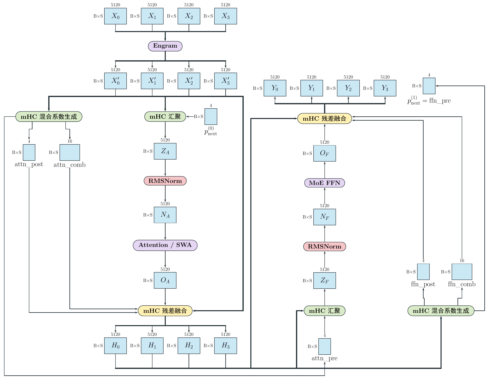
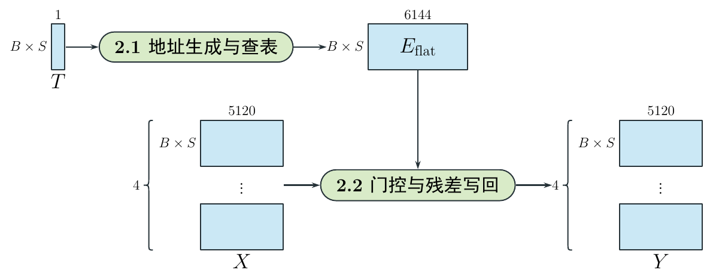
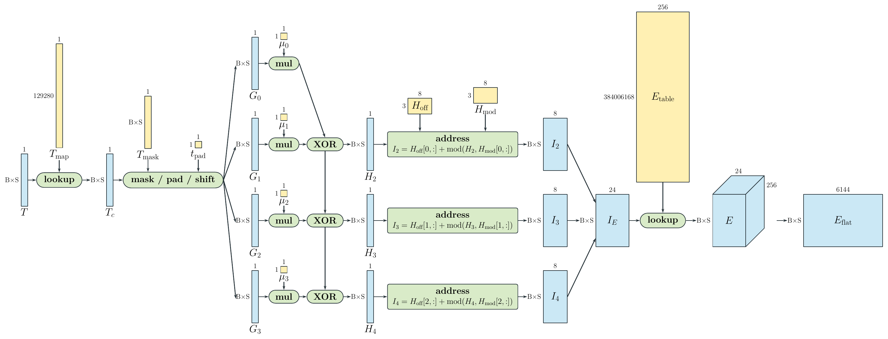
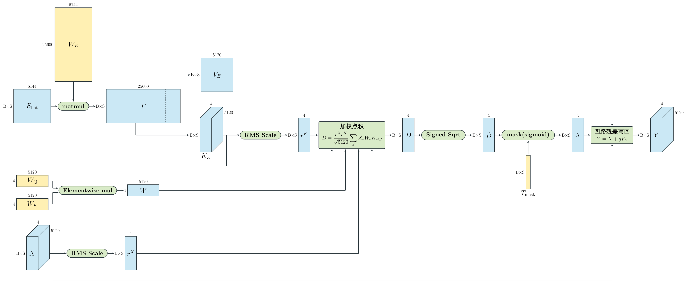
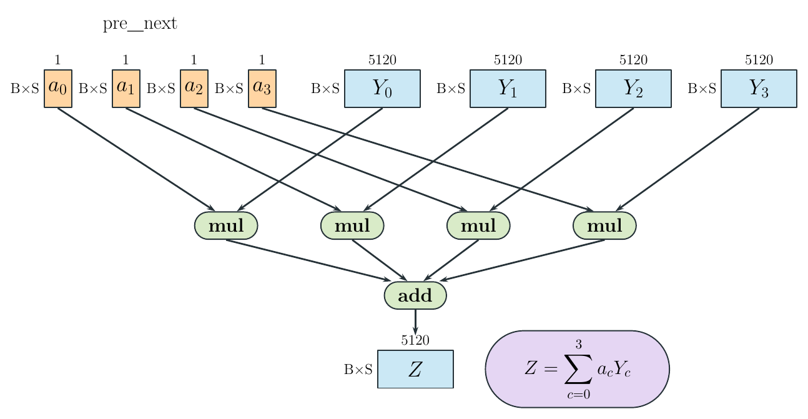

# Layer 1：从 Engram 写入到局部注意力与 MoE

## 1. Layer 1 总览

Layer 1 从 Layer 0 接收：

$$
X_{\mathrm{in}}:[B,S,4,5120]\quad\text{(BF16)},
\qquad
p_{\mathrm{next}}:[B,S,4]\quad\text{(FP32)}.
$$

其中 $X_{\mathrm{in}}$ 是四路残差，$p_{\mathrm{next}}$ 是 Layer 0 的 MoE 侧 mHC 生成的下一次汇聚系数。

Layer 1 向 Layer 2 输出：

$$
X_{\mathrm{out}}:[B,S,4,5120]\quad\text{(BF16)},
\qquad
\mathrm{ffn\_pre}:[B,S,4]\quad\text{(FP32)}.
$$

其中 $X_{\mathrm{out}}$ 是本层更新后的四路残差，`ffn_pre` 是本层 MoE 侧 mHC 生成的汇聚系数，作为 Layer 2 的 `pre_next`。

完整数据流为：

$$
\boxed{
(X_{\mathrm{in}},p_{\mathrm{next}})
\rightarrow \mathrm{Engram}
\rightarrow \mathrm{Layer\ 1\ Block}
\rightarrow (X_{\mathrm{out}},\mathrm{ffn\_pre})
}
$$

Layer 1 先通过 Engram 更新四路残差，再依次执行 Attention 和 MoE，两侧均通过 mHC 完成四路残差的汇聚与融合。与 Layer 0 相比，本层新增前置 Engram，Attention 入口则使用上一层传入的动态 `pre_next`；Engram 不修改这份系数，后续章节将展开说明。各步骤的作用及其与前文的关系如下；结构相同的算子仍使用本层独立参数。

| 步骤 | Layer 1 的行为 | 与前文的关系 |
|---|---|---|
| 1. Engram | 根据 Token 及其局部历史查表，结合四路残差计算门控并写回；传入的 `pre_next` 保持不变 | **本文重点展开** |
| 2. mHC 混合系数生成 | 根据 Engram 更新后的四路残差，生成 Attention 侧混合系数 | 与 Layer 0 相同 |
| 3. mHC 汇聚 | 使用 Layer 0 传入的动态 `pre_next`，将四路残差汇聚为单路特征 | **系数来源不同，本文重点说明** |
| 4. RMSNorm | 对单路特征归一化，得到 Attention 输入 | 与 Layer 0 相同 |
| 5. Local Attention / SWA | 接收归一化后的输入，在 128-token 局部窗口内计算注意力，输出单路特征 | 与 Layer 0 相同 |
| 6. mHC 残差融合 | 使用 Attention 侧混合系数，将 Attention 输出与四路残差融合，得到更新后的四路残差 | 与 Layer 0 相同 |
| 7. mHC 混合系数生成 | 根据更新后的四路残差，生成 MoE 侧混合系数 | 与 Layer 0 相同 |
| 8. mHC 汇聚 | 使用 `attn_pre`，将更新后的四路残差汇聚为单路特征 | 与 Layer 0 相同 |
| 9. RMSNorm | 对单路特征归一化，得到 MoE 输入 | 与 Layer 0 相同 |
| 10. MoE FFN | 接收归一化后的输入，经专家路由与前馈计算，输出单路特征 | 与 Layer 0 相同 |
| 11. mHC 残差融合 | 使用 MoE 侧混合系数，将 MoE 输出与四路残差融合，得到本层输出四路残差 | 与 Layer 0 相同 |

## 2. Engram

Engram 位于普通 Transformer Block 之前，根据当前 Token 及其局部历史检索记忆，再将检索结果写入四路残差。Token 决定读取哪些记忆，四路残差则参与判断每一路的写入幅度。

整个过程分为两部分：先对 Token 进行压缩、组织局部历史，再通过 Hash 生成地址并查表，得到检索结果 $E_{\mathrm{flat}}$；随后将检索结果投影为四路 Key 和一份共享 Value，结合四路残差计算各自的 Gate，将共享 Value 按不同幅度加回四路。输入 $X$ 与输出 $Y$ 的 Shape 均为 $[B,S,4,5120]$，上一层传入的 `pre_next` 保持不变。

图中合并展示 B、S 两个维度。

下文按以下三部分展开：

- **2.1 从 Token 到 24 个查表结果**：说明 Token 压缩、局部历史组织、Hash 地址生成与查表，得到 $E_{\mathrm{flat}}$。
- **2.2 从查表结果到四路残差写回**：说明 Key / Value 投影、四路 Gate 的计算，以及共享 Value 的残差写回。
- **2.3 参数量、计算量与 Required Global Memory 理论下界**：分析本层 Engram 的参数量、前向计算量与内存需求。

### 2.1 从 Token 到 24 个查表结果

输入 Token ID 为 $T:[B,S]$。图中从左到右完成 Token 压缩、局部历史组织、Hash 地址生成与查表，最终得到每个位置的 6144 维检索结果，交给 2.2 计算门控并写回残差。

#### 2.1.1 Token 压缩与历史组织

原始词表大小为 129,280。Hash 之前先通过固定映射 $T_{\mathrm{map}}:[129280]$ 得到压缩 ID：

$$
T_{c,b,t}=T_{\mathrm{map}}\!\left[T_{b,t}\right],
\qquad
T_c:[B,S].
$$

固定配置将原始 Token 映射到 99,092 个压缩 ID。构建映射时，对能够完整解码的 token 文本进行 Unicode 规范化、去音调、转小写和空白整理，规范化结果相同的 token 共用压缩 ID。该映射是固定运行时 buffer，不是可学习参数。

压缩后组织四个位置的输入：$G_0$ 为当前 token，$G_1,G_2,G_3$ 分别向历史回看一步、两步和三步，各自的 Shape 均为 $[B,S]$。Prefill 与 Decode 可能分属不同次前向，因此实现还维护压缩 Token 历史 cache，供当前前向读取此前写入的历史。

记 $G_{b,t,r}$ 为位置 $t$ 向前回看 $r$ 步得到的输入，$r=0,1,2,3$：

$$
G_{b,t,r}=
\begin{cases}
T_{c,b,t-r},&
t-r\ge 0\ \land\ [t-r,t]\text{ 内全部有效},\\
t_{\mathrm{pad}},&
\text{其他}.
\end{cases}
$$

序列开头缺少的历史使用固定 $t_{\mathrm{pad}}$。图中的 `T_mask` 是区分文本与图像位置的 BOOL mask；图像位置在压缩缓存中被标为无效，跨过无效位置的 n-gram 输入也会改用 $t_{\mathrm{pad}}$，避免将文本与图像位置拼成局部短语。

#### 2.1.2 Hash 与查表地址生成

Layer 1 为四个位置准备固定奇数乘数 $\mu_0,\mu_1,\mu_2,\mu_3$。先逐位置相乘，再通过 XOR（记作 $\oplus$）累积，得到图中三路 2、3、4-gram Hash：

$$
\begin{aligned}
H_{b,t,2}
&=(G_{b,t,0}\mu_0)\oplus(G_{b,t,1}\mu_1),\\
H_{b,t,3}
&=H_{b,t,2}\oplus(G_{b,t,2}\mu_2),\\
H_{b,t,4}
&=H_{b,t,3}\oplus(G_{b,t,3}\mu_3).
\end{aligned}
$$

$H_2,H_3,H_4$ 的 Shape 均为 $[B,S]$，分别表示当前 token 对应的二元、三元和四元局部上下文。

每种 n-gram 再进入八个 Hash head。固定 buffer $H_{\mathrm{mod}}$ 和 $H_{\mathrm{off}}$ 的 Shape 均为 $[3,8]$：前者给出每个分区的质数模数，后者给出该分区在大表中的起始位置。对阶数 $n\in\{2,3,4\}$ 和 head $q\in\{0,\ldots,7\}$，先取模，再加 offset，生成查表地址：

$$
I_{E,b,t,n,q}
=
H_{\mathrm{off},n,q}
+
\left(
H_{b,t,n}\bmod H_{\mathrm{mod},n,q}
\right).
$$

这里用阶数 $n$ 标记 buffer 对应的行；$n=2,3,4$ 依次对应图中的第 0、1、2 行。不同 $(n,q)$ 使用互不重叠的地址区间，逻辑上相当于 24 张小表，参数存储上拼接为一张连续大表。三种阶数乘八个 head，每个 token 共得到 24 个地址：

$$
I_E:[B,S,3,8]\rightarrow[B,S,24].
$$

官方推理实现会在进入各层循环之前，同时生成 Layer 1 和 Layer 14 的地址，得到 $I_{\mathrm{all}}:[B,S,2,24]$。执行 Layer 1 时取切片 $I_{\mathrm{all}}[:,:,0,:]$；图中只展示该层的 $[B,S,24]$ 地址。

#### 2.1.3 查表与展平

Layer 1 的 Engram 参数表为 $E_{\mathrm{table}}:[384006168,256]$。每个地址读取一行 256 维向量：

$$
E_{b,t,n,q,:}
=
E_{\mathrm{table}}
\left[
I_{E,b,t,n,q},:
\right],
$$

查表后先将三种阶数与八个 head 合并为 24 行，再将每行的 256 维沿特征维展平：

$$
E:[B,S,3,8,256]
\rightarrow
[B,S,24,256]
\rightarrow
E_{\mathrm{flat}}:[B,S,6144].
$$

其中 $6144=3\times8\times256$。输出 $E_{\mathrm{flat}}$ 汇集了当前 token 对应的 24 份局部短语记忆，接下来进入 2.2 的 Key / Value 投影与四路门控。

### 2.2 从查表结果到四路残差写回

图 3 接续图 2 的输出 $E_{\mathrm{flat}}$。查表结果先投影为四路 Key 和一份共享 Value，再与四路残差分别计算 Gate，最后把同一份 Value 按不同幅度写回四路。

#### 2.2.1 生成四路 Key 与共享 Value

查表结果 $E_{\mathrm{flat}}:[B,S,6144]$ 与无 bias 的投影权重 $W_E:[25600,6144]$ 相乘：

$$
F=E_{\mathrm{flat}}W_E^{\mathsf T},
\qquad
F:[B,S,25600].
$$

沿最后一维按 $20480+5120$ 切分，再将 Key 的 20480 维重排为四路、每路 5120 维：

$$
[F_K,V_E]
=\operatorname{split}(F,[20480,5120]),
$$

$$
K_E=\operatorname{reshape}(F_K,[B,S,4,5120]),
\qquad
V_E:[B,S,5120].
$$

$K_E:[B,S,4,5120]$ 包含四路不同的 Key，$V_E$ 只有一份，供四路共享。图中 $F$ 的虚线表示这两部分的切分位置，四路写入幅度由后面的 Gate 决定。

#### 2.2.2 计算四路 Gate

四路残差 $X:[B,S,4,5120]$ 与 $K_E$ 分别沿 5120 维计算 RMS 倒数。对残差流 $c\in\{0,1,2,3\}$：

$$
r^X_{b,t,c}
=
\left(
\frac{1}{5120}
\sum_{d=0}^{5119}X_{b,t,c,d}^{2}
+\epsilon
\right)^{-1/2},
$$

$$
r^K_{b,t,c}
=
\left(
\frac{1}{5120}
\sum_{d=0}^{5119}K_{E,b,t,c,d}^{2}
+\epsilon
\right)^{-1/2},
\qquad
\epsilon=10^{-20}.
$$

$r^X$ 与 $r^K$ 的 Shape 都是 $[B,S,4]$。它们只是当前输入动态生成的缩放因子，没有额外的可学习 RMSNorm 权重。

另一条分支将两组可学习的逐维缩放参数 $W_Q,W_K:[4,5120]$ 逐元素相乘：

$$
W=W_Q\odot W_K,
\qquad W:[4,5120].
$$

两路 RMS 因子与逐维权重汇入图中的加权点积。每一路分别沿特征维求和，再乘归一化因子，得到评分：

$$
D_{b,t,c}
=
\frac{r^X_{b,t,c}r^K_{b,t,c}}{\sqrt{5120}}
\sum_{d=0}^{5119}
X_{b,t,c,d}
W_{c,d}
K_{E,b,t,c,d},
\qquad D:[B,S,4].
$$

评分先经过 Signed Sqrt：保留符号，对绝对值设置下限后开平方。

$$
\widetilde D_{b,t,c}
=
\operatorname{copysign}
\left(
\sqrt{\max\left(|D_{b,t,c}|,10^{-6}\right)},
D_{b,t,c}
\right).
$$

这里使用 $\operatorname{copysign}$，因此 $D=0$ 时也按照源码复制正号，而不是把结果写成零。随后得到四路 Gate：

$$
g_{b,t,c}=\sigma\!\left(\widetilde D_{b,t,c}\right),
\qquad
g:[B,S,4].
$$

多模态输入使用文本位置 mask $T_{\mathrm{mask}}:[B,S]$，广播到四路，**在 Sigmoid 之后**将图像位置的 Gate 置零：

$$
g_{b,t,c}\leftarrow
\begin{cases}
g_{b,t,c},&T_{\mathrm{mask},b,t}=1,\\
0,&T_{\mathrm{mask},b,t}=0.
\end{cases}
$$

纯文本输入无需这一步。图中的 `mask(sigmoid)` 合并表示 Sigmoid 与随后应用的文本位置 mask。

#### 2.2.3 四路残差写回

共享 Value $V_E:[B,S,5120]$ 沿四路维广播，Gate $g:[B,S,4]$ 沿 5120 维广播，再逐元素相乘并加回原残差：

$$
\boxed{
Y_{b,t,c,d}
=
X_{b,t,c,d}
+g_{b,t,c}V_{E,b,t,d}
},
\qquad Y:[B,S,4,5120].
$$

四路使用同一份 Value，各自的 Gate 决定写入幅度；输出保持四路残差的 Shape。

官方推理实现将 Engram 表的 FP8 数据按 scale 还原为 BF16。进入 Gate 分支后，$X,K_E,V_E,W_Q,W_K$ 显式转换为 FP32 参与计算；最终输出 $Y$ 再转换回 $X$ 的 dtype，本配置中为 BF16。

Engram 只更新四路残差，Layer 0 传来的动态 `pre_next` 原样保留，与 $Y$ 一同交给后续 Attention 侧的第一次 `hc_pre`。

### 2.3 参数量、计算量与 Required Global Memory 理论下界

本节只统计 Layer 1 的一个 Engram 算子。Layer 1 的 mHC、RMSNorm、局部 Attention 和 MoE 留到整层汇总，不在这里重复计算。数字后缀 B 表示 $10^9$；存储量使用 Byte、GB 和 GiB。

2.1 中的“24 次查表”按逻辑行读取计数。固定 revision 的官方推理实现会分别读取 FP8 数据与对应 scale，逻辑行数不等同于底层访存指令数。

#### 参数量

只统计可学习模型标量。FP8 scale 属于量化存储元数据，计入后面的权重驻留字节，不重复算作逻辑模型参数。

| 参数 | Shape | 参数量 |
|---|---|---:|
| $E_{\mathrm{table}}$ | $[384006168,256]$ | 98,305,579,008 |
| $W_E$ | $[25600,6144]$ | 157,286,400 |
| $W_Q$ | $[4,5120]$ | 20,480 |
| $W_K$ | $[4,5120]$ | 20,480 |
| **合计** | — | **98,462,906,368** |

$$
\boxed{
\begin{aligned}
P_{\mathrm{Engram1}}
={}&384006168\times256\\
&+25600\times6144\\
&+2\times4\times5120\\
={}&98462906368.
\end{aligned}
}
$$

即 Layer 1 的单个 Engram 包含约 **98.463B** 个逻辑参数。技术报告中的约 196B 是 Layer 1 与 Layer 14 两个 Engram 的模型级合计近似。

#### 计算量

统计口径与 Layer 0 相同：标量加法、减法和乘法各计 1 次；XOR、整数取模、逻辑 Lookup、rsqrt、sqrt、exp、除法和比较单列。忽略量化与反量化、类型转换、通信、数据搬运和具体 kernel 融合。

下表为 Layer 1 Engram 处理一个 token 的计算量。Hash 部分只归因 Layer 1 的一组地址。

| 阶段 | 加 / 减 / 乘 | 其他运算 |
|---|---:|---|
| 压缩 Token ID | 0 | 逻辑 Lookup：1 |
| 当前及三个历史位置乘 Hash 乘数 | 4 | XOR：3 |
| 24 个分区取模并加 offset | 24 | 整数取模：24 |
| 读取 24 行 Engram 表 | 0 | 逻辑行 Lookup：24 |
| $6144\rightarrow25600$ 投影 | 314,547,200 | — |
| $X,K_E$ 的八个 RMS 因子 | 81,928 | rsqrt：8 |
| 四路加权点积与归一化缩放 | 61,448 | — |
| Signed Sqrt 与 Sigmoid | 8 | sqrt：4；exp：4；除法：4；比较：4 |
| 四路 $gV_E$ 写回 | 40,960 | — |
| **每 token 合计** | **314,731,572** | 见上 |

其中最大项是 $6144\rightarrow25600$ 投影。每个输出元素执行 6144 次乘法和 6143 次加法：

$$
25600\times(6144+6143)
=314547200.
$$

此外，官方推理实现每次调用 Engram 时还会计算一次：

$$
W=W_Q\odot W_K,
$$

产生 20,480 次与 token 数量无关的逐元素乘法。因此处理 $N=BS$ 个 token 时：

$$
\boxed{
C_{\mathrm{Engram1,mul/add/sub}}
=314731572N+20480
}.
$$

同时还有：

$$
3N\ \mathrm{XOR},
\qquad
24N\ \mathrm{整数取模},
\qquad
25N\ \mathrm{逻辑Lookup},
$$

$$
8N\ \mathrm{rsqrt},
\quad
4N\ \mathrm{sqrt},
\quad
4N\ \mathrm{exp},
\quad
4N\ \mathrm{除法},
\quad
4N\ \mathrm{比较}.
$$

官方推理实现会在一次 Hash 计算中同时生成 Layer 1 和 Layer 14 的地址，所以完整调用实际包含每 token 8 次整数乘法、6 次 XOR、48 次取模和 48 次 offset 加法。上面的算子表只把其中一半 Hash 主体归因给 Layer 1；共享 Token 压缩和历史 cache 不能在 Layer 14 再重复统计。

#### Required Global Memory 理论下界（理想融合口径）

与 Layer 0 相同，这里把 Engram 视为一个逻辑分析单元，并采用以下假设：

- **Weight**：参数和量化 scale 长期保存在 Global Memory。
- **I/O**：完整输入与输出保存在 Global Memory，并分别计数。
- **Internal Activation**：$E_{\mathrm{flat}},F,K_E,V_E,D,g$ 等中间量允许通过融合、分块或工作区复用，不要求全部完整写回 Global Memory。

按 `world_size=1` 核算，固定 revision 的官方推理实现中权重存储为：

| 权重 | 数据与 scale | GPU 驻留字节 |
|---|---|---:|
| Engram 表 | $384006168\times(256+8)$ | 101,377,628,352 |
| $W_E$ | $25600\times6144+800\times192$ | 157,440,000 |
| $W_Q,W_K$ | $2\times4\times5120\times2$ | 81,920 |
| **合计** | — | **101,535,150,272** |

Engram 表使用 FP8 E4M3 数据，每 32 个元素配一个 E8M0 scale；$W_E$ 使用 FP8 E4M3 数据和 $32\times32$ block scale；$W_Q,W_K$ 使用 BF16。

Engram 主体的逻辑边界为：

| Tensor | 分类 | Shape / dtype | Logical Size |
|---|---|---|---:|
| $X$ | Input | $[B,S,4,5120]$ BF16 | $40960N$ B |
| $I_E$ | Input | $[B,S,24]$ INT64 | $192N$ B |
| $Y$ | Output | $[B,S,4,5120]$ BF16 | $40960N$ B |

如果把 Layer 1 的 24 个地址视为独立输入，则：

$$
\boxed{
M_{\mathrm{Engram1,body}}
=101535150272+82112N
\quad\mathrm{Byte}
}.
$$

在官方推理实现中，$I_E$ 实际是完整 $I_{\mathrm{all}}:[B,S,2,24]$ 的视图，不会单独分配 $192N$ Byte。共享 Hash 前置组件还持有：

| 对象 | Shape / dtype | 字节数 |
|---|---|---:|
| Token 压缩映射 | $[129280]$ INT64 | 1,034,240 |
| 两层 Hash 乘数 | $[2,4]$ INT64 | 64 |
| 两层质数模数 | $[2,3,8]$ INT64 | 384 |
| 两层 offset | $[2,24]$ INT64 | 384 |
| 压缩 Token 历史 cache | $[B_{\max},S_{\max}]$ INT64 | $8B_{\max}S_{\max}$ |
| 完整 Hash 输出 | $[B,S,2,24]$ INT64 | $384N$ |

前四项固定 buffer 合计 1,035,072 Byte。按实际共享分配、不重复计算 Layer 1 地址视图时：

$$
\boxed{
\begin{aligned}
M_{\mathrm{Engram1+shared\ hash,min}}
={}&101536185344\\
&+82304N\\
&+8B_{\max}S_{\max}
\quad\mathrm{Byte}.
\end{aligned}
}
$$

多模态路径若把新生成的 BOOL `engram_mask:[B,S]` 独立计入，再加 $N$ Byte。原始 Token ID $T$ 是模型级共享输入；若把 Engram 当作完全独立的端到端算子并把 $T$ 也计入边界，再加 $8N$ Byte。

这些公式是 Required Global Memory 的理论下界，不是进程峰值显存，也不是显存读写量。FP8 解量化临时值、GEMM workspace、分片通信 buffer、allocator 保留区和 host-memory offload 都会改变实际测量结果。

形状、数据类型与执行顺序依据固定 revision 的[模型配置](https://huggingface.co/deepseek-ai/DeepSeek-V4.1-Flash/blob/5254448103b6254fc646dacbca1cbbf20e9216c1/inference/config.json)、[Hash 实现](https://huggingface.co/deepseek-ai/DeepSeek-V4.1-Flash/blob/5254448103b6254fc646dacbca1cbbf20e9216c1/inference/engram.py)和[模型前向实现](https://huggingface.co/deepseek-ai/DeepSeek-V4.1-Flash/blob/5254448103b6254fc646dacbca1cbbf20e9216c1/inference/model.py)。

## 3. Layer 1 第一次 `hc_pre` 的真正变化

橙色标出的 $a_0,a_1,a_2,a_3$ 来自 Layer 0 MoE 侧 mHC 生成的动态 `pre_next`。Layer 0 的 Attention 入口使用固定的 $[1,0,0,0]$；Layer 1 不再重新创建这组固定系数，而是使用上一层传入的值：

$$
a_{b,t,c}=p^{(0)}_{\mathrm{next},b,t,c},
\qquad c\in\{0,1,2,3\}.
$$

图中的 $Y_0$—$Y_3$ 是 2.2 中 Engram 更新后的四路残差。每一路与对应系数相乘，再沿四路相加，得到 $Z:[B,S,5120]$。`mul`、`add` 的计算与 [Layer 0 第 2.3 节](02-layer0.md#四路汇聚-hc_pre) 相同，图中保持绿色；橙色只强调本次汇聚的系数来源发生变化。

本层 Attention 侧的 `hc_mixes` 还会根据 $Y$ 生成新的 `attn_pre/post/comb`。其中 post、comb 用于当前 Attention 的残差融合，`attn_pre` 留给紧随其后的 MoE 入口；当前 Attention 入口仍使用上一层传来的 `pre_next`。MoE 侧生成的 `ffn_pre` 则继续传给 Layer 2。[Block.forward](https://huggingface.co/deepseek-ai/DeepSeek-V4.1-Flash/blob/5254448103b6254fc646dacbca1cbbf20e9216c1/inference/model.py#L909-L997)

## 4. 继承自 Layer 0 的模块

Engram 写回之后，Layer 1 沿用 Layer 0 的 Block 结构。下面列出各模块在本层的行为及对应推导。

| 模块 | Layer 1 中的行为 | 已有推导 |
|---|---|---|
| Attention 侧 mHC 系数生成 | 由 Engram 更新后的四路残差 $Y$ 生成 `attn_pre/post/comb` | [Layer 0 第 2.1—2.2 节](02-layer0.md#四路输入生成-raw-mixes) |
| 第一次 `hc_pre` | 使用 Layer 0 MoE 侧传来的动态 `pre_next`，将 $Y$ 汇聚为单路输入 | [本文第 3 章](#layer-1-第一次-hc_pre-的真正变化) |
| 两个入口 RMSNorm | 沿 5120 维归一化，并使用各自的可学习缩放参数 | [Layer 0 第 3 节](02-layer0.md#两个入口-rmsnorm) |
| Local Attention / SWA | 在 128-token 局部窗口内计算注意力，并完成输出投影 | [Layer 0 第 4 节](02-layer0.md#局部-attention-swa) |
| Attention 侧 `hc_post` | 将 Attention 输出与保留的四路残差 $Y$ 融合 | [Layer 0 第 2.4 节](02-layer0.md#残差融合-hc_post) |
| MoE FFN | 从 384 个 routed experts 中选 6 个，并执行 1 个 shared expert | [Layer 0 第 5 节](02-layer0.md#moe-前馈计算) |
| MoE 侧 mHC 与输出 | 使用 `attn_pre` 汇聚，完成 MoE 残差融合；生成的 `ffn_pre` 传给 Layer 2 | [Layer 0 第 2 节](02-layer0.md#mhc)及[本文第 3 章](#layer-1-第一次-hc_pre-的真正变化) |

各层参数独立，Local KV cache 与 RoPE 表也分别维护，不与 Layer 0 共用。本层 Attention 仍为 128-token SWA，没有 Global KV、Compressor 或 Indexer。

## 5. Layer 1 整层汇总

Engram、动态 `pre_next` 和继承模块已经分别说明。下面按照 Layer 0 的写法，只汇总整层参数、计算、显存和跨层输出，不再把 Engram 算子拆开重复讲述。

### 5.1 整层参数量与 GPU 驻留字节

Layer 1 的基准 Block 参数结构与 Layer 0 相同，再加本层 Engram：

| 部分 | 逻辑参数量 | GPU 驻留字节 |
|---|---:|---:|
| 基准 Block：两套 mHC、Norm、SWA、MoE | 13,754,511,990 | 7,423,022,552 B |
| Layer 1 Engram | 98,462,906,368 | 101,535,150,272 B |
| **Layer 1 合计** | **112,217,418,358** | **108,958,172,824 B** |

$$
\boxed{P_{\mathrm{Layer1}}=112217418358\approx112.217\ \mathrm{B}}
$$

$$
\boxed{
M_{\mathrm{Layer1,param}}
=108958172824\ \mathrm{Byte}
\approx108.958\ \mathrm{GB}
\approx101.475\ \mathrm{GiB}
}
$$

Engram 占 Layer 1 逻辑参数的约 **87.74%**，占本文核算权重驻留字节的约 **93.19%**。这不表示生产部署必须把 101.5 GB Engram 全放在单张 GPU：官方报告明确采用确定性地址进行预取，官方推理实现也支持按行跨 `world_size` 分片，并在查表后合并结果。本节的单卡完整驻留值是便于核算的 `world_size=1` 基准，不是部署建议。

### 5.2 整层前向计算量

Layer 0 的官方通用路径为：

$$
C_{\mathrm{Layer0}}
=N\left(755138906+131200\overline L\right),
$$

其中 $\overline L$ 是每个查询实际参与 SWA 评分的平均局部历史长度，$1\le\overline L\le128$。Layer 1 后半段使用同一通用路径；它的首次 `hc_pre` 是动态系数，不能做 Layer 0 identity-pre 的理论常量折叠。

加上 Engram：

$$
\boxed{
C_{\mathrm{Layer1,mul/add/sub}}
=N\left(1069870478+131200\overline L\right)+20480
}
$$

在暂不考虑 $\overline L$ 的固定部分时，Engram 使本层每 token 的加/减/乘主项比 Layer 0 官方通用路径增加约 **41.68%**。这个比例不是实际延迟比例：Engram 表可预取和分片，FP8 GEMM、访存、通信、并发重叠与 kernel 融合都会改变硬件时间。[官方报告的 Engram 预取说明](https://arxiv.org/abs/2609.19969)

### 5.3 整层 Required Global Memory 理论下界与状态

这一节给出固定 revision 官方推理实现的**共享状态视角**：参数和 scale、层边界 I/O、本层 local Attention 状态、模型级 Hash 固定 buffer、Token 历史 cache，以及同时服务 Layer 1 和 Layer 14 的完整 `engram_hashes`。内部 $E_{\mathrm{flat}},F,K_E,V_E,D,g$ 假设可通过融合、分块或工作区复用，不要求全部同时写入 Global Memory。

#### 边界 I/O 与持久状态

Layer 1 输入和输出均包含四路 BF16 残差与一份 FP32 pre：

$$
M_{\mathrm{boundary}}
=2\times N(4\times5120\times2+4\times4)
=81952N\ \mathrm{Byte}.
$$

本层 Attention 状态与 Layer 0 相同：

$$
\mathrm{window\_kv\_cache}:[B_{\max},128,512]\ \mathrm{BF16}
=131072B_{\max}\ \mathrm{Byte},
$$

$$
\mathrm{freqs\_cis}:[S_{\max},32]\ \mathrm{Complex64}
=256S_{\max}\ \mathrm{Byte}.
$$

模型级 Hash 前置组件持有：

| 对象 | Shape / dtype | 字节数 |
|---|---|---:|
| Token 压缩映射 | `[129280]` INT64 | 1,034,240 |
| 两层 Hash 乘数 | `[2,4]` INT64 | 64 |
| 两层质数模数 | `[2,3,8]` INT64 | 384 |
| 两层 offset | `[2,24]` INT64 | 384 |
| 压缩 Token 历史 cache | `[B_max,S_max]` INT64 | $8B_{\max}S_{\max}$ |
| 本次完整 Hash 输出 | `[B,S,2,24]` INT64 | $384N$ |

前四项合计 1,035,072 Byte。`engram_hashes` 在进入 Layer 0 前生成，并至少保留到 Layer 14 消费完成；Layer 1 使用的 `[B,S,24]` 只是视图，不再分配 192N Byte。

#### 汇总公式

纯文本路径没有 `engram_mask`，于是：

$$
\boxed{
\begin{aligned}
M_{\mathrm{Layer1,min}}={}&108958172824
+81952N
+384N\\
&+131072B_{\max}
+256S_{\max}\\
&+1035072
+8B_{\max}S_{\max}
\end{aligned}
\quad\mathrm{Byte}
}
$$

整理为：

$$
\boxed{
M_{\mathrm{Layer1,min}}
=108959207896
+82336N
+131072B_{\max}
+256S_{\max}
+8B_{\max}S_{\max}
\quad\mathrm{Byte}
}
$$

多模态路径若把新生成的 BOOL `engram_mask:[B,S]` 独立计入，再加 $N$ Byte。上式把整份 Hash 固定 buffer、Token cache 和 `[B,S,2,24]` Hash 输出计了一次；它们是 Layer 1 与 Layer 14 共享的模型级资源，做整模型汇总时不能再次相加。

这仍不是进程峰值显存，也不是显存读写量：未融合激活、FP8 解量化临时值、GEMM workspace、allocator 保留区、分片通信 buffer 以及实际推理引擎的 Engram CPU / host-memory offload 都会改变测量结果。

### 5.4 跨层输出与结论

Layer 1 最终输出：

| 对象 | Shape | dtype | 去向 / 生命周期 |
|---|---|---|---|
| 四路残差 $X^{(1)}_{\mathrm{out}}$ | `[B,S,4,5120]` | BF16 | Layer 2 Attention 侧 mHC |
| $p^{(1)}_{\mathrm{next}}$ | `[B,S,4]` | FP32 | Layer 2 第一次 `hc_pre` |
| `window_kv_cache` | `[B_max,128,512]` | BF16 | Layer 1 后续 Decode 的 128-token 环形窗口 |
| Token Hash cache | `[B_max,S_max]` | INT64 | Layer 1、14 共用的跨 Prefill / Decode 压缩 Token 历史 |
| `engram_hashes` | `[B,S,2,24]` | INT64 | 本次前向中供 Layer 1、14 依次消费 |

核心结论只有三条：

1. **Layer 1 是 Layer 0 基准 Block 的第一次结构扩展。** 新增 Engram，但 Attention 仍是纯 128-token SWA，MoE 与 mHC 主体不变。
2. **Engram 向四路写入共享 Value、独立 Gate。** 它更新四路残差，却不改动 Layer 0 传来的动态 `pre_next`。
3. **本层容量主要由条件记忆决定。** 单个 Engram 带来 98.463B 逻辑参数和约 94.562 GiB 的 `world_size=1` 权重驻留；实际部署依赖行分片、预取或 host-memory offload，而不是把它理解成必须单卡常驻的普通线性层。

## 6. 资料来源与版本说明

- [DeepSeek-V4.1-Flash 技术报告](https://arxiv.org/abs/2609.19969)：模型总体结构、两处 Engram、196B 总容量、Hash head 与部署预取。
- [Engram 原始论文](https://arxiv.org/abs/2601.07372)：条件记忆、Tokenizer Compression、Multi-Head Hashing 与 Context-aware Gating。
- [固定 revision 的配置](https://huggingface.co/deepseek-ai/DeepSeek-V4.1-Flash/blob/5254448103b6254fc646dacbca1cbbf20e9216c1/inference/config.json)：Layer 1、Engram、SWA、MoE 的精确尺寸。
- [固定 revision 的 Hash 实现](https://huggingface.co/deepseek-ai/DeepSeek-V4.1-Flash/blob/5254448103b6254fc646dacbca1cbbf20e9216c1/inference/engram.py)：Token 压缩、历史 cache、Hash 乘数、质数桶与 offset。
- [固定 revision 的模型前向](https://huggingface.co/deepseek-ai/DeepSeek-V4.1-Flash/blob/5254448103b6254fc646dacbca1cbbf20e9216c1/inference/model.py)：Engram 表、KV 投影、Gate、Block 与跨层 `pre_mix`。

全文于 2026-10-20 对照固定 revision [`5254448103b6254fc646dacbca1cbbf20e9216c1`](https://huggingface.co/deepseek-ai/DeepSeek-V4.1-Flash/tree/5254448103b6254fc646dacbca1cbbf20e9216c1) 重新核算。参数量、计算量和 Required Global Memory 使用本文声明的逻辑口径；官方报告中的模型级近似、官方推理实现的张量分配和具体部署引擎的测量值不混为同一数字。
