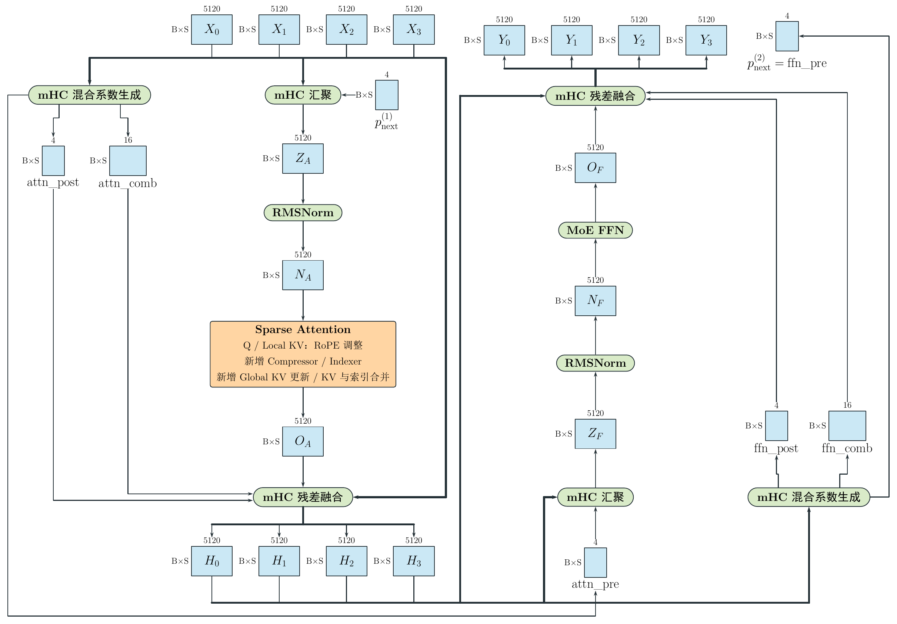
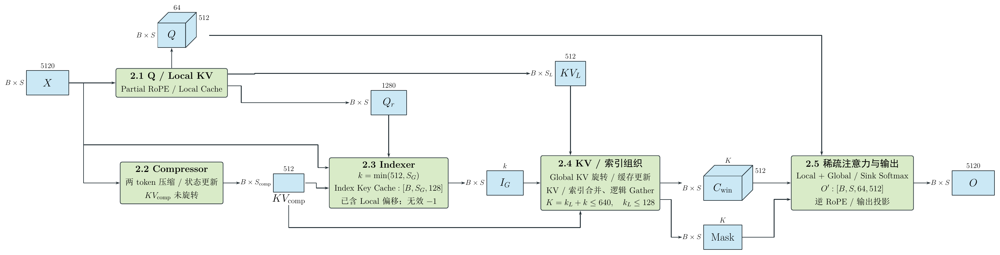
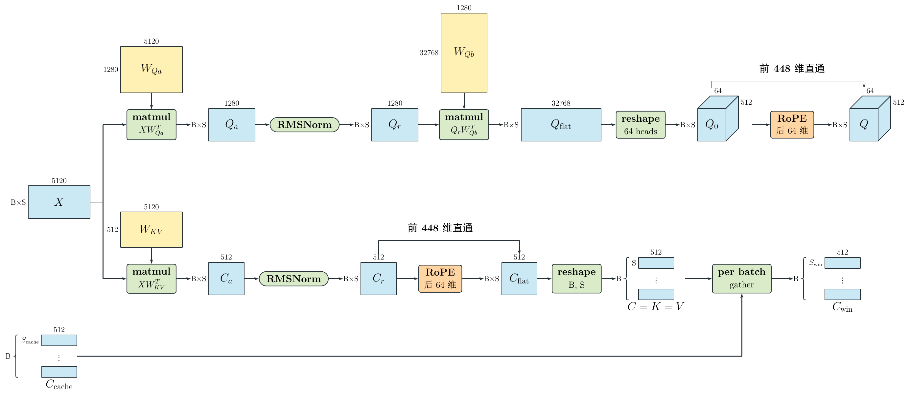
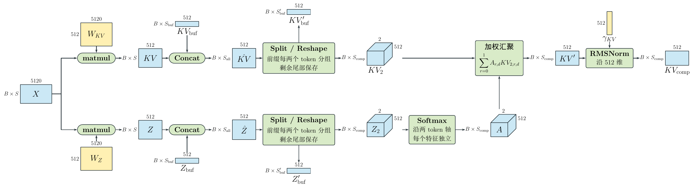
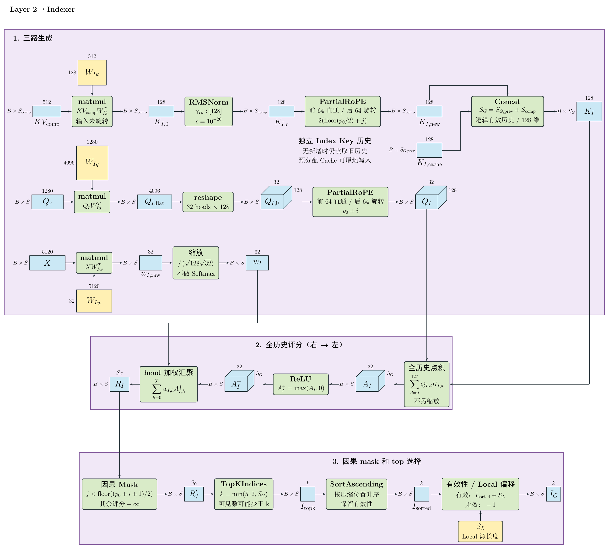
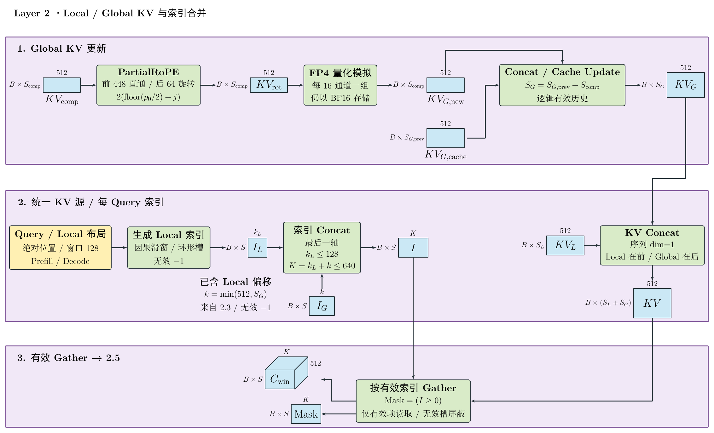
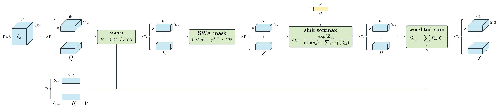

# Layer 2：从局部注意力到压缩稀疏注意力与 MoE

## 1. Layer 2 总览

Layer 2 从 Layer 1 接收：

$$
X_{\mathrm{in}}:[B,S,4,5120]\quad\text{(BF16)},
\qquad
p_{\mathrm{next}}:[B,S,4]\quad\text{(FP32)}.
$$

其中 $X_{\mathrm{in}}$ 是四路残差，$p_{\mathrm{next}}$ 是 Layer 1 的 MoE 侧 mHC 生成的下一次汇聚系数。

Layer 2 向 Layer 3 输出：

$$
X_{\mathrm{out}}:[B,S,4,5120]\quad\text{(BF16)},
\qquad
\mathrm{ffn\_pre}:[B,S,4]\quad\text{(FP32)}.
$$

其中 $X_{\mathrm{out}}$ 是本层更新后的四路残差，`ffn_pre` 是本层 MoE 侧 mHC 生成的汇聚系数，作为 Layer 3 的 `pre_next`。

完整数据流为：

$$
\boxed{
(X_{\mathrm{in}},p_{\mathrm{next}})
\rightarrow \mathrm{Layer\ 2\ Block}
\rightarrow (X_{\mathrm{out}},\mathrm{ffn\_pre})
}
$$

Layer 2 依次执行 Attention 和 MoE，两侧均通过 mHC 完成四路残差的汇聚与融合。橙色 Sparse Attention 框内新增压缩、检索与 Global KV 路径，并调整 RoPE 配置，后续章节将展开说明。各步骤的作用及其与前文的关系如下；结构相同的算子仍使用本层独立参数。

| 步骤 | Layer 2 的行为 | 与前文的关系 |
|---|---|---|
| 1. mHC 混合系数生成 | 根据输入四路残差，生成 Attention 侧混合系数 | 与 Layer 0 相同 |
| 2. mHC 汇聚 | 使用 `pre_next`，将输入四路残差汇聚为单路特征 | 与 Layer 1 相同 |
| 3. RMSNorm | 对单路特征归一化，得到 Attention 输入 | 与 Layer 0 相同 |
| 4. Sparse Attention | 接收归一化后的输入，结合局部 KV 与检索出的压缩 KV 计算注意力，输出单路特征 | 本文重点展开 |
| 5. mHC 残差融合 | 使用 Attention 侧混合系数，将 Attention 输出与四路残差融合，得到更新后的四路残差 | 与 Layer 0 相同 |
| 6. mHC 混合系数生成 | 根据更新后的四路残差，生成 MoE 侧混合系数 | 与 Layer 0 相同 |
| 7. mHC 汇聚 | 使用 `attn_pre`，将更新后的四路残差汇聚为单路特征 | 与 Layer 0 相同 |
| 8. RMSNorm | 对单路特征归一化，得到 MoE 输入 | 与 Layer 0 相同 |
| 9. MoE FFN | 接收归一化后的输入，经专家路由与前馈计算，输出单路特征 | 与 Layer 0 相同 |
| 10. mHC 残差融合 | 使用 MoE 侧混合系数，将 MoE 输出与四路残差融合，得到本层输出四路残差 | 与 Layer 0 相同 |

## 2. 压缩稀疏 Attention

相比于原始的全量 Attention，Layer 2 使用**压缩稀疏 Attention**。原始 Attention 从输入 $X$ 分别生成 Q、K、V；这里的 K 和 V 共用同一份表示，并分为 Local KV 和 Global KV，分别提供近期 token 的局部信息与压缩后的历史信息。

Q 和 Local KV 的生成过程与 Layer 0 基本相同，区别在于所使用的 RoPE 配置。Global KV 则走另一条路径：先由 Compressor 将每两个 token 压缩为一个 KV，再完成 RoPE 和缓存更新，供本层及指定的后续层共享。Indexer 为每个 Query 从压缩历史中选出最多 512 个位置，与最近最多 128 个 Local KV 共同组成 $C_{\mathrm{win}}$，参与注意力计算。

下文按图中的五个模块展开：

- **2.1 Q 与 Local KV 生成的差异**：说明相比 Layer 0 的 RoPE 配置变化，以及供 Indexer 使用的 Query 中间结果。
- **2.2 Compressor**：说明两 token 压缩为一个 KV 的过程与状态更新。
- **2.3 Indexer**：说明压缩历史的评分与 Top-K 位置选择。
- **2.4 Local 与 Global KV 及索引合并**：说明 Global KV 更新，以及候选 KV 的索引组织与读取。
- **2.5 稀疏注意力计算与输出**：说明与 Layer 0 计算过程的对应关系及候选长度变化。

### 2.1 Q 与 Local KV 生成的差异

橙色标出的两个 RoPE 算子采用 Layer 2 的频率配置，与 Layer 0 的区别如下：

| 配置 | Layer 0 | Layer 2 |
|---|---|---|
| RoPE 基础频率 `theta` | 10000 | 160000 |
| YaRN | 不启用 | 启用，扩展因子为 16 |
| YaRN 原始上下文长度 | 不适用 | 65536 |

Layer 2 的 YaRN 参数为 $\beta_{\mathrm{fast}}=32$、$\beta_{\mathrm{slow}}=1$，按频段调整旋转频率，并非将全部频率统一除以 16。上述配置同时用于 Q 和 Local KV 的 RoPE。

### 2.2 Compressor

同一输入 $X:[B,S,5120]$ 经过双路投影，分别生成候选 KV 和逐特征压缩分数：

$$
KV=XW_{KV}^{\mathsf T},\qquad Z=XW_Z^{\mathsf T},
\qquad KV,Z:[B,S,512].
$$

将上次未配对的 $KV_{\mathrm{buf}},Z_{\mathrm{buf}}$ 接到本次结果之前。图中的两个 Split / Reshape 算子分别将完整前缀按两个 token 分组，并把可能剩余的一个 token 保存为 $KV'_{\mathrm{buf}},Z'_{\mathrm{buf}}$。本次可生成的压缩 KV 数为：

$$
S_{\mathrm{comp}}
=\left\lfloor\frac{S_{\mathrm{buf}}+S}{2}\right\rfloor,
\qquad S_{\mathrm{buf}}\in\{0,1\}.
$$

完整分组重排为：

$$
KV_2,Z_2:[B,S_{\mathrm{comp}},2,512].
$$

若本次仍未凑齐一组，则不产生压缩输出。

对每个特征，在两个 token 之间独立计算 Softmax，再加权汇聚：

$$
A=\operatorname{Softmax}_{\text{两 token 维}}(Z_2),
\qquad A:[B,S_{\mathrm{comp}},2,512],
$$

$$
KV'_{b,j,d}
=\sum_{r=0}^{1}A_{b,j,r,d}KV_{2,b,j,r,d}.
$$

最后沿 512 维执行 RMSNorm，得到：

$$
KV_{\mathrm{comp}}
=\operatorname{RMSNorm}(KV';\gamma_{KV}),
\qquad KV_{\mathrm{comp}}:[B,S_{\mathrm{comp}},512].
$$

RMSNorm 算法沿用 Layer 0。投影、Softmax 和汇聚按 FP32 计算；汇聚结果转回 BF16 后执行 RMSNorm，输出为 BF16。此时尚未执行 RoPE，结果分别送入 Indexer 和 Global KV 分支。

### 2.3 Indexer

Indexer 使用 $Q_r$、$KV_{\mathrm{comp}}$ 和 $X$ 三路输入，生成检索 Query、检索 Key 和 head 权重，再对压缩历史评分，为每个 Query 选择最多 512 个访问位置。

#### 2.3.1 三路生成

未旋转的 $KV_{\mathrm{comp}}$ 经投影、128 维 RMSNorm 和 Partial RoPE，生成本次新增的检索 Key：

$$
K_{I,\mathrm{new}}
=\operatorname{PartialRoPE}
\left(\operatorname{RMSNorm}(KV_{\mathrm{comp}}W_{Ik}^{\mathsf T};\gamma_{Ik})\right),
\qquad K_{I,\mathrm{new}}:[B,S_{\mathrm{comp}},128].
$$

将新增 Key 与旧历史接续，得到：

$$
K_I=\operatorname{Concat}(K_{I,\mathrm{cache}},K_{I,\mathrm{new}}),
\qquad K_I:[B,S_G,128],
$$

$$
S_G=S_{G,\mathrm{prev}}+S_{\mathrm{comp}}.
$$

图中的 Concat 表示逻辑历史接续，实现可向预分配缓存写入新增段；没有新增 Key 时，继续使用旧历史。

$Q_r$ 经投影后重排为 32 个 head，每个 head 128 维，再执行 Partial RoPE：

$$
Q_I=\operatorname{PartialRoPE}
\left(\operatorname{reshape}(Q_rW_{Iq}^{\mathsf T},[B,S,32,128])\right).
$$

Query 和 Key 均旋转后 64 维，前 64 维直通。Query 使用当前 token 的绝对位置，Key 使用压缩组首个原始 token 的绝对位置。

输入 $X$ 经投影和缩放，生成 32 个 head 的融合权重：

$$
w_I=\frac{XW_{Iw}^{\mathsf T}}{\sqrt{128}\sqrt{32}},
\qquad w_I:[B,S,32].
$$

$w_I$ 不做 Softmax，直接用于后续 head 加权汇聚。

评分前，检索 Query 和 Key 执行 FP4 量化—反量化模拟，仍以 BF16 存储；图与公式省略该精度处理步骤。

#### 2.3.2 全历史评分

每个 Query head 与全部历史 Key 做点积，经过 ReLU，再沿 head 维加权求和：

$$
A_{I,b,i,h,j}
=\sum_{d=0}^{127}Q_{I,b,i,h,d}K_{I,b,j,d},
\qquad A_I:[B,S,32,S_G],
$$

$$
R_{I,b,i,j}
=\sum_{h=0}^{31}w_{I,b,i,h}\max(A_{I,b,i,h,j},0),
\qquad R_I:[B,S,S_G].
$$

#### 2.3.3 因果 Mask 与 Top-K 选择

设本次输入从绝对位置 $p_0$ 开始。对于本次输入中的 Query $i$，只有满足以下条件的压缩位置 $j$ 可见：

$$
j<\left\lfloor\frac{p_0+i+1}{2}\right\rfloor.
$$

其余评分设为 $-\infty$。从 Mask 后的评分中选择 Top-K，再按压缩位置升序排列：

$$
k=\min(512,S_G),
\qquad
I_{\mathrm{sorted}}
=\operatorname{SortAscending}
\left(\operatorname{TopKIndices}_k(R'_I)\right).
$$

最后，有效索引加上 Local 数据源长度 $S_L$，无效索引设为 $-1$，得到交给 2.4 的访问索引：

$$
I_G=
\begin{cases}
I_{\mathrm{sorted}}+S_L,&\text{有效位置},\\
-1,&\text{无效位置},
\end{cases}
\qquad I_G:[B,S,k]\quad\text{(INT32)}.
$$

早期 Query 的可见压缩历史可能不足 $k$，因此实际有效索引数可以少于槽数。

### 2.4 Local 与 Global KV 及索引合并

本节更新 Global KV 历史，将它与 Local KV 拼接为统一数据源，再合并两路访问索引，读取每个 Query 对应的候选 KV。

#### 2.4.1 Global KV 更新

未旋转的 $KV_{\mathrm{comp}}$ 先执行 Partial RoPE：前 448 维直通，后 64 维按压缩组首个原始 token 的位置旋转：

$$
KV_{\mathrm{rot}}
=\operatorname{PartialRoPE}(KV_{\mathrm{comp}}),
\qquad KV_{\mathrm{rot}}:[B,S_{\mathrm{comp}},512].
$$

随后按每 16 个通道一组执行 FP4 量化模拟，结果仍以 BF16 保存，得到本次新增的 $KV_{G,\mathrm{new}}$。

将新增部分写入 Global KV 缓存，与旧历史共同形成当前有效历史：

$$
KV_G:[B,S_G,512],
\qquad S_G=S_{G,\mathrm{prev}}+S_{\mathrm{comp}}.
$$

图中的 Concat / Cache Update 表示逻辑历史接续，可在预分配缓存中原地更新；没有新增压缩 KV 时，继续使用旧历史。

#### 2.4.2 数据源与访问索引合并

图中右侧将 Local KV 放在前面、Global KV 放在后面，沿序列维拼接：

$$
KV=\operatorname{Concat}(KV_L,KV_G;\mathrm{dim}=1),
\qquad KV:[B,S_L+S_G,512].
$$

左侧根据 Query 的绝对位置、128-token 因果窗口和 Local 缓存布局，生成局部访问索引：

$$
I_L:[B,S,k_L],\qquad k_L\le128.
$$

Global 索引 $I_G$ 来自 2.3，已经完成 Top-K 选择及 $S_L$ 偏移。将它与 $I_L$ 沿最后一维直接拼接：

$$
I=\operatorname{Concat}(I_L,I_G;\mathrm{dim}=-1),
\qquad I:[B,S,K],
$$

$$
K=k_L+k\le640,\qquad k=\min(512,S_G).
$$

统一数据源 $KV$ 按 batch 共享，访问索引 $I$ 则按 Query 独立组织。两路索引中的无效槽均保留为 $-1$。

#### 2.4.3 按有效索引 Gather

根据统一索引生成有效性 Mask，并读取对应的 KV：

$$
\mathrm{Mask}_{b,i,t}=(I_{b,i,t}\ge0),
$$

$$
C_{\mathrm{win},b,i,t,:}
=KV_{b,I_{b,i,t},:},
\qquad I_{b,i,t}\ge0.
$$

逻辑上得到：

$$
C_{\mathrm{win}}:[B,S,K,512],
\qquad \mathrm{Mask}:[B,S,K].
$$

无效槽由 Mask 屏蔽。每个 Query 最多使用 128 个 Local KV 和 512 个 Global KV，候选长度 $K$ 对应 2.5 中的 $S_{\mathrm{win}}$。

图中将 Gather 单独展开；官方参考实现把这一步融合在 `sparse_attn` 内核中，按统一索引分块读取 KV，直接参与后续注意力计算。

### 2.5 稀疏注意力计算与输出

本步骤与 [Layer 0 第 4.2 节](https://absurdmirror.github.io/myBlog/models/deepseek-v4.1-flash/02-layer0.html#swa-maskattention-sink-与在线-softmax) 相比，唯一变化是输入 $C_{\mathrm{win}}$ 的 $S_{\mathrm{win}}$ 维度：每个 Query 对应的候选 KV 数由最多 128 增加到最多 640，特征维度仍为 512。除候选长度变化所对应的维度外，其余张量的 shape 和全部计算算法均保持一致，因此直接复用上图及原章节的推导。

图中的 128-token SWA mask 对应 Local 分支；Global 候选的因果有效性由 2.3 的筛选与 2.4 的 Mask 保证。

注意力结果随后按本层 RoPE 配置执行逆旋转，并经两级分组输出投影得到 $O:[B,S,5120]$，结构沿用 [Layer 0 第 4.3 节](https://absurdmirror.github.io/myBlog/models/deepseek-v4.1-flash/02-layer0.html#逆-rope-与两级分组输出投影)。

### 2.6 Attention 资源分析

本节统计 $X:[B,S,5120]$ 到 $O:[B,S,5120]$ 的完整 Attention，包括 2.1—2.5，不含入口 mHC、5120 维 RMSNorm 和 MoE。

#### 2.6.1 参数量与权重驻留

| 部分 | 逻辑参数量 | 权重及 scale 字节数 |
|---|---:|---:|
| Q / Local KV 生成 | 51,119,872 | 51,171,584 |
| Compressor | 5,243,392 | 20,972,544 |
| Indexer | 5,472,384 | 5,707,008 |
| Global KV 更新、索引合并与 Gather | 0 | 0 |
| Attention Sink 与输出投影 | 75,497,536 | 109,093,120 |
| **合计** | **137,333,184** | **186,944,256** |

权重驻留约为 **178.284 MiB**。逻辑参数量不包含量化 scale；驻留字节按参考实现的 FP8、BF16、FP32 存储类型计算，并包含 FP8 scale。[官方参数与 dtype 定义](https://huggingface.co/deepseek-ai/DeepSeek-V4.1-Flash/blob/5254448103b6254fc646dacbca1cbbf20e9216c1/inference/model.py#L670-L903)

#### 2.6.2 前向计算量

沿用 Layer 0 的数学计数口径，加、减、乘各计一次；除法、exp、比较、rsqrt、量化、Top-K 和索引操作另列。

其中 $S_{\mathrm{comp}}$ 表示本次新增压缩 KV 数，$S_G$ 表示累计压缩历史长度，$\overline L$ 表示每个 Query 实际参与主 Attention 的平均有效 KV 数，最多为 640。

| 部分 | 加 / 减 / 乘次数 |
|---|---:|
| 主 Attention：Q / Local KV 生成至输出投影 | $BS(253182466+131200\overline L)$ |
| Compressor | $10484736BS+5121BS_{\mathrm{comp}}$ |
| Indexer | $10815488BS+131649BS_{\mathrm{comp}}+8223BS S_G$ |
| Global KV RoPE | $192BS_{\mathrm{comp}}$ |

已有压缩历史，即 $S_G>0$ 时，合计为：

$$
\boxed{
\begin{aligned}
C_{\mathrm{Attention}}
={}&BS\left(274482690+131200\overline L+8223S_G\right)\\
&+136962BS_{\mathrm{comp}}.
\end{aligned}
}
$$

主 Attention 最多访问 640 个候选，但 Indexer 仍对全部 $S_G$ 个压缩位置评分，因此其计算量随压缩历史长度增长。

当 $S_G=0$ 时，参考实现跳过 Indexer，此时合计为：

$$
C_{\mathrm{Attention}}
=BS(263667202+131200\overline L).
$$

本次 $S_{\mathrm{comp}}=0$ 并不意味着跳过 Indexer：只要已有压缩历史，仍需生成检索 Query 并评分。[官方执行分支](https://huggingface.co/deepseek-ai/DeepSeek-V4.1-Flash/blob/5254448103b6254fc646dacbca1cbbf20e9216c1/inference/model.py#L964-L1005)、[评分过程](https://huggingface.co/deepseek-ai/DeepSeek-V4.1-Flash/blob/5254448103b6254fc646dacbca1cbbf20e9216c1/inference/model.py#L792-L822)

以上统计数学前向运算，不等同于在线 Softmax 内核的实际指令数；分块重标定、padding 和量化等执行开销未并入主公式。

#### 2.6.3 Required Global Memory 理论下界

按预分配最大 batch $B_{\max}$ 和最大原始 token 历史容量 $S_{\max}$，持久数据为：

| 对象 | Shape / dtype | 字节数 |
|---|---|---:|
| Local KV Cache | $[B_{\max},128,512]$ BF16 | $131072B_{\max}$ |
| Global KV Cache | $[B_{\max},\lfloor S_{\max}/2\rfloor,512]$ BF16 | $1024B_{\max}\lfloor S_{\max}/2\rfloor$ |
| Index Key Cache | $[B_{\max},\lfloor S_{\max}/2\rfloor,128]$ BF16 | $256B_{\max}\lfloor S_{\max}/2\rfloor$ |
| Compressor 两路状态 | 各 $[B_{\max},2,512]$ FP32 | $8192B_{\max}$ |
| RoPE 表 | $[S_{\max},32]$ Complex64 | $256S_{\max}$ |

Attention 与 Indexer 共用的 RoPE 表只计一次；缓存有效切片作为视图，不重复分配空间。

BF16 输入和输出分别保留，边界空间合计为：

$$
M_{\mathrm{IO}}
=2\times BS\times5120\times2
=20480BS.
$$

内部张量按理想融合处理，整个 Attention 的边界空间下界为：

$$
\boxed{
\begin{aligned}
M_{\mathrm{Attention,min}}
={}&186944256+20480BS\\
&+139264B_{\max}\\
&+1280B_{\max}\left\lfloor\frac{S_{\max}}2\right\rfloor\\
&+256S_{\max}
\quad\mathrm{Byte}.
\end{aligned}
}
$$

这里不再叠加各子模块的 $X$、$Q_r$、$KV_{\mathrm{comp}}$ 边界项，避免重复计数。该式采用理想融合口径，参考代码实际物化的临时量另计。

#### 2.6.4 临时空间与拼接访存

参考实现会实际拼接完整 KV 数据源和访问索引。Indexer 也会生成完整历史评分；按 BF16 激活路径，各临时量的体积为：

| 临时量 | 字节数 |
|---|---:|
| 拼接后的 KV 数据源 | $1024B(S_L+S_G)$ |
| 拼接后的访问索引 | $4BS(k_L+k)$ |
| Indexer head 评分 $A_I$ | $64BS S_G$ |
| ReLU 后的 head 加权乘积 | $64BS S_G$ |
| 汇聚评分 $R_I$ | $2BS S_G$ |

这些张量存在于不同执行阶段，不能直接全部相加作为峰值；Top-K、排序及工作区还会占用额外空间。

两次拼接新增的输出空间为：

$$
M_{\mathrm{Concat,new}}
=1024B(S_L+S_G)+4BS(k_L+k).
$$

完整读取输入、写出结果各一次，对应逻辑读写量为：

$$
T_{\mathrm{Concat}}
=2048B(S_L+S_G)+8BS(k_L+k)
\quad\mathrm{Byte}.
$$

`Cwin` 由 Attention 内核按索引分块读取，不再额外计一份完整的 $[B,S,k_L+k,512]$ Global Memory 张量。[官方拼接与内核调用](https://huggingface.co/deepseek-ai/DeepSeek-V4.1-Flash/blob/5254448103b6254fc646dacbca1cbbf20e9216c1/inference/model.py#L1016-L1022)

## 3. 继承的 mHC、RMSNorm 与 MoE

| 模块 | Layer 2 中的行为 | 已有推导 |
|---|---|---|
| Attention 侧 mHC 系数生成 | 由本层四路残差生成 pre/post/comb | Layer 0 第 2 节 |
| 第一次 `hc_pre` | 使用 Layer 1 MoE 传来的动态 `pre_next` | Layer 1 第 3 节 |
| 两个入口 RMSNorm | 5120 维，独立可学习缩放参数 | Layer 0 第 3 节 |
| Attention `hc_post` | 将本层 Attention 输出融入四路残差 | Layer 0 第 2 节 |
| MoE | 384 个 routed experts 中选 6 个，另有 1 个 shared expert | Layer 0 第 5 节 |
| MoE 侧 mHC 与输出 | 输出四路残差；`ffn_pre` 传给 Layer 3 | Layer 0 第 2 节及 Layer 1 第 3 节 |

各层参数独立，推导见 [Layer 0](https://absurdmirror.github.io/myBlog/models/deepseek-v4.1-flash/02-layer0.html) 和 [Layer 1](https://absurdmirror.github.io/myBlog/models/deepseek-v4.1-flash/03-layer1.html)。

## 4. Layer 2 整层汇总

本章将第 2.6 节的完整 Attention 与 mHC、两个入口 RMSNorm、MoE 合并，统一核算整层参数、计算量和空间。

### 4.1 参数量与权重驻留

按单卡完整参数与参考实现的存储类型统计：

| 部分 | 逻辑参数量 | 权重及 scale 字节数 |
|---|---:|---:|
| Attention、MoE 两套 mHC | 983,094 | 3,932,376 |
| 两个入口 RMSNorm | 10,240 | 20,480 |
| 完整压缩稀疏 Attention | 137,333,184 | 186,944,256 |
| MoE FFN | 13,626,901,248 | 7,258,804,992 |
| **Layer 2 合计** | **13,765,227,766** | **7,449,702,104** |

整层权重及 scale 驻留约为 **6.938 GiB**。相对 Layer 0，新增的 Compressor 和 Indexer 共增加 10,715,776 个逻辑参数、26,679,552 Byte；MoE 仍按完整专家池统计。

### 4.2 整层计算量

沿用第 2.6 节的数学加、减、乘计数口径：

| 部分 | 加 / 减 / 乘次数 |
|---|---:|
| 两套 mHC | $2489802BS$ |
| 两个入口 RMSNorm | $40962BS$ |
| 完整压缩稀疏 Attention | $C_{\mathrm{Attention}}$，见第 2.6.2 节 |
| MoE FFN | $499425676BS$ |

已有压缩历史，即 $S_G>0$ 时，整层合计为：

$$
\boxed{
\begin{aligned}
C_{\mathrm{Layer2}}
={}&BS\left(776439130+131200\overline L+8223S_G\right)\\
&+136962BS_{\mathrm{comp}}.
\end{aligned}
}
$$

其中 $S_{\mathrm{comp}}$ 为本次新增压缩 KV 数，$S_G$ 为累计压缩历史长度，$\overline L$ 为每个 Query 的平均有效候选 KV 数。

当 $S_G=0$ 时，Indexer 被跳过，整层合计为：

$$
C_{\mathrm{Layer2}}
=BS\left(765623642+131200\overline L\right).
$$

除法、exp、比较、rsqrt、量化、Top-K 和索引等操作不并入上述主项；该统计不等同于 GPU 内核的实际指令数。

### 4.3 持久状态与整层边界空间

整层持久状态由 Local KV Cache、Global KV Cache、Index Key Cache、Compressor 两路状态及 RoPE 表组成，容量与字节数见第 2.6.3 节，整层只计一份：

$$
M_{\mathrm{persistent}}
=139264B_{\max}
+1280B_{\max}\left\lfloor\frac{S_{\max}}2\right\rfloor
+256S_{\max}.
$$

输入、输出各包含四路 BF16 残差与四个 FP32 汇聚系数，完整层边界空间为：

$$
M_{\mathrm{boundary}}
=2BS\left(4\times5120\times2+4\times4\right)
=81952BS.
$$

按完整边界输入输出分别保留、层内中间张量理想融合的口径，整层空间下界为：

$$
\boxed{
\begin{aligned}
M_{\mathrm{Layer2,min}}
={}&7449702104+81952BS\\
&+139264B_{\max}\\
&+1280B_{\max}\left\lfloor\frac{S_{\max}}2\right\rfloor\\
&+256S_{\max}
\quad\mathrm{Byte}.
\end{aligned}
}
$$

Attention 的 $X$、$O$ 属于层内中间量，不再叠加第 2.6 节的 Attention 边界空间。参考实现物化的 KV 拼接、Indexer 评分及其他工作区另计，不能把该下界当作实际峰值显存。

### 4.4 一百万 token 历史的 Decode 示例

设本次处理后历史刚好达到一百万 token，且：

$$
B=B_{\max}=1,\qquad S=1,\qquad
S_{\max}=1000000,\qquad p_0=999999.
$$

本次恰好完成一组两 token 压缩，因此：

$$
S_{\mathrm{comp}}=1,\qquad S_G=500000,\qquad
S_L=k_L=128,\qquad k=512,\qquad\overline L=640.
$$

| 项目 | 字节数 |
|---|---:|
| 整层权重及 scale | 7,449,702,104 |
| Local KV Cache | 131,072 |
| Global KV Cache | 512,000,000 |
| Index Key Cache | 128,000,000 |
| Compressor 两路预留状态 | 8,192 |
| RoPE 表 | 256,000,000 |
| 整层边界输入输出 | 81,952 |
| **理想融合边界合计** | **8,345,923,320，约 7.773 GiB** |

代入整层计算量公式，本次加、减、乘主项为：

$$
C_{\mathrm{Layer2}}=4972044092.
$$

此时主 Attention 最多读取 640 个候选 KV，Indexer 仍评分 500,000 个压缩位置。参考实现的两次拼接另分配 512,133,632 Byte，单个 BF16 head 评分张量另占 32,000,000 Byte；这些是不同阶段的临时量，不直接相加作为整层峰值。

### 4.5 输出与跨层状态

Layer 2 向 Layer 3 输出四路残差 $X_{\mathrm{out}}:[B,S,4,5120]$（BF16），并将 MoE 侧的 `ffn_pre:[B,S,4]`（FP32）作为 Layer 3 的 `pre_next`。

Local KV Cache 与 Compressor 状态用于本层后续 Decode；Global KV 和 Index Key 缓存还按配置供后续层共享。缓存与 RoPE 表按持久状态管理，不作为上述层边界输出重复计数。

